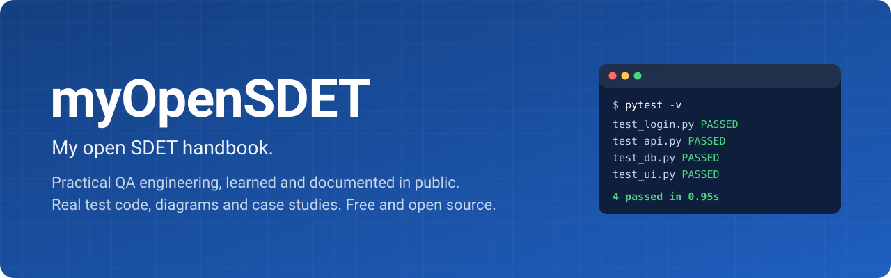
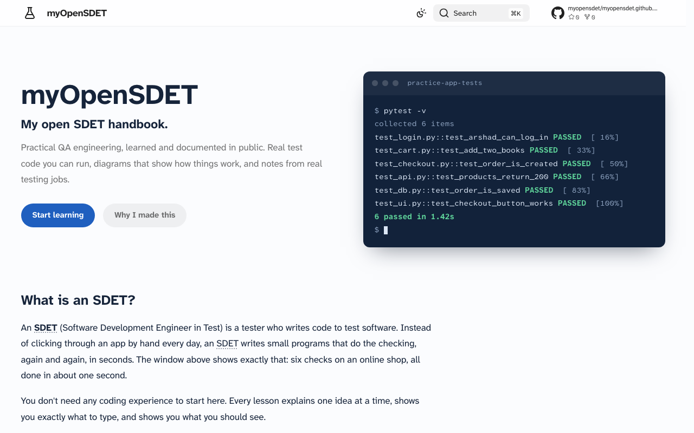

  

  <b>Learn software testing and test automation, step by step. Real templates and code you can use at work. Free.</b>

  
  
  
  
  
  

  <a href="https://arshaduzzaman-sm.github.io/myopensdet/start-here/"><b>Start learning</b></a> ·
  <a href="https://arshaduzzaman-sm.github.io/myopensdet/learning-path/">Learning path</a> ·
  <a href="https://arshaduzzaman-sm.github.io/myopensdet/start-here/skills-matrix/">Skills matrix</a> ·
  <a href="CONTRIBUTING.md">Contribute</a>

## What is this?

**myOpenSDET** is a free course and toolkit for becoming an **SDET** (Software
Development Engineer in Test): a tester who writes code to test software.

- **Start from zero.** No coding experience needed. Every lesson explains one idea at
  a time, shows exactly what to type, and shows what you should see.
- **Real work, not theory.** Each topic starts with a task you might get at work, for
  example "Can you set up API tests for our new service?", and walks you through it.
- **Templates that run.** Every code sample is a tested template you can copy into your
  own project.
- **Built for your own app.** Settings come from environment variables, so the same
  template points at your team's app, not a toy. Every page also shows the real
  output, so you can learn from the page alone.

> [!NOTE]
> The site structure is ready and lessons are being written now. Topics marked
> *coming soon* in the map below are not written yet. Star the repository to see
> new topics as they arrive.

  <a href="https://arshaduzzaman-sm.github.io/myopensdet/">
    <picture>
      <source media="(prefers-color-scheme: dark)" srcset=".github/readme/site-dark.png">
      
    </picture>
  </a>

## I need to…

Got a task at work today? Go straight to the page that helps.

| I need to… | Go to |
| --- | --- |
| Test an API | [API testing](https://arshaduzzaman-sm.github.io/myopensdet/core-automation/api-testing/) |
| Check data in a database | [Database testing](https://arshaduzzaman-sm.github.io/myopensdet/core-automation/database-testing/) |
| Test several databases | [Multi-database testing](https://arshaduzzaman-sm.github.io/myopensdet/core-automation/multi-database-testing/) |
| Set up BDD | [BDD testing](https://arshaduzzaman-sm.github.io/myopensdet/core-automation/bdd-testing/) |
| Automate a web page | [UI automation with Playwright](https://arshaduzzaman-sm.github.io/myopensdet/core-automation/ui-automation/) |
| Run tests in Docker | [Docker for testers](https://arshaduzzaman-sm.github.io/myopensdet/infrastructure/docker-for-testers/) |
| Fix a flaky test | [Flaky tests and speed](https://arshaduzzaman-sm.github.io/myopensdet/advanced-testing/flaky-tests-and-speed/) |
| Write a bug report | [Bug reports](https://arshaduzzaman-sm.github.io/myopensdet/think-like-a-tester/bug-reports/) |
| Plan testing for a feature | [Test strategy and planning](https://arshaduzzaman-sm.github.io/myopensdet/think-like-a-tester/test-strategy-and-planning/) |
| Test speed under load | [Performance testing](https://arshaduzzaman-sm.github.io/myopensdet/advanced-testing/performance-testing/) |
| Learn Python for testing | [Python for testers](https://arshaduzzaman-sm.github.io/myopensdet/start-here/python-for-testers/) |
| Prepare for an interview | [Interview preparation](https://arshaduzzaman-sm.github.io/myopensdet/professional-sdet/interview-preparation/) |

## Topic map

Six stages, plus a toolbox. Go in order, or jump to the topic you need today.
Click a stage to open it.

<!-- BEGIN topic map (generated by scripts/build_nav.py, do not edit by hand) -->

<b>Start Here</b> (5 topics)

[Open the Start Here overview](https://arshaduzzaman-sm.github.io/myopensdet/start-here/)

- [How to use this site](https://arshaduzzaman-sm.github.io/myopensdet/start-here/how-to-use-this-site/): Pick a path, read a page, copy the files, track your progress, ask for help.
- [Environment setup](https://arshaduzzaman-sm.github.io/myopensdet/start-here/environment-setup/): Install Python, VS Code and Docker, and run your first tests.
- [Python for testers](https://arshaduzzaman-sm.github.io/myopensdet/start-here/python-for-testers/): Just enough Python to write real tests: data, loops, functions, classes and files.
- [Skills Matrix](https://arshaduzzaman-sm.github.io/myopensdet/start-here/skills-matrix/): Every SDET skill, grouped by area. Tick what you know and find your next lesson.
- [Learning Path](https://arshaduzzaman-sm.github.io/myopensdet/learning-path/): The whole journey on one map, plus step-by-step paths for what you want to do.

<b>Work Playbooks</b> (8 topics)

[Open the Work Playbooks overview](https://arshaduzzaman-sm.github.io/myopensdet/work-playbooks/)

**API work**

- [Automate API tests, step by step](https://arshaduzzaman-sm.github.io/myopensdet/work-playbooks/automate-api-tests/): Install, read the spec, plan, copy the GET/POST/PUT/DELETE templates, run.
- [Test a new API endpoint](https://arshaduzzaman-sm.github.io/myopensdet/work-playbooks/new-api-endpoint/): From "please test this by Friday" to a plan, tests and a report.
- [Test an API from its Swagger file](https://arshaduzzaman-sm.github.io/myopensdet/work-playbooks/api-from-openapi/): From a Swagger link to a plan, contract checks and a report.

**Database work**

- [Check database data, step by step](https://arshaduzzaman-sm.github.io/myopensdet/work-playbooks/check-database-data/): Safe access, read the tables, plan, copy the SQL checks, run, read the results.

**Login and access**

- [Test login and permissions, step by step](https://arshaduzzaman-sm.github.io/myopensdet/work-playbooks/test-login-and-permissions/): How login works, who may do what, ready tests for tokens and access, run, read.

**UI work**

- [Automate UI tests, step by step](https://arshaduzzaman-sm.github.io/myopensdet/work-playbooks/automate-ui-tests/): Install, pick the flows, plan, copy ready tests, run, read screenshots and traces.

**Files and data**

- [Test file upload and import, step by step](https://arshaduzzaman-sm.github.io/myopensdet/work-playbooks/test-file-upload-and-import/): Get the rules, try by hand, plan, copy upload and import tests, run, read.

**Speed**

- [Check API speed, step by step](https://arshaduzzaman-sm.github.io/myopensdet/work-playbooks/check-api-speed/): Targets, one user, many users, read p95 and errors, speed tests in pytest.

<b>Think Like a Tester</b> (8 topics)

[Open the Think Like a Tester overview](https://arshaduzzaman-sm.github.io/myopensdet/think-like-a-tester/)

- [Learning a new testing area](https://arshaduzzaman-sm.github.io/myopensdet/think-like-a-tester/learning-a-new-testing-area/): A 9-step playbook for any testing task you have never done before.
- [The SDET role](https://arshaduzzaman-sm.github.io/myopensdet/think-like-a-tester/the-sdet-role/): What an SDET does, how to start the job well, and the templates for your first 90 days.
- [Test levels and the pyramid](https://arshaduzzaman-sm.github.io/myopensdet/think-like-a-tester/test-levels-and-the-pyramid/): Unit, integration, API, UI and end-to-end tests, and how many of each to write.
- [Test design techniques](https://arshaduzzaman-sm.github.io/myopensdet/think-like-a-tester/test-design-techniques/): Boundary values, decision tables and more: find the tests that catch the most bugs.
- [Static testing and reviews](https://arshaduzzaman-sm.github.io/myopensdet/think-like-a-tester/static-testing-and-reviews/): Find bugs before any code runs, by reviewing requirements and stories.
- [Test cases](https://arshaduzzaman-sm.github.io/myopensdet/think-like-a-tester/test-cases/): Write clear test cases, positive and negative, linked to what they check.
- [Bug reports](https://arshaduzzaman-sm.github.io/myopensdet/think-like-a-tester/bug-reports/): Report a bug so a developer can fix it fast: steps, severity and priority.
- [Test strategy and planning](https://arshaduzzaman-sm.github.io/myopensdet/think-like-a-tester/test-strategy-and-planning/): Decide what to test first, what not to automate, and when testing is done.

<b>Core Automation</b> (9 topics)

[Open the Core Automation overview](https://arshaduzzaman-sm.github.io/myopensdet/core-automation/)

**Foundations**

- [pytest framework](https://arshaduzzaman-sm.github.io/myopensdet/core-automation/pytest-framework/): Your first automated tests: project layout, fixtures, parametrize and markers.

**API and databases**

- [API testing](https://arshaduzzaman-sm.github.io/myopensdet/core-automation/api-testing/): Send requests from Python and check status codes, JSON, headers and auth.
- [Database testing](https://arshaduzzaman-sm.github.io/myopensdet/core-automation/database-testing/): Write SQL to prove the right data was saved, and test schemas and rules.
- [Multi-database testing](https://arshaduzzaman-sm.github.io/myopensdet/core-automation/multi-database-testing/): Run one test on MySQL, PostgreSQL, SQLite and MongoDB.
- [API + database](https://arshaduzzaman-sm.github.io/myopensdet/core-automation/api-and-database/): Call the API, then prove the change landed in the database.
- [Data-driven testing](https://arshaduzzaman-sm.github.io/myopensdet/core-automation/data-driven-testing/): Feed tests from CSV, JSON, YAML or Excel, with fake data from Faker.

**BDD and UI**

- [BDD testing](https://arshaduzzaman-sm.github.io/myopensdet/core-automation/bdd-testing/): Tests in plain English with Gherkin, using behave or pytest-bdd.
- [UI automation](https://arshaduzzaman-sm.github.io/myopensdet/core-automation/ui-automation/): Click, type and check web pages with Playwright and Page Objects.

**Reports**

- [Reporting and logging](https://arshaduzzaman-sm.github.io/myopensdet/core-automation/reporting-and-logging/): Reports people can read: pytest-html, JUnit XML, logs and screenshots.

<b>Infrastructure</b> (8 topics)

[Open the Infrastructure overview](https://arshaduzzaman-sm.github.io/myopensdet/infrastructure/)

**Your toolkit**

- [Linux and shell](https://arshaduzzaman-sm.github.io/myopensdet/infrastructure/linux-and-shell/): Read logs, search with grep, count with pipes, find ports, a ready log script.
- [Networking for testers](https://arshaduzzaman-sm.github.io/myopensdet/infrastructure/networking-for-testers/): Name, port, certificate, answer: find which step breaks, with a ready script.
- [Debugging toolkit](https://arshaduzzaman-sm.github.io/myopensdet/infrastructure/debugging-toolkit/): Read the failure, run it alone, logs, the debugger, curl -v and DevTools.
- [Everyday tools](https://arshaduzzaman-sm.github.io/myopensdet/infrastructure/everyday-tools/): Copy a request as curl, turn it into a pytest test, debug it in VS Code.

**Pipelines and environments**

- [CI/CD for testers](https://arshaduzzaman-sm.github.io/myopensdet/infrastructure/ci-cd/): Design a test pipeline: when it runs, secrets, reports, a ready workflow.
- [Docker for testers](https://arshaduzzaman-sm.github.io/myopensdet/infrastructure/docker-for-testers/): Run the same tests the same way on any computer.
- [Cloud and Kubernetes basics](https://arshaduzzaman-sm.github.io/myopensdet/infrastructure/cloud-and-kubernetes/): Cloud test environments and Kubernetes in plain words. *(coming soon)*
- [Observability](https://arshaduzzaman-sm.github.io/myopensdet/infrastructure/observability/): Logs, metrics and traces, and testing safely in production. *(coming soon)*

<b>Advanced Testing</b> (15 topics)

[Open the Advanced Testing overview](https://arshaduzzaman-sm.github.io/myopensdet/advanced-testing/)

**Services and integrations**

- [Mocking and stubbing](https://arshaduzzaman-sm.github.io/myopensdet/advanced-testing/mocking-and-stubbing/): Replace slow or unreliable parts with fakes you control.
- [Contract testing](https://arshaduzzaman-sm.github.io/myopensdet/advanced-testing/contract-testing/): Catch breaking API changes between teams before release, with Pact. *(coming soon)*
- [Testing microservices](https://arshaduzzaman-sm.github.io/myopensdet/advanced-testing/testing-microservices/): Test one service alone, then the conversations between services. *(coming soon)*
- [GraphQL testing](https://arshaduzzaman-sm.github.io/myopensdet/advanced-testing/graphql-testing/): Test GraphQL queries, mutations, schemas and errors. *(coming soon)*
- [gRPC and WebSocket testing](https://arshaduzzaman-sm.github.io/myopensdet/advanced-testing/grpc-and-websocket-testing/): Test streams and live messages that are not REST. *(coming soon)*
- [Message queue testing](https://arshaduzzaman-sm.github.io/myopensdet/advanced-testing/message-queue-testing/): Test Kafka and RabbitMQ flows, where answers arrive later. *(coming soon)*

**Beyond functional testing**

- [Performance testing](https://arshaduzzaman-sm.github.io/myopensdet/advanced-testing/performance-testing/): See what happens under load, with Locust, k6 and JMeter. *(coming soon)*
- [Security testing basics](https://arshaduzzaman-sm.github.io/myopensdet/advanced-testing/security-testing/): OWASP Top 10, auth and injection tests, and a first ZAP scan. *(coming soon)*
- [Accessibility testing](https://arshaduzzaman-sm.github.io/myopensdet/advanced-testing/accessibility-testing/): Check that everyone can use the app, with WCAG basics and Axe. *(coming soon)*
- [Visual regression](https://arshaduzzaman-sm.github.io/myopensdet/advanced-testing/visual-regression/): Catch layout changes by comparing screenshots. *(coming soon)*

**Data and reliability**

- [Data and ETL testing](https://arshaduzzaman-sm.github.io/myopensdet/advanced-testing/data-and-etl-testing/): Check that data pipelines move and change data correctly. *(coming soon)*
- [Flaky tests and speed](https://arshaduzzaman-sm.github.io/myopensdet/advanced-testing/flaky-tests-and-speed/): Fix tests that pass one day and fail the next, and run them faster. *(coming soon)*

**More platforms**

- [Mobile testing](https://arshaduzzaman-sm.github.io/myopensdet/advanced-testing/mobile-testing/): Automate Android and iOS apps with Appium. *(coming soon)*
- [AI in testing](https://arshaduzzaman-sm.github.io/myopensdet/advanced-testing/ai-in-testing/): Test features built on AI, and use AI tools safely in your own work. *(coming soon)*
- [Tricky real-world cases](https://arshaduzzaman-sm.github.io/myopensdet/advanced-testing/tricky-real-world-cases/): Emails, OTPs, file uploads, PDFs, payments and time zones. *(coming soon)*

<b>Professional SDET</b> (16 topics)

[Open the Professional SDET overview](https://arshaduzzaman-sm.github.io/myopensdet/professional-sdet/)

**Working in a team**

- [A day in the life](https://arshaduzzaman-sm.github.io/myopensdet/professional-sdet/a-day-in-the-life/): Plan the day: nightly run, stand-up, one ticket end to end, reviews, handover.
- [Your first weeks in a new job](https://arshaduzzaman-sm.github.io/myopensdet/professional-sdet/your-first-weeks/): Map a framework you didn't write, make a first useful change, earn trust.
- [SDET in Agile](https://arshaduzzaman-sm.github.io/myopensdet/professional-sdet/sdet-in-agile/): Check stories before the sprint, Three Amigos, shift-left, Definition of Done.
- [Git in a team](https://arshaduzzaman-sm.github.io/myopensdet/professional-sdet/git-in-a-team/): Branches, pull requests, a real merge conflict, and pushing safely.
- [Jira and test management](https://arshaduzzaman-sm.github.io/myopensdet/professional-sdet/jira-and-test-management/): Tickets, workflows, and linking tests to stories. *(coming soon)*
- [Working with developers](https://arshaduzzaman-sm.github.io/myopensdet/professional-sdet/working-with-developers/): Answer 'works on my machine' with evidence, talk without blame, pair.
- [Communicating your work](https://arshaduzzaman-sm.github.io/myopensdet/professional-sdet/communicating-your-work/): Clear GREEN/AMBER/RED status, risk in plain words, honest estimates.

**Releases and quality**

- [Regression, hotfixes and incidents](https://arshaduzzaman-sm.github.io/myopensdet/professional-sdet/regression-hotfixes-and-incidents/): Pick the right tests for a change, and stay calm in an incident.
- [Quality metrics](https://arshaduzzaman-sm.github.io/myopensdet/professional-sdet/quality-metrics/): Measure what matters, and know what not to measure. *(coming soon)*
- [Release sign-off](https://arshaduzzaman-sm.github.io/myopensdet/professional-sdet/release-sign-off/): Make a clear go or no-go call for a release. *(coming soon)*

**Building and leading**

- [Clean test code](https://arshaduzzaman-sm.github.io/myopensdet/professional-sdet/clean-test-code/): Test code that is easy to read, change and trust. *(coming soon)*
- [Leading quality](https://arshaduzzaman-sm.github.io/myopensdet/professional-sdet/leading-quality/): Design test architecture, choose tools and lead quality for a team. *(coming soon)*
- [Capstone project](https://arshaduzzaman-sm.github.io/myopensdet/professional-sdet/capstone-project/): Build a full test framework for your own app, from API to CI. *(coming soon)*

**Your career**

- [Career roadmap](https://arshaduzzaman-sm.github.io/myopensdet/professional-sdet/career-roadmap/): How an SDET career grows, and what each next step asks of you. *(coming soon)*
- [Interview preparation](https://arshaduzzaman-sm.github.io/myopensdet/professional-sdet/interview-preparation/): Common questions, coding tasks and clear answers. *(coming soon)*
- [Portfolio and resume](https://arshaduzzaman-sm.github.io/myopensdet/professional-sdet/portfolio-and-resume/): Show your work on GitHub and write a tester resume. *(coming soon)*

<b>Toolbox</b> (5 topics)

[Open the Toolbox overview](https://arshaduzzaman-sm.github.io/myopensdet/toolbox/)

- [Cheat sheets](https://arshaduzzaman-sm.github.io/myopensdet/toolbox/cheat-sheets/): One-page reminders: SQL, pytest, HTTP, Git, Linux, Docker and more.
- [Test idea banks](https://arshaduzzaman-sm.github.io/myopensdet/toolbox/test-idea-banks/): Ready lists of test ideas for login, search, checkout and more.
- [Template index](https://arshaduzzaman-sm.github.io/myopensdet/toolbox/template-index/): Every template on the site, in one place.
- [Glossary](https://arshaduzzaman-sm.github.io/myopensdet/glossary/): Every testing word on this site, in plain English.
- [Tags](https://arshaduzzaman-sm.github.io/myopensdet/tags/): Find lessons by subject: API, database, BDD, debugging and more.

<!-- END topic map -->

## How to use it

**To learn:** open the [website](https://arshaduzzaman-sm.github.io/myopensdet/)
and click **Start learning**. You don't need to download anything first; the
[Start Here](https://arshaduzzaman-sm.github.io/myopensdet/start-here/) section
helps you set up your computer.

**To use a template at work:** find it in the
[Template index](https://arshaduzzaman-sm.github.io/myopensdet/toolbox/template-index/),
copy it, and keep the first comment line that says where it came from.

**To run the code yourself:** clone the repository and follow
[Environment setup](https://arshaduzzaman-sm.github.io/myopensdet/start-here/environment-setup/),
or open it in the cloud with nothing to install:

**To run the website on your own computer** (for contributors), see
[Set up your computer](CONTRIBUTING.md#set-up-your-computer).

## What is in this repository

| Folder or file | What it holds |
| --- | --- |
| [`docs/`](docs/) | The website: every lesson as a Markdown page |
| [`modules/`](modules/) | The templates, examples, exercises and solutions, each with tests |
| [`practice-app/`](practice-app/README.md) | Bookshelf, a small sample shop you can run and test locally (optional) |
| [`.devcontainer/`](.devcontainer/devcontainer.json) | GitHub Codespaces setup |
| [`_new_topic_template/`](_new_topic_template/README.md) | The starting point for every new topic |
| [`scripts/`](scripts/) | Helpers: build the menu, add a topic, run every check |
| [`overrides/`](overrides/) | Small changes to the website theme |
| [`data/`](data/) | The glossary and the tag list, used to build those pages |
| [`.github/`](.github/) | Workflow, issue templates, Style guide, Security policy, Code of Conduct |
| [`zensical.toml`](zensical.toml) | Website settings |

## How to help

- **Found a mistake?** Click 👎 under "Was this page helpful?" on the page, or open a
  [Content error](https://github.com/arshaduzzaman-sm/myopensdet/issues/new?template=content-error.yml) issue.
- **A template does not run?** Open a
  [Template or code problem](https://github.com/arshaduzzaman-sm/myopensdet/issues/new?template=template-problem.yml) issue.
- **Want to fix or write something?** Read [CONTRIBUTING.md](CONTRIBUTING.md) and the
  [Style guide](.github/STYLE_GUIDE.md).
- **Found a security problem?** Please don't open a public issue. See [SECURITY.md](.github/SECURITY.md).
- **Finding it useful?** Give the repository a ⭐. It helps other testers find it.

Everyone taking part follows the [Code of Conduct](.github/CODE_OF_CONDUCT.md).

## License

- **Code** (templates, examples, scripts): [MIT License](LICENSE).
- **Text and images** on the website: [CC BY 4.0](LICENSE-CC-BY-4.0.txt). You can reuse
  them, even at work, as long as you give credit with a link to the site.

Written by **Arshaduzzaman SM**. Read more [about the site and the author](https://arshaduzzaman-sm.github.io/myopensdet/about/).
