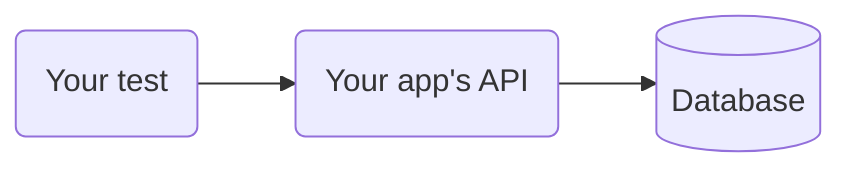

<!-- Topic playbook: "First time? Start here" (Style guide 7.1).
     One realistic work request, walked through from start to finish.
     Keep the front matter that scripts/new_topic.py created for you. -->

# TOPIC TITLE

<!-- One sentence: what this topic helps you do at work. -->

!!! info "In plain words"
    <!-- Two or three sentences and an everyday comparison. No jargon yet. -->

!!! example "Your task"
    <!-- The realistic request. Example: "Your manager says: we're adding BDD, can you set it up?" -->

## Jump to what you need

<!-- Links to every lesson in this topic, one line each. -->

- [Lesson title](lesson.md): what it teaches, in a few words

## 1. Understand the ask

<!-- Questions to ask your lead on day one: what system, why now, what "done" means,
     deadline, environments, access. -->

## 2. Picture the system

<!-- A Mermaid diagram of what you are testing and where the data flows. -->

## 3. Learn just enough

<!-- A 30 to 60 minute reading path through the official docs, in order,
     and what to skip for now. -->

## 4. Get something running

<!-- Copy the topic's template and run a first test against your own app
     within an hour. Show the command and the expected output. -->

## 5. Decide what to test

<!-- Test ideas for this area, sorted by risk, using the test design techniques. -->

## 6. Write a one-page plan

<!-- Use the test plan template and share it before building. -->

## 7. Build in small steps

<!-- Smoke test, then happy path, then negative cases, then edge cases. -->

## 8. Report and get feedback

<!-- What to show your team, and how. -->

## 9. Keep learning on your own

<!-- What to read next, practice ideas, official docs to bookmark. -->

!!! tip "How an experienced SDET thinks about this"
    <!-- The judgement calls that come with experience. -->

!!! warning "Red flags"
    <!-- Signs the plan is going wrong. -->

!!! question "Stuck? Try this"
    <!-- The common ways people get stuck in this area, and what to do about each. -->

## Templates

**Every file is below, ready to copy.** The whole folder is also [on GitHub](https://github.com/arshaduzzaman-sm/myopensdet/tree/main/modules/SECTION/TOPIC/templates).

<!-- One tab per main file (=== "name" with a --8<-- snippet), then a "How to use them" tab.
     Replace SECTION/TOPIC with the topic's folder in modules/. -->

## Official resources

<!-- Official documentation only. -->

- [Tool documentation](https://example.com)
