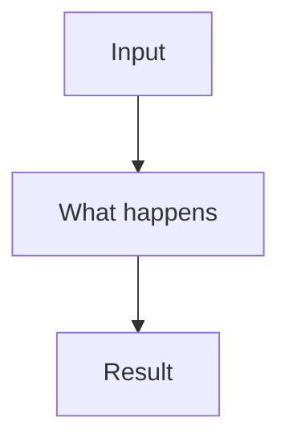

<!-- Lesson page (Style guide 7.2). One new idea per page.
     No "What you will learn" list and no quiz: the sections below do that job. -->

# LESSON TITLE

<!-- Two to four sentences: what the idea is, in plain words, and why a tester meets it. -->

!!! note "Before you start"
    <!-- Prerequisites as links, and where the example file is. -->
    You need Python 3.13 and [the previous lesson](index.md). The example file is `examples/EXAMPLE.py`.

## Why testers need this

<!-- A real work situation with real test data (made-up IDs, fake users).
     Say what goes wrong without this idea. Never an invented personal story. -->

## How it works

<!-- A short explanation, then one Mermaid diagram (3 columns at most, or top to
     bottom, so it reads on a phone), then a one-line caption in italics. -->



*Caption: what the diagram shows.*

## The code

<!-- Code is pulled from modules/ (never copy-pasted), so the site always shows
     the tested version. The output below must be from a real run; the topic
     test checks that it matches. -->

```python title="examples/EXAMPLE.py"
--8<-- "_new_topic_template/modules/templates/example_template.py"
```

```bash
python EXAMPLE.py
```

```text
real output
```

## Line by line

<!-- Explain the lines a beginner would stop at. Group them by part of the script. -->

## How it is used in a real QA project

<!-- Where this shows up at work, with links to the lessons that go further. -->

## Your task

<!-- A small exercise with a test, on realistic data. Say how to check it. -->

??? success "Solution"
    <!-- Folded by default. Explain the one or two tricky lines. -->

## When it goes wrong

<!-- Real error messages, reproduced on the stated version. For each one:
     the message in a text block, what it means, and the fix. -->

## References

<!-- Every source used. Official sources first. -->

- [Source](https://example.com)

Written for TOOL VERSION. Links checked: MONTH YEAR.
