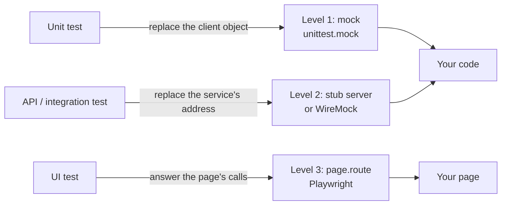

# Mocking and Stubbing for Testers: unittest.mock, Stub Servers, WireMock and page.route

Your app depends on services you don't control: a payment provider, an email service, another team's API. In tests, they are slow, sometimes down, and they can't be told "decline this card" or "take 30 seconds" when you need it. So the error paths, where the worst bugs live, go untested. This guide replaces those services with fakes you control, at three levels, and shows when each level is the right one.

!!! example "The problem"
    **Your lead:** "Checkout tests fail twice a week because the payment sandbox is down. And we've never tested what the customer sees when a card is declined or the provider times out. Can you fix both?"

## Step 1: Choose where to replace the service



| Level | What's replaced | Tests for real | Use it for |
| --- | --- | --- | --- |
| **1. Mock in code** | The client object, inside Python | Your code's decisions | Every answer the service can give: fast, no network |
| **2. Stub server** | The service's address | Your code **plus** the real HTTP: JSON, headers, timeouts | Timeouts, error codes, and checking what your app sent |
| **3. page.route** | The page's API calls, in the browser | The page's messages and states | Every message the customer can see |

The words people use, and what they mean:

| Word | Is | Example here |
| --- | --- | --- |
| **Stub** | Gives ready answers | The stub server: card `...0002` always gets "declined" |
| **Mock** | Gives ready answers **and** checks how it was called | `assert_called_once_with(amount_cents=2449, ...)` |
| **Fake** | A working, simpler version | An in-memory database instead of PostgreSQL |
| **Spy** | Records calls, passes them on | The stub's request list in step 5 |

Two rules before you start:

- **Never mock the thing you're testing.** Mock what it **talks to**.
- **A fake can lie.** If the real provider changes its answers, your stub won't. Keep one test against the real sandbox (run it nightly, not on every change), and see [contract testing](../contract-testing/index.md).

## Step 2: Get the kit

You need **Python 3.13**. Get the files from [Templates](#templates) below, or take the whole folder [from GitHub](https://github.com/arshaduzzaman-sm/myopensdet/tree/main/modules/advanced_testing/mocking_and_stubbing/templates). Then:

```bash
python -m venv .venv
source .venv/bin/activate          # Windows: .venv\Scripts\activate
python -m pip install -r requirements.txt
playwright install chromium
```

The code under test is `shop/payments.py`: `checkout()` asks a `PaymentClient` to charge a card, and decides what the customer sees.

```python
--8<-- "modules/advanced_testing/mocking_and_stubbing/templates/mock_kit/shop/payments.py"
```

Three outcomes matter: **paid**, **declined** (the provider said no), and **pending** (no clear answer: keep the order, let the customer try again). The idempotency key means a retry never charges the card twice.

## Step 3: Level 1, mock the client in code

`unittest.mock` comes with Python. `create_autospec` makes a mock with the **real** class's methods and arguments:

```python
--8<-- "modules/advanced_testing/mocking_and_stubbing/templates/mock_kit/tests/test_mock_in_code.py"
```

| Line | Does |
| --- | --- |
| `return_value = {...}` | The mock answers this |
| `side_effect = PaymentDeclinedError(...)` | The mock raises this instead: the way to test errors |
| `assert_called_once_with(...)` | Checks the code called it once, with these values |
| `patch("shop.payments.requests.post", ...)` | Replaces `requests.post` **inside** `shop.payments` for the `with` block |

Always use **autospec**. A plain `Mock()` accepts anything: `client.chrage(...)` (a typo) silently works, and your test passes while testing nothing. With autospec:

```text
AttributeError: Mock object has no attribute 'chrage'
```

## Step 4: Level 2, start a stub server

A mock in code skips the real HTTP: the JSON, the headers, the timeout. A **stub server** is a real web server that answers like the provider, from files you write. Each file says: when a request looks like this, answer that.

```json
--8<-- "modules/advanced_testing/mocking_and_stubbing/templates/mock_kit/stubs/mappings/charge_declined.json"
```

The kit has four, one per test card number, like real payment sandboxes do:

| Card | Stub answers | Tests |
| --- | --- | --- |
| `4242424242424242` | `200` succeeded | The normal path |
| `4000000000000002` | `402` insufficient funds | A declined card |
| `4000000000000119` | `500` provider error | The provider breaks |
| `4000000000009999` | `200`, but after 3 seconds | A timeout (the client waits 2) |

Start it, and send it a request by hand:

```bash
python stub_server.py
```

```text
Stub with 4 mappings on http://127.0.0.1:8798  (Ctrl+C to stop)
```

```bash
curl -i --json '{"card": "4000000000000002", "amount": 2449, "currency": "gbp"}' http://127.0.0.1:8798/v1/charges
```

```text
HTTP/1.0 402 Payment Required
...
{"error": {"decline_code": "insufficient_funds"}}
```

Your app needs one change to use it: the provider's address must come from a setting, like `PAYMENT_URL` in `payments.py`. Ask the developers for that if it's hard-coded. Then point it at the stub in test environments.

## Step 5: Test the real client against the stub

`conftest.py` starts the stub on a free port for the test run. The tests use the **real** `PaymentClient`:

```python
--8<-- "modules/advanced_testing/mocking_and_stubbing/templates/mock_kit/tests/test_stub_over_http.py"
```

The last test is the one mocks can't do well: it asks the stub **what it received**. The body has the right amount in cents, and the `Idempotency-Key` header is there. If a developer removes that header, a retry could charge a customer twice, and this test fails.

The stub keeps every request at `GET /__admin/requests`, and `DELETE` empties the list at the start of each test. These are WireMock's admin addresses, on purpose: see step 7.

## Step 6: Level 3, answer the page's calls in the browser

The checkout page calls `POST /api/pay` and shows a message. To see every message, Playwright answers the call itself with `page.route`. No backend runs at all:

```python
--8<-- "modules/advanced_testing/mocking_and_stubbing/templates/mock_kit/tests/test_ui_route.py"
```

`route.fulfill` sends a made-up answer. `route.abort("internetdisconnected")` makes the call fail like a dropped connection. The last test records what the page sent, the same idea as the stub's request list.

Run all three levels:

```bash
python -m pytest
```

```text
tests/test_mock_in_code.py::test_paid PASSED                             [  7%]
tests/test_mock_in_code.py::test_declined PASSED                         [ 14%]
tests/test_mock_in_code.py::test_provider_down_keeps_the_order PASSED    [ 21%]
tests/test_mock_in_code.py::test_a_timeout_becomes_payment_unavailable PASSED [ 28%]
tests/test_stub_over_http.py::test_paid PASSED                           [ 35%]
tests/test_stub_over_http.py::test_declined PASSED                       [ 42%]
tests/test_stub_over_http.py::test_provider_error_keeps_the_order PASSED [ 50%]
tests/test_stub_over_http.py::test_too_slow_keeps_the_order PASSED       [ 57%]
tests/test_stub_over_http.py::test_what_was_sent PASSED                  [ 64%]
tests/test_ui_route.py::test_page_shows_each_answer[chromium-200-Paid. Receipt ch_test_1001.] PASSED [ 71%]
tests/test_ui_route.py::test_page_shows_each_answer[chromium-402-Your card was declined (insufficient_funds).] PASSED [ 78%]
tests/test_ui_route.py::test_page_shows_each_answer[chromium-503-We couldn't reach the payment service. Your order is saved: try again.] PASSED [ 85%]
tests/test_ui_route.py::test_no_connection[chromium] PASSED              [ 92%]
tests/test_ui_route.py::test_page_sends_the_order_id[chromium] PASSED    [100%]

======================== 14 passed, 1 warning in 3.10s =========================
```

14 tests, about 3 seconds, and nothing depends on a sandbox being up. Every error path the lead asked about is covered. The warning is from the pytest-playwright plugin with pytest 9.2, not from these tests.

## Step 7: Move to WireMock when you need more

The kit's stub is about 100 lines, so you can read all of it. When your team needs more (matching on JSON fields, answers that change from call to call, recording a real service's answers), use **WireMock**, a widely used stub server. The kit's mapping files are already in WireMock's format, so they move over unchanged:

```yaml
--8<-- "modules/advanced_testing/mocking_and_stubbing/templates/mock_kit/docker-compose.yml"
```

```bash
docker compose up -d
STUB_URL=http://127.0.0.1:8799 python -m pytest tests/test_stub_over_http.py
docker compose down
```

```text
tests/test_stub_over_http.py::test_paid PASSED                           [ 20%]
tests/test_stub_over_http.py::test_declined PASSED                       [ 40%]
tests/test_stub_over_http.py::test_provider_error_keeps_the_order PASSED [ 60%]
tests/test_stub_over_http.py::test_too_slow_keeps_the_order PASSED       [ 80%]
tests/test_stub_over_http.py::test_what_was_sent PASSED                  [100%]

============================== 5 passed in 2.13s ===============================
```

The same 5 tests, the same 4 mapping files, now answered by WireMock. `STUB_URL` tells `conftest.py` to use it instead of starting the Python stub. The admin addresses the tests use (`/__admin/requests`) are WireMock's own. The first `docker compose up` downloads the WireMock image, about 200 MB.

## Step 8: When it goes wrong

| You see | What it means | Fix |
| --- | --- | --- |
| `AttributeError: module 'shop.payments' has no attribute 'request'` | A typo in the `patch()` target | Patch the name exactly as the module uses it: `shop.payments.requests.post` |
| The patch is in place, but the real service is still called | You patched where it's defined, not where it's used (after `from x import y`, patch `your_module.y`) | Patch the name in the module under test |
| `AttributeError: Mock object has no attribute 'chrage'` | A typo, caught by autospec | Fix the name. Without autospec, this test would have passed and tested nothing |
| `TypeError: missing a required argument: 'amount_cents'` | The code calls the method with the wrong arguments, caught by autospec | Fix the call. This is often a real bug |
| `AssertionError: expected call not found.` then `Expected: ... order_id=102` and `Actual: ... order_id=101` | The code called the mock with other values | Read Expected and Actual: one of them is wrong |
| `{"error": "No stub matches POST /v1/refunds"}` with `404` | No mapping fits the request | Add a mapping, or check the method and path |
| `x.json is not valid JSON: Expecting ',' delimiter: line 3 column 3 (char 64)` | A mapping file is broken | Fix that line, usually a missing comma |
| `OSError: [Errno 48] Address already in use` | The stub is already running | Use it, or `python stub_server.py --port 9000` |
| The UI test shows `unexpected value "No connection. Your order is saved: try again."` | The route pattern doesn't match the page's call (here `/api/payment` instead of `/api/pay`), so the call went to the real address | Copy the exact address from the Network tab or the page's code |
| All tests pass, production breaks | The stub answers what the provider used to answer | A nightly test against the real sandbox, and [contract tests](../contract-testing/index.md) |

## Templates

**Every file is below, ready to copy.** The whole folder is also [on GitHub](https://github.com/arshaduzzaman-sm/myopensdet/tree/main/modules/advanced_testing/mocking_and_stubbing/templates).

=== "stub_server.py"

    ```python
    --8<-- "modules/advanced_testing/mocking_and_stubbing/templates/mock_kit/stub_server.py"
    ```

=== "conftest.py"

    ```python
    --8<-- "modules/advanced_testing/mocking_and_stubbing/templates/mock_kit/tests/conftest.py"
    ```

=== "ui/checkout.html"

    ```html
    --8<-- "modules/advanced_testing/mocking_and_stubbing/templates/mock_kit/ui/checkout.html"
    ```

=== "Other mappings"

    ```json
    --8<-- "modules/advanced_testing/mocking_and_stubbing/templates/mock_kit/stubs/mappings/charge_succeeds.json"
    ```

    ```json
    --8<-- "modules/advanced_testing/mocking_and_stubbing/templates/mock_kit/stubs/mappings/charge_provider_error.json"
    ```

    ```json
    --8<-- "modules/advanced_testing/mocking_and_stubbing/templates/mock_kit/stubs/mappings/charge_too_slow.json"
    ```

=== "requirements.txt"

    ```text
    --8<-- "modules/advanced_testing/mocking_and_stubbing/templates/mock_kit/requirements.txt"
    ```

## References

- [Python: unittest.mock](https://docs.python.org/3/library/unittest.mock.html)
- [Python: where to patch](https://docs.python.org/3/library/unittest.mock.html#where-to-patch)
- [WireMock: stubbing](https://wiremock.org/docs/stubbing/)
- [WireMock: verifying requests](https://wiremock.org/docs/verifying/)
- [WireMock: running in Docker](https://wiremock.org/docs/standalone/docker/)
- [Playwright for Python: mock APIs](https://playwright.dev/python/docs/mock)
- [Martin Fowler: mocks aren't stubs](https://martinfowler.com/articles/mocksArentStubs.html)

Written for Python 3.13, pytest 9.2, Playwright 1.64 and WireMock 3.13. Outputs captured November 2026. Links checked: November 2026.
