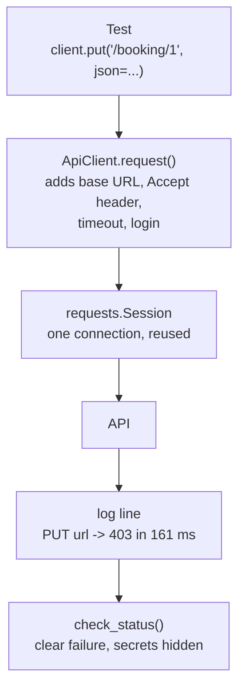

# An API Client Class: One Place for the URL, Headers, Timeout and Logging

After a few test files, the same lines repeat everywhere: the base URL, `Accept: application/json`, `timeout=15`, the login header. An **API client class** puts them in one place. Tests then read like `client.get("/booking/1")`. When the base URL or a header changes, you change one file.

!!! note "Before you start"
    Read [Object-oriented programming](../programming-for-testers/object-oriented-programming.md) and [Chaining requests](chaining-requests.md) first. The code is `templates/booker_api_tests/api/client.py`, and the example is `examples/client_demo.py`. It needs the internet.

## Why testers need this

An API test fails in the pipeline at night. The failure message is all you have.

- `assert 403 == 200` tells you nothing.
- `PUT /booking/1 returned 403, expected 200`, with the headers and the body, tells you it was the login.

A good client gives every test that second message for free. It also logs every call, with its time, so you can see the whole conversation before a failure.

## How it works



*The test says only what is different about this call. The client adds everything that is the same for every call.*

| Belongs in the client (the *how*) | Stays in tests and fixtures (the *what*) |
| --- | --- |
| Base URL, default headers, timeout | Test data |
| Login, logging, hiding secrets | Asserts about bookings |
| A clear failure helper | Which status a test expects |

## The code

```python title="templates/booker_api_tests/api/client.py"
--8<-- "modules/core_automation/api_testing/templates/booker_api_tests/api/client.py"
```

The example sends three calls through the client. The last one has a fake token, so it fails on purpose:

```python title="examples/client_demo.py"
--8<-- "modules/core_automation/api_testing/examples/client_demo.py"
```

From the `examples` folder, run:

```bash
python client_demo.py
```

```text
api: GET https://restful-booker.herokuapp.com/ping -> 201 in 637 ms
api: GET https://restful-booker.herokuapp.com/booking?firstname=Test -> 200 in 158 ms
api: PUT https://restful-booker.herokuapp.com/booking/1 -> 403 in 158 ms
PUT https://restful-booker.herokuapp.com/booking/1 returned 403, expected 200
request headers: {'User-Agent': 'python-requests/2.34.2', 'Accept-Encoding': 'gzip, deflate', 'Accept': 'application/json', 'Connection': 'keep-alive', 'Cookie': '***', 'Content-Length': '2', 'Content-Type': 'application/json'}
response body: 'Forbidden'
```

Your times will be different. Restful-booker's `/ping` answers `201`, another of its wrong codes: most health checks answer `200`.

## Line by line

**Setting things once.**

- `base_url.rstrip("/")` and `path.lstrip('/')` remove extra slashes, and the f-string joins them with exactly one. `"/ping"`, `"ping"` and `"//ping"` all work.
- `requests.Session()` keeps the connection open between calls, which is faster. It also holds the default headers and the login.
- `self.session.headers.update({"Accept": "application/json", ...})` adds the header to every request, without the test saying so.
- `kwargs.setdefault("timeout", self.timeout)` gives every request the default timeout. A test can still pass its own for one slow call.

**Logging.**

- `log = logging.getLogger("api")` makes a logger called `api`. Each call writes one line: method, full URL, status, and the time in milliseconds from `response.elapsed`.
- In the example, `logging.basicConfig(...)` prints those lines. In pytest, `log_level = INFO` in `pytest.ini` shows them for failed tests.

**Small methods.** `get`, `post`, `put`, `patch` and `delete` each call `request()` with their method. `__enter__` and `__exit__` let you use `with ApiClient(...) as api:`, which closes the session at the end.

**Clear failures.**

- `check_status(response, expected)` does nothing when the status is right.
- When it is wrong, it raises an `AssertionError` with the method and URL, the status, the request headers, and the first 300 characters of the body.
- `safe_headers()` replaces the values of `Authorization`, `Cookie` and `X-API-Key` with `***`. Look at the output: `'Cookie': '***'`. The fake token never appears.

## How it is used in a real QA project

- **One session-scoped client fixture.** Every test gets the same client from `conftest.py`, as in [chaining requests](chaining-requests.md).
- **The base URL comes from a setting.** `BOOKER_URL` picks the environment: local, test or staging. The same tests run against each one.
- **Thin endpoint methods, if any.** When the client grows a method per endpoint, like `get_booking(id)`, keep each one thin: build the request and return the response. Let the test check it. A client that fails on 404 can't be used by a test that expects 404.
- **Watch what the body can hold.** `check_status` hides secret *headers*, but it prints the body as it is. If an API echoes your token or personal data in its error body, that ends up in CI logs. For such APIs, shorten the excerpt or hide those fields too.
- **Timings in the log.** The `in 161 ms` part is a free performance signal. A call that usually takes 150 ms and now takes 3 seconds is worth a look, even when the test passes.

## Your task

Add a `health()` method to `ApiClient` that calls `/ping`, and returns `True` when the status is what the API uses for "up". It must return `False`, not crash, when the API can't be reached or doesn't answer in time. Then use it in a session fixture that skips the whole run when the API is down.

??? success "Solution"
    ```python
    def health(self, path: str = "/ping", up: int = 201) -> bool:
        try:
            return self.get(path).status_code == up
        except requests.RequestException:
            return False
    ```

    ```python
    @pytest.fixture(scope="session", autouse=True)
    def api_is_up(client):
        if not client.health():
            pytest.skip("The API is down: skipping instead of failing every test")
    ```

    Against Restful-booker it returns `True`. Against `http://127.0.0.1:9`, where nothing listens, it returns `False`.

    Catch `requests.RequestException`, not only `requests.ConnectionError`. A server that hangs raises `ReadTimeout`, and `ReadTimeout` is *not* a `ConnectionError`, so the narrower catch would crash. One clear skip reason beats a hundred connection errors. Restful-booker uses `201` for "up"; most APIs use `200`.

## When it goes wrong

These are real messages, captured November 2026.

**The base URL has no `https://`.**

```text
requests.exceptions.MissingSchema: Invalid URL 'restful-booker.herokuapp.com/ping': No scheme supplied. Perhaps you meant https://restful-booker.herokuapp.com/ping?
```

The client was built with a base URL without the scheme. Fix the setting, for example `BOOKER_URL=https://restful-booker.herokuapp.com`.

**The server took longer than the timeout.**

```text
requests.exceptions.ReadTimeout: HTTPSConnectionPool(host='restful-booker.herokuapp.com', port=443): Read timed out. (read timeout=15)
```

This happened while this page was written: the free demo server sometimes sleeps, and the first call waited more than 15 seconds. The client's timeout did its job: the run stopped instead of hanging. If it happens often on your test environment, report it. Don't just raise the timeout for every test.

**A header from one test shows up in another.**

```text
url: https://restful-booker.herokuapp.com/ping | later request still sends: test_one
```

A test set `client.session.headers["X-Test-Name"] = "test_one"`. The session keeps it, and the client is shared, so every later request sends it too. Pass per-request headers with `headers=` instead.

**The expected status is wrong.**

```text
GET https://restful-booker.herokuapp.com/ping returned 201, expected 200
```

`check_status` says what came back and what was expected. Here the test assumed `200`, but this API uses `201` for "up". Read the docs, then fix the test or report the API.

**No log lines in the pytest output.** pytest shows logs only for failing tests, at the level in `pytest.ini` (`log_level = INFO`). Run with `-o log_cli=true` to see them live.

## References

- [Requests: session objects](https://requests.readthedocs.io/en/latest/user/advanced/#session-objects)
- [Requests: exceptions](https://requests.readthedocs.io/en/latest/api/#exceptions)
- [Python: logging HOWTO](https://docs.python.org/3/howto/logging.html)
- [pytest: how to manage logging](https://docs.pytest.org/en/stable/how-to/logging.html)

Written for Python 3.13, pytest 9.2 and requests 2.34. Outputs captured November 2026. Links checked: November 2026.
