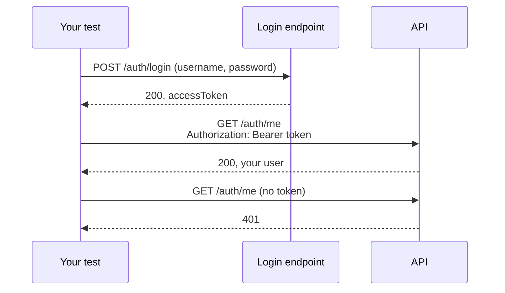

# API Authentication: API Keys, Basic, Bearer Tokens and OAuth2

Most APIs want to know who is calling. Almost all of them use one of four ways: an **API key** in a header, **Basic auth** with a username and password, a **Bearer token** you got from a login, or **OAuth2**, where a separate server gives out tokens. Your tests must send the right one. They must also test what happens without it, because a missing login check is one of the worst bugs an API can have.

!!! note "Before you start"
    Read [Headers and JSON](headers-and-json.md) first: every login travels in a header. The example file is `examples/auth_demo.py`. It needs the internet. The keys and passwords in it are fake, or the demo accounts that [httpbin](https://httpbin.org/) and [DummyJSON](https://dummyjson.com/docs/auth) publish for practice.

## Why testers need this

Login bugs are security bugs:

- an endpoint that works without a token,
- a token that never expires,
- another user's data behind your token,
- a server that crashes (`500`) on a strange token, instead of refusing it (`401`).

And login code is where secrets leak: a token pasted into a test file, or printed in a CI log that the whole company can read.

## How it works

The Bearer token flow is the one you will meet most:



*Log in once, then send the token in a header on every call. Without it, the API must answer 401.*

| Kind | How it travels | Typical use |
| --- | --- | --- |
| API key | A header like `X-API-Key: ...` | Simple service APIs, partner APIs |
| Basic | `Authorization: Basic ...` (name and password, encoded) | Old or internal APIs, test tools |
| Bearer token | `Authorization: Bearer <token>` after a login | Most web and mobile APIs |
| OAuth2 | A token server gives a Bearer token | Service-to-service, "Log in with ..." |

## The code

```python title="examples/auth_demo.py"
--8<-- "modules/core_automation/api_testing/examples/auth_demo.py"
```

From the `examples` folder, run:

```bash
python auth_demo.py
```

```text
API key    200 server got test-key-123
Basic      200 True | wrong password: 401
Bearer     200 True | no token: 401
Login      200 then /auth/me: 200 emilys
Bad token  401 {'message': 'Invalid/Expired Token!'}
```

## Line by line

**API key.**

- `headers={"X-API-Key": "test-key-123"}` sends a fixed key. The header name depends on the API, so check its docs.
- Some APIs take the key in the query (`?api_key=...`). Avoid that when you can: URLs end up in logs and browser history.

**Basic auth.**

- `auth=("tester", "s3cret")` makes `requests` build the `Authorization: Basic ...` header for you, on every request.
- The name and password are only encoded, not encrypted. Anyone who sees the header can read them. Basic auth is safe only over HTTPS.
- The wrong password got `401`, which is right.

**Bearer token.**

- httpbin's `/bearer` accepts any token, so it only shows the header shape: `Authorization: Bearer abc123`. Without it: `401`.
- DummyJSON's `/auth/login` is a real login. It answers with an `accessToken`. `expiresInMins: 5` asks for a token that lasts five minutes.
- `/auth/me` with that token answers with the user it belongs to: `emilys`. A made-up token gets `401`.

**Not every "token" is a Bearer token.** Restful-booker wants its token as a cookie, `Cookie: token=...`, as in [the HTTP methods lesson](http-methods.md). Always read the API's docs.

## How it is used in a real QA project

**Log in once per run, in a fixture.** Tokens expire, and logins are slow. A session-scoped pytest fixture logs in once, and every test uses the token. The [API project](index.md) does this, and skips with a clear message when the login is not set.

**OAuth2 client credentials for service APIs.** A separate token server gives out tokens. Your test sends a client id and a client secret to the token URL, gets an `access_token`, and then calls the API with it as a Bearer token. The template's helper does exactly that:

```python title="templates/booker_api_tests/api/auth.py (part)"
def oauth2_client_credentials(
    token_url: str,
    client_id: str,
    client_secret: str,
    scope: str | None = None,
    timeout: float = 10,
) -> str:
    """Get an access token with the OAuth2 client credentials flow (RFC 6749, section 4.4)."""
    data = {"grant_type": "client_credentials"}
    if scope:
        data["scope"] = scope
    response = requests.post(token_url, data=data, auth=(client_id, client_secret), timeout=timeout)
    response.raise_for_status()
    return response.json()["access_token"]
```

The token request is a form (`data=`), not JSON, as [the OAuth2 standard](https://www.rfc-editor.org/rfc/rfc6749#section-4.4) says. There is no public OAuth2 server that is safe to depend on, so this site's tests check the helper against a small local server. At work, your team gives you the token URL, a client id and a client secret for the test environment.

**Test the login itself.** For every endpoint that needs a login:

| Case | Expect |
| --- | --- |
| A valid login | 200, and only your data |
| No login at all | 401 |
| A wrong or made-up token | 401 |
| A token in the wrong shape (`bearer`, no space) | 401, never 500 |
| An expired token | 401 |
| A valid login without the right role | 403 |
| Another user's item, with your token | 403 or 404, never their data |

The template's `test_put_without_login_is_refused` checks the "no login" row, and then checks the booking did not change.

**Keep secrets out of code.** Read them from environment variables:

```python title="templates/booker_api_tests/api/auth.py (part)"
def secret(name: str) -> str:
    """Read a secret from an environment variable, with a clear message if it isn't set."""
    value = os.environ.get(name)
    if not value:
        raise LookupError(f"Set the environment variable {name} first")
    return value
```

In CI, the values come from the CI tool's secret store. Never commit them, not even for a test environment. And never print them: the template's `BearerAuth` prints as `BearerAuth(token=***)`, and `check_status` hides `Authorization`, `Cookie` and `X-API-Key` in failure messages.

## Your task

Write two pytest tests for DummyJSON's `/auth/me`:

1. With no `Authorization` header at all. What status do you expect?
2. With a real token, but sent as `bearer <token>`, with a small b. What should it answer, and what does it really answer?

??? success "Solution"
    ```python
    import requests

    BASE = "https://dummyjson.com"


    def test_me_needs_a_login():
        response = requests.get(f"{BASE}/auth/me", timeout=15)
        assert response.status_code == 401


    def test_me_refuses_a_badly_shaped_header():
        login = {"username": "emilys", "password": "emilyspass", "expiresInMins": 5}
        token = requests.post(f"{BASE}/auth/login", json=login, timeout=15).json()["accessToken"]
        response = requests.get(
            f"{BASE}/auth/me", headers={"Authorization": f"bearer {token}"}, timeout=15
        )
        assert response.status_code == 401
    ```

    ```text
    E       assert 500 == 401
    E        +  where 500 = <Response [500]>.status_code
    1 failed, 1 passed in 1.04s
    ```

    The first test passes: with no login, the answer is `401`. The second fails: DummyJSON crashes with `500` instead of refusing the header with `401`. The test is right and the API is wrong. Mark it `xfail` with the reason, and report it.

## When it goes wrong

These are real answers, captured November 2026.

**The header is in the wrong shape.**

```text
bearer abc123          401 {"message":"Invalid/Expired Token!"}
bearer + real token    500 {"message":"invalid token"}
Bearer abc123          401 {"message":"Invalid/Expired Token!"}
Token + real token     500 {"message":"invalid token"}
real token, no word    200 {"id":1,"firstName":"Emily","lastName":"Johnson","maidenName
```

DummyJSON's answers to five shapes of the `Authorization` header. Look closely: a made-up token is refused correctly, but a *real* token after the wrong word crashes the server with `500`. And a real token with no word at all is accepted. This is why the test table above has a row for the wrong shape. In your own code, use `Bearer`, a capital B, and one space. Print the header *names* you send, never the values.

**The token expired.**

```text
now 200
after 70 s 401 {"message":"Token Expired!"}
```

A token asked for with `expiresInMins: 1`, used again 70 seconds later. If your tests start failing with 401 half-way through a long run, the token ran out. Log in again in the fixture, or ask for a longer-lived test token.

**A wrong password.**

```text
wrong pw 400 {"message":"Invalid credentials"}
```

DummyJSON answers `400` to a wrong password. Many teams expect `401` there. Check the docs, write down what the API does, and ask if it is meant.

**The secret is not set.**

```text
LookupError: Set the environment variable BOOKER_USERNAME first
```

The template's `secret()` could not find the variable. Set it in the same terminal before you run: `export BOOKER_USERNAME=admin BOOKER_PASSWORD=password123` (Restful-booker's public demo login). In CI, add it to the secret store.

**403 instead of 200.** You are logged in, but your test user lacks a role. Ask for a test user with the right role. Don't use an admin for everything, or you will never catch role bugs.

**A token pasted into a test file.** Once it is in git history, treat it as leaked, even after you delete the line. Ask for it to be replaced.

## References

- [MDN: HTTP authentication](https://developer.mozilla.org/en-US/docs/Web/HTTP/Guides/Authentication)
- [Requests: authentication](https://requests.readthedocs.io/en/latest/user/authentication/)
- [Requests: custom authentication](https://requests.readthedocs.io/en/latest/user/advanced/#custom-authentication)
- [RFC 6749: OAuth 2.0, client credentials grant](https://www.rfc-editor.org/rfc/rfc6749#section-4.4)
- [RFC 6750: Bearer tokens](https://www.rfc-editor.org/rfc/rfc6750)
- [DummyJSON: auth](https://dummyjson.com/docs/auth)
- [OWASP API Security Top 10 (2023)](https://owasp.org/API-Security/editions/2023/en/0x11-t10/)

Written for Python 3.13 and requests 2.34. Outputs captured November 2026. Links checked: November 2026.
