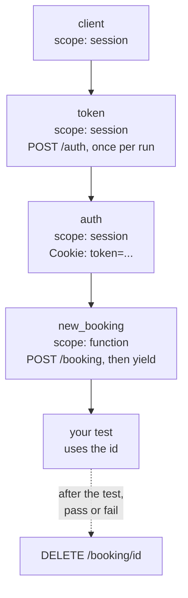

# Chaining Requests: Log In, Create, Use the Id, Clean Up

Real API tests are chains. Log in, and keep the token. Create a booking, and keep its id. Use both in the next request. Then delete what you made. Done badly, chains turn into one long test, where step 3 fails because step 1 did. Done with **pytest fixtures**, each test gets fresh data, and the clean-up runs even when the test fails.

!!! note "Before you start"
    Read [Fixtures and conftest.py](../automation-testing/pytest/fixtures-and-conftest.md) and [Authentication](authentication.md) first. The code is this topic's template project, `templates/booker_api_tests`. It needs the internet and Restful-booker's public demo login:

    ```bash
    export BOOKER_USERNAME=admin BOOKER_PASSWORD=password123
    ```

## Why testers need this

Shared test environments fill up with junk data. Tests fail because "booking 1" was changed by someone else's run, or because yesterday's failed run left 300 bookings behind. Tests that make their own data, and delete it afterwards:

- are faster to debug, because nothing else touched their data,
- can run in any order, and one at a time,
- can run in parallel,
- leave the environment as clean as they found it.

## How it works



*Each fixture asks for the one above it. The login happens once per run; every test gets its own booking, and it is deleted after the test either way.*

## The code

The fixtures live in `tests/conftest.py`, so every test file can use them:

```python title="templates/booker_api_tests/tests/conftest.py"
--8<-- "modules/core_automation/api_testing/templates/booker_api_tests/tests/conftest.py"
```

A test just names what it needs:

```python title="templates/booker_api_tests/tests/test_patch_booking.py"
--8<-- "modules/core_automation/api_testing/templates/booker_api_tests/tests/test_patch_booking.py"
```

From the `booker_api_tests` folder, run:

```bash
python -m pytest -v
```

```text
tests/test_auth.py::test_login_gives_a_token PASSED                      [  8%]
tests/test_auth.py::test_wrong_password_is_refused PASSED                [ 16%]
tests/test_delete_booking.py::test_delete_removes_the_booking PASSED     [ 25%]
tests/test_delete_booking.py::test_delete_without_login_is_refused PASSED [ 33%]
tests/test_get_booking.py::test_get_returns_the_saved_booking PASSED     [ 41%]
tests/test_get_booking.py::test_get_unknown_booking_is_404 PASSED        [ 50%]
tests/test_get_booking.py::test_response_is_json PASSED                  [ 58%]
tests/test_patch_booking.py::test_patch_changes_only_what_was_sent PASSED [ 66%]
tests/test_post_booking.py::test_create_booking PASSED                   [ 75%]
tests/test_post_booking.py::test_missing_field_is_a_client_error XFAIL   [ 83%]
tests/test_put_booking.py::test_put_replaces_the_booking PASSED          [ 91%]
tests/test_put_booking.py::test_put_without_login_is_refused PASSED      [100%]

=========================== short test summary info ============================
XFAIL tests/test_post_booking.py::test_missing_field_is_a_client_error - Restful-booker answers 500 for a missing field; it should be 400
======================== 11 passed, 1 xfailed in 7.11s =========================
```

## Line by line

**The chain.**

- `def token(client):` names `client` as an argument, so pytest makes `client` first and passes it in. You never call fixtures yourself; pytest works out the order.
- `auth` builds on `token`, and `new_booking` builds on `client` and `auth`. That is the chain: `client` → `token` → `auth` → `new_booking`.

**The scopes.**

- `client`, `token` and `auth` are `scope="session"`: one login for the whole run. Logging in for every test is slow, and some APIs block you for it.
- `new_booking` has the default scope, `function`: one booking per test, so no test sees another test's changes.

**Passing values along.**

- `booker_token(...)` reads the token from the login answer. `{"Cookie": f"token={token}"}` puts it in the header the next requests need.
- `response.json()["bookingid"]` reads the new id, and `yield booking_id, data` gives the test both the id and the data it sent, so the test can compare.

**Cleaning up.**

- Everything after `yield` runs when the test ends, passed or failed. So the booking is deleted either way.
- `delete_booking()` checks the answer. If the delete did not work, it raises `Clean-up failed: ...`. A silent clean-up failure leaves junk behind, and nobody notices.
- `created_bookings` is for tests that create bookings themselves, like the POST test. The test adds each new id to the list *before* any check, so a failing check can't skip the clean-up.

**The test.** `test_patch_changes_only_what_was_sent` is four lines: PATCH, check the status, check the schema, check the data. The login, the create and the clean-up are all in fixtures.

## How it is used in a real QA project

- **Chain requests inside a test, never between tests.** "Test 1 creates, test 2 updates, test 3 deletes" breaks when test 1 fails, when you run test 2 alone, and when tests run in parallel. Each test must work alone.
- **One fixture per kind of data.** A team builds a small set of fixtures: `new_user`, `new_order`, `paid_order`. Each one builds on the one before, and each cleans up only what it made.
- **Unique data.** The template's `booking_data()` uses a fixed name. If two people run the suite at the same time against the same environment, add a random part, like a short id, so you can tell the data apart.
- **Clean up by API, not by hand.** If the API has no delete, ask for a test-only clean-up endpoint, or a nightly job that removes test data by name.
- **Without the login, skip on a laptop, fail in CI.** The `token` fixture skips with a clear reason on your computer:

    ```text
    SKIPPED [1] tests/test_put_booking.py:9: Set the environment variable BOOKER_USERNAME first (skipped on this computer; in CI this fails)
    ```

    In a pipeline, where `CI` is set, it fails instead. A green run with the login tests quietly skipped would look as if they passed. See [the API project](index.md).

## Your task

Write a fixture `booking_without_breakfast` that builds on `new_booking`. It PATCHes the booking to `additionalneeds = ""`, then yields the id. Write a test that uses it and checks the field is empty. Does the new fixture need its own clean-up?

??? success "Solution"
    ```python
    import pytest
    from api.client import check_status


    @pytest.fixture
    def booking_without_breakfast(client, auth, new_booking):
        booking_id, data = new_booking
        response = client.patch(f"/booking/{booking_id}", json={"additionalneeds": ""}, headers=auth)
        check_status(response, 200)
        yield booking_id


    def test_task(client, booking_without_breakfast):
        assert client.get(f"/booking/{booking_without_breakfast}").json()["additionalneeds"] == ""
    ```

    No own clean-up. It uses `new_booking`, and `new_booking` deletes the booking after the test. Each fixture cleans up only what it made.

## When it goes wrong

These are real messages from pytest 9.2, captured November 2026.

**A long-lived fixture asks for a short-lived one.**

```text
ScopeMismatch: You tried to access the function scoped fixture new_booking with a session scoped request object. Requesting fixture stack:
```

A `scope="session"` fixture asked for `new_booking`, which lives for one test only. A longer-lived fixture can't depend on a shorter-lived one. Give the asking fixture the shorter scope, or move the shared part up the chain.

**The clean-up itself fails.**

```text
_____________________ ERROR at teardown of test_get_works ______________________
E           AssertionError: Clean-up failed: DELETE /booking/1679 answered 403
ERROR tests/test_chain_demo.py::test_get_works - AssertionError: Clean-up fai...
1 passed, 1 error in 0.93s
```

The test passed, but the delete after `yield` was sent without the login, so it got `403`. pytest shows it as an `ERROR at teardown`, after the test result. Read it, fix the clean-up, and delete the leftover booking by hand.

**Junk data piles up.** A test deletes in its last line, so a failure skips the delete. Move the delete after `yield` in a fixture.

**Tests pass alone and fail together.** They share data. Give each test its own, from a function-scoped fixture.

**Every test fails with 401 half-way through a long run.** The session token expired. Ask how long tokens last. Log in again when you get a 401, or ask for a longer-lived test token. See [authentication](authentication.md).

## References

- [pytest: how to use fixtures](https://docs.pytest.org/en/stable/how-to/fixtures.html)
- [pytest: teardown with yield fixtures](https://docs.pytest.org/en/stable/how-to/fixtures.html#yield-fixtures-recommended)
- [pytest: fixture scopes](https://docs.pytest.org/en/stable/how-to/fixtures.html#scope-sharing-fixtures-across-classes-modules-packages-or-session)

Written for Python 3.13, pytest 9.2 and requests 2.34. Outputs captured November 2026. Links checked: November 2026.
