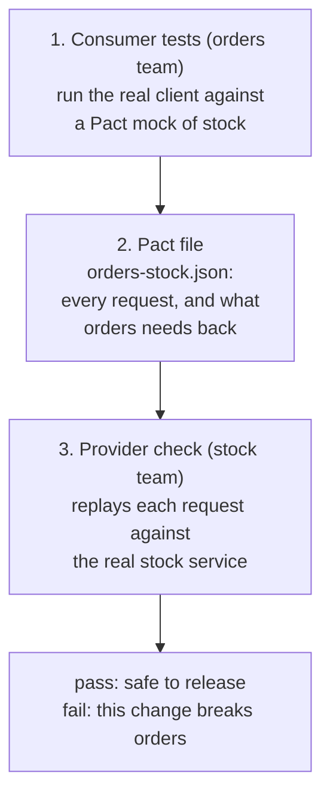

# Contract Testing With Pact: Catch Breaking API Changes Between Teams

Two teams, two services. The orders team calls the stock team's API. The orders team's tests use a fake stock service, so they're fast and stable. Then the stock team renames one field. Their tests pass, because they changed their tests too. The orders team's tests pass, because the fake didn't change. Production breaks. A **contract test** closes that gap. The consumer's tests write down exactly what it needs, and the provider checks every change against that list.

!!! example "The problem"
    **Your lead:** "Stock renamed `price_cents` to `price` last sprint. Every test was green, and checkout showed £0.00 for an hour. The two teams test separately, and an end-to-end test of everything takes 40 minutes. How do we catch this in minutes, before release?"

## Step 1: See how a contract test works



*The consumer's tests write the contract. The provider proves it keeps it. Neither team has to run the other's service.*

This is called **consumer-driven**: the consumer says what it uses, so the provider knows what it may change. A field nobody uses can be renamed freely. A field somebody uses can't, at least not without talking first.

| Test | Checks | Catches the rename? |
| --- | --- | --- |
| Consumer tests with a mock | Orders' own logic | No: the mock still sends `price_cents` |
| Provider's own API tests | Stock's own logic | No: the team changed the test with the code |
| End-to-end, everything running | The whole path | Yes, but slowly, late, and often flaky |
| **Contract test** | That what stock answers is what orders reads | **Yes, in seconds, on the stock team's own build** |

## Step 2: Get the kit

You need **Python 3.13**. Get the files from [Templates](#templates) below, or take the whole folder [from GitHub](https://github.com/myopensdet/myopensdet.github.io/tree/main/modules/advanced_testing/contract_testing/templates/contract_kit). Then:

```bash
python -m venv .venv
source .venv/bin/activate          # Windows: .venv\Scripts\activate
python -m pip install -r requirements.txt
```

The kit uses [Pact](https://docs.pact.io/), the most common contract testing tool, through `pact-python`. It brings a compiled core, `pact-python-ffi` (about 12 MB), which does the matching. Both are pinned in `requirements.txt`.

**Tracking is off.** Pact sends anonymous usage numbers (its version, your operating system) unless `PACT_DO_NOT_TRACK` is `true`. The kit's `conftest.py` sets it before Pact loads. Set the same in your CI.

The two sides are the same practice shop as in [testing microservices](../microservices/index.md):

- `stock_client.py` is the **consumer** code: the part of orders that calls stock.
- `stock_service.py` is the **provider**: a small stock service.

## Step 3: Write the consumer tests

The consumer code reads three fields, and nothing else:

```python
--8<-- "modules/advanced_testing/contract_testing/templates/contract_kit/stock_client.py"
```

Each consumer test describes one request, and what orders needs back. Then it runs the **real** client against Pact's mock server:

```python
--8<-- "modules/advanced_testing/contract_testing/templates/contract_kit/tests/test_consumer.py"
```

| Part | Means |
| --- | --- |
| `upon_receiving("a request for an item")` | A name for this interaction. It shows up in every report |
| `given("SNS-0042 is in stock")` | A **provider state**: what must be true on the provider before this request. The provider sets it up in step 5 |
| `with_request("GET", "/stock/SNS-0042")` | What orders sends |
| `will_respond_with(200)` and `with_body(...)` | What orders needs back |
| `match.int(40)` | Any whole number. Not exactly 40 |
| `pact.serve()` | Starts the mock, and checks every described request really arrived |

Use **matchers** for values that change: stock counts, ids, dates. With a plain `40`, the provider check fails the day the stock is 39. Put **only the fields your code reads** in the body. The stock service also sends `sku`, and orders reads it, so it's in. Anything orders ignores stays out, so the stock team can change it.

```bash
python -m pytest tests/test_consumer.py
```

```text
tests/test_consumer.py::test_get_an_item PASSED                          [ 33%]
tests/test_consumer.py::test_an_unknown_item PASSED                      [ 66%]
tests/test_consumer.py::test_reserve_items PASSED                        [100%]

============================== 3 passed in 0.06s ===============================
```

## Step 4: Read the pact file

The `pact` fixture in `conftest.py` gives each test its own Pact. (A Pact can't take new interactions after it has served once.) Each passing test adds its interaction to `pacts/orders-stock.json`. The first one:

```json
{
  "description": "a request for an item",
  "providerStates": [{"name": "SNS-0042 is in stock"}],
  "request": {"method": "GET", "path": "/stock/SNS-0042"},
  "response": {
    "status": 200,
    "body": {
      "content": {"available": 40, "price_cents": 2499, "sku": "SNS-0042"},
      "contentType": "application/json"
    },
    "matchingRules": {
      "body": {
        "$.available": {"combine": "AND", "matchers": [{"match": "integer"}]},
        "$.price_cents": {"combine": "AND", "matchers": [{"match": "integer"}]}
      }
    }
  }
}
```

(Shortened: the real file also has the headers, the Pact version, and the other two interactions.) This file **is** the contract. It's plain JSON, so anyone can read it in a code review. `matchingRules` says `available` and `price_cents` must be integers, of any value. `sku` has no rule, so it must be exactly `"SNS-0042"`.

## Step 5: Check the provider keeps the contract

The stock team runs this. It starts the real stock service, and asks Pact to replay every request from the pact file against it:

```python
--8<-- "modules/advanced_testing/contract_testing/templates/contract_kit/tests/test_provider.py"
```

- `state_handler({...})` maps each `given(...)` text to a function that sets it up. Before "a request for an item", `in_stock` puts SNS-0042 in the shop. The names must match the consumer's text exactly.
- `teardown=True` calls the same function with `action="teardown"` afterwards, so you can clean up.
- When it fails, Pact's own error says only `Failed to execute verifier`. The `except` turns that into Pact's full report.

```bash
python -m pytest tests/test_provider.py
```

```text
tests/test_provider.py::test_stock_keeps_every_consumer_contract PASSED  [100%]

============================== 1 passed in 1.03s ===============================
```

## Step 6: Break the contract on purpose

`STOCK_CHANGE` plants a change another team might make. First the lead's bug, the rename:

```bash
STOCK_CHANGE=rename_price python -m pytest tests/test_provider.py
```

```text
E               AssertionError: Failures:
E
E               1) Verifying a pact between orders and stock Given SNS-0042 is in stock - a request for an item
E                   1.1) has a matching body
E                          $ -> Actual map is missing the following keys: price_cents
E                   {
E                 "available": 40,
E                   -  "price_cents": 2499,
E                   +  "price": 2499,
E                     "sku": "SNS-0042"
E               }
E
E
E               There were 1 pact failures
=========================== short test summary info ============================
FAILED tests/test_provider.py::test_stock_keeps_every_consumer_contract - Ass...
============================== 1 failed in 1.04s ===============================
```

It names the consumer (`orders`), the interaction, the missing key, and shows the difference: `-` is what orders needs, `+` is what stock sent. The stock team sees this on **their** build, before they merge. All three changes:

| `STOCK_CHANGE` | What stock now sends | Result |
| --- | --- | --- |
| `rename_price` | `"price": 2499` | Fails: `$ -> Actual map is missing the following keys: price_cents` |
| `price_as_text` | `"price_cents": "24.99"` | Fails: `$.price_cents -> Expected '24.99' (String) to be an integer` |
| `add_field` | Adds `"warehouse": "Dhaka-1"` | **Passes.** A new field breaks nobody: orders ignores it |

The last line matters as much as the first two. A contract test doesn't freeze the API. It only protects what someone uses.

## Step 7: Share the contracts in a team

In the kit, both sides sit in one folder, so the pact file is simply there. In a real team, the consumer and the provider live in different repositories. The usual setup:

1. **The consumer's pipeline publishes** the pact file to a **Pact Broker**, a server that stores contracts by version. You can host one yourself (it's open source), or use the hosted PactFlow service.
2. **The provider's pipeline downloads** every consumer's latest pact from the broker, and verifies it. In the kit, that's `.add_source(PACTS)`. With a broker, it's `.broker_source("https://broker.example.test/")`.
3. **Before each release, a `can-i-deploy` check** asks the broker: has this version been verified against every version of the other side that's already live? If not, the release stops.

This guide doesn't run a broker, so there are no broker outputs here. Start without one: keep the pact files in the provider's repository, and update them by pull request. Move to a broker when there are more than a few pairs of services.

## Step 8: Use it on your own services

1. **Start with one pair.** Pick the consumer and provider whose break hurt most, like the lead's checkout.
2. **Write consumer tests from the consumer's code.** List the fields its code really reads (search for them). Describe one interaction for each request, with matchers for anything that changes.
3. **Agree on the state names with the provider team.** `given("SNS-0042 is in stock")` is a promise that they can set that up. Keep the names short and plain.
4. **Run the provider check on every provider change**, in the provider's own pipeline. It takes seconds.
5. **Keep a few end-to-end tests** for the most important journeys. Contract tests check each pair of services. They don't check the whole path, or what the user sees.

For GraphQL APIs, the [schema check in the GraphQL guide](../graphql/index.md) is a lighter version of the same idea.

## Step 9: When it goes wrong

These are real messages from pact-python 4.2, captured November 2026.

| You see | What it means | Fix |
| --- | --- | --- |
| `pact.error.MismatchesError: Mismatches:` then `(1) Request not found: GET /stocks/SNS-0042` and `(2) Missing request: GET /stock/SNS-0042` | The client sent a request the test didn't describe (here a typo in the path, `/stocks/`). The mock answered `500`, so you also see `HTTPError: 500 Server Error` | Fix the client, or the test. **Request not found** is what was sent, **Missing request** is what was expected |
| `Missing request: GET /1: {}` alone | A described request was never sent | The test code didn't call the client, or called it outside `with pact.serve()` |
| `RuntimeError: The provider state could not be specified.` | New interactions were added to a Pact after it served | Use one Pact per test, like the kit's `pact` fixture |
| `Failed: No pact files in pacts/. Run the consumer tests first: pytest tests/test_consumer.py` | The provider check ran before any consumer test wrote a pact | Run the consumer tests first, or download the pacts from your broker |
| `One or more of the setup state change handlers has failed` | The pact has a `given(...)` the provider has no handler for. Pact retries it, so this one takes several seconds | Add a handler with exactly the same text |
| `ValueError: Host mismatch: 127.0.0.1 != localhost` | The `Verifier` expects `localhost`, and the service address says `127.0.0.1` | `Verifier("stock", host="127.0.0.1")`, as in the kit |
| `We are tracking events anonymously to gather important usage statistics` | Pact's usage tracking is on | Set `PACT_DO_NOT_TRACK=true` before Pact loads |
| `Expected '24.99' (String) to be an integer` | The provider changed a field's type | A breaking change: talk to the consumer team before releasing it |

## Templates

**Every file is below, ready to copy.** The whole folder is also [on GitHub](https://github.com/myopensdet/myopensdet.github.io/tree/main/modules/advanced_testing/contract_testing/templates/contract_kit).

=== "tests/conftest.py"

    ```python
    --8<-- "modules/advanced_testing/contract_testing/templates/contract_kit/tests/conftest.py"
    ```

=== "stock_service.py"

    ```python
    --8<-- "modules/advanced_testing/contract_testing/templates/contract_kit/stock_service.py"
    ```

=== "pytest.ini"

    ```ini
    --8<-- "modules/advanced_testing/contract_testing/templates/contract_kit/pytest.ini"
    ```

=== "requirements.txt"

    ```text
    --8<-- "modules/advanced_testing/contract_testing/templates/contract_kit/requirements.txt"
    ```

## References

- [Pact: introduction](https://docs.pact.io/)
- [Pact: how Pact works](https://docs.pact.io/getting_started/how_pact_works)
- [Pact: matching](https://docs.pact.io/getting_started/matching)
- [Pact: provider states](https://docs.pact.io/getting_started/provider_states)
- [Pact: can-i-deploy](https://docs.pact.io/pact_broker/can_i_deploy)
- [pact-python on GitHub](https://github.com/pact-foundation/pact-python)
- [Martin Fowler: consumer-driven contracts](https://martinfowler.com/articles/consumerDrivenContracts.html)

Written for Python 3.13, pytest 9.2 and pact-python 4.2. Outputs captured November 2026. Links checked: November 2026.
