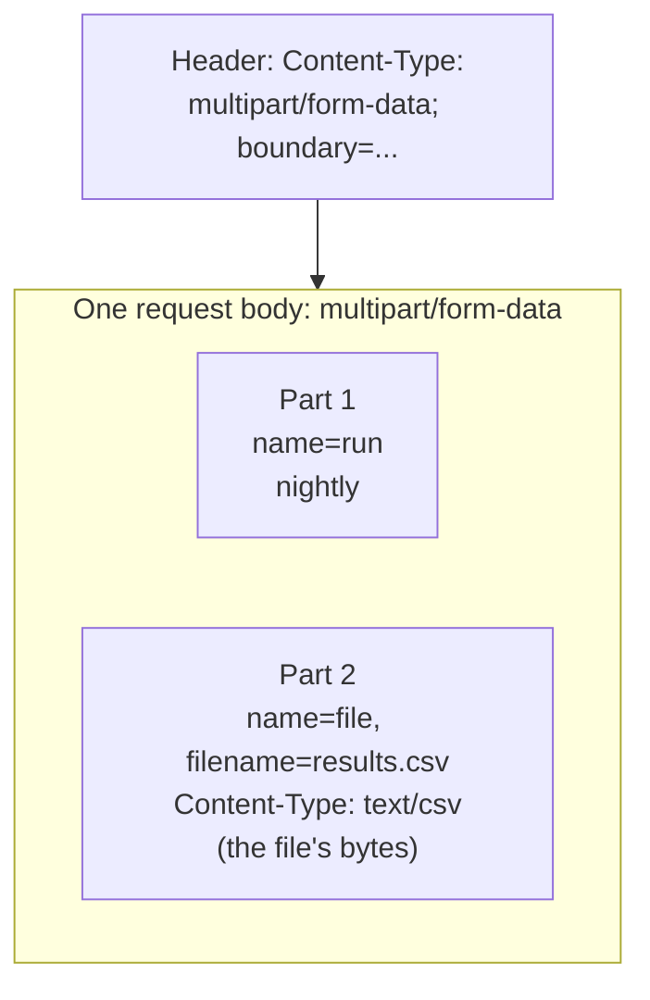

# File Upload: Send a File With multipart/form-data

Uploads use a different body from JSON: **multipart/form-data**. The body is split into parts, one for each form field and one for each file. In `requests`, `files=` sends the file and `data=` sends the other fields. `requests` builds the parts and the header for you.

!!! note "Before you start"
    Read [Headers and JSON](headers-and-json.md) first. The example files are `examples/upload_demo.py` and `examples/results.csv`, a small fake test report. The example needs the internet.

## Why testers need this

Profile photos, CSV imports and attachments all go through upload endpoints. Uploads are where APIs meet files they didn't expect:

- an empty file, or a huge one,
- the wrong type, like an `.exe` sent as a photo,
- a name with Bengali letters, spaces, or `../` in it,
- a CSV saved by Excel, with a hidden mark at the start.

Some of these are security bugs. A file name used as a path can let someone write files outside the upload folder.

## How it works



*The header names a **boundary**: a random line that separates the parts. Each part has its own small header, saying which field it is, and for a file, its name and type.*

## The code

```python title="examples/upload_demo.py"
--8<-- "modules/core_automation/api_testing/examples/upload_demo.py"
```

From the `examples` folder, run:

```bash
python upload_demo.py
```

```text
Status: 200
Sent as: multipart/form-data
Form field: {'run': 'nightly'}
File received: 4 lines, the same as sent: True
```

httpbin's `/post` answers with what it received, so you can check both sides.

## Line by line

- `report = Path(__file__).parent / "results.csv"` finds the file next to the script, whatever folder you start from.
- `report.open("rb")` opens it in **binary** mode. Uploads send bytes, not text. `with` closes the file after the request.
- `files={"file": ("results.csv", file, "text/csv")}` has four parts:
    - `"file"` is the field name the API expects. Check the docs: it is often `file`, sometimes `upload` or `attachment`.
    - `"results.csv"` is the file name the server sees.
    - `file` is the open file.
    - `"text/csv"` is the file's type.
- `data={"run": "nightly"}` sends a normal form field in its own part.
- `body["headers"]["Content-Type"].split(";")[0]` shows the type without the boundary: `multipart/form-data`.
- `received == report.read_text(encoding="utf-8")` compares what the server got with the file on disk: `True`.

## How it is used in a real QA project

**Check the file arrived the same.** Real APIs usually answer with an id or a URL, not the file. Download the file back and compare the bytes, or compare a checksum (like SHA-256) if the API gives one.

**Test the edges.**

| Case | Expect |
| --- | --- |
| A normal file | 200 or 201, and the same file back |
| An empty file | A clear 400, or accepted if empty is allowed |
| Just over the size limit | 413 Content Too Large, or a clear 400 |
| The wrong type, like an `.exe` as a photo | 400 or 415 |
| A name with Bengali letters or spaces | Saved with the right name |
| A name like `../../config` | The path part is ignored, never used |
| No file at all | 400, saying the file is missing |

The `../` case is a security test. See [security testing](../security-testing/index.md) and the [OWASP file upload cheat sheet](https://cheatsheetseries.owasp.org/cheatsheets/File_Upload_Cheat_Sheet.html).

**Keep test files small and fake.** Keep a few tiny files next to the tests: a normal one, an empty one, one with a Bengali name, and one just over the limit (make it in the test, so it isn't stored in Git). Never use real customer files.

**Make a big file in the test.** `b"x" * (5 * 1024 * 1024 + 1)` is one byte over 5 MB. Ask the team for the real limit first.

## Your task

Change the example to upload two files in one request: `results.csv` as `file`, and a second copy as `backup`. Print the keys of the server's `files` part. How does it change?

??? success "Solution"
    ```python
    with report.open("rb") as first, report.open("rb") as second:
        response = requests.post(
            "https://httpbin.org/post",
            files={
                "file": ("results.csv", first, "text/csv"),
                "backup": ("results.csv", second, "text/csv"),
            },
            timeout=15,
        )
    print(response.json()["files"].keys())
    ```

    ```text
    dict_keys(['backup', 'file'])
    ```

    The server's `files` now has two keys: one part per field name.

## When it goes wrong

These are real results from requests 2.34 and httpbin, captured November 2026.

**The file vanished after you set `Content-Type` by hand.**

```text
by hand: 200 {} {}
```

The code set `headers={"Content-Type": "multipart/form-data"}`. That header has no boundary, so the server can't find the parts: no files, no fields, and still `200`. Remove the header, and let `requests` set it.

**The file was closed too early.**

```text
ValueError: read of closed file
```

The file was closed before the request was sent, often because `requests.post(...)` sits outside the `with open(...)` block. Move the request inside the block.

**`json=` together with `files=`.**

```text
json+files: {} None ['file']
```

The file arrived, but the JSON did not: `json` is `None`. A multipart body can't also be JSON, so `requests` drops it without a word. Send other fields with `data=`.

**The server says the file is missing.**

```text
field name upload: ['upload']
```

The file was sent under the name `upload`. If the API expects `file`, it sees no file at all. Compare the field name with the docs, or with a working upload in the browser's Network tab.

**An empty file is accepted.**

```text
empty: 200 {'file': ''}
```

httpbin takes anything. Your API should not, unless empty files are allowed. Write the test, and ask what the rule is.

**A big upload times out.** Raise the `timeout` for that test only, and ask what the real size limit is.

## References

- [Requests: POST a multipart-encoded file](https://requests.readthedocs.io/en/latest/user/quickstart/#post-a-multipart-encoded-file)
- [MDN: sending form data](https://developer.mozilla.org/en-US/docs/Learn_web_development/Extensions/Forms/Sending_and_retrieving_form_data)
- [MDN: 413 Content Too Large](https://developer.mozilla.org/en-US/docs/Web/HTTP/Reference/Status/413)
- [OWASP: file upload cheat sheet](https://cheatsheetseries.owasp.org/cheatsheets/File_Upload_Cheat_Sheet.html)

Written for Python 3.13 and requests 2.34. Outputs captured November 2026. Links checked: November 2026.
