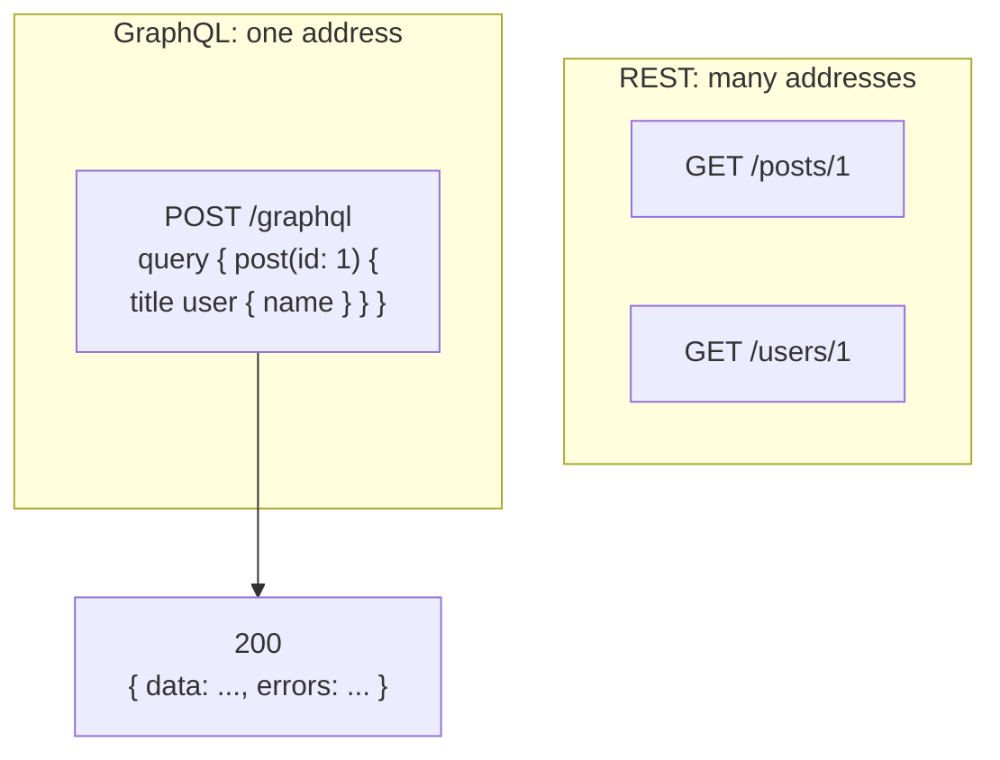

# GraphQL Testing: Queries, Mutations, Variables, Errors and Schema Checks

GraphQL is another way to build an API. Instead of many addresses, there is **one**. The client sends a query that names exactly the fields it wants, and gets back exactly those fields. It looks simple. But a GraphQL API can answer `200 OK` while the request failed, and a REST-style test that only checks the status will pass. This guide builds a small Python kit that tests GraphQL the right way, against a free public practice API.

!!! example "The problem"
    **Your lead:** "The new mobile app talks to our GraphQL API. Our REST tests don't cover it. Last week a backend change renamed one field, and the app's home screen went blank. The API's health check stayed green. Can you set up GraphQL tests that would have caught it?"

## Step 1: See how GraphQL differs from REST



*REST needs two calls for a post and its author. GraphQL asks once, at one address, and names the fields it wants.*

| | REST | GraphQL |
| --- | --- | --- |
| Addresses | One per thing: `/posts/1`, `/users/1` | One: `/graphql` |
| Method | `GET`, `POST`, `PUT`, `DELETE` | Almost always `POST` |
| What comes back | What the server decides | Only the fields you asked for |
| Reading data | `GET` | A **query** |
| Changing data | `POST`, `PUT`, `PATCH`, `DELETE` | A **mutation** |
| The rules | Docs, maybe an OpenAPI file | A **schema**: every type and field, built in |
| Errors | The status code: `404`, `400` | An `errors` list in the body, **often with `200`** |

The last line is what this guide is about. The status code alone can't tell you whether a GraphQL call worked.

## Step 2: Get the kit

You need **Python 3.13** and the internet. Get the files from [Templates](#templates) below, or take the whole folder [from GitHub](https://github.com/myopensdet/myopensdet.github.io/tree/main/modules/advanced_testing/graphql/templates/graphql_kit). Then:

```bash
python -m venv .venv
source .venv/bin/activate          # Windows: .venv\Scripts\activate
python -m pip install -r requirements.txt
```

The kit has no GraphQL library. GraphQL is JSON over HTTP, so `requests` is enough, and you can see every part.

The practice API is [GraphQLZero](https://graphqlzero.almansi.me/), free and public. It has posts and users, and it answers mutations, but it doesn't save anything. That makes it safe to practice on.

## Step 3: Send your first query

A GraphQL request is a `POST` with a JSON body. The `query` is text, written in GraphQL's own language:

```bash
curl https://graphqlzero.almansi.me/api --json '{"query": "{ post(id: 1) { id title user { name } } }"}'
```

```text
{"data":{"post":{"id":"1","title":"sunt aut facere repellat provident occaecati excepturi optio reprehenderit","user":{"name":"Leanne Graham"}}}}
```

The answer has the same shape as the query: `post`, then `id`, `title`, and the `user` with only its `name`. The text is the practice API's made-up data.

Now spell one field wrong, `titel`, and add `-i` to see the status:

```bash
curl -i https://graphqlzero.almansi.me/api --json '{"query": "{ post(id: 1) { id titel } }"}'
```

```text
HTTP/2 400
content-type: application/json; charset=utf-8
...

{"errors":[{"message":"Cannot query field \"titel\" on type \"Post\". Did you mean \"title\"?","locations":[{"line":1,"column":20}],"extensions":{"code":"GRAPHQL_VALIDATION_FAILED"}}]}
```

Every GraphQL error has three useful parts:

| Part | Here | Use it for |
| --- | --- | --- |
| `message` | `Cannot query field "titel"...` | Reading. Don't assert on the whole text: it can change |
| `extensions.code` | `GRAPHQL_VALIDATION_FAILED` | **Asserting.** Codes are stable |
| `path` | (none here) | Which field failed, when only part of the answer broke |

## Step 4: Use a client that never misses an error

Here this API answered `400`. Not every error does. Leave out a required variable, from Python, in the kit's folder:

```python
from gql import GraphQLClient

client = GraphQLClient("https://graphqlzero.almansi.me/api")
answer = client.execute("query Post($id: ID!) { post(id: $id) { id } }")
print(answer.status, answer.codes())
```

```text
200 ['BAD_USER_INPUT']
```

The request failed, and the status is `200`.

A test that checks only `status_code == 200` passes here. So the kit's client looks at `errors` on every call:

```python
--8<-- "modules/advanced_testing/graphql/templates/graphql_kit/gql.py"
```

| Method | Returns | Use it when |
| --- | --- | --- |
| `client.data(query, variables)` | Only `data` | The call should work. Any error fails the test, even with `200` |
| `client.execute(query, variables)` | The whole `Answer`: `status`, `data`, `errors`, `codes()` | You are testing an error on purpose |

When `data()` meets an error, the failure says what it was:

```text
GraphQL answered 200 with 1 error(s):
  [BAD_USER_INPUT] at -: Variable "$id" of required type "ID!" was not provided.
```

## Step 5: Test queries, with variables

```python
--8<-- "modules/advanced_testing/graphql/templates/graphql_kit/tests/test_queries.py"
```

- `query Post($id: ID!)` names the query and declares a **variable**, `$id`, of type `ID`. The `!` means it is required.
- The value travels separately, in `variables`: `{"id": "1"}`.
- `test_only_the_fields_asked_for_come_back` checks a GraphQL promise: you get what you asked for, and nothing more.
- `test_a_missing_post_is_null` is marked `xfail`: it **finds a real bug** in the practice API (step 9).

**Always use variables. Never build the query with `%s` or an f-string.** A real result: this title has quotes in it, and was pasted into the query text:

```python
title = 'Sensor "SNS-0042" offline'
query = 'mutation { createPost(input: {title: "%s", body: "x"}) { id title } }' % title
```

```text
GraphQL answered 400 with 1 error(s):
  [GRAPHQL_PARSE_FAILED] at -: Syntax Error: Invalid number, unexpected digit after 0: "0".
```

The quote before `SNS` closed the text early, and the server tried to read `-0042` as a number. Sent as a variable, the same title arrives whole: `{'createPost': {'title': 'Sensor "SNS-0042" offline'}}`. Building queries from user input is also how injection attacks start.

## Step 6: Test mutations

A **mutation** changes data. It looks like a query, and it starts with the word `mutation`:

```python
--8<-- "modules/advanced_testing/graphql/templates/graphql_kit/tests/test_mutations.py"
```

- `CreatePostInput!` is an **input type**: a set of fields sent together, like a form.
- `test_create_returns_what_was_sent` sends a post and checks the answer has the same title and body.
- `test_create_without_a_required_field` leaves out `body`. The answer has code `BAD_USER_INPUT` and no `data`.
- `test_delete_a_missing_post` is the second **real bug**: deleting post `9999`, which doesn't exist, answers `true`.

On your own app, a mutation really changes data. Clean up afterwards, as in [chaining requests](../chaining-requests.md).

## Step 7: Test the errors

Assert on the **code**, not the status and not the whole message:

```python
--8<-- "modules/advanced_testing/graphql/templates/graphql_kit/tests/test_errors.py"
```

What the practice API answered, captured November 2026:

| You send | Status | Code |
| --- | --- | --- |
| A field that doesn't exist (`titel`) | `400` | `GRAPHQL_VALIDATION_FAILED` |
| Broken query text (a missing `}`) | `400` | `GRAPHQL_PARSE_FAILED` |
| A required variable left out | **`200`** | `BAD_USER_INPUT` |
| A variable of the wrong type | **`200`** | `BAD_USER_INPUT` |
| Two queries, and no `operationName` | `400` | `OPERATION_RESOLUTION_FAILURE` |

These codes come from Apollo Server, a common GraphQL server. Other servers use other codes, or none. Run each case once on your API, and write down what it answers. Then test for exactly that.

## Step 8: Check the schema for removed fields

This is the test the lead asked for. A GraphQL server can describe itself: the **introspection** query asks it for every type and field. `schema_check.py` compares that with a list of the fields your app uses, in `expected_fields.json`:

```json
--8<-- "modules/advanced_testing/graphql/templates/graphql_kit/expected_fields.json"
```

```bash
python schema_check.py
```

```text
12 fields checked, 0 problem(s)
```

To see it catch a change, edit `expected_fields.json`: make `title` `"String!"` (required) and rename `email` to `emails`. Then run it again:

```text
changed Post.title: expected String!, found String
missing field User.emails
12 fields checked, 2 problem(s)
```

It exits with code `1`, so a pipeline stops. The first line matters as much as the second. When a field changes from **required** (`String!`) to **may be empty** (`String`), the app may now get `null` where it never did before. That's how a screen goes blank.

## Step 9: Run everything, and read the result

```bash
python -m pytest
```

```text
tests/test_errors.py::test_a_wrong_field_name PASSED                     [  6%]
tests/test_errors.py::test_a_missing_variable_still_answers_200 PASSED   [ 12%]
tests/test_errors.py::test_a_variable_of_the_wrong_type PASSED           [ 18%]
tests/test_errors.py::test_broken_query_text PASSED                      [ 25%]
tests/test_errors.py::test_data_fails_loudly_on_errors PASSED            [ 31%]
tests/test_mutations.py::test_create_returns_what_was_sent PASSED        [ 37%]
tests/test_mutations.py::test_create_without_a_required_field PASSED     [ 43%]
tests/test_mutations.py::test_update_changes_only_the_title PASSED       [ 50%]
tests/test_mutations.py::test_delete PASSED                              [ 56%]
tests/test_mutations.py::test_delete_a_missing_post XFAIL (Known bug...) [ 62%]
tests/test_queries.py::test_post_by_id PASSED                            [ 68%]
tests/test_queries.py::test_only_the_fields_asked_for_come_back PASSED   [ 75%]
tests/test_queries.py::test_pages[1-2-ids0] PASSED                       [ 81%]
tests/test_queries.py::test_pages[2-2-ids1] PASSED                       [ 87%]
tests/test_queries.py::test_a_missing_post_is_null XFAIL (Known bug:...) [ 93%]
tests/test_schema.py::test_every_field_the_app_uses_is_still_there PASSED [100%]

======================== 14 passed, 2 xfailed in 6.63s =========================
```

`XFAIL` means "expected to fail": a known bug, written down as a test. The two bugs, in the practice API's own answers:

| You ask | It answers | It should answer |
| --- | --- | --- |
| `post(id: 9999)` | `{"post": {"id": null, "title": null}}`: an empty post | `{"post": null}` |
| `deletePost(id: 9999)` | `{"deletePost": true}` | `false`, or an error |

The first one is dangerous: the app gets an object, so it shows an empty post instead of "not found". `strict=True` means when the bug is fixed, the test fails as `XPASS(strict)`. That tells you to remove the mark.

## Step 10: Use it on your own app

1. **Point the kit at your API.** Set `GRAPHQL_URL` (and `GRAPHQL_TOKEN` if it needs a login), then run `python schema_check.py` first.
2. **Fill `expected_fields.json` from the app's real queries.** Ask the frontend or mobile developers for their query files, or copy the queries from the browser's Network tab (filter for `graphql`). Every field they use goes in the list.
3. **Write the tests for your types.** Copy `test_queries.py` and `test_mutations.py`, and change the queries and the checks.
4. **Run the schema check on every backend change.** It takes seconds, and it is the test that catches a blank home screen. For a full check across teams, see [contract testing](../contract-testing/index.md).

GraphQL has its own risks. Test these as well:

| Test | Why |
| --- | --- |
| Ask for a field you may not see, like another user's `email` | Login rules must apply to **each field**, not only to the address |
| A very deep query: posts, their users, their posts, their users... | One request can make the server do huge work. A good server has a depth or cost limit |
| A page size of `10000` | The server should refuse it, or cap it |
| Introspection on the **live** site | Usually turned off in production, so outsiders can't read the whole schema. Ask what the rule is |
| An error's text | It must not show internal addresses, database errors or stack traces (see the next step) |

See the [OWASP GraphQL cheat sheet](https://cheatsheetseries.owasp.org/cheatsheets/GraphQL_Cheat_Sheet.html) and [security testing](../../security-testing/index.md).

## Step 11: When it goes wrong

These are real results, captured November 2026.

**Half the answer is missing, and the status is `200`.** One query asked for two things, and one of them broke. A real answer from the public [Rick and Morty API](https://rickandmortyapi.com/documentation/#graphql):

```python
rick = GraphQLClient("https://rickandmortyapi.com/graphql")
answer = rick.execute('{ a: character(id: 1) { name } b: charactersByIds(ids: [1, "abc"]) { name } }')
print(answer.status, answer.data)
print(answer.codes(), answer.errors[0]["path"])
print(answer.errors[0]["extensions"]["response"])
```

```text
200 {'a': {'name': 'Rick Sanchez'}, 'b': None}
['INTERNAL_SERVER_ERROR'] ['b']
{'url': 'http://localhost:8080/api/character/1,abc', 'status': 500, 'statusText': 'Internal Server Error', 'body': {'error': 'Cast to Number failed for value "NaN" at path "id" for model "Character"'}}
```

GraphQL returns the parts that worked (`a`), and an error with a `path` for the part that didn't (`b`). `client.data()` fails on it. If you use `execute()`, check `errors` as well as `data`.

The last line is a second problem. The error shows the server's **internal address and a database error**, to anyone who asks. On your app, that's a security bug: report it.

| You see | What it means | Fix |
| --- | --- | --- |
| `Not a GraphQL answer: 403 text/html '<!DOCTYPE HTML PUBLIC ...` | The address is wrong: here `/` instead of `/api`. A web page answered, not the API | Copy the exact address from the Network tab or the docs |
| `400`, with code `BAD_REQUEST` and the word `CSRF` | The query was sent as a `GET` with `?query=`, and the server blocks that | Send a `POST` with a JSON body, as the kit does |
| `[GRAPHQL_PARSE_FAILED] ... Syntax Error` | The query text is broken: often a missing `}`, or a value pasted into the text | Use variables, and check the brackets |
| `[GRAPHQL_VALIDATION_FAILED] Cannot query field "x" on type "Post"` | The field doesn't exist. It was renamed, removed, or misspelled | Read the `Did you mean` hint, then run `schema_check.py` |
| `[BAD_USER_INPUT] Variable "$id" of required type "ID!" was not provided` | A variable is missing, or `variables` is not a dictionary | Check the name matches, without the `$`: `{"id": "1"}` |
| `[OPERATION_RESOLUTION_FAILURE] Must provide operation name if query contains multiple operations` | The text has two named queries | Pass `operation="Post"` to say which one to run |
| `Introspection is off or failed: ...` from `schema_check.py` | Introspection is turned off, often on the live site | Run it on a test environment, or ask for the `schema.graphql` file |
| `XPASS(strict)` on one of the bug tests | The bug was fixed | Remove the `xfail` mark, and keep the test |

## Templates

**Every file is below, ready to copy.** The whole folder is also [on GitHub](https://github.com/myopensdet/myopensdet.github.io/tree/main/modules/advanced_testing/graphql/templates/graphql_kit).

=== "schema_check.py"

    ```python
    --8<-- "modules/advanced_testing/graphql/templates/graphql_kit/schema_check.py"
    ```

=== "tests/conftest.py"

    ```python
    --8<-- "modules/advanced_testing/graphql/templates/graphql_kit/tests/conftest.py"
    ```

=== "tests/test_schema.py"

    ```python
    --8<-- "modules/advanced_testing/graphql/templates/graphql_kit/tests/test_schema.py"
    ```

=== "pytest.ini"

    ```ini
    --8<-- "modules/advanced_testing/graphql/templates/graphql_kit/pytest.ini"
    ```

=== "requirements.txt"

    ```text
    --8<-- "modules/advanced_testing/graphql/templates/graphql_kit/requirements.txt"
    ```

## References

- [GraphQL: queries](https://graphql.org/learn/queries/)
- [GraphQL: mutations](https://graphql.org/learn/mutations/)
- [GraphQL: schemas and types](https://graphql.org/learn/schema/)
- [GraphQL: introspection](https://graphql.org/learn/introspection/)
- [GraphQL: serving over HTTP](https://graphql.org/learn/serving-over-http/)
- [Apollo Server: error codes](https://www.apollographql.com/docs/apollo-server/data/errors)
- [OWASP: GraphQL cheat sheet](https://cheatsheetseries.owasp.org/cheatsheets/GraphQL_Cheat_Sheet.html)

Written for Python 3.13, pytest 9.2 and requests 2.34. Outputs captured November 2026. Links checked: November 2026.
