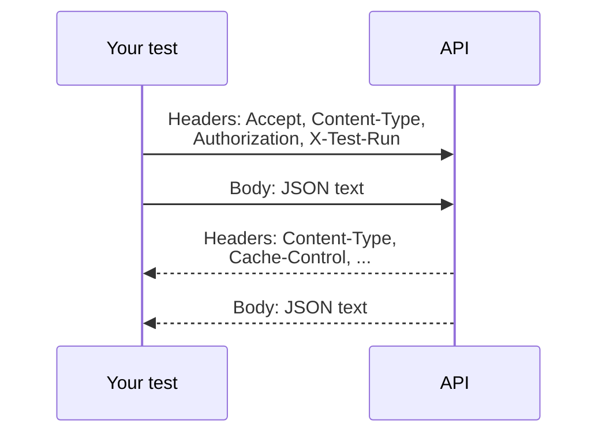

# Headers and JSON: What Goes With Every Request, and the Two Ways to Send Data

**Headers** are the notes on the envelope. They say what kind of answer you want (`Accept`), what kind of body you are sending (`Content-Type`), who you are (`Authorization`), and anything else the API asks for. The **body** is the data, usually JSON. In `requests`, `json=` sends JSON and sets the right header for you, and `data=` sends a form. Mixing them up is one of the most common reasons a request "works in Postman but not in Python".

!!! note "Before you start"
    Read [How HTTP works](how-http-works.md), and [JSON](../programming-for-testers/json.md) if JSON is new to you. The example file is `examples/headers_and_json.py`. It needs the internet.

## Why testers need this

Wrong headers cause confusing failures:

- a `415 Unsupported Media Type`, because `Content-Type` is wrong,
- an HTML page instead of JSON, because `Accept` is missing,
- a `400` or `500`, because the body was sent as a form,
- a body the server never sees, because the header and the body don't match.

Response headers are worth testing too: the content type, caching rules, and security headers. A wrong `Content-Type` in a response breaks every app that trusts it.

## How it works



*Headers travel first and describe the body. The server reads `Content-Type` to know how to read your body; you read its `Content-Type` to know how to read the answer.*

| Header | Who sends it | Says |
| --- | --- | --- |
| `Accept` | You | The kind of answer you want: `application/json` |
| `Content-Type` | Both | The kind of body this message has |
| `Authorization` | You | Who you are: `Bearer <token>` |
| `User-Agent` | You | Which program sent it. `requests` adds its own |
| `X-...` | Either | A custom header, like `X-Test-Run` |
| `Cache-Control` | The server | Whether the answer may be stored, and for how long |

## The code

```python title="examples/headers_and_json.py"
--8<-- "modules/core_automation/api_testing/examples/headers_and_json.py"
```

From the `examples` folder, run:

```bash
python headers_and_json.py
```

```text
The server saw: {'Accept': 'application/json', 'X-Test-Run': 'nightly-42', 'User-Agent': 'python-requests/2.34.2'}
json=  -> application/json {'battery': 87, 'device_id': 'SNS-0042', 'location': 'ঢাকা অফিস'}
data=  -> application/x-www-form-urlencoded {'battery': '87', 'device_id': 'SNS-0042', 'location': 'ঢাকা অফিস'}
Response type: application/json
Title: Sample Slide Show
```

httpbin's `/headers` and `/anything` answer with what they received, so you can see exactly what your code sent.

## Line by line

**Sending headers.**

- `headers={"Accept": "application/json", "X-Test-Run": "nightly-42"}` is a plain dictionary. The server saw both, plus `User-Agent`, which `requests` adds by itself.
- `X-Test-Run` is a custom header. Headers like this help the team find your test's requests in the server logs.

**`json=` versus `data=`.**

- `json=reading` turns the dictionary into JSON text, and sets `Content-Type: application/json`. Look at the output: `battery` stays the number `87`, and `ঢাকা অফিস` arrives as it is.
- `data=reading` sends the same dictionary as a form, `application/x-www-form-urlencoded`, like an HTML form does. Everything becomes text: `'battery': '87'`.
- Use `json=` for JSON APIs. Use `data=` only when the API asks for a form, as some login endpoints do.

**Reading the answer.**

- `response.headers["Content-Type"]` says what the body is. Check it before you call `.json()`. Header names don't care about capital letters, so `response.headers["content-type"]` works too.
- `response.json()["slideshow"]["title"]` reaches into the JSON body, like a nested dictionary.

## How it is used in a real QA project

- **One place for the common headers.** A test client sets `Accept`, `Authorization` and any custom headers once, in a `requests.Session`, so no test forgets them. See [an API client class](api-client-class.md).
- **Check the response type.** A test that expects JSON checks that `Content-Type` starts with `application/json`. A wrong type is a bug, even when the body looks fine.
- **Check the body, not only one field.** Check the values that matter, then the shape of the whole body with a [schema](schema-validation.md). For a list, check its length and one or two items, not only that it isn't empty.
- **Hide secrets in logs.** `Authorization` and `Cookie` hold secrets. A good client prints `***` instead.
- **Security headers.** Some teams check that responses have headers like `Strict-Transport-Security` and `X-Content-Type-Options: nosniff`. That is a small, cheap security test.

## Your task

Send `{"price": 4.25, "tags": ["paper"]}` to `https://httpbin.org/anything`, once with `json=` and once with `data=`. Print `response.json()["json"]` and `response.json()["form"]` each time. What happened to the number and the list?

??? success "Solution"
    ```python
    import requests

    body = {"price": 4.25, "tags": ["paper"]}
    as_json = requests.post("https://httpbin.org/anything", json=body, timeout=15)
    as_form = requests.post("https://httpbin.org/anything", data=body, timeout=15)
    print(as_json.json()["json"])
    print(as_form.json()["form"])
    ```

    ```text
    {'price': 4.25, 'tags': ['paper']}
    {'price': '4.25', 'tags': 'paper'}
    ```

    With `json=`, the server gets a number and a list. With `data=`, everything is text, and the one-item list became a plain value. Forms can't carry nested data or types. That is why JSON APIs use JSON.

## When it goes wrong

These are real answers, captured November 2026.

**The body arrives empty on the server.**

```text
json: None   data: x=1   form: {}
```

This is what httpbin received when the code set `Content-Type: application/json` by hand but sent a dictionary with `data=`. The header says JSON, but the body is a form, so the server finds no JSON at all. Don't set `Content-Type` by hand; let `json=` set it.

**A JSON API gets a form.**

```text
500 Internal Server Error
```

Restful-booker's answer to `POST /booking` sent with `data=`. A good API answers `415 Unsupported Media Type` or `400`. Switch to `json=`, and report the 500: the server should not crash on a wrong body.

**The answer's type is wrong.**

```text
200 text/html; charset=utf-8 <?xml version='1.0'?>
```

Restful-booker, asked with `Accept: application/xml`, sends XML but labels it `text/html`. Apps that trust the label will fail. Check `Content-Type` in your tests, and report a wrong one.

**Python data that JSON can't hold.**

```text
TypeError: Object of type date is not JSON serializable
```

You passed a `date` in `json=`. JSON has no date type. Send `value.isoformat()`, a string like `"2026-12-01"`.

**The answer is HTML, not JSON.** Send `Accept: application/json`. Some APIs send HTML error pages to browsers, and JSON only to clients that ask for it.

**A header you sent never arrives.** A proxy or gateway between you and the server may remove it. Ask the team which headers pass through, and test against the same setup the app uses.

## References

- [MDN: HTTP headers](https://developer.mozilla.org/en-US/docs/Web/HTTP/Reference/Headers)
- [Requests: custom headers](https://requests.readthedocs.io/en/latest/user/quickstart/#custom-headers)
- [Requests: more complicated POST requests](https://requests.readthedocs.io/en/latest/user/quickstart/#more-complicated-post-requests)
- [MDN: sending form data](https://developer.mozilla.org/en-US/docs/Learn_web_development/Extensions/Forms/Sending_and_retrieving_form_data)

Written for Python 3.13 and requests 2.34. Outputs captured November 2026. Links checked: November 2026.
