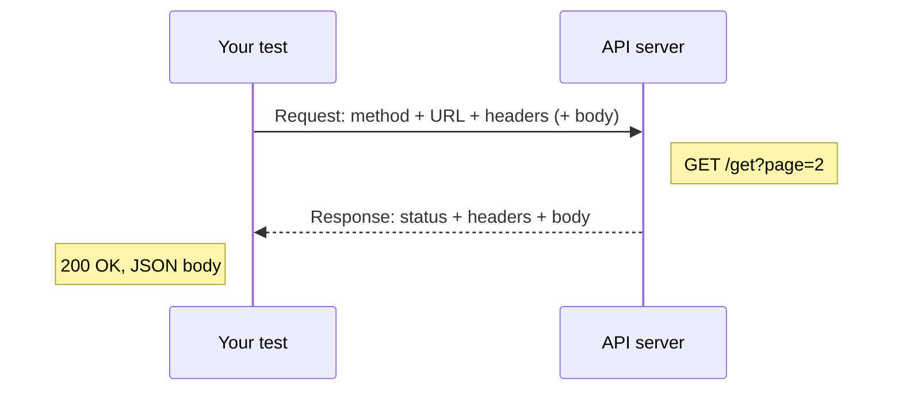

# How HTTP Works: A Request, a Response, and What's in Each

Every API call is a conversation in two parts. The **request** says what you want: a method like GET, a URL, some headers, and sometimes a body. The **response** answers: a status code, headers, and usually a body. Once you can name those parts, every API test reads the same way: send a request, then check the parts of the response.

!!! note "Before you start"
    You need Python 3.13 and `requests` 2.34 in a [virtual environment](../programming-for-testers/virtual-environments-and-pip.md). The example file is `examples/http_basics.py` in this topic's folder. It needs the internet.

## Why testers need this

An API test fails in the pipeline, and the log says only `AssertionError`. Before you can fix anything, you must know which part was wrong:

- the **status code** (the server refused, or crashed),
- a **header** (the body is HTML, not JSON),
- the **body** (a field is missing or has the wrong value),
- or there was **no response at all** (the network, a timeout, a certificate).

Each of these has a different owner and a different fix. Testers who can name the parts read a failure in seconds, and write bug reports developers can act on at once.

## How it works



*The test sends one request and gets one response. Each side has the same three kinds of parts: a first line, headers, and an optional body.*

| Part | In the request | In the response |
| --- | --- | --- |
| First line | **Method** and **URL**: `GET https://httpbin.org/get?page=2` | **Status code** and **reason**: `200 OK` |
| Headers | Notes about the request: `Accept`, `Authorization` | Notes about the answer: `Content-Type` |
| Body | Data you send (POST, PUT, PATCH) | The data itself, often JSON |

## The code

```python title="examples/http_basics.py"
--8<-- "modules/core_automation/api_testing/examples/http_basics.py"
```

From the `examples` folder, run:

```bash
python http_basics.py
```

```text
Request:  GET https://httpbin.org/get?page=2
Status:   200 OK
Type:     application/json
OK?       True
Body has: ['args', 'headers', 'method', 'origin', 'url']
args:     {'page': '2'}
```

[httpbin.org](https://httpbin.org/) is a public service that answers with details of the request you sent. It is made for learning and testing HTTP.

## Line by line

- `requests.get(url, params={"page": 2}, timeout=15)` sends a GET request. `params=` builds the query `?page=2` for you, and encodes any special letters. `timeout=15` gives up after 15 seconds instead of waiting forever.
- `response.request.method` and `response.request.url` show the request that was really sent. The **URL** has a scheme (`https`), a host (`httpbin.org`), a path (`/get`) and a query (`?page=2`).
- `response.status_code` and `response.reason` are the first line of the answer: `200 OK`.
- `response.headers["Content-Type"]` says what the body is. `application/json` means you can read it with `.json()`.
- `response.ok` is `True` for any status below 400. It is a quick check, not a full one: a test should check the exact code it expects.
- `response.json()` turns the JSON body into a dictionary. `sorted(body)` lists its keys.
- `body["args"]` shows what the server received: `{'page': '2'}`. The number became the text `'2'`, because everything in a URL is text.

**Two more ideas that matter for tests:**

- **HTTP is stateless.** Each request stands alone. The server does not remember your last one, unless you send something that reminds it, like a token or a cookie. That is why a login token goes in a header on every request, and why well-made tests can run in any order.
- **HTTPS** is the same conversation, encrypted on the way. `requests` checks the server's certificate by default. Never turn that off with `verify=False` for tests against real environments. If a test environment has its own certificate, ask for the certificate file and pass it with `verify="path/to/cert.pem"`.

## How it is used in a real QA project

- **Every API assertion checks a part.** Status first, then headers, then the body. See [status codes](status-codes.md) and [headers and JSON](headers-and-json.md).
- **Bug reports quote the parts.** A good API bug report has the method, URL, request headers and body, and the response status, headers and body. Hide tokens first.
- **Logging.** Test clients log one line per call, like `GET /booking/1 -> 200 in 120 ms`, so a failed run shows what happened. See [an API client class](api-client-class.md).
- **Browser checks.** The Network tab in the browser's developer tools shows the same parts for every call a web page makes. See [how the web works](how-the-web-works.md).

## Your task

Change the example to ask for `https://httpbin.org/get` with two parameters, `name=Test` and `page=3`. Which lines of the output change, and how?

??? success "Solution"
    Use `params={"name": "Test", "page": 3}`. The request line becomes `GET https://httpbin.org/get?name=Test&page=3`, and `args` shows both values, as text: `{'name': 'Test', 'page': '3'}`. Everything in a URL is text, even numbers.

## When it goes wrong

These are real messages from `requests` 2.34. The long ones are the last line of the traceback.

**No answer at all.**

```text
requests.exceptions.ConnectionError: HTTPConnectionPool(host='127.0.0.1', port=9): Max retries exceeded with url: /devices (Caused by NewConnectionError("HTTPConnection(host='127.0.0.1', port=9): Failed to establish a new connection: [Errno 61] Connection refused"))
```

Nothing answered at that host and port: a wrong address, a server that is down, no internet, or a proxy. Try the URL with `curl` or a browser to see whether it is your code or the network.

**The server was too slow.**

```text
requests.exceptions.ReadTimeout: HTTPSConnectionPool(host='httpbin.org', port=443): Read timed out. (read timeout=1)
```

The server did not answer within `timeout`. That is the timeout doing its job. If the endpoint is really that slow, it may be a performance bug worth reporting.

**The body is not JSON.**

```text
requests.exceptions.JSONDecodeError: Expecting value: line 1 column 1 (char 0)
```

You called `.json()` on an HTML page or an empty body. Print `response.status_code`, `response.headers["Content-Type"]` and `response.text[:200]` first. Error pages are usually HTML.

**The certificate is not trusted.**

```text
requests.exceptions.SSLError: HTTPSConnectionPool(host='expired.badssl.com', port=443): Max retries exceeded with url: / (Caused by SSLError(SSLCertVerificationError(1, '[SSL: CERTIFICATE_VERIFY_FAILED] certificate verify failed: certificate has expired (_ssl.c:1035)')))
```

The server's certificate is expired, self-made, or replaced by a company proxy. Ask for the right certificate bundle and pass it with `verify=`. An expired certificate on a real server is a bug.

**The URL has no scheme.**

```text
requests.exceptions.MissingSchema: Invalid URL 'httpbin.org/get': No scheme supplied. Perhaps you meant https://httpbin.org/get?
```

The URL needs `https://` (or `http://`) at the start. Usually the base URL in a setting is missing it.

## References

- [MDN: an overview of HTTP](https://developer.mozilla.org/en-US/docs/Web/HTTP/Guides/Overview)
- [Requests: quickstart](https://requests.readthedocs.io/en/latest/user/quickstart/)
- [Requests: timeouts](https://requests.readthedocs.io/en/latest/user/quickstart/#timeouts)
- [RFC 9110: HTTP semantics](https://www.rfc-editor.org/rfc/rfc9110)

Written for Python 3.13 and requests 2.34. Outputs captured November 2026. Links checked: November 2026.
