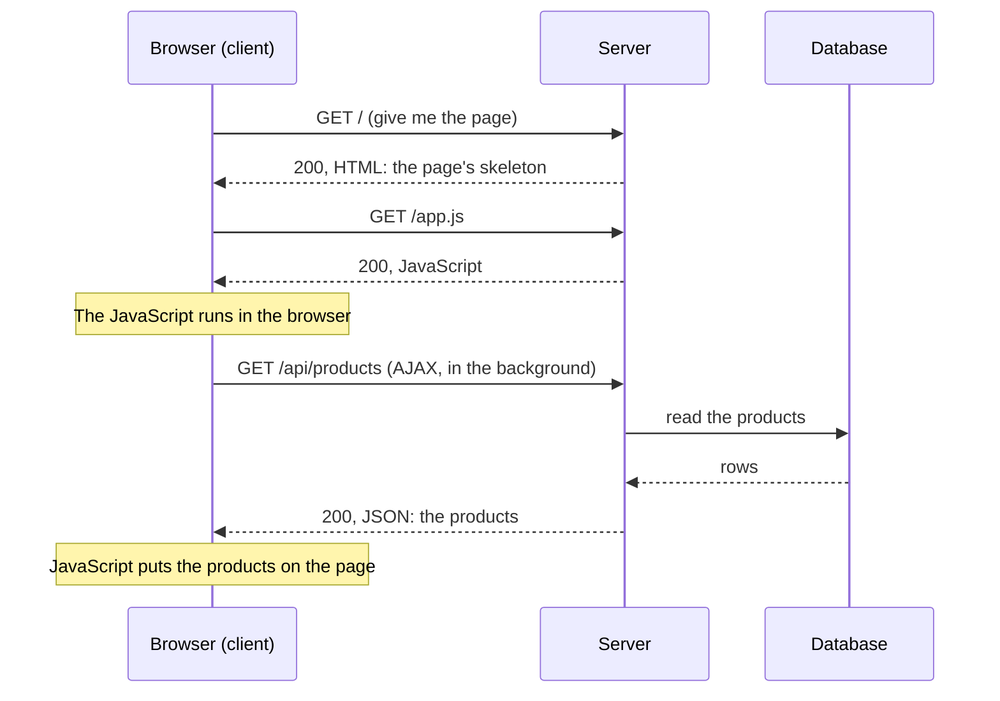

# How the Web Works for Testers: Client, Server, HTML, AJAX, JSON and REST

Every web app is two programs talking: one on the user's device, one on a server. Most testers know this as a sentence. Knowing it as a **picture** changes how you test. You know where a bug can live, which layer to test, and who should get the ticket. This page builds that picture with a small practice shop you run on your own computer.

!!! example "The problem"
    **A customer:** "Your website says the mug costs £10, but my receipt says £9.99."<br>
    **Your lead:** "Is that a frontend bug or a backend bug? I need to know who gets the ticket."

## Step 1: See the whole picture

When you open a shop page, this happens:



| Part | What it is | Where it runs |
| --- | --- | --- |
| **Client** | The program that asks: a browser, a phone app, or your test | The user's device |
| **Server** | The program that answers. It runs the app's rules | The company's computers |
| **HTML** | The text a page is made of: `<h1>`, `<button>`, `<ul>` | Sent by the server, shown by the browser |
| **JavaScript** | Code that runs **in the browser**, and changes the page | The user's device |
| **DOM** | The page as the browser holds it **now**, after JavaScript changed it | The user's device |
| **AJAX** | JavaScript asking the server for data in the background, without loading a new page | Browser to server |
| **API** | The addresses the server answers with data, not pages: `/api/products` | The server |
| **REST** | The common style of API: an address for each thing, HTTP methods for actions | The server |
| **JSON** | The text format the data travels in: `{"title": "Test mug", "price": 9.99}` | Between them |

The **frontend** is everything on the user's device: HTML, JavaScript, the DOM. The **backend** is everything on the servers: the API, the rules, the database. A bug lives in one of them. The rest of this page shows how to find out which.

## Step 2: Start the practice shop

You need **Python 3.13**. Get the files from [Templates](#templates) below, or take the whole folder [from GitHub](https://github.com/myopensdet/myopensdet.github.io/tree/main/modules/core_automation/api_testing/templates/web_kit). The shop uses only Python's standard library. `watch_requests.py` (step 4) also needs `pip install playwright` and `playwright install chromium`.

```bash
python web_demo.py
```

```text
Practice shop on http://127.0.0.1:8797  (Ctrl+C to stop)
```

Open `http://127.0.0.1:8797` in your browser. You see three products, a form, and a button. Leave the server running, and use a second terminal for the next steps. The first terminal shows every request the server gets:

```text
server got: GET / -> 200
server got: GET /app.js -> 200
server got: GET /api/products -> 200
```

Three requests for one page. That's the picture from step 1, really happening. (Your browser may also ask for `/favicon.ico`, the small icon on the tab, and get a `404`. That's normal.)

## Step 3: See the HTML the server sends

Ask for the page the way the browser does, but with curl:

```bash
curl http://127.0.0.1:8797/
```

The part where the products should be:

```html
  <p id="status">Loading products...</p>
  <ul id="products"></ul>
```

**The list is empty.** The products you see in the browser are not in the HTML. The JavaScript fetched them and put them into the page afterwards.

You can see both versions in any browser:

| In the browser | Shows | Here |
| --- | --- | --- |
| Right-click, **View Page Source** | The HTML the server sent | An empty list |
| Right-click, **Inspect** | The DOM: the page now | Three `<li>` products |

Why testers care: a test that reads the HTML right away (or a UI test that doesn't wait) sees "Loading products..." and no products. It's also why Playwright waits for elements: they may arrive after the page.

## Step 4: See the AJAX call

In the browser, open the developer tools (++f12++, or ++cmd+option+i++ on a Mac):

1. Click the **Network** tab.
2. Click **Fetch/XHR**. That filter shows only the calls JavaScript makes: the AJAX calls.
3. Reload the page. One line appears: `products`, status `200`.
4. Click it, then **Response** (or **Preview**): the JSON the server sent.

`watch_requests.py` does the same in a terminal, so you can paste it into a ticket:

```bash
python watch_requests.py http://127.0.0.1:8797
```

```text
 #  type       method status address
 1  document   GET    200    http://127.0.0.1:8797/
 2  script     GET    200    http://127.0.0.1:8797/app.js
 3  fetch      GET    200    http://127.0.0.1:8797/api/products

API calls made by JavaScript (AJAX): 1
  GET http://127.0.0.1:8797/api/products -> 200
  answer: [{"id": 1, "title": "Practice book", "price": 24.5, "stock": 3}, {"id": 2, "title": "Test mug", "price": 9.99, "stock": 12}, {"id": 3, "title": "Bug sticker", "price": 1.5, "stock": 0}]
```

The `type` column tells you who asked: `document` is the page itself, `script` is a JavaScript file, `fetch` (or `xhr`, the older way) is an AJAX call.

## Step 5: Read the REST API and its JSON

The shop's API follows the REST style. Each **thing** (a resource) has an address, and the HTTP method says what to do with it:

| Method and address | Means |
| --- | --- |
| `GET /api/products` | All products |
| `GET /api/products/2` | Product 2 |
| `POST /api/cart` | Make a new cart (send the item as JSON) |
| `DELETE /api/products/2` | Delete product 2 (this shop doesn't allow it: `405`) |

Ask for one product, with `-i` to see the headers too:

```bash
curl -i http://127.0.0.1:8797/api/products/2
```

```text
HTTP/1.0 200 OK
Server: PracticeShop/1.0 Python/3.13.18
Date: Thu, 19 Nov 2026 11:55:19 GMT
Content-Type: application/json; charset=utf-8
Content-Length: 58

{"id": 2, "title": "Test mug", "price": 9.99, "stock": 12}
```

`Content-Type: application/json` says the body is JSON. JSON has only six kinds of value, and a test should check the kind as well as the value:

| Kind | Example | Watch out for |
| --- | --- | --- |
| Text (string) | `"Test mug"` | Numbers sent as text: `"9.99"` instead of `9.99` |
| Number | `9.99`, `12` | `24.5` and `24.50` are the same number. Format money on the page, not in the API |
| True or false | `true` | `"true"` in quotes is text, not a boolean |
| Nothing | `null` | `null` and a missing field can mean different things |
| List (array) | `[1, 2, 3]` | An empty list `[]` is fine. A missing list may not be |
| Object | `{"id": 2}` | Field names are case-sensitive: `Price` is not `price` |

More on headers and JSON in [headers and JSON](headers-and-json.md). Checking the whole shape at once is [schema validation](schema-validation.md).

## Step 6: Send data, and read the refusals

Add 2 mugs to a cart. `--json` sends the body with the right `Content-Type` (curl 7.82 or newer):

```bash
curl -i --json '{"product_id": 2, "quantity": 2}' http://127.0.0.1:8797/api/cart
```

```text
HTTP/1.0 201 Created
...
{"items": [{"product_id": 2, "quantity": 2}], "total": 19.98}
```

With an older curl, write the header yourself: `curl -i -X POST http://127.0.0.1:8797/api/cart -H "Content-Type: application/json" -d '{"product_id": 2, "quantity": 2}'`.

Now the wrong requests. A good API refuses each one with a clear code and message:

| You send | Answer |
| --- | --- |
| `{"product_id": 3, "quantity": 1}` (sold out) | `422` `{"error": "Bug sticker is sold out"}` |
| `{"product_id": 2, "quantity": 50}` | `422` `{"error": "quantity must be 1 to 12"}` |
| `{"product_id": 9, "quantity": 1}` | `404` `{"error": "product 9 not found"}` |
| JSON with a missing `}` | `400` `{"error": "send JSON like {\"product_id\": 1, \"quantity\": 2}"}` |
| `DELETE /api/products/2` | `405` `{"error": "DELETE is not allowed on /api/products/2"}` |

The same refusal reaches the user through the frontend. In the browser, pick **Bug sticker** and click **Add to cart**: the page says "Sorry: Bug sticker is sold out". The JavaScript showed the API's message. What each status code means is in [status codes](status-codes.md).

## Step 7: Frontend bug or backend bug?

Back to the problem. Stop the shop (++ctrl+c++) and start it with a planted bug:

```bash
python web_demo.py --bug frontend
```

```bash
python watch_requests.py http://127.0.0.1:8797 --find "Test mug"
```

```text
API calls made by JavaScript (AJAX): 1
  GET http://127.0.0.1:8797/api/products -> 200
  answer: [{"id": 1, "title": "Practice book", "price": 24.5, "stock": 3}, {"id": 2, "title": "Test mug", "price": 9.99, "stock": 12}, {"id": 3, "title": "Bug sticker", "price": 1.5, "stock": 0}]

The page shows: Test mug £10
```

The API sent `9.99`. The page shows `£10`. **The data was right when it reached the browser, and wrong on the screen: a frontend bug.** (The JavaScript rounds the price.)

Now the other bug:

```bash
python web_demo.py --bug backend
```

```text
  answer: [{"id": 1, "title": "Practice book", "price": 24.5, "stock": 3}, {"id": 2, "title": "Test mug", "price": 99.9, "stock": 12}, {"id": 3, "title": "Bug sticker", "price": 1.5, "stock": 0}]

The page shows: Test mug £99.90
```

The page shows exactly what the API sent, and the API is wrong: **a backend bug.** The rule for any app:

| The API's answer | The page | Bug in | Ticket goes to |
| --- | --- | --- | --- |
| Right | Wrong | Frontend | The frontend (web or app) developers |
| Wrong | Shows the wrong value | Backend | The backend (API) developers |
| An error, like `500` | A broken or empty page | Backend, and the frontend may handle errors badly | Backend first. Note the page, too |
| No call at all | Wrong or empty | Frontend: it never asked | The frontend developers |

Put the proof in the ticket: the API call, its answer, and what the page shows. That's three lines from `watch_requests.py`, and nobody needs to argue about who owns the bug.

## Step 8: Use it on your own app

1. **Map the calls behind each page.** Run `python watch_requests.py https://your-app.example.com/products` (an address you may test). The list of `fetch` and `xhr` calls is the list of API endpoints that page uses. Those are your API tests.
2. **Test each layer for what it does.** The rules (prices, stock, who may do what) live in the backend: test them through the API, fast and many. The frontend shows and collects data: a few UI tests check that it shows the API's data correctly. See [the test levels](../manual-testing/test-levels/index.md).
3. **Never trust the frontend alone.** The browser is on the user's computer, and users can change anything in it. If the page hides a button, the API must still refuse the action. Test the API directly for that.
4. **When a page is wrong**, compare the API answer with the screen before you write the ticket (step 7).

Pages behind a login show only the login page's calls at first. Log in with Playwright first, as in [automate UI tests](../case-studies/automate-ui-tests/index.md), or use the browser's Network tab while logged in.

## Step 9: When it goes wrong

| You see | What it means | Fix |
| --- | --- | --- |
| `Could not open the page: Page.goto: net::ERR_CONNECTION_REFUSED at http://127.0.0.1:8797/` | Nothing is running at that address | Start `python web_demo.py` in another terminal |
| `Not a full address: '127.0.0.1:8797'. Start with http:// or https://` | The address needs its start | `python watch_requests.py http://127.0.0.1:8797` |
| `OSError: [Errno 48] Address already in use` when starting the shop | It's already running | Use it, or stop the other one. Or `python web_demo.py --port 8798` |
| `415` `{"error": "send JSON, with Content-Type: application/json"}` | The body was sent as form data | Send JSON with the `Content-Type` header, as above |
| The curl output has no products, but the browser does | The products come by AJAX, after the HTML | Call the API address instead: `curl http://127.0.0.1:8797/api/products` |
| `API calls made by JavaScript (AJAX): 0` on your app | The page builds its HTML on the server, or the calls start later (on scroll or click) | Fine: test that page's HTML. For later calls, use the Network tab while you click |

## Templates

**Every file is below, ready to copy.** The whole folder is also [on GitHub](https://github.com/myopensdet/myopensdet.github.io/tree/main/modules/core_automation/api_testing/templates/web_kit).

=== "watch_requests.py"

    ```python
    --8<-- "modules/core_automation/api_testing/templates/web_kit/watch_requests.py"
    ```

=== "web_demo.py"

    ```python
    --8<-- "modules/core_automation/api_testing/templates/web_kit/web_demo.py"
    ```

=== "page/index.html"

    ```html
    --8<-- "modules/core_automation/api_testing/templates/web_kit/page/index.html"
    ```

=== "page/app.js"

    ```javascript
    --8<-- "modules/core_automation/api_testing/templates/web_kit/page/app.js"
    ```

## References

- [MDN: How the web works](https://developer.mozilla.org/en-US/docs/Learn_web_development/Getting_started/Web_standards/How_the_web_works)
- [MDN: An overview of HTTP](https://developer.mozilla.org/en-US/docs/Web/HTTP/Guides/Overview)
- [MDN: The Document Object Model (DOM)](https://developer.mozilla.org/en-US/docs/Web/API/Document_Object_Model)
- [MDN: Using the Fetch API](https://developer.mozilla.org/en-US/docs/Web/API/Fetch_API/Using_Fetch)
- [JSON.org: the JSON format](https://www.json.org/json-en.html)
- [Chrome DevTools: inspect network activity](https://developer.chrome.com/docs/devtools/network)
- [Playwright for Python: network events](https://playwright.dev/python/docs/network)

Written for Python 3.13 and Playwright 1.64. Outputs captured November 2026. Links checked: November 2026.
