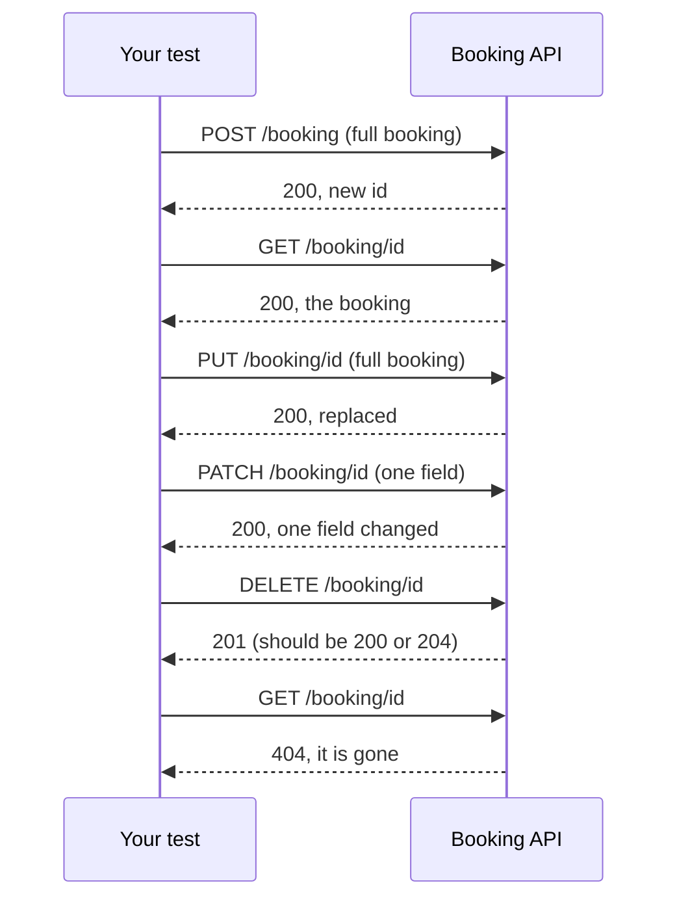

# GET, POST, PUT, PATCH and DELETE: The Five Methods on One Booking

Five HTTP methods do almost all the work in a REST API. **GET** reads, **POST** creates, **PUT** replaces, **PATCH** changes part of something, and **DELETE** removes it. Together they are often called CRUD: create, read, update, delete. This lesson runs all five on one real booking, and shows what to check after each one.

!!! note "Before you start"
    Read [How HTTP works](how-http-works.md) first. The example file is `examples/methods_tour.py`. It needs the internet and Restful-booker's public demo login:

    ```bash
    export BOOKER_USERNAME=admin BOOKER_PASSWORD=password123
    ```

## Why testers need this

Most API bugs hide in updates and deletes, not in reads:

- a PATCH that wipes the fields you didn't send,
- a DELETE that answers "done" but leaves the data,
- a PUT that works without a login,
- a POST that, sent twice after a timeout, makes two orders.

If you know what each method *should* do, you know what to check. A test that only looks at the status code misses all four.

## How it works



*One booking from birth to removal. The last GET is the real proof that the DELETE worked.*

| Method | What it does | Sends a body? | Safe (changes nothing) | Idempotent (same result if repeated) |
| --- | --- | --- | --- | --- |
| GET | Reads | No | Yes | Yes |
| POST | Creates | Yes, the new item | No | No: two POSTs make two bookings |
| PUT | Replaces all of it | Yes, the whole item | No | Yes |
| PATCH | Changes part of it | Yes, only the changed fields | No | Not always |
| DELETE | Removes | Usually no | No | Yes: after the first, it is already gone |

## The code

```python title="examples/methods_tour.py"
--8<-- "modules/core_automation/api_testing/examples/methods_tour.py"
```

From the `examples` folder, run:

```bash
python methods_tour.py
```

```text
POST    200 new booking id: 1226
GET     200 Test 120
PUT     200 totalprice is now 150
PATCH   200 Late checkout 150
DELETE  201 Created
GET     404 Not Found
```

Your booking id will be different.

## Line by line

**Logging in.**

- `os.environ["BOOKER_USERNAME"]` reads the login from the environment, so no password is written in the file.
- `requests.post(f"{BASE}/auth", json=login, ...)` asks for a token. `auth` is a set of headers with `Cookie: token=...`. Restful-booker wants it for PUT, PATCH and DELETE.

**POST creates.**

- `json=booking` sends the dictionary as a JSON body and sets `Content-Type: application/json` for you.
- `created.json()["bookingid"]` is the new id. Check: the id is there, and the saved data equals what you sent.

**GET reads.**

- No body, only the id in the path. Check: the data is what was saved. A GET must never change anything.

**PUT replaces.**

- `{**booking, "totalprice": 150}` copies the whole booking and changes one value. PUT sends *everything*. A field you leave out may be cleared, or the request refused.
- Check: a GET afterwards shows exactly what you sent.

**PATCH changes part.**

- It sends only `{"additionalneeds": "Late checkout"}`. Look at the output: the total is still 150 from the PUT.
- Check: the field you sent changed, **and every other field stayed the same**. That second check is the one people forget.

**DELETE removes.**

- The answer is `201 Created`, which is the wrong status code for a delete. A good API answers `200` or `204`. That is a real bug in this demo API, worth a note in a test report.
- The last GET gives `404 Not Found`. That is the proof the data is gone. Never trust the DELETE answer alone.

## How it is used in a real QA project

- **One CRUD test per resource.** Teams write a test like this tour for each main thing in the API (users, orders, devices). It is the first API test a new project gets. See [the API project](index.md) for one in pytest.
- **Check the other fields after PATCH.** Read the item before and after, and compare the two. Only the fields you sent should differ.
- **Retry rules follow idempotency.** Test clients often retry a GET, PUT or DELETE after a timeout, but never a POST. If a POST must be retried, the API needs a way to spot repeats (often an `Idempotency-Key` header). Ask about it, and test it: send the same POST twice and count the results.
- **Permission tests.** For each method that changes data, send it with no login and with a user who should not be allowed. Expect `401` or `403`, and check the data did not change.
- **Clean up.** A test that creates data deletes it afterwards, even when it fails. The [API project](index.md) does this with a fixture.

## Your task

Change the tour so the PATCH sends `{"totalprice": 99}` instead. What should a GET afterwards show for `additionalneeds`, and why? Add that GET, and print both fields.

??? success "Solution"
    ```python
    patched = requests.patch(
        f"{BASE}/booking/{booking_id}", json={"totalprice": 99}, headers=auth, timeout=15
    )
    after = requests.get(f"{BASE}/booking/{booking_id}", headers=JSON, timeout=15).json()
    print(after["totalprice"], after["additionalneeds"])
    ```

    It should print `99 Breakfast`. PATCH changes only what you send, so `additionalneeds` keeps its value from the POST. The PUT sent `Breakfast` too, because PUT sends the whole booking.

## When it goes wrong

These are real answers from Restful-booker and httpbin, captured November 2026.

**No login on PUT, PATCH or DELETE.**

```text
403 Forbidden
```

The token is missing or wrong. Restful-booker wants `Cookie: token=...`. Other APIs use `Authorization: Bearer ...`. See [authentication](authentication.md).

**The path does not accept that method.**

```text
405 Method Not Allowed
```

httpbin's `/get` gives this to a PATCH. Check the API docs: maybe it is `PATCH`, not `PUT`, or the path is different. Restful-booker also gives `405` for a PATCH or DELETE on a booking that no longer exists, which is confusing. Most APIs answer `404` there.

**`.json()` crashes on a PATCH that worked a minute ago.**

```text
requests.exceptions.JSONDecodeError: Expecting value: line 1 column 1 (char 0)
```

This happened while this page was being written. The public demo wipes its data now and then. The booking vanished in the middle of the run, so the PATCH got `405 Method Not Allowed` as plain text, not JSON. The fix in a test is to check the status first, and to print `response.status_code` and `response.text` when it is wrong. Shared test environments do this; it is a common cause of flaky tests.

**A POST with a missing field.**

```text
500 Internal Server Error
```

Restful-booker answers this to a POST with only `firstname`. A good API answers `400` and says which field is missing. A `500` is a crash on the server: report it as a bug.

**`KeyError: 'bookingid'` right after POST.** The POST failed, so the body has no id. Print the status and the text before reading the body. Better: check the status first, as `check_status` does in [an API client class](api-client-class.md).

**PATCH clears fields you didn't send.** That is a bug: the API treats PATCH like PUT. Report it with the GET before and the GET after.

## References

- [MDN: HTTP request methods](https://developer.mozilla.org/en-US/docs/Web/HTTP/Reference/Methods)
- [RFC 9110: methods, safe and idempotent](https://www.rfc-editor.org/rfc/rfc9110#name-methods)
- [RFC 5789: PATCH](https://www.rfc-editor.org/rfc/rfc5789)
- [Restful-booker API docs](https://restful-booker.herokuapp.com/apidoc/index.html)

Written for Python 3.13 and requests 2.34. Outputs captured November 2026. Links checked: November 2026.
