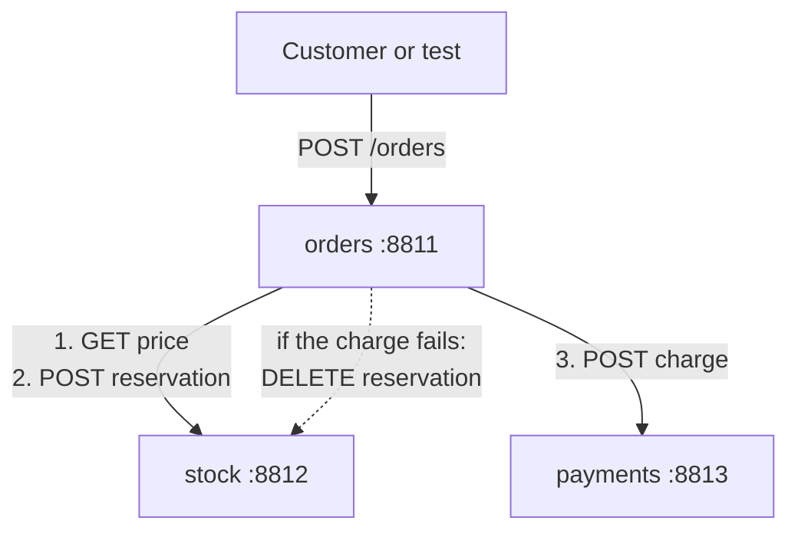

# Testing Microservices: One Service Alone, the Calls Between Them, and Tracing

A **microservice** system is one app split into small programs, each with its own job and its own team: orders, stock, payments. They talk to each other over HTTP. Each team tests its own service, and each service works. The bugs live **between** them: one service is slow, another is down, and nobody planned what happens next. This guide tests those gaps with a practice shop of three services you run on your own computer.

!!! example "The problem"
    **Your lead:** "Last release, payments was slow for ten minutes. Customers saw 'payment failed', which is fine. But the items they tried to buy stayed reserved, and the shop showed 'sold out' for the rest of the day. Every team's tests passed. How do we test what happens between services?"

## Step 1: See what can break between services



*Orders asks stock for the price and keeps the items, then asks payments for the money. If the money doesn't come, orders must give the items back. The dotted line is the step the lead's bug skipped.*

Giving the items back is called a **compensating action**. Inside one database, a failed step undoes everything for you. Across services, nothing does. Someone has to write the "undo" step, and someone has to test it.

| What breaks | Example | The test |
| --- | --- | --- |
| A service is **down** | payments doesn't answer at all | The order fails clearly, and the items go back |
| A service is **slow** | stock takes 3 seconds | Orders gives up after its own timeout, and doesn't hang |
| A service says **no** | the card is declined | The items go back |
| A step **is never undone** | The lead's bug | Check the stock count after every failure |
| An answer **changes shape** | stock renames `price_cents` | [Contract testing](../contract-testing/index.md) |
| Nobody can **follow** a request | Three logs, no link between them | One request id in every service's log |

## Step 2: Start the practice shop

You need **Python 3.13**. Docker is only needed for step 7. Get the files from [Templates](#templates) below, or take the whole folder [from GitHub](https://github.com/myopensdet/myopensdet.github.io/tree/main/modules/advanced_testing/microservices/templates/services_kit). Then:

```bash
python -m venv .venv
source .venv/bin/activate          # Windows: .venv\Scripts\activate
python -m pip install -r requirements.txt
python run_all.py
```

```text
orders    http://127.0.0.1:8811
stock     http://127.0.0.1:8812
payments  http://127.0.0.1:8813
Logs in logs/. Ctrl+C to stop.
```

The services use only Python's standard library. In a second terminal, buy 2 sensors, then try to buy 25 (25 × £24.99 is over the practice limit of £500, so the card is declined):

```bash
curl -i --json '{"sku": "SNS-0042", "qty": 2}' -H "X-Request-ID: demo-0001" http://127.0.0.1:8811/orders
```

```text
HTTP/1.0 201 Created
Server: BaseHTTP/0.6 Python/3.13.18
Date: Tue, 24 Nov 2026 11:09:24 GMT
X-Request-ID: demo-0001
Content-Type: application/json
Content-Length: 58

{"order_id": "o1", "status": "paid", "amount_cents": 4998}
```

```bash
curl --json '{"sku": "SNS-0042", "qty": 25}' -H "X-Request-ID: demo-0002" http://127.0.0.1:8811/orders
curl http://127.0.0.1:8812/stock/SNS-0042
```

```text
{"order_id": "o2", "status": "payment_failed"}
{"sku": "SNS-0042", "available": 38, "price_cents": 2499}
```

The stock started at 40. The paid order took 2, and the declined order took nothing: `38`. That last number is the whole test. The `X-Request-ID` header comes back in the answer: step 5 uses it.

## Step 3: Test one service alone, with fakes

First, test the orders service on its own. Stock and payments are replaced with **fakes**: tiny servers that answer whatever the test says, and keep every call they get. (More ways to do this are in [mocking and stubbing](../mocking-and-stubbing/index.md).)

```python
--8<-- "modules/advanced_testing/microservices/templates/services_kit/tests/test_orders_alone.py"
```

- `stock.answers[("POST", "/reservations")] = (201, {...})` decides what the fake stock answers.
- `payments.calls == [("POST", "/charges", {..., "amount_cents": 4998})]` checks what orders **sent**: 2 × 2499.
- `("DELETE", "/reservations/r7", None) in stock.calls` checks the undo step happened.
- The slow test makes the fake stock wait 2 seconds. Orders is started with `CALL_TIMEOUT=0.5`, so it must give up in about half a second, and never charge the card.

These tests are fast, and they can create any answer, even ones the real services rarely give. But they only prove what orders **does**. They can't prove the real stock service agrees.

## Step 4: Test the conversations, with faults switched on

Now all three real services run together. To test "payments is down" or "stock is slow", each practice service has a test-only switch, `POST /__faults`:

```bash
curl --json '{"down": true}' http://127.0.0.1:8813/__faults
curl -i --json '{"sku": "SNS-0042", "qty": 1}' http://127.0.0.1:8811/orders
```

```text
{"down": true, "delay_ms": 0}
HTTP/1.0 503 Service Unavailable
...
{"order_id": "o3", "status": "payment_failed"}
```

Switch it off again with `curl --json '{}' http://127.0.0.1:8813/__faults`. The tests do it for you:

```python
--8<-- "modules/advanced_testing/microservices/templates/services_kit/tests/test_across_services.py"
```

- `available(system)` asks the **real** stock service. Every failure test reads it before and after.
- The `fault` fixture switches a fault on, and always off again after the test, even when it fails.
- `test_slow_stock_gives_a_503_within_the_timeout`: stock waits 3 seconds, and orders gives up after 2.

**Never put a fault switch in a production build.** On your system, ask the developers for a test-only way to break a service, or use a tool that sits between services and slows or cuts their traffic, like [Toxiproxy](https://github.com/Shopify/toxiproxy). In Docker, you can also stop a container (step 7).

## Step 5: Follow one request through every service

Three services means three logs. To read them as one story, every service does two things:

1. It reads the `X-Request-ID` header (or makes one up), and passes it on in every call it makes.
2. It writes that id on every log line.

`trace_request.py` collects the lines with one id from all the logs, and puts them in time order:

```bash
python trace_request.py demo-0002
```

```text
+   0.0 ms  orders    received     method=POST path=/orders
+   0.3 ms  stock     received     method=GET path=/stock/SNS-0042
+   0.3 ms  stock     answered     path=/stock/SNS-0042 status=200
+   0.4 ms  orders    called       method=GET url=http://127.0.0.1:8812/stock/SNS-0042 status=200 ms=0
+   0.6 ms  stock     received     method=POST path=/reservations
+   0.6 ms  stock     answered     path=/reservations status=201
+   0.7 ms  orders    called       method=POST url=http://127.0.0.1:8812/reservations status=201 ms=0
+   1.0 ms  payments  received     method=POST path=/charges
+   1.1 ms  payments  answered     path=/charges status=402
+   1.2 ms  orders    called       method=POST url=http://127.0.0.1:8813/charges status=402 ms=0
+   1.4 ms  stock     received     method=DELETE path=/reservations/r2
+   1.4 ms  stock     answered     path=/reservations/r2 status=204
+   1.5 ms  orders    called       method=DELETE url=http://127.0.0.1:8812/reservations/r2 status=204 ms=0
+   1.5 ms  orders    answered     path=/orders status=402
```

The whole story of the declined order: price, reservation, a `402` from payments, then the `DELETE` that gives the items back. Now the slow stock (3 seconds, with a 2-second timeout in orders):

```text
+   0.0 ms  orders    received     method=POST path=/orders
+2000.4 ms  orders    call_failed  method=GET url=http://127.0.0.1:8812/stock/SNS-0042 error=timed out
+2000.9 ms  orders    answered     path=/orders status=503
+3002.5 ms  stock     received     method=GET path=/stock/SNS-0042
+3002.7 ms  stock     answered     path=/stock/SNS-0042 status=200
```

Look at the last two lines. Orders gave up at 2 seconds and told the customer. **Stock still did the work at 3 seconds**, and nobody was listening. Here it was only a read. If it had been a reservation, the items would be kept for an order that had already failed. When a service times out, ask: what happens to the work the other side finishes later?

On a real system, tools like Jaeger, Grafana Tempo or Datadog do this for you, using a standard header, `traceparent` (W3C Trace Context). As a tester, you search by the id. Ask your team to **show the id to users on error pages**, and to put it in support tickets. Then any bug report leads straight to its trace.

## Step 6: Run everything, then find the planted bug

```bash
python -m pytest
```

```text
tests/test_across_services.py::test_a_paid_order_takes_the_items_from_stock PASSED [ 12%]
tests/test_across_services.py::test_a_declined_payment_puts_the_items_back PASSED [ 25%]
tests/test_across_services.py::test_payments_down_puts_the_items_back PASSED [ 37%]
tests/test_across_services.py::test_slow_stock_gives_a_503_within_the_timeout PASSED [ 50%]
tests/test_across_services.py::test_one_request_id_reaches_every_service PASSED [ 62%]
tests/test_orders_alone.py::test_a_paid_order_charges_price_times_quantity PASSED [ 75%]
tests/test_orders_alone.py::test_a_declined_payment_gives_the_items_back PASSED [ 87%]
tests/test_orders_alone.py::test_a_slow_stock_service_gets_a_quick_503 PASSED [100%]

============================== 8 passed in 5.93s ===============================
```

The tests start the three services themselves, on fresh logs. Stop `run_all.py` first (++ctrl+c++), or the ports are busy.

Now plant the lead's bug. `ORDERS_BUG=no_release` makes orders skip the undo step:

```bash
ORDERS_BUG=no_release python -m pytest -q
```

```text
E       AssertionError: assert 13 == 38
E       AssertionError: assert 12 == 13
E       AssertionError: assert ('DELETE', '/reservations/r7', None) in [('GET', '/stock/SNS-0042', None), ('POST', '/reservations', {'sku': 'SNS-0042', 'qty': 2})]
FAILED tests/test_across_services.py::test_a_declined_payment_puts_the_items_back
FAILED tests/test_across_services.py::test_payments_down_puts_the_items_back
FAILED tests/test_orders_alone.py::test_a_declined_payment_gives_the_items_back
========================= 3 failed, 5 passed in 6.44s ==========================
```

Both levels catch it, and each says it differently:

| Failure | Says |
| --- | --- |
| `assert 13 == 38` | The real stock lost 25 items after a declined payment. **What** went wrong, as the customer sees it |
| `assert 12 == 13` | The same when payments was down |
| `('DELETE', ...) in [...]` | Orders never called `DELETE`. **Why** it went wrong: the list shows every call it did make |

## Step 7: Run the services in Docker Compose

A real test environment runs each service in its own container. `docker-compose.yml` does that with the same code:

```yaml
--8<-- "modules/advanced_testing/microservices/templates/services_kit/docker-compose.yml"
```

- `name: zts-services` keeps these containers apart from anything else you run in Docker.
- `healthcheck` plus `depends_on: condition: service_healthy` start orders only after stock and payments answer `/health`.
- `--wait` makes `docker compose up` return only when all three are healthy.

```bash
docker compose up -d --wait
ORDERS_URL=http://127.0.0.1:8811 python -m pytest tests/test_across_services.py
```

```text
tests/test_across_services.py::test_a_paid_order_takes_the_items_from_stock PASSED [ 20%]
tests/test_across_services.py::test_a_declined_payment_puts_the_items_back PASSED [ 40%]
tests/test_across_services.py::test_payments_down_puts_the_items_back PASSED [ 60%]
tests/test_across_services.py::test_slow_stock_gives_a_503_within_the_timeout PASSED [ 80%]
tests/test_across_services.py::test_one_request_id_reaches_every_service PASSED [100%]

============================== 5 passed in 2.68s ===============================
```

The same 5 tests, now across containers. `ORDERS_URL` tells `conftest.py` not to start its own services. The trace now reads the containers' logs:

```bash
docker compose logs --no-log-prefix | python trace_request.py demo-0005 -
```

Now a harder failure: stop the payments container completely.

```bash
docker compose stop payments
curl --json '{"sku": "SNS-0042", "qty": 1}' -H "X-Request-ID: demo-0006" http://127.0.0.1:8811/orders
docker compose logs --no-log-prefix orders | python trace_request.py demo-0006 -
```

```text
{"order_id": "o6", "status": "payment_failed"}
+   0.0 ms  orders    received     method=POST path=/orders
+   1.1 ms  orders    called       method=GET url=http://stock:8812/stock/SNS-0042 status=200 ms=1
+   2.0 ms  orders    called       method=POST url=http://stock:8812/reservations status=201 ms=1
+ 234.1 ms  orders    call_failed  method=POST url=http://payments:8813/charges error=[Errno -2] Name or service not known
+ 236.2 ms  orders    called       method=DELETE url=http://stock:8812/reservations/r4 status=204 ms=2
+ 236.3 ms  orders    answered     path=/orders status=503
```

A stopped container doesn't just refuse calls: its name disappears, so `payments` can't even be found. Orders still gave the items back. When you're done: `docker compose down`. The first `up` downloads the `python:3.13-slim-bookworm` image (about 200 MB on disk) if you don't have it.

## Step 8: Use it on your own system

1. **Draw the calls first.** For one user action, ask the developers which services it touches, in which order, and what each one changes. Mark every step that changes data. Each one needs an "undo" when a later step fails.
2. **Test at the right level.**

    | Level | Runs | Catches | How many |
    | --- | --- | --- | --- |
    | One service alone, with fakes | One service | Its own decisions, every error path | Many |
    | Contract tests | One service at a time | Answers that changed shape | One per pair of services ([contract testing](../contract-testing/index.md)) |
    | Across services | Several real services | Lost undo steps, timeouts, request ids | Some: one per failure that matters |
    | End to end, through the UI | Everything | That the whole path works | Few: they are slow and break easily |

3. **Ask for three things that make testing possible:** a `/health` address on every service, a request id passed on and logged everywhere, and a test-only way to make a service slow or down.
4. **Check the state, not only the answer.** After every failure test, read the stock, the balance, the order status, from the service that owns it.
5. **Pick the environment.** A shared test environment is closest to production, but other people's tests change the data under yours. A Compose file per test run gives you fresh data every time. Many teams use both.

## Step 9: When it goes wrong

| You see | What it means | Fix |
| --- | --- | --- |
| `RuntimeError: Port 8811 for orders is already in use. Stop the old run first (Ctrl+C in its terminal), or find it with: lsof -i :8811` | An old `run_all.py` is still running, or the Compose services are up | Stop it first. Without this check, the tests would quietly talk to the old services, with old data |
| `error=[Errno -2] Name or service not known` in a trace | A service name can't be found: the container is stopped, or the name is wrong | `docker compose ps`, then check the `*_URL` settings |
| `{"error": "a service is unavailable: GET http://127.0.0.1:8812/stock/SNS-0042: timed out"}` | A service didn't answer within orders' timeout | Is it slow, or is a fault switched on? `curl --json '{}' http://127.0.0.1:8812/__faults` |
| `No log lines with request id demo-0001` | Wrong id, or the logs are from another run (each run starts fresh logs) | Copy the id from the answer's `X-Request-ID` header. For Docker, pipe `docker compose logs` in with `-` |
| `assert 13 == 38` after a declined payment | A step that changed data was never undone | Trace that request: is the `DELETE` there? Report it to the team that owns the calling service |
| A failure test passes alone, but fails in the full run | A fault was left on by an earlier test, or two tests share the same data | Switch faults off in a fixture's teardown, like `fault` does. Read the count before **and** after |
| `curl: (7) Failed to connect to 127.0.0.1 port 8811 after 0 ms: Couldn't connect to server` | Nothing is running | Start `python run_all.py`, or `docker compose up -d --wait` |

## Templates

**Every file is below, ready to copy.** The whole folder is also [on GitHub](https://github.com/myopensdet/myopensdet.github.io/tree/main/modules/advanced_testing/microservices/templates/services_kit).

=== "services/orders.py"

    ```python
    --8<-- "modules/advanced_testing/microservices/templates/services_kit/services/orders.py"
    ```

=== "services/stock.py"

    ```python
    --8<-- "modules/advanced_testing/microservices/templates/services_kit/services/stock.py"
    ```

=== "services/payments.py"

    ```python
    --8<-- "modules/advanced_testing/microservices/templates/services_kit/services/payments.py"
    ```

=== "services/common.py"

    ```python
    --8<-- "modules/advanced_testing/microservices/templates/services_kit/services/common.py"
    ```

=== "run_all.py"

    ```python
    --8<-- "modules/advanced_testing/microservices/templates/services_kit/run_all.py"
    ```

=== "trace_request.py"

    ```python
    --8<-- "modules/advanced_testing/microservices/templates/services_kit/trace_request.py"
    ```

=== "tests/conftest.py"

    ```python
    --8<-- "modules/advanced_testing/microservices/templates/services_kit/tests/conftest.py"
    ```

=== "pytest.ini"

    ```ini
    --8<-- "modules/advanced_testing/microservices/templates/services_kit/pytest.ini"
    ```

=== "requirements.txt"

    ```text
    --8<-- "modules/advanced_testing/microservices/templates/services_kit/requirements.txt"
    ```

## References

- [Martin Fowler: testing strategies in a microservice architecture](https://martinfowler.com/articles/microservice-testing/)
- [microservices.io: the saga pattern (undo steps across services)](https://microservices.io/patterns/data/saga.html)
- [Docker: control startup order in Compose](https://docs.docker.com/compose/how-tos/startup-order/)
- [OpenTelemetry: traces](https://opentelemetry.io/docs/concepts/signals/traces/)
- [W3C: Trace Context](https://www.w3.org/TR/trace-context/)
- [Toxiproxy: simulate network problems](https://github.com/Shopify/toxiproxy)

Written for Python 3.13, pytest 9.2 and Docker Compose 5.6. Outputs captured November 2026. Links checked: November 2026.
