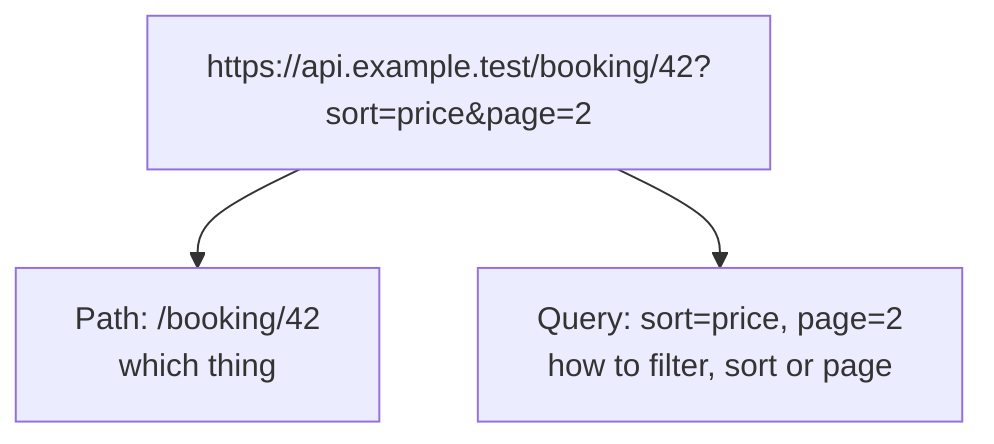

# Query and Path Parameters: ?page=2 and /booking/42

There are two ways to put values in a URL. A **path parameter** is part of the path, and usually names one thing: `/booking/42` is booking 42. A **query parameter** comes after `?`, and usually filters, sorts or pages: `/booking?firstname=Test&page=2`. Both are inputs. Like every input, they deserve boundary and negative tests.

!!! note "Before you start"
    Read [How HTTP works](how-http-works.md) first. The example file is `examples/params.py`. It needs the internet.

## Why testers need this

Parameters are where APIs meet user input, and they break in the same places again and again:

- an id of `0`, `-1` or `abc`,
- a search for `&`, `#` or `%`,
- a name in Bengali,
- a filter name with a typo, which the API quietly ignores.

And an id in the path is where access bugs live. Can you read booking 43 if it isn't yours? That is the number one API security risk.

## How it works



*The path picks one thing. The query, after `?`, shapes the answer. Pairs are joined with `&`.*

| | Path parameter | Query parameter |
| --- | --- | --- |
| Looks like | `/booking/42` | `?firstname=Test&page=2` |
| Used for | One item: an id, a name | Filters, sorting, paging, options |
| If missing | A different endpoint, or 404 | Usually a default: all items, page 1 |
| In `requests` | Put it in the f-string | Pass `params={...}` |

## The code

```python title="examples/params.py"
--8<-- "modules/core_automation/api_testing/examples/params.py"
```

From the `examples` folder, run:

```bash
python params.py
```

```text
URL sent: https://httpbin.org/get?q=%E0%A6%AC%E0%A6%87&sort=price&page=2
Server read: {'page': '2', 'q': 'বই', 'sort': 'price'}
/booking/<id>: an id from the list -> 200
/booking/<id>: 999999999 -> 404
```

## Line by line

**Query parameters.**

- `params={"q": "বই", "sort": "price", "page": 2}` is a dictionary. `requests` builds `?q=...&sort=price&page=2` from it.
- The Bengali word "বই" became `%E0%A6%AC%E0%A6%87`. Those are its UTF-8 bytes, written as `%` codes. This is called **URL encoding**. The server decoded it back, as the second line shows.
- `response.url` shows the URL that was really sent. Print it whenever a filter seems not to work.
- Everything in a URL is text, so the server read `page` as `'2'`, not `2`.

**Path parameters.**

- `requests.get(f"{BASE}/booking", ...).json()[0]["bookingid"]` takes a real id from the list. The example does not use a fixed id like `1`, because someone else could delete it.
- `f"{BASE}/booking/{booking_id}"` puts the id in the path.
- The real id gives `200`. A made-up id gives `404`, which is the right answer.

## How it is used in a real QA project

**Test path parameters with a table.** For an id:

| Case | Expect |
| --- | --- |
| An id that exists | 200 and the right data |
| An id that doesn't exist | 404 |
| `0`, `-1`, a very big number | 404 or 400, never 500 |
| Text, like `abc`, or `1.5` | 400 or 404, never 500, never another item |
| Someone else's id | 403 or 404, never their data |

The last row matters most. It is called broken object level authorization, and it is number one in [the OWASP API Top 10 (API1:2023)](https://owasp.org/API-Security/editions/2023/en/0xa1-broken-object-level-authorization/). Log in as user A, create something, then ask for it as user B.

**Test query parameters with a checklist.**

- **Filters:** one match, no matches, special characters (`%`, `'`, `&`, `#`), and Bengali text.
- **Paging:** page 1, the last page, one past the last, `0` and `-1`, a page size of `0` and a huge one.
- **Sorting:** each allowed field, both directions, and a field that is not allowed.
- **Unknown names:** a typo like `?frstname=Test` must not quietly return everything.

**Always check what the server did.** A filter that is ignored looks exactly like a filter that matches everything. Use a value that should match nothing, and expect an empty list.

**Use your own data.** Create the item in the test, and use its id. Then the test does not break when shared data changes.

## Your task

Call `https://httpbin.org/get` with `params={"name": "Test & Co", "tag": ["a", "b"]}`. Print `response.url` and `response.json()["args"]`. What did `requests` do with the `&` and the list?

??? success "Solution"
    ```python
    import requests

    response = requests.get(
        "https://httpbin.org/get", params={"name": "Test & Co", "tag": ["a", "b"]}, timeout=15
    )
    print(response.url, response.json()["args"])
    ```

    ```text
    https://httpbin.org/get?name=Test+%26+Co&tag=a&tag=b {'name': 'Test & Co', 'tag': ['a', 'b']}
    ```

    The `&` inside the value became `%26`, and the spaces became `+`, so it is not read as a new parameter. The list became the same name twice, `tag=a&tag=b`, which is how many APIs read a list in a query. The server read it all back correctly.

## When it goes wrong

These are real answers, captured November 2026.

**A query built by hand splits in two.**

```text
by hand: https://httpbin.org/get?name=Test%20&%20Co&page=2 {' Co': '', 'name': 'Test ', 'page': '2'}
```

The URL was written as `"...?name=Test & Co&page=2"`. The `&` inside the name started a new parameter, so the server got `name='Test '` and a strange `' Co'`. Use `params=`; it encodes the `&` for you.

**A `#` cuts the URL short.**

```text
hash: https://httpbin.org/get?q=C#&page=2 {'q': 'C'}
```

A search for `C#`, built by hand. Everything after `#` is never sent to the server, so it saw only `q=C`, and no `page`. `params=` sends `#` as `%23`.

**A typo in a filter name returns everything.**

```text
all: 328 firstname=Test: 0 typo frstname=Test: 331 no match: 0
```

Restful-booker ignores names it does not know, so `?frstname=Test` gave every booking. (The count went up while the test ran: other people were creating bookings.) A test that only checks "the list is not empty" would pass. Check that the results really match the filter.

**A bad id returns a real item.**

```text
1.5 200 OK
```

Restful-booker reads only the digits at the start of the id, so `/booking/1.5` and `/booking/1abc` both return booking 1. A good API answers `400` or `404`. This kind of bug can show one person's data to another. Report it.

**The base URL is empty or broken.**

```text
requests.exceptions.InvalidURL: Invalid URL 'https:///booking/1': No host supplied
```

The host part is missing, often because an environment variable like `BASE_URL` is empty. Print the URL before you send it, and check the setting.

**`404` for an id you just created.** Check the path: a missing `/`, or spaces or quotes around the id from a copy. Print `response.url`.

**Results come back in a different order each time.** Without a sort parameter, the order is not promised. Sort the results in the test, or ask the API to sort.

## References

- [Requests: passing parameters in URLs](https://requests.readthedocs.io/en/latest/user/quickstart/#passing-parameters-in-urls)
- [MDN: URL query](https://developer.mozilla.org/en-US/docs/Web/URI/Reference/Query)
- [MDN: percent-encoding](https://developer.mozilla.org/en-US/docs/Glossary/Percent-encoding)
- [OWASP API1:2023 Broken Object Level Authorization](https://owasp.org/API-Security/editions/2023/en/0xa1-broken-object-level-authorization/)

Written for Python 3.13 and requests 2.34. Outputs captured November 2026. Links checked: November 2026.
