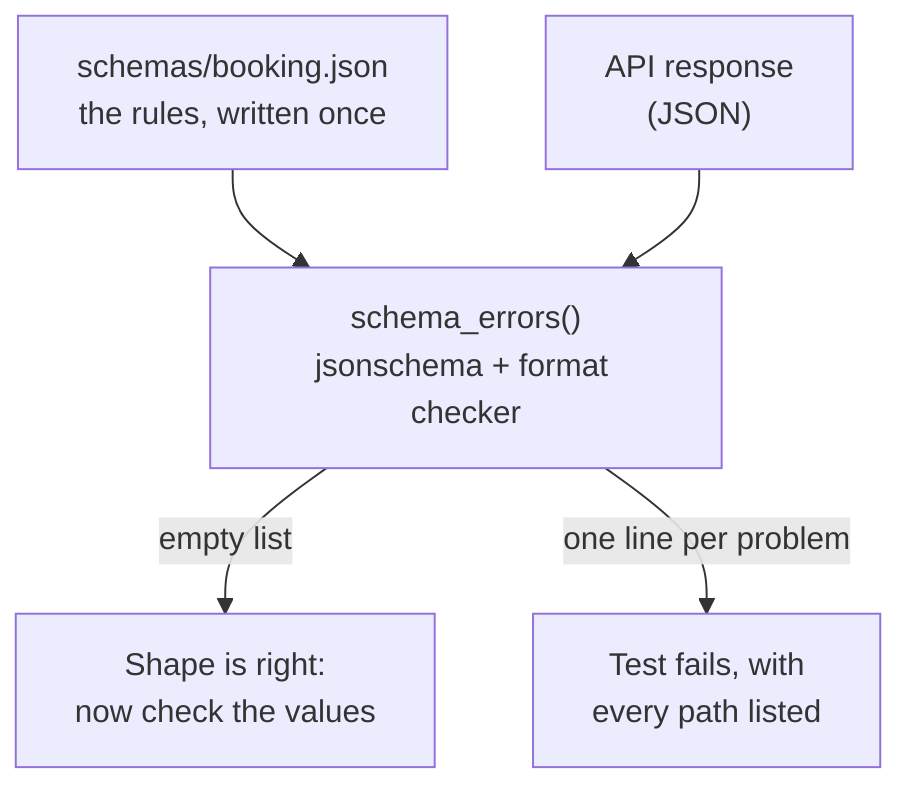

# Schema Validation: Check the Shape of Every Response

Checking one or two values is not enough. A response can have the right `firstname` and still be broken: a price sent as text, a date in the wrong format, a missing field, or a new field that leaks data. A **JSON Schema** describes the shape a response must have. The `jsonschema` library checks it in one line, and can list every problem with its path.

!!! note "Before you start"
    Read [Headers and JSON](headers-and-json.md) first. The example file is `examples/schema_demo.py`. It uses the schema helper from this topic's template project, needs the internet, and needs Restful-booker's public demo login to clean up:

    ```bash
    export BOOKER_USERNAME=admin BOOKER_PASSWORD=password123
    ```

## Why testers need this

Web and mobile apps break when a field changes type or goes missing. This often happens in a release that nobody thought touched the API. A schema check in every API test catches it the first time it happens:

- `totalprice` arrives as `"120"`, not `120`,
- `checkout` is gone from a booking,
- a date comes back as `01/12/2026`,
- a new field appears, like `passwordHash` in a user response.

The last one is a security bug. `additionalProperties: false` catches it.

## How it works



*The schema is written once and used by every test. A failure lists all the problems at once, not only the first.*

The template's `schemas/booking.json`:

```json title="templates/booker_api_tests/schemas/booking.json"
--8<-- "modules/core_automation/api_testing/templates/booker_api_tests/schemas/booking.json"
```

| Rule | Means |
| --- | --- |
| `"type": "object"` | The body must be a JSON object. Others: `string`, `integer`, `number`, `boolean`, `array`, `null` |
| `required` | These fields must be there |
| `additionalProperties: false` | No field the schema doesn't name |
| `minLength`, `minimum` | Not empty; not below 0 |
| `"format": "date"` | The text must be a real date, like `2026-12-01` |

## The code

```python title="examples/schema_demo.py"
--8<-- "modules/core_automation/api_testing/examples/schema_demo.py"
```

From the `examples` folder, run:

```bash
python schema_demo.py
```

```text
Real booking: matches the schema
Broken copy:
- $.bookingdates.checkin: '2026-13-01' is not a 'date'
- $.bookingdates: 'checkout' is a required property
- $.totalprice: '120' is not of type 'integer'
- $: Additional properties are not allowed ('discount' was unexpected)
```

## Line by line

**Getting the helper.**

- `sys.path.insert(0, ...)` lets the example import from the template project next to it. In your own project, the helper is simply part of the code.
- `load_schema("booking.json")` reads the schema file into a dictionary.

**Checking a real booking.**

- The example creates its own booking, so other people's data can't change the result.
- `schema_errors(booking, schema)` returns a list of problems. An empty list means the shape is right, so `or "matches the schema"` prints the message.

**Checking a broken copy.**

- `{**booking, "totalprice": "120", ...}` copies the real booking and breaks four things on purpose: a text price, an impossible date, a missing `checkout`, and an extra `discount` field.
- Each problem is printed with its **path**. `$` is the whole body, and `$.bookingdates.checkin` is a field inside a field.

**Inside `schema_errors()`** (in `api/schema.py`):

- `Draft202012Validator(schema, ...)` makes a checker for this schema version.
- `format_checker=Draft202012Validator.FORMAT_CHECKER` turns on format checks. They are **off by default**: without this, `'2026-13-01'` passes, because it is a string.
- `registry=_registry()` loads every schema in the folder, so one schema can point to another.
- `validator.iter_errors(data)` finds *every* problem. `sorted(...)` keeps them in the same order on every run, so failures are easy to compare.

**Clean up.** The last lines log in and delete the booking, so the demo leaves nothing behind.

## How it is used in a real QA project

**One line in every API test, after the status check.**

```python
assert response.status_code == 200
assert_matches_schema(response.json(), load_schema("booking.json"))
assert response.json()["firstname"] == "Test"
```

The schema checks the shape. Your asserts check the meaning. The [API project](index.md) does this for every GET, POST, PUT and PATCH.

**Reuse schemas with `$ref`.** The create answer wraps a booking: `{"bookingid": 1, "booking": {...}}`. Instead of copying the booking rules, `created_booking.json` points to them:

```json title="templates/booker_api_tests/schemas/created_booking.json"
--8<-- "modules/core_automation/api_testing/templates/booker_api_tests/schemas/created_booking.json"
```

`"$ref": "booking.json"` works because `_registry()` loads each schema by its `$id`.

**Use the team's OpenAPI file if there is one.** Its `components/schemas` section already holds JSON Schemas. Reuse them instead of writing your own, and the tests follow the API's real contract. See [contract testing](contract-testing/index.md).

**Know what schemas don't catch.** A schema can't tell you the price is *right*, that checkout is after check-in, or that you got *your* booking. Those need asserts. The schema is a safety net under them.

## Your task

Add a rule to `booking.json` so `firstname` can be at most 50 characters. Then check a booking with `"firstname": "A" * 51` using `schema_errors()`. What does the problem line say?

??? success "Solution"
    Change the field to:

    ```json
    "firstname": {"type": "string", "minLength": 1, "maxLength": 50},
    ```

    The check then reports:

    ```text
    $.firstname: 'AAAAAAAAAAAAAAAAAAAAAAAAAAAAAAAAAAAAAAAAAAAAAAAAAAA' is too long
    ```

    The path comes first, so you know which field. Before you add a limit, ask the API team for the real one: the schema should match what the API promises, not a guess.

## When it goes wrong

These are real messages from jsonschema 4.26.

**A `$ref` points to a schema the checker doesn't know.**

```text
jsonschema.exceptions._WrappedReferencingError: Unresolvable: booking.json
```

`created_booking.json` uses `"$ref": "booking.json"`, but the checker was made without a registry. Pass a registry with every schema in it, like the template's `_registry()`, or use `schema_errors()`.

**Only one problem is reported, when there are more.**

```text
validate(): ValidationError: Additional properties are not allowed ('discount' was unexpected)
```

`jsonschema.validate()` stops at the first problem. Here it missed the text price in the same body. Use `iter_errors()`, as `schema_errors()` does, to see them all.

**A wrong date passes.**

```text
format off: []
format on: ["$.bookingdates.checkin: '2026-13-01' is not a 'date'"]
```

The same impossible date, checked twice. Without a format checker, there are no problems. Pass `format_checker=`.

**An empty body passes.**

```text
loose, empty object: []
```

A schema with no `required` list accepts `{}`. List the fields that must be there.

**Every response fails with "Additional properties are not allowed".** The API sends fields the schema doesn't name. Ask whether they are meant to be there. If they are, add them to the schema. If they hold private data, report it: that is [OWASP API3:2023](https://owasp.org/API-Security/editions/2023/en/0xa3-broken-object-property-level-authorization/).

**The schema passes, but the app still breaks.** The schema is too loose: a field is not `required`, or a type is `["string", "null"]` when null isn't allowed. Tighten it.

## References

- [JSON Schema: getting started](https://json-schema.org/learn/getting-started-step-by-step)
- [JSON Schema: reference](https://json-schema.org/understanding-json-schema/reference)
- [python-jsonschema documentation](https://python-jsonschema.readthedocs.io/en/stable/)
- [python-jsonschema: validating formats](https://python-jsonschema.readthedocs.io/en/stable/validate/#validating-formats)
- [OWASP API3:2023 Broken Object Property Level Authorization](https://owasp.org/API-Security/editions/2023/en/0xa3-broken-object-property-level-authorization/)

Written for Python 3.13 and jsonschema 4.26. Outputs captured November 2026. Links checked: November 2026.
