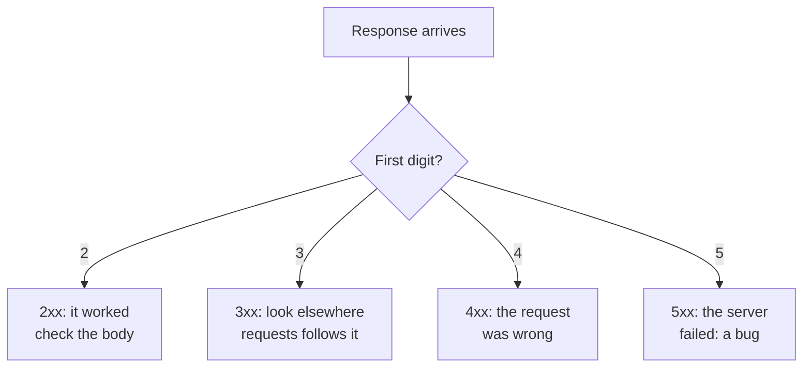

# Status Codes: What 200, 201, 404 and 500 Mean, and What APIs Get Wrong

The **status code** is the first thing to check in every response. It is a three-digit number, and its first digit says the group: 2xx it worked, 4xx the request was wrong, 5xx the server broke. Apps, browsers and monitoring all decide what to do from this number. So a wrong code is a real bug, even when the body looks fine.

!!! note "Before you start"
    Read [How HTTP works](how-http-works.md) first. The example file is `examples/status_codes.py`. It needs the internet.

## Why testers need this

A mobile app decides what to show from the status code:

- `503`: "Try again in a minute."
- `401`: "Please log in."
- `404`: "This booking no longer exists."

If the API answers `200` with an error inside the body, or `500` for a missing field, the app shows the wrong screen. Developers usually test the happy path, where the code is `200`. Testers are often the only ones who check the codes for everything else.

## How it works



*The first digit tells you whose problem it is: 4xx is the caller's, 5xx is the server's.*

| Group | Means | You'll see |
| --- | --- | --- |
| 1xx | Still working | Rarely, in tests |
| 2xx | It worked | 200 OK, 201 Created, 204 No Content |
| 3xx | Look somewhere else | 301, 302, 304 (redirects and caching) |
| 4xx | The request was wrong | 400, 401, 403, 404, 409, 422, 429 |
| 5xx | The server failed | 500, 502, 503, 504 |

## The code

```python title="examples/status_codes.py"
--8<-- "modules/core_automation/api_testing/examples/status_codes.py"
```

From the `examples` folder, run:

```bash
python status_codes.py
```

```text
200 OK                     ok
201 Created                ok
204 No Content             ok
400 Bad Request            not ok
401 Unauthorized           not ok
403 Forbidden              not ok
404 Not Found              not ok
500 Internal Server Error  not ok
503 Service Unavailable    not ok
HTTPError: 404 Client Error: Not Found for url: https://httpbin.org/status/404
```

`https://httpbin.org/status/404` answers with whatever code you put in the path. It is a handy way to see how your code reacts to each one.

## Line by line

- `for code in [200, 201, ...]` asks httpbin for each code in turn.
- `response.status_code` is the number, and `response.reason` is the short text after it, like `Not Found`.
- `f"{response.reason:<22}"` pads the text to 22 letters, so the last column lines up.
- `response.ok` is `True` below 400 and `False` from 400 up. Notice that `204` and `201` are "ok" too. `ok` is a rough check; a test checks the exact code.
- **No error was raised for 404 or 500.** To `requests`, a 404 is a normal answer: the server replied. It hands you the response and lets you decide. Tests need that: a test for "an unknown id gives 404" must be able to see the 404.
- `response.raise_for_status()` turns a 4xx or 5xx into an `HTTPError`. The last output line shows its message. Use it in helper code where any error should stop everything, like logging in. Don't use it in a test that expects a 4xx.

## How it is used in a real QA project

**Test for the exact code.** `assert response.status_code == 404` is a real check. `assert response.status_code != 500` is not: it passes for `200`, `403` and `418` too.

**Plan a test for each 4xx case.** These are the codes that matter most:

| Code | Means | Test it with |
| --- | --- | --- |
| 400 Bad Request | The request is malformed or invalid | A missing field, a wrong type |
| 401 Unauthorized | Not logged in, or the login is invalid | No token, an expired token |
| 403 Forbidden | Logged in, but not allowed | Another user's booking |
| 404 Not Found | It doesn't exist | An unknown id, a deleted booking |
| 409 Conflict | It clashes with what is there | The same email twice |
| 422 Unprocessable Content | Valid JSON, but the values break a rule | Checkout before checkin |
| 429 Too Many Requests | Slow down | Many requests very fast |

401 versus 403 is a common mix-up. 401 means "who are you?". 403 means "I know who you are, and no".

**Report wrong codes.** Restful-booker gets several wrong, which makes it good practice:

| Case | Restful-booker answers | Should be |
| --- | --- | --- |
| Create a booking | 200 | 201 Created |
| Delete a booking | 201 Created | 204 No Content, or 200 |
| Wrong password on `/auth` | 200 with `{"reason": "Bad credentials"}` | 401 |
| A required field missing | 500 | 400, saying which field |
| PATCH a booking that is gone | 405 | 404 |

When you find one, keep the right expectation in a test marked `xfail`, with the bug's reason. The [API project](index.md) does this. Then file the bug with the request and the response. Never quietly change a test to match a wrong answer: then nobody fixes it.

**Watch for 5xx in every run.** Some teams add one check to their API client: any 5xx fails the test at once, whatever the test expected. A 500 is never the right answer.

## Your task

Write a pytest test that checks a wrong password gets a `401` from Restful-booker's `/auth`. Run it. What happens, and what should you do next?

??? success "Solution"
    ```python
    import requests


    def test_wrong_password_is_401():
        response = requests.post(
            "https://restful-booker.herokuapp.com/auth",
            json={"username": "admin", "password": "wrong"},
            timeout=15,
        )
        assert response.status_code == 401
    ```

    ```text
    E       assert 200 == 401
    E        +  where 200 = <Response [200]>.status_code
    1 failed in 0.63s
    ```

    The test is right, and the API is wrong. Mark it with `@pytest.mark.xfail(reason="BUG: /auth answers 200 for a wrong password")`, and file a bug with the request and the response body `{"reason":"Bad credentials"}`.

## When it goes wrong

These are real answers, captured November 2026.

**`raise_for_status()` stops a test that expects a 4xx.**

```text
requests.exceptions.HTTPError: 404 Client Error: Not Found for url: https://httpbin.org/status/404
```

Something called `raise_for_status()` on a 404. In a test that expects 404, don't call it. Check `response.status_code` instead.

**Everything answers 200, even errors.**

```text
200 {"reason":"Bad credentials"}
```

This is Restful-booker's answer to a wrong password. The error is only in the body. Check the body too, and report it: apps can't rely on such an API.

**You expected a redirect, but got 200.**

```text
redirect: 200 [302] https://httpbin.org/get
no follow: 302 /get
```

`requests` follows redirects by default. The first line is `https://httpbin.org/redirect/1`: the final answer is 200, and `response.history` holds the 302 it followed. To test the redirect itself, pass `allow_redirects=False`. Then you see the 302, and its `Location` header.

**You expect 404 but get 401.** Many APIs check the login before anything else. Send a valid login, then test for 404.

**You get 429 Too Many Requests.** You are sending too fast, often from a test loop. Slow down, read the `Retry-After` header if there is one, or ask for a higher limit on the test environment.

## References

- [MDN: HTTP response status codes](https://developer.mozilla.org/en-US/docs/Web/HTTP/Reference/Status)
- [RFC 9110: status codes](https://www.rfc-editor.org/rfc/rfc9110#name-status-codes)
- [Requests: response status codes](https://requests.readthedocs.io/en/latest/user/quickstart/#response-status-codes)
- [Requests: redirection and history](https://requests.readthedocs.io/en/latest/user/quickstart/#redirection-and-history)

Written for Python 3.13 and requests 2.34. Outputs captured November 2026. Links checked: November 2026.
