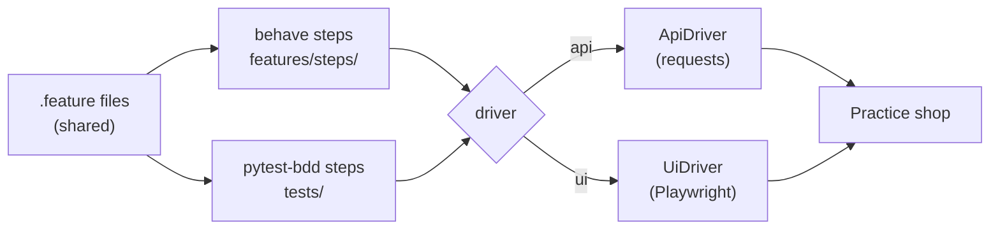

# BDD Testing in Python With behave and pytest-bdd

BDD turns agreed examples into tests: "Given an empty cart, when I add 2 copies of Python for Testers and apply SAVE10, then the total is 44.98." This topic sets it up from nothing, with **behave and pytest-bdd side by side, running the same feature files**, through an API and through a web page. It also covers the part tools can't do: writing the scenarios together with the business.

!!! info "In plain words"
    The product owner, a developer and a tester agree on short stories of how the shop should behave. The stories are written so that a computer can check them, every day, and anyone can still read them.

!!! example "Your task"
    Your manager says: "We're adding BDD. The product owner wants to read the tests. Some teams here use behave, some use pytest. Set it up so it works for both, and checks the API and the web page." This page walks through it, with a small practice shop that starts by itself.

!!! note "Before you start"
    Read [pytest framework](../pytest/index.md) and [API testing](../../api-testing/index.md). In a virtual environment, from the [template project](#templates): `python -m pip install -r requirements.txt`, then once per computer `python -m playwright install chromium` for the web page runs. No other setup: the tests start the practice shop on a free port of your computer.

## Jump to what you need

1. [What is BDD](what-is-bdd.md): BDD, TDD and ATDD, and when BDD is worth it
2. [Gherkin and feature files](gherkin-and-feature-files.md): Given, When, Then, about behaviour, not clicks
3. [Step definitions](step-definitions.md): connect steps to Python, in both tools
4. [Scenario outlines](scenario-outlines.md): one scenario, many rows
5. [Tags and hooks](tags-and-hooks.md): choose what runs; set up and clean up; known bugs
6. [BDD for API and UI](bdd-for-api-and-ui.md): the same scenarios through requests and Playwright
7. [Writing scenarios with the business](writing-scenarios-with-the-business.md): Three Amigos and example mapping

## 1. Understand the ask

| You ask | Your manager answers |
| --- | --- |
| Who will read the scenarios? | The product owner, and new people learning the rules |
| behave or pytest-bdd? | Both are in use here. Same feature files for both |
| API, web page, or both? | Both. The API on every change, the page before release |
| Where does it run? | Locally, and later in the pipeline |
| What about known bugs? | Keep the scenario, mark it, and see when it's fixed |

## 2. Picture the system



One set of feature files. Each tool has its own small set of steps. Both call the same drivers, so the target (API or web page) is a command-line choice.

## 3. Learn just enough

Read [what is BDD](what-is-bdd.md) (10 minutes) and [Gherkin and feature files](gherkin-and-feature-files.md). Most BDD suites that fail, fail in the feature files: too many clicks, too little behaviour.

## 4. Get something running

From the template project folder:

=== "behave"

    ```bash
    behave --format=progress
    ```

    ```text
    USING RUNNER: behave.runner:Runner
    features/cart.feature  ......
    features/coupons.feature  ..

    2 features passed, 0 failed, 0 skipped
    8 scenarios passed, 0 failed, 1 skipped
    30 steps passed, 0 failed, 6 skipped
    ```

=== "pytest-bdd"

    ```bash
    python -m pytest
    ```

    ```text
    =========================== short test summary info ============================
    XFAIL tests/test_shop.py::test_a_coupon_works_only_once - Known bug: see the scenario's description
    8 passed, 1 xfailed in 0.48s
    ```

Add `-D target=ui` (behave) or `--target=ui` (pytest-bdd) to run the same scenarios through Chromium. The one scenario that doesn't pass is the bug planted in the practice shop: a coupon can be applied twice.

## 5. Decide what to put in

| Put in a feature file | Keep in plain pytest |
| --- | --- |
| Rules the business cares about: prices, limits, permissions | Edge cases only engineers care about |
| Examples agreed with the product owner | Unit tests of single functions |
| One scenario per behaviour, a few lines each | Long journeys and timing checks |
| `@smoke` on the few scenarios that must always work | Hundreds of data rows (use [data-driven testing](../data-driven/index.md)) |

## 6. Write a one-page plan

Which features get scenarios first (start with one, with money or rules in it), who joins the Three Amigos session, which tool or tools, which targets, the tags you'll use and what each means, and how known bugs are marked. The [template project](#templates) is that plan as code for one shop.

## 7. Build in small steps

Write one feature file with two scenarios. Make them pass on the API in one tool. Then add the other tool's steps, then the UI driver, then tags and hooks. Keep every step to a line or two. Run both tools after each step.

## 8. Check it with your team

Before anything else: send the feature files to the product owner and ask "Is each one right? What's missing?" Show developers the drivers: they'll know when the API or page changes. Agree that a rule change means a scenario change, in the same review.

## 9. Keep learning on your own

Next, [UI automation](../playwright/index.md) goes deep into Playwright: locators, waiting, page objects. For reports the business can read, see [reporting and logging](../reports-and-logs/index.md).

!!! tip "How an experienced SDET thinks about this"
    - BDD is the conversation. The tool is the last step.
    - Scenarios describe behaviour. Clicks live in the driver.
    - One feature file, many ways in: API for speed, the page for truth.
    - A known bug stays visible until it's fixed.
    - If nobody outside engineering reads the scenarios, question whether you need BDD.

!!! warning "Red flags"
    - Scenarios that start with "I open the URL" and click through every field.
    - Separate feature files for the API and the UI that say the same thing.
    - Hundreds of step definitions, many almost the same.
    - Scenarios written after release, by testers alone.
    - A failing scenario deleted instead of tagged.

!!! question "Stuck? Try this"
    - **A step "is not found".** Compare the step text with the pattern, word for word, and check the keyword (`Given` or `When`).
    - **behave: `No steps directory`.** Run it from the folder that holds `features/`.
    - **The UI run fails, the API run passes.** Open the screenshot in `reports/screenshots/`.
    - **`Executable doesn't exist`.** Run `python -m playwright install chromium` once.

## Templates

**Every file is below, ready to copy.** The whole folder is also [on GitHub](https://github.com/myopensdet/myopensdet.github.io/tree/main/modules/core_automation/bdd_testing/templates).

Copy the whole `bdd_tests` folder, or the parts you need. Each file starts with a line that says where it came from.

=== "features/coupons.feature"

    ```gherkin
    --8<-- "modules/core_automation/bdd_testing/templates/bdd_tests/features/coupons.feature"
    ```

=== "features/cart.feature"

    ```gherkin
    --8<-- "modules/core_automation/bdd_testing/templates/bdd_tests/features/cart.feature"
    ```

=== "behave steps"

    ```python
    --8<-- "modules/core_automation/bdd_testing/templates/bdd_tests/features/steps/shop_steps.py"
    ```

=== "behave hooks"

    ```python
    --8<-- "modules/core_automation/bdd_testing/templates/bdd_tests/features/environment.py"
    ```

=== "pytest-bdd steps"

    ```python
    --8<-- "modules/core_automation/bdd_testing/templates/bdd_tests/tests/test_shop.py"
    ```

=== "pytest-bdd conftest"

    ```python
    --8<-- "modules/core_automation/bdd_testing/templates/bdd_tests/tests/conftest.py"
    ```

=== "drivers"

    ```python
    --8<-- "modules/core_automation/bdd_testing/templates/bdd_tests/drivers/api_driver.py"
    ```

    ```python
    --8<-- "modules/core_automation/bdd_testing/templates/bdd_tests/drivers/ui_driver.py"
    ```

=== "How to use them"

    1. Copy `bdd_tests`, make a virtual environment, `python -m pip install -r requirements.txt`, and `python -m playwright install chromium`.
    2. Point it at your app: set `SHOP_URL`, and change the two drivers in `drivers/` to your API paths and page labels. Delete `shop_app/` once you don't need the practice shop.
    3. Write your own feature files with your product owner, then the steps. Keep steps thin: the drivers do the work.
    4. Use one tool or both. behave needs `features/steps/`, `features/environment.py` and `behave.ini`. pytest-bdd needs `tests/` and `pytest.ini`.
    5. The other files: `pytest.ini`, `behave.ini`, `drivers/__init__.py`, and `shop_app/` (the practice shop and the code that starts it).

## Official resources

- [behave documentation](https://behave.readthedocs.io/en/latest/)
- [pytest-bdd documentation](https://pytest-bdd.readthedocs.io/en/stable/)
- [Cucumber: Gherkin reference](https://cucumber.io/docs/gherkin/reference/)
- [Cucumber: Behaviour-Driven Development](https://cucumber.io/docs/bdd/)
- [Playwright for Python](https://playwright.dev/python/docs/intro)

Written for Python 3.13, behave 1.3, pytest-bdd 9.0 and Playwright 1.64. Outputs captured November 2026. Links checked: November 2026.
