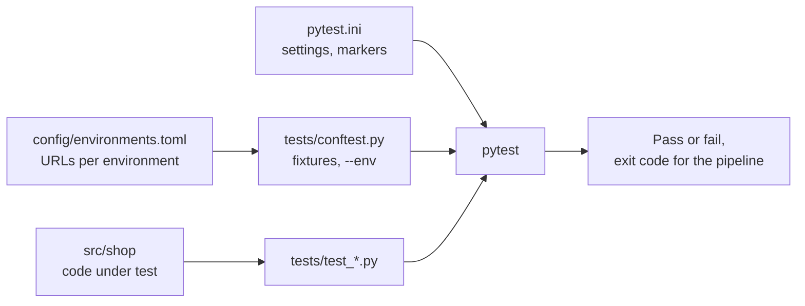

# pytest Framework: Turn Hand-Run Checks Into a Real Test Project

**pytest** is the test runner most Python teams use. You write tests as plain functions with `assert`, and pytest finds them, runs them, explains every failure, and gives the pipeline a clear pass or fail. This topic builds a real pytest project step by step: the folder layout, fixtures for shared setup, one test for many rows of data, markers to choose what runs, settings in `pytest.ini`, and switching between environments without changing code.

!!! info "In plain words"
    A script that prints "OK" is like a smoke alarm with no sound: you only know it went off if you're standing next to it.
    pytest is the alarm with a siren. It checks everything, tells you exactly what broke, and the pipeline hears it too.

!!! example "Your task"
    Your team checks the shop's cart with scripts that someone runs by hand and reads. Your lead says: "Turn these into a proper pytest project, so the pipeline can run them on every change, on local and on staging."
    This page walks through that change, from one script to a project the whole team can use.

!!! note "Before you start"
    You need Python 3.11 or newer and pytest: `python -m pip install "pytest==9.2.0"` inside a [virtual environment](../../programming-for-testers/virtual-environments-and-pip.md). New computer? [Environment setup](../../getting-started/environment-setup/index.md) installs Python step by step. If Python is new to you, start with [Python for testers](../../programming-for-testers/index.md).
    Run the commands from the `examples/shop_project` folder of this topic.

## Jump to what you need

1. [Project layout](project-layout.md): where tests, code, settings and fixtures go
2. [Tests and asserts](tests-and-asserts.md): write a test, read a failure
3. [Fixtures and conftest.py](fixtures-and-conftest.md): shared setup and cleanup, without copy and paste
4. [Parametrize](parametrize.md): one test, many rows of data
5. [Markers](markers.md): smoke, nightly and api, and how to choose what runs
6. [pytest.ini](pytest-ini.md): the settings file, line by line
7. [Environments](environments.md): local or staging with one option, and secrets kept out of files

## 1. Understand the ask

| You ask | Your lead answers |
| --- | --- |
| What do the scripts check today? | Cart totals and coupons, and whether the server is up |
| Who runs them? | Whoever remembers, before a release |
| Where must they run? | On every pull request, and on staging before a release |
| Any tests that need a server? | The health check. It must not break the run when no server is there |

## 2. Picture the system



## 3. Learn just enough

Read [tests and asserts](tests-and-asserts.md) and [fixtures and conftest.py](fixtures-and-conftest.md) first (30 minutes together). They are the two ideas everything else builds on. The official [Get started](https://docs.pytest.org/en/stable/getting-started.html) page is short and worth reading too.

## 4. Get something running

Here's one of today's scripts:

```python
--8<-- "modules/core_automation/pytest_framework/examples/before/check_cart.py"
```

```bash
python check_cart.py
```

```text
total: 1000
OK
Traceback (most recent call last):
  File ".../check_cart.py", line 19, in <module>
    cart.apply_coupon("WELCOME5")
    ~~~~~~~~~~~~~~~~~^^^^^^^^^^^^
  File ".../shop/cart.py", line 30, in apply_coupon
    raise ValueError("WELCOME5 needs an order of at least 20.00")
ValueError: WELCOME5 needs an order of at least 20.00
```

Look at what happened. The first check printed "OK", which only a person can read. The second check crashed, so nothing after it ran. And the crash isn't even a bug: WELCOME5 needs 20.00, and the cart has 10.00. The script mixed up "the code is wrong" and "the check is wrong". pytest keeps each check separate, and says clearly which one failed and why.

## 5. Decide what to put in

Each check becomes one test with a name that says what should be true. Shared setup, like "a cart with two notebooks and a pen", becomes a fixture. The coupon rules become one parametrized test with a row per case. The health check gets an `api` marker, so it only runs when someone asks for it.

## 6. Write a one-page plan

For a test project, the plan is the layout and a README that says how to run it. The [pytest skeleton](#templates) has both. The [project layout](project-layout.md) lesson explains each part.

## 7. Build in small steps

Start with one test file and run it. Add `conftest.py` when two tests need the same setup. Add `pytest.ini` when you start typing the same options every time. Here's the finished example project:

```bash
python -m pytest
```

```text
........                                                                 [100%]

======================= 63 passed, 1 deselected in 0.03s =======================
```

63 tests ran. The one "deselected" is the health check, waiting for `-m api`.

## 8. Report and get feedback

Share the project with the commands from its README, and ask a teammate to run it on their machine before the pipeline does. If it doesn't run for them, the README or the setup is missing something. Fix that first: a test project only one person can run isn't finished.

## 9. Keep learning on your own

Next is [API testing](../../api-testing/index.md), where these fixtures and environments call a real API. For running tests in a pipeline, see [CI/CD](../../devops-for-qa/ci-cd/index.md). For test data from files, see [data-driven testing](../data-driven/index.md).

!!! tip "How an experienced SDET thinks about this"
    - One test checks one thing, and its name says what. A failure should explain itself before anyone opens the code.
    - Setup goes in fixtures, not in the test. Tests should read like the rule they check.
    - Every test must be able to run alone, in any order. Shared state is how flaky suites start.
    - Settings in files, secrets in environment variables, never the other way round.

!!! warning "Red flags"
    - Tests that print "OK" instead of using `assert`.
    - Tests that only pass in a certain order.
    - A URL or a password written inside a test.
    - Hundreds of copied setup lines, with small differences nobody can explain.
    - Markers nobody registered, so a typo silently runs nothing.

!!! question "Stuck? Try this"
    - **pytest says "no tests ran".** File names must start with `test_`, test functions with `test`, and you must run from the folder with `pytest.ini`.
    - **`ModuleNotFoundError` for your own code.** Add `pythonpath = src` to `pytest.ini`, and run `python -m pytest`, not just `pytest`.
    - **A test passes alone but fails with the others.** Something is shared between tests. Run with `--setup-show` and look for a fixture that doesn't clean up.
    - **You don't know which command to use.** Keep the [cheat sheet](#templates) open. It has the 20 commands you'll use most, and what to try when something is wrong.

## Templates

**Every file is below, ready to copy.** The whole folder is also [on GitHub](https://github.com/myopensdet/myopensdet.github.io/tree/main/modules/core_automation/pytest_framework/templates).

Copy these into your own project. Each file starts with a line that says where it came from.

=== "pytest.ini"

    ```ini
    --8<-- "modules/core_automation/pytest_framework/templates/pytest_skeleton/pytest.ini"
    ```

=== "tests/conftest.py"

    ```python
    --8<-- "modules/core_automation/pytest_framework/templates/pytest_skeleton/tests/conftest.py"
    ```

=== "config/environments.toml"

    ```toml
    --8<-- "modules/core_automation/pytest_framework/templates/pytest_skeleton/config/environments.toml"
    ```

=== "tests/test_example.py"

    ```python
    --8<-- "modules/core_automation/pytest_framework/templates/pytest_skeleton/tests/test_example.py"
    ```

=== "README.md"

    ```markdown
    --8<-- "modules/core_automation/pytest_framework/templates/pytest_skeleton/README.md"
    ```

=== "Cheat sheet"

    ```markdown
    --8<-- "modules/core_automation/pytest_framework/templates/pytest_cheatsheet.md"
    ```

=== "How to use them"

    1. Copy the whole `pytest_skeleton` folder, rename it, and make a virtual environment in it.
    2. `python -m pip install -r requirements.txt`, then `python -m pytest`. You should see `3 passed, 1 deselected`.
    3. Change `config/environments.toml` to your app's URLs, and the token variable names to your own.
    4. Replace `tests/test_example.py` with your tests. Keep `conftest.py`, and add your own fixtures under the ones that are there.
    5. If your tests import your app's code, add `pythonpath = src` to `pytest.ini`, like the example project.

## Official resources

- [pytest documentation](https://docs.pytest.org/en/stable/)
- [pytest: Get started](https://docs.pytest.org/en/stable/getting-started.html)
- [pytest: Good integration practices](https://docs.pytest.org/en/stable/explanation/goodpractices.html): the official advice on project layout
- [pytest: How to invoke pytest](https://docs.pytest.org/en/stable/how-to/usage.html)
