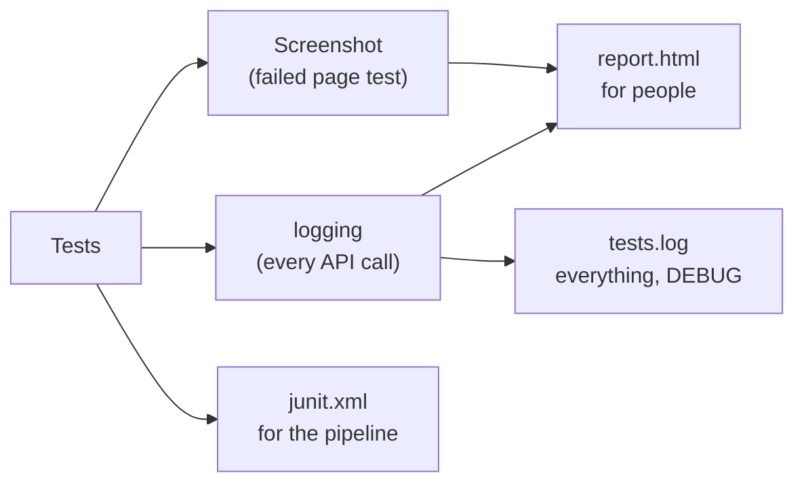

# Test Reporting and Logging in Python With pytest

A test run is only useful if people can see what happened. Developers need the failing request and response. Your lead wants one page with what passed and failed. The pipeline needs a file it can read. And when a page test fails at night, someone needs to see the page. This topic sets all of that up for one suite: **logs, an HTML report, JUnit XML, and screenshots in the report**, with passwords and card numbers kept out of all of them.

!!! info "In plain words"
    Tests are a team of inspectors. Logging is each inspector's notebook. The report is the one-page summary for the manager. The XML file is the form the head office's computer reads. Photos are attached to every problem found.

!!! example "Your task"
    Your lead says: "When a test fails in the pipeline, people ask you what happened. I want them to see it themselves: a report with the failures, what the API answered, and a picture of the page. And no passwords in any of it."

!!! note "Before you start"
    Read [pytest framework](../pytest/index.md) and [API testing](../../api-testing/index.md). For the page tests, [UI automation](../playwright/index.md) helps. From the [template project](#templates), in a virtual environment: `python -m pip install -r requirements.txt`, then once per computer `python -m playwright install chromium`. The tests start their own practice shop.

## Jump to what you need

1. [Logging in tests](logging-in-tests.md): levels, loggers, and pytest's log settings
2. [HTML reports with pytest-html](html-reports-with-pytest-html.md): one file anyone can open
3. [JUnit XML for pipelines](junit-xml-for-pipelines.md): the format every CI tool reads
4. [Screenshots and request logs in reports](screenshots-and-request-logs.md): evidence on every failure, secrets kept out

## 1. Understand the ask

| You ask | Your lead answers |
| --- | --- |
| Who reads the report? | Developers, testers, me. Sometimes the product owner |
| Where will it be? | Saved with every pipeline run, and on your machine |
| What must a failure show? | The error, the API calls before it, a picture for page tests |
| Anything that must not be in it? | Passwords, tokens, card numbers. Reports get shared |
| Does the pipeline need a format? | Yes, JUnit XML: it shows failures on each merge request |

## 2. Picture the system



One run, three files in `reports/`. The tests don't write any of them directly: pytest and its plugins do, from the results and the log lines.

## 3. Learn just enough

Read [logging in tests](logging-in-tests.md) first. Good logs make every report better, and a log full of noise or secrets makes every report worse.

## 4. Get something running

From the template project folder:

```bash
python -m pytest
```

```text
- generated xml file: .../reports/junit.xml -
- Generated html report: file://.../reports/report.html -
=========================== short test summary info ============================
XFAIL tests/test_pages.py::test_remove_updates_the_cart_count - Known bug: the cart count stays the same after Remove
======================== 8 passed, 1 xfailed in 10.20s =========================
```

Open `reports/report.html` in a browser. The one test that doesn't pass is the planted bug from [UI automation](../playwright/index.md): the cart count doesn't change after **Remove**. Run `python -m pytest --runxfail` to see it as a real failure, with its screenshot in the report.

## 5. Decide what to put in

| Put in reports and logs | Keep out |
| --- | --- |
| Each API call: method, path, status, time | Passwords, tokens, cookies, card numbers |
| Bodies, shortened, at DEBUG level | Whole responses of thousands of lines |
| A screenshot of every failed page test | Screenshots of every passing step |
| The name of each test in the log | `print()` lines nobody can turn off |
| Which app and version was tested | The computer's name, when the report is shared outside the company |

## 6. Write a one-page plan

Which files every run writes (`report.html`, `junit.xml`, `tests.log`), where the pipeline keeps them and for how long, what each log level is for in your team, which fields are secret and how they're hidden, and who looks at the night's report. The [template project](#templates) is that plan as code.

## 7. Build in small steps

Add `logging` to your API client first, one INFO line per call. Then pytest's log settings in `pytest.ini`. Then `--junitxml`, then pytest-html. Then the screenshot hook. After each step, make a test fail on purpose and look at what you get.

## 8. Check it with your team

Send a developer the report of a failed run, and ask: "Can you tell what went wrong without asking me?" Ask the security or platform team which fields count as secrets. Agree how long reports are kept: they can contain test data.

## 9. Keep learning on your own

[CI/CD](../../devops-for-qa/ci-cd/index.md) saves these reports with every pipeline run. Allure, a richer report with history and steps, is added to this topic soon. The [screenshots and traces](../playwright/screenshots-and-traces.md) lesson goes deeper on page evidence.

!!! tip "How an experienced SDET thinks about this"
    - A failure report must answer "what happened?" without anyone running the test again.
    - Log every call at INFO in one line. Put the details at DEBUG.
    - Logs and reports get shared. Hide secrets before they're written, not after.
    - Quiet other libraries' logs, or your own lines drown.
    - One run, three files: one for people, one for tools, one for digging.

!!! warning "Red flags"
    - `print()` everywhere instead of logging.
    - A report nobody opens, because it's 40 MB or has no failures on top.
    - Passwords or tokens in a log or report, even once.
    - "Works on my machine": the pipeline keeps no report.
    - Screenshots of every step of every passing test.

!!! question "Stuck? Try this"
    - **The log file is empty.** Something reconfigured logging during the run. See [logging in tests](logging-in-tests.md#when-it-goes-wrong).
    - **No log lines in the terminal.** pytest shows them only for failed tests. Add `--log-cli-level=INFO` to see them live.
    - **`unrecognized arguments: --html`.** pytest-html isn't installed in this environment: `python -m pip install -r requirements.txt`.
    - **No screenshot in the report.** The test has no `page` fixture, or it passed.

## Templates

**Every file is below, ready to copy.** The whole folder is also [on GitHub](https://github.com/myopensdet/myopensdet.github.io/tree/main/modules/core_automation/reporting_and_logging/templates).

Copy the whole `report_tests` folder, or the parts you need. Each file starts with a line that says where it came from.

=== "pytest.ini"

    ```ini
    --8<-- "modules/core_automation/reporting_and_logging/templates/report_tests/pytest.ini"
    ```

=== "helpers/api_client.py"

    ```python
    --8<-- "modules/core_automation/reporting_and_logging/templates/report_tests/helpers/api_client.py"
    ```

=== "tests/conftest.py"

    ```python
    --8<-- "modules/core_automation/reporting_and_logging/templates/report_tests/tests/conftest.py"
    ```

=== "tests/test_logging.py"

    ```python
    --8<-- "modules/core_automation/reporting_and_logging/templates/report_tests/tests/test_logging.py"
    ```

=== "How to use them"

    1. Copy `report_tests`, make a virtual environment, `python -m pip install -r requirements.txt`, and `python -m playwright install chromium` if you have page tests.
    2. Copy `pytest.ini`'s `addopts` and `log_` lines into your project. Every run then writes the three files into `reports/`.
    3. Copy the `call()` method of `helpers/api_client.py` into your own API client, and add your own secret field names to `SECRETS`.
    4. Copy the hooks in `tests/conftest.py`: the report title, the test name in the log, and the screenshot on failure. Point `SHOP_URL` at your app; delete `shop_app/` when you don't need it.
    5. Keep `tests/test_logging.py`: it fails the day someone logs a password.
    6. The other files: `tests/test_api.py`, `tests/test_pages.py`, `requirements.txt` and `.gitignore` (keeps `reports/` out of Git).

## Official resources

- [Python: Logging HOWTO](https://docs.python.org/3/howto/logging.html)
- [pytest: How to manage logging](https://docs.pytest.org/en/stable/how-to/logging.html)
- [pytest-html documentation](https://pytest-html.readthedocs.io/en/latest/)
- [pytest: JUnit XML](https://docs.pytest.org/en/stable/how-to/output.html#creating-junitxml-format-files)
- [OWASP: Logging Cheat Sheet](https://cheatsheetseries.owasp.org/cheatsheets/Logging_Cheat_Sheet.html)

Written for Python 3.13, pytest 9, pytest-html 4.2 and Playwright 1.64. Outputs captured November 2026. Links checked: November 2026.
