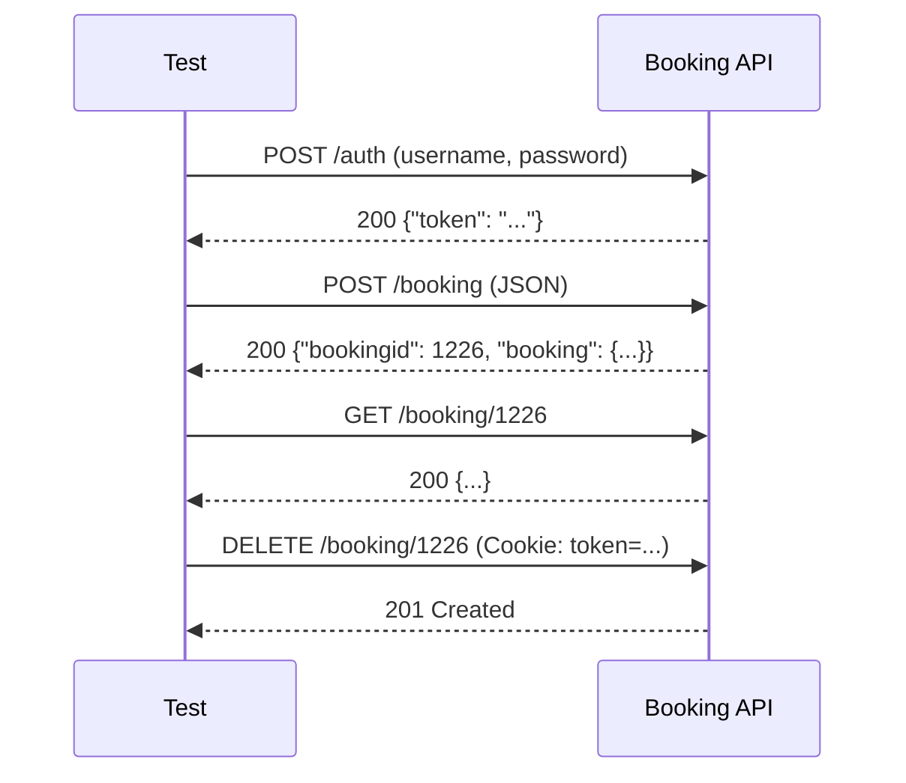

# API Testing With Python: Requests, Status Codes, Auth and Schemas

Most of what an app does happens behind its screens, in an **API**: the web page asks the server for data, and the server answers in JSON. Testing the API directly is faster and more stable than clicking through the UI, and it finds bugs the UI hides. This topic teaches API testing with Python's `requests` library and pytest, against three public practice APIs, from your first request to a test project with a client class, login, schema checks and clean-up.

!!! info "In plain words"
    An API is a restaurant's kitchen window. You pass in an order on a slip (the request), and a plate comes back (the response). Testing the API means checking the plates come back right, without walking through the dining room every time.

!!! example "Your task"
    Your team is building tests for a hotel booking API. Your lead says: "We need automated API tests for bookings: create, read, update, delete, with login, and checks that the answers have the right shape. They'll run in the pipeline, so they must clean up after themselves."
    This page walks through it, with [Restful-booker](https://restful-booker.herokuapp.com/apidoc/index.html), a public booking API made for practising exactly this.

!!! note "Before you start"
    Read [pytest framework](../pytest-framework/index.md) first. Install the tools in a virtual environment: `python -m pip install "pytest==9.2.0" "requests==2.34.2" "jsonschema==4.26.0"`.
    The examples call public practice APIs, so you need the internet. Send only fake test data to them: anyone can read what's stored there.

## Jump to what you need

1. [How the web works](how-the-web-works.md): client and server, HTML, AJAX, JSON and REST, and frontend vs backend bugs
2. [How HTTP works](how-http-works.md): a request, a response, and what's in each
3. [GET, POST, PUT, PATCH and DELETE](http-methods.md): the five methods, on one booking
4. [Status codes](status-codes.md): what 200, 201, 404 and 500 mean, and what an API gets wrong
5. [Headers and JSON](headers-and-json.md): what goes with every request, and the two ways to send data
6. [Query and path parameters](query-and-path-params.md): `?page=2` and `/booking/42`
7. [Authentication](authentication.md): API key, Basic, Bearer token and OAuth2
8. [Schema validation](schema-validation.md): check the shape of every answer in one line
9. [Chaining requests](chaining-requests.md): use one answer in the next request, and clean up
10. [File upload](file-upload.md): send a file, and check what arrived
11. [API client class](api-client-class.md): one place for the base URL, headers, logging and clear failures

## 1. Understand the ask

| You ask | Your lead answers |
| --- | --- |
| Is there API documentation? | Yes: [the booking API docs](https://restful-booker.herokuapp.com/apidoc/index.html) |
| How do we log in? | `POST /auth` gives a token. Send it as a cookie on changes |
| Which test account? | The demo account in the docs. In real projects, a test account from your team, as environment variables |
| What must the tests not do? | Leave bookings behind, or print the token |

## 2. Picture the system



Every test follows that shape: set up what it needs, check one thing, clean up.

## 3. Learn just enough

New to how web apps talk? Start with [how the web works](how-the-web-works.md). Then read [how HTTP works](how-http-works.md) and [GET, POST, PUT, PATCH and DELETE](http-methods.md) (30 minutes together). Then skim the [booking API docs](https://restful-booker.herokuapp.com/apidoc/index.html): reading the docs before the first request is half of API testing.

## 4. Get something running

One booking, every method, with plain `requests`:

```bash
export BOOKER_USERNAME=admin BOOKER_PASSWORD=password123
python methods_tour.py
```

```text
POST    200 new booking id: 1226
GET     200 Test 120
PUT     200 totalprice is now 150
PATCH   200 Late checkout 150
DELETE  201 Created
GET     404 Not Found
```

The username and password are the demo account published in Restful-booker's docs. Your booking id will be different. Look at two of the status codes: creating a booking answers 200, and deleting one answers 201 "Created". Most APIs would answer 201 and 204. Restful-booker has odd answers on purpose, so testers can practise finding them. The [status codes](status-codes.md) lesson covers what to do about them.

## 5. Decide what to put in

For each method: one test for the normal case, and one for the most important refusal (no login, unknown id, missing field). Check three things in each answer: the status code, the body, and the shape of the body with a schema. Every booking a test creates is deleted by a fixture, even when the test fails.

## 6. Write a one-page plan

The plan is a table: method, normal case, refusal, and what to check. The [template project](#templates) is that table turned into tests, one file per method.

## 7. Build in small steps

Start with plain `requests` calls in one test. When you copy the base URL for the third time, move it into a client fixture. When you copy the login, make a token fixture. When you copy the clean-up, make a `new_booking` fixture. The finished project:

```bash
python -m pytest
```

```text
XFAIL tests/test_post_booking.py::test_missing_field_is_a_client_error - Restful-booker answers 500 for a missing field; it should be 400
======================== 11 passed, 1 xfailed in 6.22s =========================
```

The "xfailed" test is a real bug in the API, kept as a test marked `xfail` with the reason. When the API is fixed, the test starts passing, `xfail_strict` fails the run, and someone removes the marker.

## 8. Report and get feedback

Share the run with your lead, and file the bugs you found: a missing field answers 500 instead of 400, a wrong password answers 200, and DELETE answers 201. Use the [bug report](../../think-like-a-tester/bug-reports/index.md) template, with the exact request and response. Then ask the developers which odd answers are on purpose. Some APIs keep strange codes for old clients, and the tests should say so in a comment.

## 9. Keep learning on your own

Next, [database testing](../database-testing/index.md) checks what the API saved, and [API + database](../api-and-database/index.md) puts the two together. For tests that don't need a real server, see [mocking and stubbing](../../advanced-testing/mocking-and-stubbing/index.md).

!!! tip "How an experienced SDET thinks about this"
    - Read the docs, then distrust them. The docs say what should happen. Your tests find what does.
    - Check the status code, the body and the shape. A 200 with the wrong body is still a bug.
    - Every test creates its own data and deletes it. Never depend on data someone else made.
    - Secrets come from environment variables, and never appear in logs or failure messages.

!!! warning "Red flags"
    - Tests that only check `status_code == 200`.
    - Tests that use a fixed id like `/booking/1`, which someone else can change or delete.
    - A token or password written in a test file.
    - No timeout on requests, so one slow server hangs the pipeline.
    - Tests that leave data behind, so the test environment fills up with rubbish.

!!! question "Stuck? Try this"
    - **You get 401 or 403.** Print the request headers (with the token hidden). The login is missing, sent in the wrong header, or expired. See [authentication](authentication.md).
    - **The response isn't JSON.** Print `response.headers["Content-Type"]` and the first 200 characters of `response.text`. It's often an HTML error page.
    - **It works in the browser or Postman, but not in Python.** Compare the headers. The difference is usually `Accept`, `Content-Type` or a cookie.
    - **The test passes sometimes.** Shared data, or a slow server. Create your own data, and give every request a timeout.

## Templates

**Every file is below, ready to copy.** The whole folder is also [on GitHub](https://github.com/arshaduzzaman-sm/myopensdet/tree/main/modules/core_automation/api_testing/templates).

Copy the whole `booker_api_tests` folder, or the parts you need. Each file starts with a line that says where it came from.

=== "api/client.py"

    ```python
    --8<-- "modules/core_automation/api_testing/templates/booker_api_tests/api/client.py"
    ```

=== "api/auth.py"

    ```python
    --8<-- "modules/core_automation/api_testing/templates/booker_api_tests/api/auth.py"
    ```

=== "api/schema.py"

    ```python
    --8<-- "modules/core_automation/api_testing/templates/booker_api_tests/api/schema.py"
    ```

=== "tests/conftest.py"

    ```python
    --8<-- "modules/core_automation/api_testing/templates/booker_api_tests/tests/conftest.py"
    ```

=== "GET"

    ```python
    --8<-- "modules/core_automation/api_testing/templates/booker_api_tests/tests/test_get_booking.py"
    ```

=== "POST"

    ```python
    --8<-- "modules/core_automation/api_testing/templates/booker_api_tests/tests/test_post_booking.py"
    ```

=== "PUT"

    ```python
    --8<-- "modules/core_automation/api_testing/templates/booker_api_tests/tests/test_put_booking.py"
    ```

=== "PATCH"

    ```python
    --8<-- "modules/core_automation/api_testing/templates/booker_api_tests/tests/test_patch_booking.py"
    ```

=== "DELETE"

    ```python
    --8<-- "modules/core_automation/api_testing/templates/booker_api_tests/tests/test_delete_booking.py"
    ```

=== "schemas/booking.json"

    ```json
    --8<-- "modules/core_automation/api_testing/templates/booker_api_tests/schemas/booking.json"
    ```

=== "How to use them"

    1. Copy `booker_api_tests`, make a virtual environment, and `python -m pip install -r requirements.txt`.
    2. Set the login as environment variables, then `python -m pytest`. Without them, the tests that need a login are skipped with a reason.
    3. For your own API: change `BOOKER_URL`, the login in `api/auth.py`, the test data in `api/data.py`, and the schemas.
    4. Keep the patterns: one file per resource or method, a fixture that cleans up, `check_status` for clear failures, a schema check on every body.

## Official resources

- [Requests: Quickstart](https://requests.readthedocs.io/en/latest/user/quickstart/)
- [MDN: An overview of HTTP](https://developer.mozilla.org/en-US/docs/Web/HTTP/Guides/Overview)
- [RFC 9110: HTTP Semantics](https://www.rfc-editor.org/rfc/rfc9110): the standard behind methods and status codes
- [jsonschema documentation](https://python-jsonschema.readthedocs.io/en/stable/)
- [OWASP API Security Top 10 (2023)](https://owasp.org/API-Security/editions/2023/en/0x11-t10/)
- [Restful-booker API docs](https://restful-booker.herokuapp.com/apidoc/index.html), [httpbin](https://httpbin.org/) and [DummyJSON](https://dummyjson.com/docs/auth): the practice APIs used here
