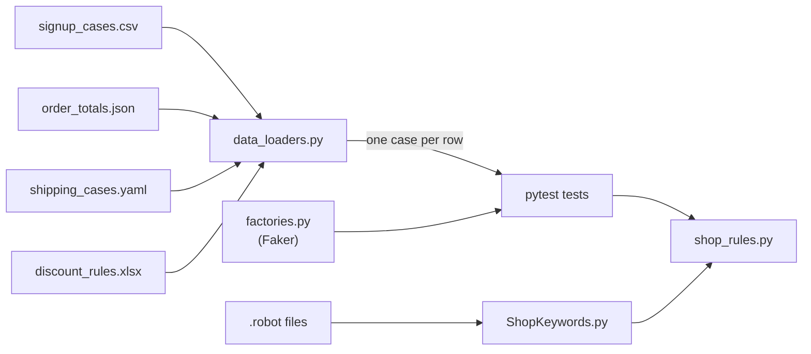

# Data-Driven Testing in Python: CSV, JSON, YAML, Excel, Faker and Robot Framework

Most rules come with a list of cases: this email, this password, this age, and what should happen. Data-driven testing writes **the check once** and keeps **the cases as data**: in a CSV, JSON, YAML or Excel file, made by a factory, or written as readable steps in Robot Framework. Adding a case means adding a row.

!!! info "In plain words"
    One answer key, many answer sheets. The key is your test. Each sheet is a row of data. A new student is one more sheet, not a new key.

!!! example "Your task"
    The product owner sends the signup rules as a CSV of edge cases. The business team keeps the discount rules in an Excel sheet. Logistics has a shipping price list. Your lead says: "Turn all of these into tests, straight from their files, so when they change a rule, they change a row. And give the business team tests they can read."
    This page walks through it, with a small shop's rules as the code under test.

!!! note "Before you start"
    Read [Parametrize](../pytest-framework/parametrize.md) and [Fixtures](../pytest-framework/fixtures-and-conftest.md). In a virtual environment, from the [template project](#templates): `python -m pip install -r requirements.txt` (pytest, PyYAML, openpyxl, Faker and Robot Framework, all pinned). No database or network needed.

## Jump to what you need

1. [One test, many rows](one-test-many-rows.md): the idea, naming each case, marking a known bug
2. [CSV, JSON and YAML data](csv-json-yaml-data.md): one loader, and the trap in each format
3. [Excel test data](excel-test-data.md): run the business team's sheet as tests
4. [Fake data with Faker](fake-data-with-faker.md): realistic, safe, and repeatable with a seed
5. [Test data factories](test-data-factories.md): valid by default, one change per test
6. [Keyword-driven: Robot Framework](keyword-driven-robot-framework.md): tests as readable steps

## 1. Understand the ask

| You ask | Your lead answers |
| --- | --- |
| Who owns each file? | Signup cases: product owner. Discounts: business team. Shipping: logistics |
| Do the tests read their files, or a copy? | Their files. A copy goes stale |
| Can test data be real customers? | Never. Fake data only |
| Who reads the test results? | Everyone. The business team wants readable tests |
| What happens with a known bug? | Keep the row, mark the bug id, and the run stays green until it's fixed |

## 2. Picture the system



Every file goes through one loader, which gives pytest one named case per row. Factories make data that only has to be valid. Robot Framework reaches the same code through Python keywords.

## 3. Learn just enough

Read [one test, many rows](one-test-many-rows.md) (10 minutes) and [CSV, JSON and YAML data](csv-json-yaml-data.md). The second one has the format traps that cause most wrong data-driven tests.

## 4. Get something running

From the template project folder:

```bash
python -m pytest
```

```text
fake data seed: 837744 (repeat with TEST_SEED=837744)
tests/test_discounts_excel.py ......                                     [ 15%]
tests/test_order_totals_json.py ..........                               [ 41%]
tests/test_shipping_yaml.py ........                                     [ 61%]
tests/test_signup_csv.py .x.........                                     [ 89%]
tests/test_with_factories.py ....                                        [100%]
=========================== short test summary info ============================
XFAIL tests/test_signup_csv.py::test_signup_rules[exactly 18] - Known bug AGE-18
======================== 38 passed, 1 xfailed in 0.53s =========================
```

Then the Robot Framework suites:

```bash
robot --pythonpath . --outputdir results --skiponfailure known-bug robot
```

```text
Robot                                                                 | PASS |
10 tests, 9 passed, 0 failed, 1 skipped
```

The xfail and the skip are the same bug, planted in `app/shop_rules.py`: 18-year-olds are turned away. The row "exactly 18" found it.

## 5. Decide what to put in

| Data | Where it lives | Example in the template |
| --- | --- | --- |
| Edge cases of a rule | a data file, one row per case | `signup_cases.csv` |
| Cases owned by another team | their own file, read as it is | `discount_rules.xlsx` |
| Nested data, or cases that expect an error | JSON or YAML | `order_totals.json`, `shipping_cases.yaml` |
| "Any valid value" | a factory with Faker | `make_signup()`, `make_order()` |
| Rules that hold for every input | a loop over generated data | `test_members_never_pay_more` |
| Tests the business reads | Robot Framework | `checkout.robot` |

## 6. Write a one-page plan

For each rule: who owns its cases, which file they live in, the edges (just under, exactly on, just over), and the expected values, worked out by hand. Add the bug ids of known failures, and who updates the files. The [template project](#templates) is that plan as code for one shop.

## 7. Build in small steps

Start with one rule, five rows and one test. Run it, break a row on purpose, and read the failure. Then add the loader for the next format, then factories, then Robot Framework. Run `python -m pytest` after each step.

## 8. Check it with your team

Send the data files to their owners and ask: "Is every row right? What's missing?" They'll find cases nobody wrote down. Show the business team `checkout.robot` and the `log.html` report. Agree who changes which file, and that changes go through review like code.

## 9. Keep learning on your own

Next, [BDD testing](../bdd-testing/index.md) takes readable tests further, with Gherkin scenarios. For data at scale, see [data and ETL testing](../../advanced-testing/data-and-etl-testing/index.md).

!!! tip "How an experienced SDET thinks about this"
    - Edges go in fixed rows. Random data is for "any valid value".
    - Every row has a name, so a failure says what broke.
    - Read the owner's file, never a copy of it.
    - Every random run prints its seed.
    - Text from a file is text: convert it on purpose.

!!! warning "Red flags"
    - Failures named `test_rule[row7]`.
    - An `if` in the test for some kinds of rows.
    - Expected values worked out with the same code being tested, or with an Excel formula.
    - Real customer data in the test files.
    - A random test that "sometimes fails", with no seed in the output.

!!! question "Stuck? Try this"
    - **A row fails with a strange type error.** Print the row. A value is text, `None`, or a YAML guess. Convert or quote it.
    - **A random test failed once.** Find the seed at the top of the run and use `TEST_SEED=<seed>`.
    - **Robot says `No keyword with name ... found`.** Look higher up for an `Importing library ... failed` error, and run from the template folder with `--pythonpath .`.
    - **An Excel value is `None`.** An empty cell, or a formula with no saved value.

## Templates

**Every file is below, ready to copy.** The whole folder is also [on GitHub](https://github.com/arshaduzzaman-sm/myopensdet/tree/main/modules/core_automation/data_driven_testing/templates).

Copy the whole `data_driven_tests` folder, or the parts you need. Each file starts with a line that says where it came from.

=== "helpers/data_loaders.py"

    ```python
    --8<-- "modules/core_automation/data_driven_testing/templates/data_driven_tests/helpers/data_loaders.py"
    ```

=== "helpers/factories.py"

    ```python
    --8<-- "modules/core_automation/data_driven_testing/templates/data_driven_tests/helpers/factories.py"
    ```

=== "signup_cases.csv"

    ```text
    --8<-- "modules/core_automation/data_driven_testing/templates/data_driven_tests/test_data/signup_cases.csv"
    ```

=== "test_signup_csv.py"

    ```python
    --8<-- "modules/core_automation/data_driven_testing/templates/data_driven_tests/tests/test_signup_csv.py"
    ```

=== "test_discounts_excel.py"

    ```python
    --8<-- "modules/core_automation/data_driven_testing/templates/data_driven_tests/tests/test_discounts_excel.py"
    ```

=== "test_with_factories.py"

    ```python
    --8<-- "modules/core_automation/data_driven_testing/templates/data_driven_tests/tests/test_with_factories.py"
    ```

=== "robot/ShopKeywords.py"

    ```python
    --8<-- "modules/core_automation/data_driven_testing/templates/data_driven_tests/robot/ShopKeywords.py"
    ```

=== "robot/checkout.robot"

    ```robotframework
    --8<-- "modules/core_automation/data_driven_testing/templates/data_driven_tests/robot/checkout.robot"
    ```

=== "How to use them"

    1. Copy `data_driven_tests`, make a virtual environment, and `python -m pip install -r requirements.txt`.
    2. Replace `app/shop_rules.py` with an import of your own code, and the files in `test_data/` with your team's files.
    3. Keep a `case` column (or pass `id_field=`) and, for known failures, a `known_bug` column.
    4. Point `test_discounts_excel.py` at the real sheet and its name. `tools/make_discount_sheet.py` only builds the sample.
    5. The other files: `test_order_totals_json.py`, `test_shipping_yaml.py`, `robot/signup_rules.robot`, and the JSON and YAML files in `test_data/`.

## Official resources

- [pytest: How to parametrize](https://docs.pytest.org/en/stable/how-to/parametrize.html)
- [Python: csv](https://docs.python.org/3/library/csv.html), [json](https://docs.python.org/3/library/json.html), [PyYAML](https://pyyaml.org/wiki/PyYAMLDocumentation)
- [openpyxl documentation](https://openpyxl.readthedocs.io/en/stable/)
- [Faker documentation](https://faker.readthedocs.io/en/master/)
- [Robot Framework User Guide](https://robotframework.org/robotframework/latest/RobotFrameworkUserGuide.html)

Written for Python 3.13, pytest 9.2, PyYAML 6.0, openpyxl 3.1, Faker 40.54 and Robot Framework 7.5. Outputs captured November 2026. Links checked: November 2026.
