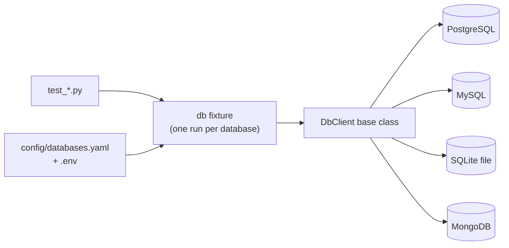

# Multi-Database Testing With Python: PostgreSQL, MySQL, SQLite and MongoDB

Most companies keep data in more than one database, and copy it between them. Each database can be fine on its own, and the data can still go wrong on the way from one to another: rows lost, names cut short, times shifted. This topic builds one pytest suite that runs the same tests on **PostgreSQL, MySQL, SQLite and MongoDB**, compares them against a source of truth, and checks a migration job.

!!! info "In plain words"
    Four shops in a chain, each with its own stock book. Each book can look tidy. Multi-database testing checks the books against each other, so a box that left one shop and never arrived in the other is found the same day.

!!! example "Your task"
    Your company is moving its shop from PostgreSQL to MySQL, the mobile app keeps an offline copy in SQLite, and the analytics team reads from MongoDB. Your lead says: "I need one test suite that checks all four: same tables, same rules, same data. And before we switch, prove the migration job copies everything, exactly."
    This page walks through it, with all four databases on your own computer.

!!! note "Before you start"
    Read [Database testing](../database-testing/index.md) first. You need Docker, and these in a virtual environment: `python -m pip install -r requirements.txt` from the [template project](#templates) (pytest, PyYAML, psycopg, PyMySQL and PyMongo, all pinned).

## Jump to what you need

1. [Why test several databases](why-test-several-databases.md): where they meet, and the bugs in between
2. [Docker Compose for test databases](docker-compose-for-databases.md): three databases in one command, safely
3. [Config per database](config-per-database.md): one YAML file, passwords from `.env`
4. [One client, many drivers](one-client-many-drivers.md): a base class, and each driver's quirks in its own class
5. [One test on every database](one-test-every-database.md): a parametrized fixture, and one question in four query languages
6. [Cross-database comparison](cross-database-comparison.md): counts, checksums, then the exact values
7. [Migration and ETL validation](migration-and-etl-validation.md): test a copy job, and find its bugs

## 1. Understand the ask

| You ask | Your lead answers |
| --- | --- |
| Which database is the source of truth? | PostgreSQL, until the switch |
| Which versions? | PostgreSQL 17, MySQL 8.4, MongoDB 8.0, and the SQLite built into Python |
| Should the copies match exactly? | Yes. Cancelled orders too: finance needs them |
| Which times? | Everything is stored in UTC |
| Where do the tests run? | Locally with Docker, and in the pipeline |

## 2. Picture the system



Tests talk to one base class. Each database has a small client behind it. The config file says where each database is. `.env` holds the passwords.

## 3. Learn just enough

Read [why test several databases](why-test-several-databases.md) (10 minutes) and [one client, many drivers](one-client-many-drivers.md). The second one has the types table every comparison depends on.

## 4. Get something running

From the template project folder:

```bash
cp config/.env.example .env      # then change the passwords
docker compose up -d --wait
python -m pytest
```

```text
............................................                             [100%]
44 passed in 0.20s
```

9 test functions, 44 results: every test that uses `db` runs on all four databases, and every comparison runs on the three that aren't the source. If port 3306 (or 5432, 27017) is already taken on your computer, set `MYSQL_PORT=3307` (or another free port) in `.env`. No Docker? `TEST_DATABASES=sqlite python -m pytest` runs the SQLite part alone.

## 5. Decide what to put in

| Check | Runs on | Finds |
| --- | --- | --- |
| Schema | every database | a missing or renamed column |
| Integrity | every database | duplicates, orders without a customer, bad values |
| Same question, own language | every database | a report query that's wrong on one database |
| Row counts | each target against the source | lost or doubled rows |
| Checksums, then values | each target against the source | changed values, with the exact row |

## 6. Write a one-page plan

List the databases and their roles (source, copy, cache), the tables, the key of each table, the business rules, and the edge cases for the test data: accents, long text, every status, times near midnight. The [template project](#templates) is that plan as code.

## 7. Build in small steps

Start with two databases (the source and one copy) and one table. Get the comparison working there, then add the other databases, one at a time. Each new database usually shows one new type difference. Fix it in the normalizer or that database's client, never in the tests.

## 8. Check it with your team

Show the comparison failure from the [migration lesson](migration-and-etl-validation.md#step-by-step) to the developers who own the copy job. Agree on what "the same" means for each column: is a cancelled order copied? Are times UTC? Rules nobody wrote down become bugs on migration day.

## 9. Keep learning on your own

Next, [API + database](../api-and-database/index.md) checks that an API call saved the right rows. For big data pipelines, [data and ETL testing](../../advanced-testing/data-and-etl-testing/index.md) goes further.

!!! tip "How an experienced SDET thinks about this"
    - One suite, run on every database. Never four suites that drift apart.
    - Pick one source of truth, and compare everything against it.
    - Differences between databases go in one place: the client or the normalizer.
    - The best migration test data is the awkward data: accents, long names, midnight, cancelled.

!!! warning "Red flags"
    - "The counts match, so the migration worked."
    - A different test file for each database.
    - Test databases open on `0.0.0.0`, or with passwords in the Compose file.
    - Loading test data into the target before comparing it with the source.

!!! question "Stuck? Try this"
    - **One database fails, the others pass.** Run it alone with `TEST_DATABASES=<name>` and read the values. It's usually a type or a time zone.
    - **A port is in use.** Set another port in `.env`. Don't stop the program that's using it.
    - **Everything is skipped.** No `.env` in the project folder. The skip reason names the missing variable.
    - **Thousands of differences.** Check five rows by hand. If they look the same, fix the normalizer. If not, the copy is wrong.

## Templates

**Every file is below, ready to copy.** The whole folder is also [on GitHub](https://github.com/myopensdet/myopensdet.github.io/tree/main/modules/core_automation/multi_database_testing/templates).

Copy the whole `multi_db_tests` folder, or the parts you need. Each file starts with a line that says where it came from.

=== "docker-compose.yml"

    ```yaml
    --8<-- "modules/core_automation/multi_database_testing/templates/multi_db_tests/docker-compose.yml"
    ```

=== "config/databases.yaml"

    ```yaml
    --8<-- "modules/core_automation/multi_database_testing/templates/multi_db_tests/config/databases.yaml"
    ```

=== "db_clients/base_client.py"

    ```python
    --8<-- "modules/core_automation/multi_database_testing/templates/multi_db_tests/db_clients/base_client.py"
    ```

=== "db_clients/sql_client.py"

    ```python
    --8<-- "modules/core_automation/multi_database_testing/templates/multi_db_tests/db_clients/sql_client.py"
    ```

=== "db_clients/mongo_client.py"

    ```python
    --8<-- "modules/core_automation/multi_database_testing/templates/multi_db_tests/db_clients/mongo_client.py"
    ```

=== "tests/conftest.py"

    ```python
    --8<-- "modules/core_automation/multi_database_testing/templates/multi_db_tests/tests/conftest.py"
    ```

=== "test_schema.py"

    ```python
    --8<-- "modules/core_automation/multi_database_testing/templates/multi_db_tests/tests/test_schema.py"
    ```

=== "test_data_integrity.py"

    ```python
    --8<-- "modules/core_automation/multi_database_testing/templates/multi_db_tests/tests/test_data_integrity.py"
    ```

=== "test_cross_db_compare.py"

    ```python
    --8<-- "modules/core_automation/multi_database_testing/templates/multi_db_tests/tests/test_cross_db_compare.py"
    ```

=== "How to use them"

    1. Copy `multi_db_tests`, make a virtual environment, and `python -m pip install -r requirements.txt`.
    2. `cp config/.env.example .env`, change the passwords, then `docker compose up -d --wait` and `python -m pytest`.
    3. For your own databases: change `config/databases.yaml`, the `schema.sql` files in `queries/`, the CSV files in `test_data/`, and the expected values in the tests.
    4. Against real databases, set `LOAD_TEST_DATA=none`. Loading test data drops and re-creates the tables.
    5. The other files: `postgres_client.py`, `mysql_client.py` and `sqlite_client.py` in `db_clients/`, the per-database queries in `queries/`, and the test data in `test_data/`.

## Official resources

- [Docker Compose documentation](https://docs.docker.com/compose/)
- [psycopg 3](https://www.psycopg.org/psycopg3/docs/), [PyMySQL](https://pymysql.readthedocs.io/en/latest/), [Python sqlite3](https://docs.python.org/3/library/sqlite3.html), [PyMongo](https://pymongo.readthedocs.io/en/stable/)
- [PEP 249: Python Database API](https://peps.python.org/pep-0249/)
- [pytest: Parametrizing fixtures](https://docs.pytest.org/en/stable/how-to/fixtures.html#parametrizing-fixtures)

Written for Python 3.13, pytest 9.2, PostgreSQL 17, MySQL 8.4, SQLite 3 and MongoDB 8.0. Outputs captured November 2026. Links checked: November 2026.
