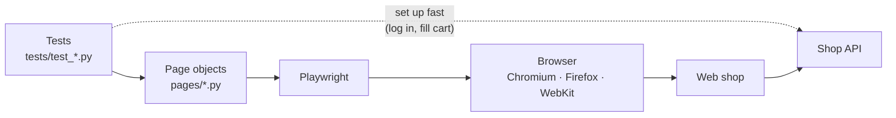

# UI Automation in Python With Playwright and Page Objects

UI tests use the app the way a person does: open the page, type, click, and check what's on the screen. They catch what API tests can't: a button that does nothing, a number that doesn't update, a form that hides its error. They are also the slowest and most fragile tests you'll write, unless you build them well. This topic builds a **Page Object Model framework with Playwright and pytest** for a small web shop, from the first click to screenshots, traces and three browsers.

!!! info "In plain words"
    A UI test is a robot that uses the website for you. You tell it what to find ("the Log in button"), what to do (click it) and what you expect to see ("the Books page"). It does it the same way every time, in seconds.

!!! example "Your task"
    Your lead says: "Customers say the cart count is sometimes wrong. We have API tests, but nothing checks the pages. Set up UI tests for log-in, search, cart and checkout. They must not be flaky, they must be easy to fix when the page changes, and when one fails at night I want to see what happened."

!!! note "Before you start"
    Read [pytest framework](../pytest-framework/index.md), and [fixtures and conftest](../pytest-framework/fixtures-and-conftest.md) in particular. From the [template project](#templates), in a virtual environment: `python -m pip install -r requirements.txt`, then once per computer `python -m playwright install chromium`. New computer? See [Environment setup](../../start-here/environment-setup/index.md). The tests start their own practice shop on a free port of your computer.

## Jump to what you need

1. [How browsers and locators work](how-browsers-and-locators-work.md): browser, context, page, and what a locator really is
2. [Choosing locators](choosing-locators.md): by role and label first, test ids next, CSS last
3. [Waits](waits.md): auto-waiting, `expect()`, and why `sleep` makes tests flaky
4. [Page Object Model](page-object-model.md): one class per page, tests that read like steps
5. [Forms, dialogs, frames and tabs](forms-dialogs-frames-and-tabs.md): select, radio, checkbox, confirm dialogs, iframes, new tabs
6. [Screenshots and traces on failure](screenshots-and-traces.md): see exactly what happened in a failed run
7. [Cross-browser runs](cross-browser-runs.md): Chromium, Firefox and WebKit from one suite

## 1. Understand the ask

| You ask | Your lead answers |
| --- | --- |
| Which journeys first? | Log in, search, cart, checkout. The money path |
| Which browsers? | Chrome for every change. Safari and Firefox before a release |
| Can tests skip the log-in form? | Yes, except the log-in tests themselves |
| Is there a test environment? | Yes. Locally, a practice copy of the shop |
| What do you want from a failed run? | A screenshot, and enough to see what happened before it |

## 2. Picture the system



Tests say what to do and what to expect. Page objects know where things are on each page. Playwright drives a real browser. Slow set-up, like logging in or filling a cart, goes through the API instead of the page.

## 3. Learn just enough

Read [how browsers and locators work](how-browsers-and-locators-work.md) and [waits](waits.md). Most UI test pain comes from those two: a locator that finds the wrong thing, or a check that runs before the page is ready.

## 4. Get something running

From the template project folder:

```bash
python -m pytest
```

```text
=========================== short test summary info ============================
XFAIL tests/test_cart.py::test_remove_a_book_updates_the_cart_count - Known bug: the cart count stays the same after Remove
======================== 15 passed, 1 xfailed in 16.39s ========================
```

16 tests through a real Chromium, in about 16 seconds. The one that doesn't pass is a bug planted in the practice shop, and the very one your lead described: after you remove a book, the cart count in the header doesn't change.

## 5. Decide what to put in

| Test through the page | Leave to API or unit tests |
| --- | --- |
| The main journeys: log in, search, cart, checkout | Every rule's edge cases (prices, limits) |
| What only the page does: counts, messages, dialogs, new tabs | Data checks: use [database testing](../database-testing/index.md) |
| One happy path and the most important errors per form | Every wrong input of every field |
| A few checks per test, on what the user sees | Set-up steps: log in and fill carts through the API |

## 6. Write a one-page plan

Which journeys get tests first, which browsers run when (Chromium on every change; Firefox and WebKit nightly or before a release), how tests log in, which locators the team agrees on (roles and labels first; `data-testid` for the rest, added by developers), what a failed run leaves behind, and who looks at the night's failures. The [template project](#templates) is that plan as code.

## 7. Build in small steps

Write one test for log-in, with no page objects. Make it pass. Move what it finds into a `LoginPage` class. Add the API log-in fixture, then one test per journey. Then screenshots and traces. Then other browsers. Run the suite after every step, and run it three times in a row before you trust it.

## 8. Check it with your team

Show developers the locators: ask them to keep labels and roles stable, and to add `data-testid` where nothing else works. Show your lead a failed run's screenshot and trace. Agree that a flaky test gets fixed or removed within a day, not retried until it passes.

## 9. Keep learning on your own

[BDD for API and UI](../bdd-testing/bdd-for-api-and-ui.md) runs Gherkin scenarios through a Playwright driver. Next, [reporting and logging](../reporting-and-logging/index.md) turns failed runs into reports people read. Later, [accessibility testing](../../advanced-testing/accessibility-testing/index.md) builds on the roles and labels you learn here.

!!! tip "How an experienced SDET thinks about this"
    - Find things the way a user does: by role, label and text.
    - Never sleep. Wait for something the user would see.
    - Set up through the API, check through the page.
    - Each test gets a fresh browser context. No test depends on another.
    - Page objects find and do. Tests check.
    - A failed UI test without a screenshot is a mystery. Without a trace, it's a guess.

!!! warning "Red flags"
    - `time.sleep(3)` anywhere in a UI suite.
    - Long XPath like `//div[3]/div[2]/span[1]` in a test.
    - Tests that must run in a certain order.
    - Retrying failed tests until they pass, and calling the suite green.
    - Every test logs in through the form.
    - UI tests for every rule that an API test could check in milliseconds.

!!! question "Stuck? Try this"
    - **`strict mode violation: ... resolved to 2 elements`.** Your locator finds more than one thing. Narrow it: find the row or card first, then the button inside. See [choosing locators](choosing-locators.md).
    - **A check fails, but the screenshot looks right.** You checked too early. Use `expect()`, which waits. See [waits](waits.md).
    - **`Timeout 10000ms exceeded`, waiting for a field you can see.** It may be in an iframe. See [forms, dialogs, frames and tabs](forms-dialogs-frames-and-tabs.md).
    - **`Executable doesn't exist`.** Run `python -m playwright install chromium` once.
    - **Want to see it happen?** `python -m pytest --headed --slowmo=500` opens the browser and slows every action.

## Templates

**Every file is below, ready to copy.** The whole folder is also [on GitHub](https://github.com/myopensdet/myopensdet.github.io/tree/main/modules/core_automation/ui_automation/templates).

Copy the whole `ui_tests` folder, or the parts you need. Each file starts with a line that says where it came from.

=== "tests/conftest.py"

    ```python
    --8<-- "modules/core_automation/ui_automation/templates/ui_tests/tests/conftest.py"
    ```

=== "pages/cart_page.py"

    ```python
    --8<-- "modules/core_automation/ui_automation/templates/ui_tests/pages/cart_page.py"
    ```

=== "pages/checkout_page.py"

    ```python
    --8<-- "modules/core_automation/ui_automation/templates/ui_tests/pages/checkout_page.py"
    ```

=== "pages/books_page.py"

    ```python
    --8<-- "modules/core_automation/ui_automation/templates/ui_tests/pages/books_page.py"
    ```

=== "pages/header.py"

    ```python
    --8<-- "modules/core_automation/ui_automation/templates/ui_tests/pages/header.py"
    ```

=== "tests/test_cart.py"

    ```python
    --8<-- "modules/core_automation/ui_automation/templates/ui_tests/tests/test_cart.py"
    ```

=== "tests/test_checkout.py"

    ```python
    --8<-- "modules/core_automation/ui_automation/templates/ui_tests/tests/test_checkout.py"
    ```

=== "pytest.ini"

    ```ini
    --8<-- "modules/core_automation/ui_automation/templates/ui_tests/pytest.ini"
    ```

=== "How to use them"

    1. Copy `ui_tests`, make a virtual environment, `python -m pip install -r requirements.txt`, and `python -m playwright install chromium`.
    2. Point it at your app: set `SHOP_URL=https://your-test-environment`. Change `TEST_USER` and the `logged_in_page` fixture in `tests/conftest.py` to your app's log-in. Delete `shop_app/` once you don't need the practice shop.
    3. Write one page object per page of your app in `pages/`, starting with the page your first test needs. Keep the header (or any part on many pages) as its own component.
    4. Write tests in `tests/`. Set up through your API, check through the page with `expect()`.
    5. The other files: `pages/login_page.py`, `pages/__init__.py`, `tests/test_books.py`, `tests/test_login.py`, `first_look.py` (a first script without pytest), `requirements.txt` and `.gitignore` (keeps `reports/` out of Git).

## Official resources

- [Playwright for Python: Getting started](https://playwright.dev/python/docs/intro)
- [Playwright: Locators](https://playwright.dev/python/docs/locators)
- [Playwright: Auto-waiting](https://playwright.dev/python/docs/actionability)
- [Playwright: Assertions](https://playwright.dev/python/docs/test-assertions)
- [Playwright: Trace viewer](https://playwright.dev/python/docs/trace-viewer)
- [Playwright: Best practices](https://playwright.dev/docs/best-practices)
- [Martin Fowler: Page Object](https://martinfowler.com/bliki/PageObject.html)

Written for Python 3.13, pytest 9 and Playwright 1.64. Outputs captured November 2026. Links checked: November 2026.
