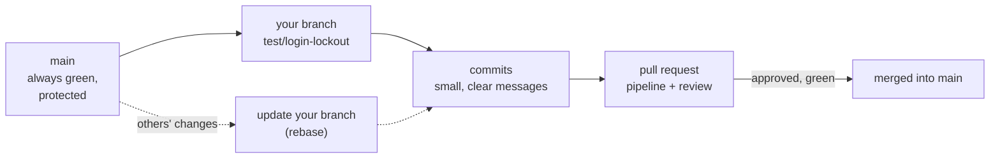

# Git in a Team for Testers: Branches, Pull Requests and Conflicts, Step by Step

Alone, Git is a save button. In a team, it's how five people change the same test suite without breaking each other's work. The commands are few. What matters is the **workflow** around them, and staying calm when Git says `CONFLICT`. This guide walks the whole flow on a safe practice copy, including a real conflict with a colleague's change.

!!! example "The problem"
    **A colleague, in the team chat:** "Your pull request has conflicts with main. Can you fix them before I review?"

## Step 1: See the team workflow



| Rule | Why |
| --- | --- |
| **Nobody pushes straight to `main`** | `main` is what everyone builds on. It must always pass |
| **One branch per change**, named for it (`test/login-lockout`) | Reviewers see one thing. If it's wrong, only it is undone |
| **Every change goes through a pull request** | The pipeline runs the tests, and a colleague reads it |
| **Update your branch often** | Small conflicts today, instead of big ones in a week |
| **Delete the branch after the merge** | The list of branches stays readable |

Teams call this **trunk-based development** or **GitHub flow**. Some teams use longer-lived branches (`develop`, `release/...`); ask which yours uses. The commands below are the same.

## Step 2: Get the kit and make a practice copy

You need **Git** ([install it](https://git-scm.com/downloads)) and **bash** (Git Bash on Windows). Get the files from [Templates](#templates) below, or take the whole folder [from GitHub](https://github.com/myopensdet/myopensdet.github.io/tree/main/modules/professional_sdet/git_in_a_team/templates).

`git_practice.sh` makes a safe place to practise: a pretend server (`server.git`), **your** copy (`me`), and a **colleague's** copy, all inside one new folder. It doesn't touch any other project or your Git settings.

```bash
bash git_practice.sh setup
cd git-practice/me
```

```text
Ready: git-practice/me is your copy. Next: cd git-practice/me
```

## Step 3: Make a branch and a change

Your ticket: add a test for account lockout. It also needs a longer timeout. Start a branch for it:

```bash
git switch -c test/login-lockout
```

```text
Switched to a new branch 'test/login-lockout'
```

Make the change: add a test to `tests/test_login.py`, and change `TIMEOUT = 10` to `TIMEOUT = 15` in `conftest.py`. Then look before you save:

```bash
git status
git diff
```

```text
On branch test/login-lockout
Changes not staged for commit:
  (use "git add <file>..." to update what will be committed)
  (use "git restore <file>..." to discard changes in working directory)
	modified:   conftest.py
	modified:   tests/test_login.py

no changes added to commit (use "git add" and/or "git commit -a")
```

```text
diff --git a/conftest.py b/conftest.py
index 572b8f8..3d79f37 100644
--- a/conftest.py
+++ b/conftest.py
@@ -1,4 +1,4 @@
 import os

 BASE_URL = os.environ.get("BASE_URL", "http://127.0.0.1:8000")
-TIMEOUT = 10
+TIMEOUT = 15
diff --git a/tests/test_login.py b/tests/test_login.py
index 323d0f0..2ce8b1a 100644
--- a/tests/test_login.py
+++ b/tests/test_login.py
@@ -1,2 +1,6 @@
 def test_login_page_opens():
     assert True
+
+
+def test_account_locks_after_five_wrong_passwords():
+    assert True
```

`-` lines are removed, `+` lines are added. **Always read your diff before committing**: it's where you catch a leftover debug line or a password you pasted for a quick try.

## Step 4: Commit and push

```bash
git add conftest.py tests/test_login.py
git commit -m "Add the account lockout test"
git push -u origin test/login-lockout
```

```text
[test/login-lockout bf39a2a] Add the account lockout test
 2 files changed, 5 insertions(+), 1 deletion(-)
```

```text
To ../server.git
 * [new branch]      test/login-lockout -> test/login-lockout
branch 'test/login-lockout' set up to track 'origin/test/login-lockout'.
```

Good commit messages say **what** the commit does, like a command: "Add the account lockout test", "Raise the timeout for staging". Not "fix", "changes" or "wip". In six months, `git log` is the only explanation left.

On a real project, now open a **pull request** on GitHub or GitLab. Fill in the [pull request template](#templates): what changed, why, how you checked it.

## Step 5: Your colleague changes the same line

Meanwhile, a colleague raised the timeout for the slow staging server, and that change is already on `main`. Make it happen in the practice copy (from the folder **above** `git-practice`, in a second terminal):

```bash
bash git_practice.sh colleague
```

```text
Your colleague pushed a change to conftest.py on main.
```

Back in `git-practice/me`, get their change and put your work on top of it:

```bash
git fetch origin
git rebase origin/main
```

```text
From ../server
   5393819..cce6e9a  main       -> origin/main
```

```text
Rebasing (1/1)Auto-merging conftest.py
CONFLICT (content): Merge conflict in conftest.py
error: could not apply bf39a2a... Add the account lockout test
hint: Resolve all conflicts manually, mark them as resolved with
hint: "git add/rm <conflicted_files>", then run "git rebase --continue".
hint: You can instead skip this commit: run "git rebase --skip".
hint: To abort and get back to the state before "git rebase", run "git rebase --abort".
hint: Disable this message with "git config set advice.mergeConflict false"
Could not apply bf39a2a... # Add the account lockout test
```

`fetch` downloads others' work without changing yours. `rebase` replays your commits on top of the newest `main`, as if you'd started from it today. Your change and theirs touch the same line, so Git can't decide alone: a **conflict**. Nothing is lost. `git rebase --abort` would put everything back as it was.

## Step 6: Resolve the conflict

```bash
git status
```

```text
interactive rebase in progress; onto cce6e9a
Last command done (1 command done):
   pick bf39a2a # Add the account lockout test
No commands remaining.
You are currently rebasing branch 'test/login-lockout' on 'cce6e9a'.
  (fix conflicts and then run "git rebase --continue")
  (use "git rebase --skip" to skip this patch)
  (use "git rebase --abort" to check out the original branch)

Changes to be committed:
  (use "git restore --staged <file>..." to unstage)
	modified:   tests/test_login.py

Unmerged paths:
  (use "git restore --staged <file>..." to unstage)
  (use "git add <file>..." to mark resolution)
	both modified:   conftest.py
```

Your new test went in fine. Only `conftest.py` is "both modified". Open it:

```text
import os

BASE_URL = os.environ.get("BASE_URL", "http://127.0.0.1:8000")
<<<<<<< HEAD
TIMEOUT = 30  # the staging server is slow
=======
TIMEOUT = 15
>>>>>>> bf39a2a (Add the account lockout test)
```

Between `<<<<<<< HEAD` and `=======` is what's on `main` now (the colleague's 30). Between `=======` and `>>>>>>>` is yours (15). **Decide, don't guess.** Here the colleague's reason is clear, and 30 covers your test too, so keep theirs. When it's not clear, ask them: it's a two-minute chat. Edit the file so only the right line is left, with no markers:

```text
import os

BASE_URL = os.environ.get("BASE_URL", "http://127.0.0.1:8000")
TIMEOUT = 30  # the staging server is slow
```

Then mark it resolved and carry on. Git opens your editor for the commit message: save and close it.

```bash
git add conftest.py
git rebase --continue
```

```text
[detached HEAD 549be0a] Add the account lockout test
 1 file changed, 4 insertions(+)
Successfully rebased and updated refs/heads/test/login-lockout.
```

Run the tests before you push. A conflict that Git accepted can still be wrong.

## Step 7: Push the updated branch safely

A plain push is refused:

```bash
git push
```

```text
To ../server.git
 ! [rejected]        test/login-lockout -> test/login-lockout (non-fast-forward)
error: failed to push some refs to '../server.git'
hint: Updates were rejected because the tip of your current branch is behind
hint: its remote counterpart. If you want to integrate the remote changes,
hint: use 'git pull' before pushing again.
hint: See the 'Note about fast-forwards' in 'git push --help' for details.
```

Rebase gave your commit a new id (`bf39a2a` became `549be0a`), so the server sees a different history. Don't follow the hint to `git pull` here: it would mix the old and new versions of your commit. Instead:

```bash
git push --force-with-lease
git log --oneline --graph --all
```

```text
To ../server.git
 + bf39a2a...549be0a test/login-lockout -> test/login-lockout (forced update)
```

```text
* 549be0a Add the account lockout test
* cce6e9a Raise the timeout for staging
* 5393819 Start the test project
```

A straight line: your work sits on top of your colleague's. `--force-with-lease` replaces **your own** branch, but refuses if someone else pushed to it since you last fetched. Plain `--force` doesn't check, and can delete a colleague's work. Never force-push to `main`.

When you're done practising: `bash git_practice.sh reset` (from the folder above `git-practice`).

## Step 8: Make pull requests easy to review

The pull request is where your work meets the team. Small and clear gets merged; big and vague waits for days.

- **One change** per pull request. Under 300 changed lines is a good target.
- **Say why**, not only what. Link the ticket.
- **Say how you checked it.** "Ran the 6 checkout tests, saw each fail once."
- **Point at the tricky part**, so the reviewer spends time where it matters.
- **Answer every review comment**, with a change or a reason. Then ask for another look.

Save the kit's template as `.github/pull_request_template.md` in your test repository, and GitHub fills every new pull request with it:

```markdown
--8<-- "modules/professional_sdet/git_in_a_team/templates/git_kit/pull_request_template.md"
```

When **you** review test code, use the review checklist from [a day in the life](../../working-as-a-qa/a-day-in-the-life/index.md#step-6-review-pull-requests). Also add a `.gitignore` to the test project from day one (the kit's `gitignore_for_tests.txt`). Reports, `.env` files and screenshots must never reach Git.

## Step 9: When it goes wrong

| You see | What it means | Fix |
| --- | --- | --- |
| `CONFLICT (content): Merge conflict in conftest.py` | You and someone else changed the same lines | Step 6. Or `git rebase --abort` to go back and ask first |
| `! [rejected] ... (non-fast-forward)` after a rebase | Your branch's history changed | `git push --force-with-lease` (your own branch only) |
| `! [rejected] ... (non-fast-forward)` on a branch you didn't rebase | Someone else pushed to it | `git pull --rebase`, then push |
| `git-practice already exists. Use it, or run: bash git_practice.sh reset` | You ran `setup` twice | Use the existing folder, or reset |
| `Usage: bash git_practice.sh setup \| colleague \| reset` | No command, or a typo | `bash git_practice.sh setup` |
| You committed a password or token | It's in the history, even after you delete the line | Tell your lead **now**. The secret must be changed; deleting it from Git is not enough |
| You committed to `main` by mistake (not pushed) | Forgot to make a branch | `git switch -c test/my-change` (takes the commit with it), then `git switch main` and `git reset --hard origin/main` |
| The editor opened and you don't know how to leave | `git rebase --continue` or `git commit` without `-m` | In Vim: press Esc, type `:wq`, Enter. Set an easier editor: `git config --global core.editor "code --wait"` |

## Templates

**Every file is below, ready to copy.** The whole folder is also [on GitHub](https://github.com/myopensdet/myopensdet.github.io/tree/main/modules/professional_sdet/git_in_a_team/templates).

=== "Cheat sheet"

    ```markdown
    --8<-- "modules/professional_sdet/git_in_a_team/templates/git_kit/git_team_cheat_sheet.md"
    ```

=== "gitignore_for_tests.txt"

    ```text
    --8<-- "modules/professional_sdet/git_in_a_team/templates/git_kit/gitignore_for_tests.txt"
    ```

=== "git_practice.sh"

    ```bash
    --8<-- "modules/professional_sdet/git_in_a_team/templates/git_kit/git_practice.sh"
    ```

## References

- [Pro Git book (free)](https://git-scm.com/book/en/v2)
- [Git: rebase](https://git-scm.com/docs/git-rebase)
- [Git: push (`--force-with-lease`)](https://git-scm.com/docs/git-push)
- [GitHub: about pull requests](https://docs.github.com/en/pull-requests/collaborating-with-pull-requests/proposing-changes-to-your-work-with-pull-requests/about-pull-requests)
- [GitHub: resolving a merge conflict on the command line](https://docs.github.com/en/pull-requests/collaborating-with-pull-requests/addressing-merge-conflicts/resolving-a-merge-conflict-using-the-command-line)
- [GitHub: a pull request template for your repository](https://docs.github.com/en/communities/using-templates-to-encourage-useful-issues-and-pull-requests/creating-a-pull-request-template-for-your-repository)

Written for Git 2.54. Outputs captured November 2026. Links checked: November 2026.
