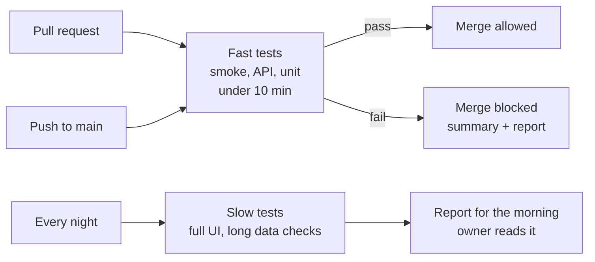

# CI/CD for Testers: Run Your Tests on Every Change, Step by Step

Tests that only run on your laptop protect nobody. They protect the team when they run **by themselves**, on every change, before the change is merged. This guide designs that pipeline for a real team, then builds it with a ready GitHub Actions workflow you can drop into your own repository.

!!! example "The problem"
    **Your lead:** "Last week a broken login reached the test environment, and we found out two days later. Can our tests run on every pull request, and stop the merge when they fail?"

## Step 1: Understand the words

| Word | Means |
| --- | --- |
| **CI** (continuous integration) | Every change is built and tested automatically, as soon as it's pushed |
| **CD** (continuous delivery or deployment) | Changes that pass are made ready to release, or released, automatically |
| **Pipeline** | The list of steps that run for each change: get the code, install, test, report |
| **Workflow** | GitHub's name for a pipeline: one `.yml` file in `.github/workflows/` |
| **Runner** | The fresh computer that runs it. It starts empty every time |
| **Artifact** | A file the pipeline keeps after it finishes, like a test report |

The tester's part is the **T** in the middle: which tests run, when, how fast, and what people see when they fail.

## Step 2: Design the pipeline

Before writing any file, decide **what runs when**. Running everything on every change is slow. Running too little lets bugs through. The usual design:



| Decision | The usual choice | Why |
| --- | --- | --- |
| **Pull requests** | Fast tests only | People wait for this. Over 10 minutes, they stop waiting and merge anyway |
| **Push to main** | Fast tests again | Two pull requests can each pass, and still break when combined |
| **Every night** | Slow tests | Nobody is waiting. Someone **owns** the results and reads them each morning |
| **By hand** | A "Run workflow" button | For a re-run before a release, or after a fix in the test environment |
| **Where** | A test environment, never production | Tests create data and send emails |
| **Failures** | Block the merge, and show which test and why | A red mark nobody can read gets ignored |

Other CI tools (GitLab CI, Jenkins, Azure Pipelines) use different file formats for the same ideas: triggers, a runner, steps, secrets, artifacts. Learn the design once, and the file is a translation.

## Step 3: Get the kit and run it on your computer first

A pipeline runs exactly the commands you give it. If they don't pass on your computer in a fresh folder, they won't pass on the runner. So run them locally first.

1. **Get the files**: copy them from [Templates](#templates) below into a new folder, or take the whole folder [from GitHub](https://github.com/arshaduzzaman-sm/myopensdet/tree/main/modules/infrastructure/ci_cd/templates). Open the `ci_kit` folder in a terminal.
2. Make a fresh virtual environment, like the runner does, and install:

    ```bash
    python3.13 -m venv .venv
    source .venv/bin/activate         # Windows: .venv\Scripts\Activate.ps1
    python -m pip install -r requirements.txt
    ```

3. Point the smoke tests at your app, and run them **the way the pipeline will**:

    ```bash
    export BASE_URL=https://test.your-app.example     # Windows: $env:BASE_URL = "..."
    python -m pytest -ra --junitxml=reports/junit.xml
    python ci_summary.py reports/junit.xml
    ```

Against a small test site with a home page and a health page:

```text
collected 3 items

tests/test_smoke.py ...                                                  [100%]

- generated xml file: .../reports/junit.xml -
============================== 3 passed in 0.04s ===============================
## Test results

**3 passed, 0 failed, 0 skipped** in 0.0 s
```

`--junitxml` writes the results as **JUnit XML**, a format every CI tool can read. `ci_summary.py` turns it into a short table for people.

On your app, change `PAGES` in `tests/test_smoke.py` to your most important pages, then add your real tests next to it.

## Step 4: See what a failure looks like

Pipelines are for the bad days, so check the bad day too. With the health page gone:

```text
tests/test_smoke.py:16: AssertionError
- generated xml file: .../reports/junit.xml -
=========================== short test summary info ============================
FAILED tests/test_smoke.py::test_page_answers[/health] - AssertionError: /hea...
========================= 1 failed, 2 passed in 0.05s ==========================
```

pytest exits with code `1`, and that's what turns a pipeline red. The summary names the test and the reason:

```text
## Test results

**2 passed, 1 failed, 0 skipped** in 0.0 s

| Test | Kind | First line of the error |
| --- | --- | --- |
| `test_page_answers[/health]` | failure | AssertionError: /health gave 404 |
```

In GitHub Actions, the same table appears on the run's summary page, so a developer sees **which test and why** without opening any logs.

## Step 5: Read the workflow file

```yaml
--8<-- "modules/infrastructure/ci_cd/templates/ci_kit/github_workflows/tests.yml"
```

Each part answers one design decision from step 2:

| Part | Does |
| --- | --- |
| `on:` | When it runs: pull requests, pushes to `main`, every night at 02:00 UTC, and by hand |
| `permissions: contents: read` | The job can read the code and nothing else. If a test package were ever hacked, it couldn't change your repository |
| `concurrency` | A new push cancels the older run of the same branch, so you don't wait for runs nobody needs |
| `timeout-minutes: 15` | A stuck test can't hold the pipeline for hours. GitHub's default is 6 hours |
| `matrix` | The same job once per Python version, side by side. `fail-fast: false` lets every version finish, so you see all the failures |
| `env` | `BASE_URL` from **variables**, `API_AUTH` from **secrets**. Neither is written in the file |
| `uses: ...@3d3c42e...` | Each action is pinned to one exact commit, with the version in a comment. A tag like `@v7` can be moved to other code; a commit can't |
| `if: always()` | The summary and the report are made **even when tests fail**. That's when you need them |
| `upload-artifact` | Keeps `reports/` for 14 days, to download from the run's page |

## Step 6: Add the secrets and variables

In your repository on GitHub: **Settings → Secrets and variables → Actions**.

| Tab | Add | Example |
| --- | --- | --- |
| **Variables** | `BASE_URL` | `https://test.your-app.example` |
| **Secrets** | `API_AUTH` | `Bearer` and a token for a **test** account |

GitHub hides secrets in the logs: if a test prints one, the log shows `***`. Still, never print them on purpose, and never use a real person's account.

!!! warning "Pull requests from forks don't get secrets"
    On a public repository, a pull request from someone else's copy (a fork) runs **without** your secrets, so a stranger can't steal them. Tests that need a login will fail there. That's on purpose; don't work around it.

## Step 7: Check the workflow before you push it

A typo in a workflow file is only found after you push, and then the pipeline doesn't start at all. **actionlint** finds it first. It runs in Docker, so there's nothing to install:

```bash
docker run --rm -v "$PWD:/repo" -w /repo rhysd/actionlint:1.7.12 -no-color
```

No output means no problems. With `runs-on` typed as `runs_on`:

```text
.github/workflows/broken.yml:23:3: "runs-on" section is missing in job "tests" [syntax-check]
   |
23 |   tests:
   |   ^~~~~~
.github/workflows/broken.yml:24:5: unexpected key "runs_on" for "job" section. expected one of "concurrency", "container", "continue-on-error", "defaults", "env", "environment", "if", "name", "needs", "outputs", "permissions", "runs-on", "secrets", "services", "snapshot", "steps", "strategy", "timeout-minutes", "uses", "with" [syntax-check]
   |
24 |     runs_on: ubuntu-24.04
   |     ^~~~~~~~
```

It names the line and lists the words it expected.

## Step 8: Turn it on and block bad merges

1. Copy `github_workflows/tests.yml` into your repository as **`.github/workflows/tests.yml`**, together with `ci_summary.py`, `requirements.txt` and your tests.
2. Open a pull request. The **Checks** area of the pull request shows the run, one line per Python version.
3. Make failures **block** the merge: **Settings → Rules → Rulesets** (or **Branches** on older screens), protect `main`, and require the **tests** checks to pass. Without this rule, a red pipeline is only a suggestion.
4. Open a finished run: the **Summary** shows the table from step 4, and **Artifacts** at the bottom has the report.

Then use the [pipeline checklist](#templates) with your team: who owns the nightly run, and which tests run where.

!!! note "About the screens"
    This page shows real local runs and real actionlint output. GitHub's own pipeline pages aren't shown, because they change often. The [GitHub Actions documentation](https://docs.github.com/en/actions) has the current screens.

## Step 9: When it goes wrong

| You see | What it means | Fix |
| --- | --- | --- |
| `Failed: BASE_URL is not set. Locally: export BASE_URL=...; in CI: add it as a variable` (3 errors) | The tests don't know which app to test | Locally: `export BASE_URL=...`. In CI: add the variable (step 6) |
| `No report at reports/junit.xml: did the tests run at all?` | pytest stopped before it could write the report: install failed, or a wrong folder | Read the step **above** "Write the summary" in the run's log |
| `unexpected key "runs_on" for "job" section` | A typo in the workflow file | Run actionlint (step 7) before every push |
| Passes on your computer, fails in the pipeline | Something only your computer has: a file, a package, a login, the VPN | Run step 3 in a **new** folder and a **new** virtual environment. The runner can't reach addresses inside your company network |
| The run never starts | The file isn't in `.github/workflows/`, or the trigger doesn't match the branch | Check the folder name and `branches:` |
| The run is cancelled after 15 minutes | A test is stuck, often waiting for a page or a lock | Download the report and find the last test that started. Add timeouts to your tests |
| Tests pass one run and fail the next | Flaky tests: timing, shared test data, order | See [fix a flaky test](../../advanced-testing/flaky-tests-and-speed/index.md) |

## Templates

**Every file is below, ready to copy.** The whole folder is also [on GitHub](https://github.com/arshaduzzaman-sm/myopensdet/tree/main/modules/infrastructure/ci_cd/templates).

=== "Pipeline checklist"

    ```markdown
    --8<-- "modules/infrastructure/ci_cd/templates/ci_kit/pipeline_checklist.md"
    ```

=== "ci_summary.py"

    ```python
    --8<-- "modules/infrastructure/ci_cd/templates/ci_kit/ci_summary.py"
    ```

=== "tests/conftest.py"

    ```python
    --8<-- "modules/infrastructure/ci_cd/templates/ci_kit/tests/conftest.py"
    ```

=== "tests/test_smoke.py"

    ```python
    --8<-- "modules/infrastructure/ci_cd/templates/ci_kit/tests/test_smoke.py"
    ```

=== "requirements.txt"

    ```text
    --8<-- "modules/infrastructure/ci_cd/templates/ci_kit/requirements.txt"
    ```

## References

- [GitHub Actions documentation](https://docs.github.com/en/actions)
- [GitHub: workflow syntax](https://docs.github.com/en/actions/reference/workflows-and-actions/workflow-syntax)
- [GitHub: using secrets in GitHub Actions](https://docs.github.com/en/actions/how-tos/write-workflows/choose-what-workflows-do/use-secrets)
- [GitHub: security hardening for GitHub Actions](https://docs.github.com/en/actions/reference/security/secure-use)
- [GitHub: about rulesets](https://docs.github.com/en/repositories/configuring-branches-and-merges-in-your-repository/managing-rulesets/about-rulesets)
- [actionlint](https://github.com/rhysd/actionlint)
- [pytest: JUnit XML reports](https://docs.pytest.org/en/stable/how-to/output.html#creating-junitxml-format-files)

Written for GitHub Actions, Python 3.13, pytest 9.2 and actionlint 1.7.12. Outputs captured November 2026. Links checked: November 2026.
