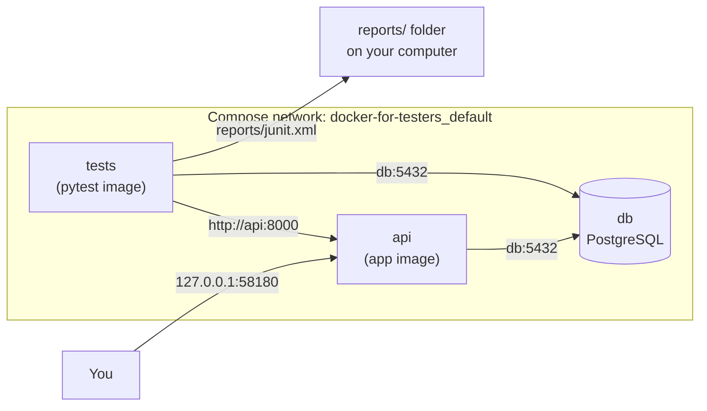

# Docker for Testers: Images, Test-Runner Dockerfiles and Compose Environments

Tests depend on what's around them: the database version, the Python version, the packages, the settings. When those differ, a test passes on one computer and fails on another. Docker puts each of them in a **container** made from a pinned **image**, so every run gets the same things. This topic takes you from your first container to a whole **test environment in one file**: a database, the app under test and your tests, started with one command and deleted with another.

!!! info "In plain words"
    Docker is a shipping container for software. Whatever is packed inside, every port, ship and truck handles it the same way. Your tests travel in one, the app in another, the database in a third. They arrive the same everywhere.

!!! example "Your task"
    Your lead says: "New people take two days to get the tests running, and the pipeline fails on things that pass on laptops. I want one command that starts the app and its database, runs the tests and gives us the report, the same way everywhere."

!!! note "Before you start"
    Install [Docker](../../start-here/environment-setup/index.md#5-install-docker) and start it. Read [pytest framework](../../core-automation/pytest-framework/index.md) and [API testing](../../core-automation/api-testing/index.md). From the [template project](#templates): `cp .env.example .env`, set a password, then `docker compose run --rm --build tests`. Nothing else to install: Python and the packages are in the images.

## Jump to what you need

1. [Images and containers](images-and-containers.md): pull, run, look inside, stop and remove
2. [Dockerfile for a test suite](dockerfile-for-a-test-suite.md): your tests in their own image
3. [Compose test environments](compose-test-environments.md): database, app and tests in one file

## 1. Understand the ask

| You ask | Your lead answers |
| --- | --- |
| What must run besides the tests? | The API and its PostgreSQL database |
| Which versions? | Whatever production uses. Pin them, so they don't change by surprise |
| Who runs it? | Every tester and developer, and the pipeline |
| What should it leave behind? | The test report. Nothing else: no old data, no running containers |
| Anything that must not be in it? | Real passwords. And the database must not be reachable from the office network |

## 2. Picture the system



Three containers on one private network, each found by its name. Only two ports are open to your own computer, and none to the network. The report is the only thing that comes out.

## 3. Learn just enough

Read [images and containers](images-and-containers.md) first: the difference between an image and a container, and why a container starts clean every time, explain everything after it.

## 4. Get something running

From the template project folder, after `cp .env.example .env`:

```bash
docker compose run --rm --build tests
```

```text
 Container docker-for-testers-api-1 Healthy
 Container docker-for-testers-tests-run-65c21d7b359b Created
============================= test session starts ==============================
platform linux -- Python 3.13.18, pytest-9.2.0, pluggy-1.7.0
...
tests/test_books_api.py .....                                            [100%]

----------------- generated xml file: /tests/reports/junit.xml -----------------
============================== 5 passed in 0.05s ===============================
```

The first run builds two images and takes under a minute. Then clean up with `docker compose down -v`.

## 5. Decide what to put in

| Put in | Keep out |
| --- | --- |
| Images pinned by version and digest | `latest`, or a tag with no digest |
| One image for the tests, one per service | Tests and app in one image |
| Passwords in `.env`, read with `${VARIABLE}` | Passwords in the Dockerfile or the Compose file |
| Ports on `127.0.0.1` only | Ports open to the whole network |
| Health checks, and `depends_on` that waits for them | `sleep 10` and hope |
| A normal user in every image you build | Running as root |

## 6. Write a one-page plan

Which services the tests need and their versions; which image each comes from, pinned; the settings and secrets each needs and where they come from; which ports you open and why; how the tests find each service; where reports go; how to start, run and clean up, in three commands. The [template project](#templates) is that plan as code.

## 7. Build in small steps

Start the database alone with `docker run`, and connect to it. Then put it in a Compose file with a health check. Add the app, waiting for the database. Run your tests from your computer against it. Last, put the tests in their own image and add them as a service. After each step, run `down -v` and start again from nothing.

## 8. Check it with your team

Ask a teammate to run it on their computer, from a fresh clone, with only Docker installed. Every question they ask is a missing line in the README. Ask the platform team which base images are allowed, and where the pipeline keeps secrets.

## 9. Keep learning on your own

[CI/CD](../ci-cd/index.md) runs this environment on every change. [Docker Compose for test databases](../../core-automation/multi-database-testing/docker-compose-for-databases.md) adds MySQL and MongoDB. Playwright publishes an image with its browsers, for running page tests in a container.

!!! tip "How an experienced SDET thinks about this"
    - Every run should start from nothing and leave nothing behind but the report.
    - Pin everything: image versions with digests, package versions in `requirements.txt`.
    - Wait for "healthy", never for a number of seconds.
    - Use service names between containers. `localhost` in a container is the container.
    - An image can be taken apart. Nothing secret goes into one.

!!! warning "Red flags"
    - `image: postgres:latest` in a test environment.
    - `sleep 30` in a script, "so the database is ready".
    - Ports written as `5432:5432`, open to everyone on the network.
    - A test environment only one person can start.
    - Containers from last week still running, with last week's data.

!!! question "Stuck? Try this"
    - **`required variable POSTGRES_PASSWORD is missing a value`.** Make `.env`: `cp .env.example .env`.
    - **`port is already allocated`.** Change `API_PORT` or `DB_PORT` in `.env`.
    - **`Connection refused` to `localhost` from the tests.** Use the service name: `http://api:8000`.
    - **The tests run old code.** Add `--build` to `docker compose run`.
    - **Docker doesn't answer at all.** Start Docker Desktop, and wait until it says it's running.

## Templates

**Every file is below, ready to copy.** The whole folder is also [on GitHub](https://github.com/arshaduzzaman-sm/myopensdet/tree/main/modules/infrastructure/docker_for_testers/templates).

Copy the whole `docker_tests` folder, or the parts you need. Each file starts with a line that says where it came from.

=== "Dockerfile (test runner)"

    ```dockerfile
    --8<-- "modules/infrastructure/docker_for_testers/templates/docker_tests/Dockerfile"
    ```

=== "docker-compose.yml"

    ```yaml
    --8<-- "modules/infrastructure/docker_for_testers/templates/docker_tests/docker-compose.yml"
    ```

=== ".dockerignore"

    ```text
    --8<-- "modules/infrastructure/docker_for_testers/templates/docker_tests/.dockerignore"
    ```

=== "tests/conftest.py"

    ```python
    --8<-- "modules/infrastructure/docker_for_testers/templates/docker_tests/tests/conftest.py"
    ```

=== "app/Dockerfile"

    ```dockerfile
    --8<-- "modules/infrastructure/docker_for_testers/templates/docker_tests/app/Dockerfile"
    ```

=== "How to use them"

    1. Copy `docker_tests`, then `cp .env.example .env` and set a password. `.env` is in `.gitignore`.
    2. Run `docker compose run --rm --build tests`. The report lands in `reports/`. Clean up with `docker compose down -v`.
    3. For your own project: copy `Dockerfile`, `.dockerignore`, `requirements.txt` and `pytest.ini` next to your tests. Put your packages in `requirements.txt`.
    4. In `docker-compose.yml`, replace `api` with your app (its image, or `build:` pointing at its Dockerfile) and give it a health check. Keep `db`, or swap it for your database.
    5. Make your tests read addresses from the environment, as `tests/conftest.py` does with `API_URL` and `DATABASE_URL`. Set them under the `tests` service.
    6. The other files: `app/` (the practice book API: delete it when you have your own app), `.env.example`, `.gitignore`, and `tests/test_books_api.py`.

## Official resources

- [Docker: Get started](https://docs.docker.com/get-started/)
- [Docker: Dockerfile reference](https://docs.docker.com/reference/dockerfile/)
- [Docker Compose: File reference](https://docs.docker.com/reference/compose-file/)
- [Docker: Building best practices](https://docs.docker.com/build/building/best-practices/)
- [Docker Hub: Python image](https://hub.docker.com/_/python)

Written for Docker 29, Docker Compose 5, Python 3.13 and pytest 9. Outputs captured November 2026. Links checked: November 2026.
