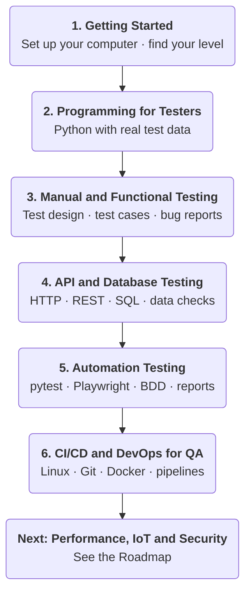

# SDET Learning Path

This page shows the whole journey on one map, then gives you a step-by-step path for what you want to do next.

!!! info "In plain words"
    Learning to be an SDET is like learning to drive. First you learn the car and the rules.
    Then you drive on quiet roads. Later you handle motorways, bad weather and long trips.
    Each stage builds on the one before, but you can always go back and practise.

## The whole journey

Each box is a group of topics. Follow the arrows from top to bottom.

You don't have to go in order. If you have a task at work today, jump to the topic you need: every page says what to read first.
Everyone moves at their own speed, and that is fine.

!!! tip "Check where you are"
    The [Skills Matrix](getting-started/skills-matrix.md) lists every skill by area. Tick what you know, then pick the path below that fits.

---

## Manual tester to automation

**For you if:** you test by hand today and have never written code.
**Goal:** write and run your first automated tests with confidence.

1. [How to use this site](getting-started/how-to-use-this-site/index.md)
2. [Environment setup](getting-started/environment-setup/index.md): Python, VS Code and a virtual environment
3. [Python for testers](programming-for-testers/index.md): just enough Python to write tests
4. [The SDET role](manual-testing/fundamentals/index.md)
5. [Test design techniques](manual-testing/test-design/index.md)
6. [pytest framework](automation-testing/pytest/index.md): your first automated test
7. [API testing](api-testing/index.md)
8. [Database testing](database-testing/index.md)
9. [Git in a team](devops-for-qa/git-and-github/index.md)
10. [Debugging toolkit](devops-for-qa/debugging/index.md)

---

## Build a whole test suite

**For you if:** you can write tests, but someone else designs the framework.
**Goal:** build and run a whole test suite on your own.

1. [API + database](database-testing/api-and-database/index.md)
2. [Data-driven testing](automation-testing/data-driven/index.md)
3. [BDD testing](automation-testing/bdd/index.md): with behave and with pytest-bdd
4. [UI automation](automation-testing/playwright/index.md) with Playwright
5. [Reporting and logging](automation-testing/reports-and-logs/index.md)
6. [CI/CD](devops-for-qa/ci-cd/index.md): run your tests on every change
7. [Docker for testers](devops-for-qa/docker/index.md)
8. [Multi-database testing](database-testing/several-databases/index.md)
9. [Mocking and stubbing](api-testing/mocking-and-stubbing/index.md)
10. [Flaky tests and speed](automation-testing/flaky-tests/index.md)
11. [Test strategy and planning](manual-testing/test-planning/index.md)
12. [Clean test code](working-as-a-qa/clean-test-code/index.md)

---

## Design how a team tests

**For you if:** you build test suites on your own and want to design how a team tests.
**Goal:** own quality for a product, and be trusted to say a release is safe.

1. [Performance testing](performance-testing/index.md): Locust, k6 and JMeter
2. [Security testing basics](security-testing/index.md)
3. [Contract testing](api-testing/contract-testing/index.md)
4. [Testing microservices](api-testing/microservices/index.md)
5. [Data and ETL testing](database-testing/data-and-etl/index.md)
6. [Cloud and Kubernetes basics](devops-for-qa/cloud-and-kubernetes/index.md)
7. [Observability](devops-for-qa/observability/index.md)
8. [Quality metrics](working-as-a-qa/quality-metrics/index.md)
9. [Release sign-off](devops-for-qa/release-testing/index.md)
10. [Leading quality](working-as-a-qa/leading-quality/index.md)
11. [Capstone project](working-as-a-qa/capstone-project/index.md): build a full framework

---

## Interview prep in 4 weeks

**For you if:** you have an SDET interview coming up.
**Goal:** walk in knowing the common questions, and with a project to show.

| Week | Focus | Lessons |
| --- | --- | --- |
| 1 | Testing basics and Python | [Test design techniques](manual-testing/test-design/index.md), [Bug reports](manual-testing/bug-reports/index.md), [Python for testers](programming-for-testers/index.md) |
| 2 | API and database | [API testing](api-testing/index.md), [Database testing](database-testing/index.md), [pytest framework](automation-testing/pytest/index.md) |
| 3 | UI, CI and frameworks | [UI automation](automation-testing/playwright/index.md), [CI/CD](devops-for-qa/ci-cd/index.md), [Clean test code](working-as-a-qa/clean-test-code/index.md) |
| 4 | Interview practice | [Interview preparation](working-as-a-qa/interview-preparation/index.md), [Portfolio and resume](working-as-a-qa/portfolio-and-resume/index.md), [Career roadmap](working-as-a-qa/career-roadmap/index.md) |

!!! warning "Be honest with yourself"
    Four weeks is enough to prepare, but not to learn everything from zero.
    If you are new to coding, start with the [manual tester path](#manual-tester-to-automation) first.
