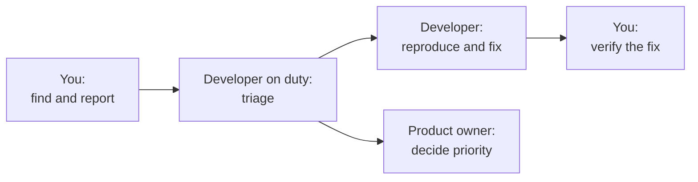

# Bug Reports: Write Reports Developers Can Act On Fast

Finding a bug is half the job. The other half is the report. A good report lets a developer reproduce the problem in two minutes, understand why it matters, and fix it. A bad report ("signup broken") starts a week of back-and-forth, and sometimes the bug is closed as "can't reproduce" while it is still hurting users. This topic shows how to write the good kind, every time.

!!! info "In plain words"
    Calling a mechanic and saying "my car makes a noise" doesn't help much. Saying "a squeak from the front left wheel, only when I brake, since Monday" lets them find it in minutes.
    A bug report is that phone call. The more exact you are, the faster the fix.

!!! example "Your task"
    While testing the sign-up rules (see [Error guessing](../test-design/error-guessing.md)), you found that Bengali names are refused while names like "José" are accepted. A teammate already filed a quick report: "Signup broken. Try a Bengali name. Expected: it works. Actual: error." Your lead asks: "Can you rewrite it so the developers can pick it up today?"
    This page walks through that rewrite.

## Jump to what you need

- [What makes a great bug report](what-makes-a-great-bug-report.md): each part, and the vague report rewritten
- [Severity and priority](severity-and-priority.md): how bad it is, and how soon to fix it, which are not the same thing
- [The bug lifecycle](bug-lifecycle.md): from "new" to "closed", and what to do at each step

## 1. Understand the ask

| You ask | Your lead answers |
| --- | --- |
| Where do bugs go? | GitHub issues, using the bug report form |
| Who reads them first? | The developer on duty triages new bugs each morning |
| What do they complain about most? | No steps, and "it doesn't work" with no message |
| Who sets the priority? | The team, in triage. You suggest one |

## 2. Picture the system

A bug report travels through several people. Each one needs something different from it:



The developer needs exact steps. The product owner needs to know who is affected. You, later, need to know exactly what to check when the fix arrives.

## 3. Learn just enough

Read this topic's [what makes a great bug report](what-makes-a-great-bug-report.md) lesson (15 minutes). If you have another 20 minutes, Simon Tatham's essay [How to Report Bugs Effectively](https://www.chiark.greenend.org.uk/~sgtatham/bugs.html) is a classic that many developers know.

## 4. Get something running

Run the [bug report checker](#templates) on the quick report:

```bash
python bug_report_check.py bug_before.md
```

```text
- Title: "Signup broken" is too vague. Say what is wrong, where, and when.
- Environment: missing or empty.
- Severity and priority: missing or empty.
- Steps to reproduce: write at least two numbered steps.
- Expected result: too vague. Write exactly what you saw or expected.
- Actual result: too vague. Write exactly what you saw or expected.

6 things to fix before you send it.
```

Six problems, and each one is a question the developer would otherwise have to ask.

## 5. Decide what to put in

Reproduce the bug yourself first, with the smallest steps you can. Then collect: the exact message, the exact input, where you ran it, and one comparison that shows the bug clearly ("José" works, "আরশাদ" doesn't). That comparison is often the most useful line in the whole report.

## 6. Write a one-page plan

Here the "plan" is the report itself, in the [bug report template](#templates): title, summary, steps, expected, actual, environment, severity and priority, evidence. The [great bug report](what-makes-a-great-bug-report.md) lesson shows the finished version, which the checker passes:

```text
Looks ready to send. Read it once more as if you were the developer.
```

## 7. Build in small steps

Write the title last. Once you've written the steps and results, you know exactly what the bug is, and the title becomes easy: "Sign-up refuses usernames in Bengali, but accepts accented Latin names". If you have a failing automated test, link it. It is the best proof there is.

## 8. Report and get feedback

File the report, then tell the developer on duty in one line, with the link. Watch for their first question. If they ask something your report should have answered, add it to the report, and to your own checklist for next time.

## 9. Keep learning on your own

Next, read [Test strategy and planning](../test-planning/index.md) to see how bugs feed into release decisions. When you automate tests later, a failing test's output is part of your evidence: the [reporting and logging](../../automation-testing/reports-and-logs/index.md) topic shows how to make it readable.

!!! tip "How an experienced SDET thinks about this"
    - Write for a tired developer at 9 in the morning. They should understand the bug from the title, and reproduce it from the steps without asking you.
    - Copy, don't describe. Paste the exact message, status code and input. "An error" is not evidence.
    - One bug, one report. Two problems in one report means one gets forgotten.
    - Severity is a fact about the users. Priority is a team decision. Suggest the second, insist on the first.

!!! warning "Red flags"
    - Titles like "broken", "doesn't work" or "bug in login".
    - Many bugs closed as "can't reproduce".
    - Bug reports with real customer data, passwords or tokens pasted in.
    - Every bug is "critical".
    - Fixed bugs are closed without anyone checking the fix.

!!! question "Stuck? Try this"
    - **You can't reproduce the bug again.** Write down exactly what you did and what you saw, mark it "seen once", and add everything you have: time, account, logs. Some bugs only appear sometimes, and that is useful to know too.
    - **The developer says "works on my machine".** Compare environments: version, browser, data, settings. The difference is usually the cause. The [environment section](what-makes-a-great-bug-report.md) exists for exactly this.
    - **You're not sure it is a bug.** Check the story or spec. If it doesn't say, report it as a question: "Is this expected?" Unclear rules are worth reporting too.
    - **Your bugs keep getting low priority.** Show who is affected and how much: "every customer with a Bengali name" is more convincing than "Bengali names fail".

## Templates

**Every file is below, ready to copy.** The whole folder is also [on GitHub](https://github.com/myopensdet/myopensdet.github.io/tree/main/modules/think_like_a_tester/bug_reports/templates).

Copy these into your own project. Each file starts with a line that says where it came from.

=== "Bug report (Markdown)"

    ```markdown
    --8<-- "modules/think_like_a_tester/bug_reports/templates/bug_report.md"
    ```

=== "bug_report_check.py"

    ```python
    --8<-- "modules/think_like_a_tester/bug_reports/templates/bug_report_check.py"
    ```

=== "GitHub issue form"

    ```yaml
    --8<-- "modules/think_like_a_tester/bug_reports/templates/bug_report_issue_form.yml"
    ```

=== "Severity, priority and states"

    ```markdown
    --8<-- "modules/think_like_a_tester/bug_reports/templates/severity_priority_guide.md"
    ```

=== "How to use them"

    1. Write each bug in the Markdown template, then run `python bug_report_check.py my_bug.md` before you send it.
    2. On GitHub, save the issue form as `.github/ISSUE_TEMPLATE/bug_report.yml`. Everyone who opens a bug then gets the same fields.
    3. Agree the severity guide with your team once, and link it from the form or the README.

## Official resources

- [Simon Tatham: How to Report Bugs Effectively](https://www.chiark.greenend.org.uk/~sgtatham/bugs.html)
- [GitHub: Syntax for issue forms](https://docs.github.com/en/communities/using-templates-to-encourage-useful-issues-and-pull-requests/syntax-for-issue-forms)
- [GitHub: Configuring issue templates](https://docs.github.com/en/communities/using-templates-to-encourage-useful-issues-and-pull-requests/configuring-issue-templates-for-your-repository)
- [ISTQB Glossary: defect report, severity, priority](https://glossary.istqb.org/)
