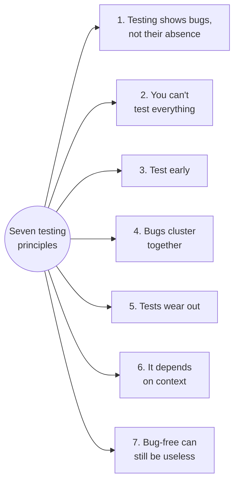

# The Seven Testing Principles, with Real Examples

This lesson explains the seven testing principles. Testers everywhere use them, and job interviews often ask about them. You will see two of them happen in real test runs.

!!! note "Before you start"
    Read [What an SDET does](what-an-sdet-does.md) first.
    The principles come from the ISTQB Foundation Level syllabus, version 4.0. **ISTQB** is a group that writes testing exams used in many countries.

## What you will learn

- The seven principles, in plain words
- Why passing tests did not mean "no bugs"
- How the principles change what you test first
- How to answer "name the testing principles" in an interview

## Why this matters at work

Sooner or later, someone asks: "The tests pass, so it has no bugs, right?" Or: "Why didn't you test everything?" The principles give you clear, honest answers. They also help you spend your time on the tests that matter most.

## The idea in plain words

!!! info "In plain words"
    A doctor's check-up can find that you are ill. It can never prove you will never get ill.
    Testing is the same. It finds problems, but it can't prove there are none. The seven principles are seven ideas like this one.



## Step by step

1. **Testing shows that bugs are there, not that they are gone.** Take the shipping rule from [What an SDET does](what-an-sdet-does.md): orders of $50.00 or more ship free. Say the code has the `>` bug, so exactly $50.00 still pays $4.99. Now say the team's test checks only these amounts:

    ```python
    (0, 0),  # empty cart: nothing to ship
    (1, 499),  # $0.01: the smallest real order pays shipping
    (4999, 499),  # $49.99: one cent under the line
    (5001, 0),  # $50.01: just over the line
    ```

    Run it:

    ```bash
    python -m pytest test_shipping.py -q
    ```

    You should see:

    ```text
    4 passed in 0.02s
    ```

    Every test passed, and the bug is still there. Nobody checked exactly $50.00, so nothing failed. "All tests pass" only means "the things we checked work". When you report results, say what you checked, not "no bugs".

2. **You can't test everything.** Count the ways one checkout can go, in a small shop:

    ```python
    quantities = 10      # 1 to 10 copies
    coupons = 6          # no coupon, or one of 5 codes
    payments = 4         # Visa, Mastercard, Amex, PayPal
    countries = 195
    products = 1000
    print(f"{quantities * coupons * payments * countries * products:,} combinations")
    ```

    You should see:

    ```text
    46,800,000 combinations
    ```

    At one second each, that is more than a year and a half of testing without a break. So you choose. You test the risky parts and the edges, using [test design techniques](../test-design/index.md): they find most bugs with a few hundred well-chosen tests, not millions.

3. **Test early.** A bug found while reading the story costs one question. The same bug found after release costs a fix, a new release and unhappy customers. Ask "is exactly $50.00 free?" before the code exists, and the shipping bug never gets written.

4. **Bugs cluster together.** Most bugs hide in a few parts of a system, often the complex or most-changed parts. If you find one bug in checkout, look harder at checkout, not less.

5. **Tests wear out.** Running the same tests again and again finds fewer new bugs over time. Old tests still protect what already works, but to find new bugs you need new tests and new data. ISTQB calls this the **pesticide paradox**: insects get used to the same spray.

6. **Testing depends on context.** A bank app and a hobby blog need very different testing. For an online shop, payments and logins get the most tests, because mistakes there hurt customers most.

7. **Bug-free can still be useless.** A shop with no bugs but no search box fails its users. Testing also asks: "Is this what people need?" This is the **absence-of-errors fallacy** (a fallacy is a wrong belief).

    !!! success "Check: you should now be able to"
        Name the seven principles, and explain why "4 passed" did not prove the shipping code was bug-free.

## When it goes wrong

- **Someone asks "Is it bug-free?" before a release.** Don't say yes. Say what you tested, what you didn't, and what you think the biggest remaining risk is. That answer is honest, and it lets them make the decision.
- **There is not enough time to test.** That is principle 2 in real life. List your tests by risk, run the top ones first, and tell your lead in writing what will not be tested.
- **Bugs keep appearing in the same area.** That is principle 4. Ask for more test time there, and ask a developer what makes that code hard to change. The answer often points to the next bug.

## Common mistakes

!!! warning "Common mistakes"
    - **Saying "tested, so no bugs".** Say what you tested and what you didn't. That is honest and useful.
    - **Using "you can't test everything" as an excuse.** It means "choose wisely", not "test less". Test the riskiest parts first.
    - **Never changing old tests.** Add new cases when you find bugs, or the suite stops finding anything new.

!!! failure "If you see this error"
    **`E       assert 499 == 0`**
    pytest shows the actual value on the left and the expected value on the right. Here the code gave 499 ($4.99 shipping), but the test expected 0 (free). Look at the test's name to see which amount it was: a failure like this is a test doing its job.

## Try it yourself

Your lead says: "The checkout tests all passed last night, so we can release." Write a short, polite answer that uses at least two principles.

??? success "Solution"
    One possible answer:

    ```text
    The checkout tests passed, which is good news: what we checked works.
    It doesn't prove checkout has no bugs (principle 1). For example, we don't test
    coupon + free shipping together yet. Bugs often cluster in checkout (principle 4),
    so I'd like 30 minutes to explore it by hand before we release.
    ```

## References

- [ISTQB Certified Tester Foundation Level v4.0](https://istqb.org/certifications/certified-tester-foundation-level-ctfl-v4-0/): section 1.3, the seven testing principles
- [ISTQB Glossary](https://glossary.istqb.org/): pesticide paradox, defect clustering, exhaustive testing

Written for Python 3.13, pytest 9 and the ISTQB CTFL v4.0 syllabus. Links checked: November 2026.
