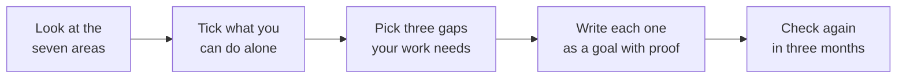

# SDET Skills Map: What the Job Needs, and How to Find Your Gaps

This lesson shows the seven areas of skill an SDET uses at work, what each one looks like in a real task, and how to turn your gaps into a plan.

!!! note "Before you start"
    Read [What an SDET does](what-an-sdet-does.md) first.
    You don't need to install anything for this lesson.

## What you will learn

- The seven skill areas, and what each one looks like on a normal working day
- How to tell a skill you have from a skill you have only read about
- How to find your three most useful gaps
- How to turn them into goals with proof

## Why this matters at work

"I want to get better at automation" is too big to act on, and too vague for your lead to help with. A short list of real skills, each tied to a task on your team, turns it into small steps. It also gives you something concrete to talk about in one-to-one meetings and interviews.

## The idea in plain words

!!! info "In plain words"
    Before a long trip, you check your car: tyres, oil, lights, fuel. You don't fix everything. You fix what matters most for this trip first.
    A skills map works the same way. You check each area, then work on the gaps your next task needs.



## Step by step

1. **Meet the seven areas.** Each row shows what the skill looks like in a real task.

    | Area | What it looks like at work | Where this site teaches it |
    | --- | --- | --- |
    | Testing basics | You read a new story and list the risky cases before anyone writes code | [Think like a tester](../index.md) |
    | Python | You read a failing test someone else wrote, and find the line that broke | [Python for testers](../../programming-for-testers/index.md) |
    | API testing | You check that a new endpoint refuses a request without a login token | [API testing](../../api-testing/index.md) |
    | UI automation | You write a browser test for checkout that doesn't break when a button moves | [UI automation](../../automation-testing/playwright/index.md) |
    | Databases | You prove with SQL that a cancelled order really changed its status | [Database testing](../../database-testing/index.md) |
    | Tools | Your tests run in the pipeline, and you can read why a run failed | [Toolbox](../../toolbox/index.md) |
    | Teamwork | You explain to a manager, in two sentences, why a release is risky | [Professional SDET](../../working-as-a-qa/index.md) |

2. **Tick what you can do alone.** Open the [Skills Matrix](../../getting-started/skills-matrix.md). It lists every skill in these areas, each with a link to the lesson that teaches it. Tick a box only if you have done the task yourself, without help. Reading about it, or watching a video, does not count yet. Your ticks stay in your own browser.

3. **Pick three gaps your work needs.** Don't pick the three hardest skills. Pick the three that your next real task needs. Say your next task is to automate the checkout check. Then pick:

    | Gap | Why now |
    | --- | --- |
    | Write tests with pytest | Every automated check needs it |
    | Send API requests from Python and check the answer | The checkout test logs in and pays through the API |
    | Run tests in a CI pipeline | The test must run on every change, not only on your computer |

4. **Write each gap as a goal with proof.** "Learn pytest" can't be checked. A goal with proof can. Add them to your [30-60-90 day plan](index.md#templates):

    | Goal | Proof it is done |
    | --- | --- |
    | Write tests with pytest | 10 tests for shipping and coupons, reviewed by a developer |
    | Test the API from Python | The checkout test logs in, adds to cart and pays, through the API |
    | Run tests in CI | The tests run on every pull request, and a failure blocks the merge |

5. **Check again in three months.** Open the Skills Matrix again and tick what you can now do. Your gaps change as your work changes. That is the point.

    !!! success "Check: you should now have"
        Three gaps tied to a real task, each written as a goal with proof you can show.

## When it goes wrong

- **Every skill looks like a gap.** That feeling is normal when you start. Ignore the list for a moment and look only at your next task. Which one or two skills does it really need? Start there.
- **You picked a skill but have no time to learn it.** Ask your lead for a real task that uses it. Learning on real work counts as work, and it sticks better than a weekend course.
- **Three months pass and nothing changed.** Your goals were probably too big. Cut each one in half, and give it a proof you can finish in two weeks.

## The template

The goals go into the 30-60-90 day plan from the [topic page](index.md#templates):

=== "30-60-90 day plan"

    ```markdown
    --8<-- "modules/think_like_a_tester/the_sdet_role/templates/first_90_days_plan.md"
    ```

=== "How to use it"

    1. Copy the file into your notes.
    2. Put your three gaps into "Days 1 to 30" or "Days 31 to 60", each with its proof.
    3. Agree it with your lead, and look at it together at each check-in.

## Common mistakes

!!! warning "Common mistakes"
    - **Ticking what you have read about, not what you have done.** Be strict. An honest map is the only useful one.
    - **Picking gaps that look impressive.** Kubernetes can wait if your task this month is an API test.
    - **Trying to close every gap at once.** Three at a time is enough. Finishing one beats starting five.

!!! failure "If you see this error"
    **Your ticks on the Skills Matrix are gone.**
    Ticks are saved only in the browser you used, on that computer. A private window, another browser, or clearing your browser's data starts empty. Use the same browser each time, or write your three gaps into your plan, where they can't disappear.

## Try it yourself

A developer on your team wants to move into test automation. They write Python every day, but have never written a test plan or a bug report. Their next task is to test a new password reset feature. Which three gaps should they pick?

??? success "Solution"
    One good answer:

    | Gap | Why now |
    | --- | --- |
    | Use test design techniques (boundary values and more) | To find the risky cases: expired codes, used codes, wrong codes |
    | Write a one-page test plan sorted by risk | To agree what will and won't be tested |
    | Write a bug report a developer can act on | To report what they find |

    They don't need Python yet: they already have it. Their gaps are in testing basics, not code. That is common for developers, and the opposite of most manual testers.

## References

- [Skills Matrix](../../getting-started/skills-matrix.md): every SDET skill, grouped by area, with the lesson for each
- [ISTQB Certified Tester Foundation Level](https://istqb.org/certifications/certified-tester-foundation-level-ctfl-v4-0/): the testing basics most teams expect

Links checked: November 2026.
