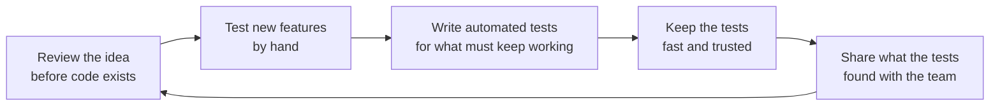

# What Does an SDET Do? The Daily Work, Explained Simply

This lesson explains what an SDET does in a normal week, and shows you an automated test catching a real bug.

!!! note "Before you start"
    You don't need any testing or coding experience. Every step shows its result, so you can learn without running anything.
    If you want to run the example yourself, you need Python and pytest (`pip install pytest`).

## What you will learn

- What the letters SDET mean
- The five kinds of work an SDET does in a week
- What an automated test is, and what it looks like when it catches a bug
- What an SDET does not do

## Why this matters at work

Job ads use the words SDET, QA engineer, test automation engineer and quality engineer for jobs that overlap a lot. If you know what the work really is, you can read any job ad, see what it asks for, and explain your own work in an interview.

## The idea in plain words

!!! info "In plain words"
    A smoke alarm checks for fire all day and night, so nobody has to sniff the air every hour.
    An SDET builds smoke alarms for software: small programs that check the app again and again, and shout when something breaks.
    But someone still has to decide where to put the alarms. That part is the tester's thinking.



## Step by step

1. **Know what the letters mean.** SDET stands for **Software Development Engineer in Test**. It is an engineer whose main job is testing, and who writes code to do it.

2. **Learn the five kinds of work.** A normal week has a bit of each:

    | Work | Example in the shop |
    | --- | --- |
    | Review ideas early | "The story says free shipping from $50. Is exactly $50.00 free?" |
    | Test by hand | Try the new coupon box with odd inputs before anyone automates it |
    | Write automated tests | A test that checks shipping at $49.99, $50.00 and $50.01 |
    | Keep tests healthy | Fix a test that fails at random, so the team trusts the results |
    | Share results | Tell the team which bug the tests caught, and what is still not tested |

3. **See an automated test.** An automated test is code that uses the app and checks the answer. Say the user story is: "Orders of $50.00 or more ship free. Smaller orders pay $4.99." Here is the code that works out shipping (money is in cents, so 5000 means $50.00):

    ```python
    --8<-- "modules/think_like_a_tester/the_sdet_role/examples/shipping.py"
    ```

    And here is the test an SDET writes for it. It checks the amounts where bugs like to hide: just under, exactly on, and just over the $50.00 line.

    ```python
    --8<-- "modules/think_like_a_tester/the_sdet_role/examples/test_shipping.py"
    ```

    `assert` is the check. If the shipping is not what the line says, the test fails.

4. **Run it.** Save both files in one folder, then run:

    ```bash
    python -m pytest test_shipping.py -v
    ```

    You should see:

    ```text
    test_shipping.py::test_free_shipping_from_50_dollars[0-0] PASSED         [ 20%]
    test_shipping.py::test_free_shipping_from_50_dollars[1-499] PASSED       [ 40%]
    test_shipping.py::test_free_shipping_from_50_dollars[4999-499] PASSED    [ 60%]
    test_shipping.py::test_free_shipping_from_50_dollars[5000-0] PASSED      [ 80%]
    test_shipping.py::test_free_shipping_from_50_dollars[5001-0] PASSED      [100%]
    ============================== 5 passed in 0.03s ===============================
    ```

5. **Watch it catch a bug.** Months later, a developer tidies the code and changes `>=` to `>`. It looks harmless. The tests run on their change, and say:

    ```text
    E       assert 499 == 0
    E        +  where 499 = shipping_cost(5000)
    ...
    FAILED test_shipping.py::test_free_shipping_from_50_dollars[5000-0] - assert ...
    1 failed, 4 passed in 0.02s
    ```

    The name tells you exactly what broke: an order of exactly $50.00 (5000 cents) now pays $4.99. A person checking by hand would have to build an order of exactly $50.00 to see this, and few people do. The test checks it in a fraction of a second, every time anyone changes the code, before a single customer sees the bug.

6. **Know what an SDET does not do.** An SDET is not the only person who cares about quality, and not a "bug catcher" at the end. Developers still test their own code. The whole team owns quality; the SDET makes testing faster and easier for everyone.

    !!! success "Check: you should now be able to"
        Say what SDET stands for, name the five kinds of work, and explain what the failed test name means.

## When it goes wrong

- **A test fails and you don't know why.** Read the bottom of the output first: the `FAILED` line names the test and the values. Then read the `E` lines just above it. They show what the code gave and what the test expected. Most failures make sense after that.
- **A test passes, but you think there is still a bug.** Trust your doubt. Try the case by hand. If it is wrong, the test is missing that case, so add it. A test that never fails may be checking the wrong thing.
- **Someone says "just make the test pass".** Don't change the expected value to match the code without asking why. First check the user story. If the story says $50.00 ships free, the code is wrong, not the test.

## Common mistakes

!!! warning "Common mistakes"
    - **Thinking SDET means "only automation".** The tester's thinking decides what to automate. Without it, you automate the wrong things fast.
    - **Thinking you must be a strong developer first.** Many SDETs start as manual testers and learn code one test at a time.
    - **Measuring yourself by the number of tests.** A few tests that catch real bugs beat hundreds that never fail.

!!! failure "If you see this error"
    **`ModuleNotFoundError: No module named 'shipping'`**
    Python can't find `shipping.py`. Put both files in the same folder, open the terminal in that folder, and run `python -m pytest test_shipping.py -v`. The `python -m` part makes Python look in the current folder.

## Try it yourself

The business changes the rule: "Orders of $75.00 or more ship free." What do you change first, the test or the code? Which test lines change?

??? success "Solution"
    Change the test first, so it describes the new rule. The three lines at the edge move from $50 to $75:

    ```python
    (7499, 499),  # $74.99: one cent under the line
    (7500, 0),  # $75.00: exactly on the line, ships free
    (7501, 0),  # $75.01: just over the line
    ```

    Run it before touching the code. It should fail, because the code still uses the old rule:

    ```text
    FAILED test_shipping.py::test_free_shipping_from_75_dollars[7499-499] - asser...
    1 failed, 4 passed in 0.02s
    ```

    Now change `FREE_SHIPPING_FROM = 5000` to `7500` in `shipping.py` and run again:

    ```text
    5 passed in 0.02s
    ```

    A failing test first, then the fix, then a passing test: now you know the test really checks the new rule. Rename the test to `test_free_shipping_from_75_dollars` too, so its name stays true.

## Quick check

1. What does SDET stand for?

    ??? question "Answer"
        Software Development Engineer in Test.

2. Why is an automated test useful if a person could check the same thing by hand?

    ??? question "Answer"
        It runs in a fraction of a second, every time the code changes, and it never forgets or gets bored.

3. Does an SDET stop testing by hand?

    ??? question "Answer"
        No. New features are explored by hand first. Automation checks the things that must keep working.

## References

- [ISTQB Glossary](https://glossary.istqb.org/): test automation, test case and other terms
- [pytest: Get started](https://docs.pytest.org/en/stable/getting-started.html)
- [pytest: Parametrizing tests](https://docs.pytest.org/en/stable/how-to/parametrize.html)

Written for Python 3.13 and pytest 9. Links checked: November 2026.
