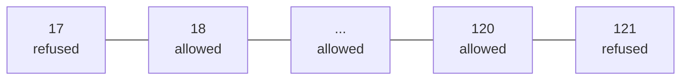

# Boundary Value Analysis: Test at the Edges, Where Bugs Hide

If you learn only one test design technique, learn this one. Bugs gather at edges: the last allowed value, the first refused one. A developer types `<` when they meant `<=`, and everyone who is exactly 18 is turned away. Boundary value analysis is how you catch that before a customer does.

!!! note "Before you start"
    Read [Equivalence partitioning](equivalence-partitioning.md) first. Boundaries are the edges between its groups.
    To run the examples: `pip install pytest`, then run the commands from the `examples` folder.

## What you will learn

- Why bugs gather at the edges of a range
- How to pick boundary values: two-value and three-value
- A real off-by-one bug that group tests miss and an edge test catches
- How to use the `boundaries.py` helper

## Why this matters at work

"Free shipping from $50", "password at least 8 characters", "code valid for 10 minutes", "up to 10 items". Almost every story has a limit in it. And the limit is exactly where a tiny slip in the code changes the result. Edge tests are cheap, and they catch real bugs again and again.

## The idea in plain words

!!! info "In plain words"
    Think of a ride at a fair: "You must be 120 cm tall." The person checking doesn't worry about tall adults or tiny babies. The hard cases are the children who are almost exactly 120 cm. That is where the mistakes happen.
    Software is the same. Values in the middle of a group are easy. Values at the edge are where `<` and `<=` get mixed up.



For each edge, test the last value on one side and the first value on the other.

## Step by step

1. **Find every edge.** Each range has two: the lowest allowed value and the highest. Age 18 to 120 has edges at 18 and 120. Username length 3 to 20 has edges at 3 and 20.

2. **List the values on both sides of each edge.** For age, that is 17, 18, 120 and 121. You can work them out by hand, or let the [boundaries.py](index.md#templates) helper do it:

    ```bash
    python boundaries.py 18 120
    ```

    You should see:

    ```text
    Range 18 to 120. Test these values:
          17  outside
          18  inside
         120  inside
         121  outside
    ```

    This is called **two-value** boundary testing. Some teams also test the value just inside each edge (19 and 119). That is **three-value** testing. Use it when the rule is important, like money:

    ```bash
    python boundaries.py 3 20 --three
    ```

    ```text
    Range 3 to 20. Test these values:
           2  outside
           3  inside
           4  inside
          19  inside
          20  inside
          21  outside
    ```

3. **Write the expected result from the rule, not from the app.** For each value, decide from the story what should happen. 18: allowed. 17: refused. Never run the app first and copy what it does: if the app is wrong, your test would agree with the bug.

4. **Turn each value into a test.**

    ```python
    --8<-- "modules/think_like_a_tester/test_design_techniques/examples/tests/test_signup_edges.py"
    ```

    ```bash
    python -m pytest tests/test_signup_edges.py -q
    ```

    ```text
    8 passed in 0.03s
    ```

5. **Watch an edge test catch a bug that group tests miss.** Here is what really happens on teams. A developer changes one line, and types `<` instead of `<=`:

    ```python
    if not MIN_AGE < age <= MAX_AGE:
    ```

    Now an 18-year-old is refused. Run the group tests from the [last lesson](equivalence-partitioning.md):

    ```text
    8 passed in 0.02s
    ```

    All green. Ages 10, 30 and 150 still behave correctly, so the group tests can't see the problem. Now run the edge tests:

    ```text
    >       assert check_signup("arshad", age) == expected
    E       AssertionError: assert ['Age must be 18 to 120'] == []
    E
    E         Left contains one more item: 'Age must be 18 to 120'

    FAILED tests/test_signup_edges.py::test_age_at_the_edges[18-expected1] - Asse...
    1 failed, 7 passed in 0.03s
    ```

    Read the failure line: the test with age 18 expected no problems, but got "Age must be 18 to 120". One character in the code, and one edge test caught it. This is why boundaries are worth learning first.

    !!! success "Check: you should now be able to"
        Find the edges of any range, list the values on both sides, and explain why the group tests missed the `<` bug.

## When it goes wrong

- **The story doesn't say whether the edge is included.** "Under 18 can't sign up" and "18 and over can sign up" mean the same, but "up to 120" is not clear. Ask. Then write the answer into the story, so the next person doesn't have to ask.
- **The values aren't whole numbers.** For money, a step is one cent: test $49.99, $50.00 and $50.01. For time, ask what the app measures in: a code "valid for 10 minutes" might need tests at 9:59 and 10:01. Pick the smallest step the app really uses.
- **The edge is checked in two places.** Many apps check a rule in the browser and again in the API. Test the edges in both, because they are different code and can disagree. A form that allows 120 while the API refuses it is a bug.
- **An edge test fails, and the developer says "that's a tiny detail".** Explain who it hurts: "Every customer who is exactly 18 can't sign up." A real person on the edge makes the bug easy to understand.

## Common mistakes

!!! warning "Common mistakes"
    - **Testing only one side of the edge.** 18 alone isn't enough. You need 17 too, to prove the edge is in the right place.
    - **Forgetting the top edge.** Low limits get tested often. High limits (120, 20 characters, 10 items) are forgotten more, and break just as often.
    - **Copying the expected result from the app.** Write it from the rule. Otherwise a wrong app passes its own test.

!!! failure "If you see this error"
    **`ValueError: low (120) must not be bigger than high (18)`**
    You gave `boundaries.py` the numbers the wrong way round. Put the lowest allowed value first: `python boundaries.py 18 120`.

## Try it yourself

A password must be "at least 8 and at most 64 characters". A shop gives free shipping "from $50.00". List the boundary values for each, with the expected result.

??? success "Solution"
    **Password length:**

    | Length | Expected |
    | --- | --- |
    | 7 | Refused |
    | 8 | Allowed |
    | 64 | Allowed |
    | 65 | Refused |

    **Free shipping** (money moves in cents, so the step is one cent):

    | Order total | Expected |
    | --- | --- |
    | $49.99 | Pays shipping |
    | $50.00 | Free |

    Free shipping has only one edge, because there is no upper limit. Some testers also add $50.01, to be safe.

## Quick check

1. Why do bugs gather at edges?

    ??? question "Answer"
        Because the edge is where a tiny slip in the code, like `<` instead of `<=`, changes the result. Values in the middle aren't affected.

2. What are the two-value boundary values for the range 3 to 20?

    ??? question "Answer"
        2, 3, 20 and 21.

3. In step 5, why did the group tests pass with the bug in the code?

    ??? question "Answer"
        None of them used age 18. They tested 10, 30 and 150, which the bug didn't change.

## References

- [ISTQB Glossary: boundary value analysis](https://glossary.istqb.org/)
- [pytest: How to parametrize tests](https://docs.pytest.org/en/stable/how-to/parametrize.html)

Written for Python 3.13 and pytest 9. Links checked: November 2026.
