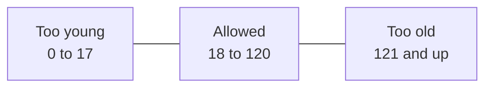

# Equivalence Partitioning: Test One Value From Each Group

A sign-up form asks for your age. You could test age 1, 2, 3, all the way to 200. Or you could notice that 25, 30 and 45 will all be treated exactly the same, and test just one of them. That is equivalence partitioning: a big name for a very natural idea.

!!! note "Before you start"
    You should know what a test is. Knowing a little Python helps for the examples, but every output is on the page.
    To run the examples: `pip install pytest`, then run the commands from the `examples` folder.

## What you will learn

- What a "group" (equivalence partition) is
- How to find the groups in any input, including the invalid ones
- How to pick one good value from each group
- How to turn the groups into pytest tests

## Why this matters at work

Most bugs in forms and APIs are about input: a value the code didn't expect. Equivalence partitioning makes sure you try every *kind* of input at least once, without wasting time on many values of the same kind. It is also the base for [boundary values](boundary-values.md), the technique you will use most.

## The idea in plain words

!!! info "In plain words"
    Think of a cinema with ticket prices: children under 12 pay less, adults pay full price, people over 65 pay less again. To test the ticket machine, you don't need to try every age. One child, one adult and one older person cover all three prices. Each price is a group.



The idea behind it: **if the app treats every value in a group the same way, testing one value tells you about the whole group.**

## Step by step

Say your shop has a new sign-up form with two fields. The rules, from the story: "Age must be 18 to 120. Username must be 3 to 20 characters, letters and numbers only." Here is the code:

```python
--8<-- "modules/think_like_a_tester/test_design_techniques/examples/shop/signup.py"
```

1. **Find the allowed group.** Read the rule and write down the values that should work. For age: 18 to 120. That is one group.

2. **Find the groups around it.** Every range has a group below it and a group above it. For age: under 18, and over 120. These are **invalid groups**. They are not less important. Many real bugs are in how an app handles bad input.

3. **Find the "wrong kind" groups.** This is the step beginners miss. What else could someone type? For a username:

    | Group | Example | Should it work? |
    | --- | --- | --- |
    | Empty | `""` | No |
    | Too short | `al` | No |
    | Allowed | `arshad` | Yes |
    | Too long | 30 letters | No |
    | Right length, wrong characters | `ars had` (a space) | No |

    The last row is easy to forget. The length is fine, but the characters break the rule. It is a different group, because the app has to check something different.

4. **Pick one value from each group.** Pick a normal value from the middle, not one near the edges. Edges get their own tests in the next lesson. So: age 10, 30 and 150.

5. **Turn each group into a test.** In pytest, `parametrize` runs one test once per row, so each group is one line:

    ```python
    --8<-- "modules/think_like_a_tester/test_design_techniques/examples/tests/test_signup_groups.py"
    ```

    Notice the comment on each row says which group it stands for. When someone reads this in six months, they will know *why* 150 is there.

6. **Run them.**

    ```bash
    python -m pytest tests/test_signup_groups.py -q
    ```

    You should see:

    ```text
    8 passed in 0.03s
    ```

    Eight tests cover every kind of input for both fields.

    !!! success "Check: you should now be able to"
        Look at any input, list its groups (valid, invalid, and wrong kind), and pick one value from each.

## When it goes wrong

- **You are not sure if two values are in the same group.** Ask: "Would the code take a different path for these?" If a 15-year-old and a 5-year-old get the same error, they are one group. If 5-year-olds get "ask a parent" instead, that is a new group, and a new test.
- **The rule is vague, like "a sensible age".** Don't guess. Write your groups as a table, with your best guess for each, and send it to the product owner. "Is 120 allowed?" gets an answer in minutes.
- **A test in the "allowed" group fails.** Before you report it, check your value really is in the middle of the group. Then check the rule again. Sometimes the story changed and nobody told you. Either way, it is worth a conversation.

## Common mistakes

!!! warning "Common mistakes"
    - **Only testing allowed values.** Invalid groups find many bugs. Every rule has at least one invalid group on each side.
    - **Testing five values from the same group.** Ages 25, 30, 35, 40 and 45 are one test, repeated. Spend that time on another group.
    - **Forgetting "wrong kind" inputs:** empty, spaces only, letters in a number field, very long text, emoji.

!!! failure "If you see this error"
    **`ModuleNotFoundError: No module named 'shop'`**
    You ran pytest from the wrong folder, or used `pytest` instead of `python -m pytest`. Go to the `examples` folder (the one with `shop/` and `tests/` in it), and run `python -m pytest`.

## Try it yourself

A delivery form asks for a postcode. The rule: "5 digits, numbers only." List the groups, with one example value for each.

??? success "Solution"
    | Group | Example | Should it work? |
    | --- | --- | --- |
    | Allowed: 5 digits | `12345` | Yes |
    | Too short | `123` | No |
    | Too long | `1234567` | No |
    | Empty | `""` | No |
    | Right length, has letters | `12a45` | No |
    | Right length, has a space | `12 45` | No |

    Then ask the team one question the rule doesn't answer: is `01234` allowed? A postcode can start with zero, but if the code stores it as a number, the zero disappears. That is a classic bug.

## References

- [ISTQB Glossary: equivalence partitioning](https://glossary.istqb.org/)
- [pytest: How to parametrize tests](https://docs.pytest.org/en/stable/how-to/parametrize.html)

Written for Python 3.13 and pytest 9. Links checked: November 2026.
