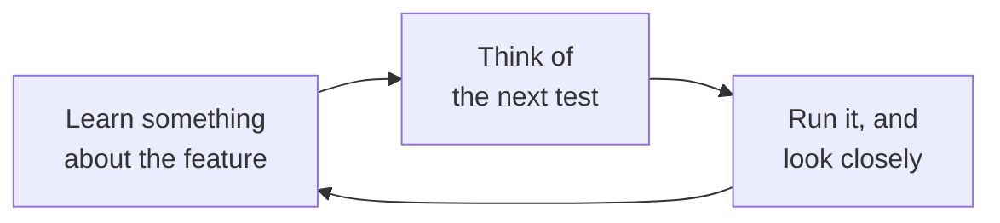

# Exploratory Testing: Learn, Design and Test at the Same Time

Scripted tests check what you already thought of. Exploratory testing is how you find what you didn't think of. You learn the feature, think of the next test, and run it, all at the same time, each result shaping the next idea. It isn't "clicking around". Done well, it has a goal, a time limit and notes, and it finds bugs that no script would.

!!! note "Before you start"
    Read [Error guessing](error-guessing.md) first: its checklist is one of your best tools while exploring.
    You don't need to install anything. The example session uses the order status code from [State transitions](state-transitions.md).

## What you will learn

- What exploratory testing is, and what it isn't
- How to write a charter: the goal of one session
- How to take notes that someone else can use
- How to report a session in a few lines

## Why this matters at work

Automated tests are great at "did anything I know about break?" They can't ask "what else could go wrong?" New features, unclear stories, and areas with many bugs before all need a human who explores. Teams that only run scripts find their surprises in production.

## The idea in plain words

!!! info "In plain words"
    Think of visiting a new city with a goal: "find a good place for lunch near the station, in one hour". You don't follow a fixed route. You look, notice a busy street, try it, and change direction when something looks interesting. But you still have a goal and a time limit, so you don't wander all day.
    An exploratory testing session works the same way.



## Step by step

1. **Write a charter.** A charter is one sentence that says what the session is about. A simple form that many testers use: **Explore** *something*, **with** *some tool or idea*, **to find out** *something*.

    ```text
    Explore cancelling an order
    with actions in the wrong order, repeated actions, and badly typed actions
    to find out whether any order can end up in a wrong status, and whether the messages make sense
    ```

    A good charter is small enough for one session, and clear enough that you know when you are drifting off it.

2. **Set a time box.** 30 to 90 minutes. Set a timer. A short, focused session beats a long, tired one. If you find a whole new area to explore, don't follow it now: write it under "Ideas" for the next session.

3. **Explore, and take notes as you go.** Write the time, what you did, and what you saw. Short notes are fine. Here is a real session on the example shop's order code. Each line was really tried:

    | Time | What I did | What I saw |
    | --- | --- | --- |
    | 00:02 | pay, then pay again | Refused: "Can't pay an order that is paid". Good, no double payment |
    | 00:05 | cancel, then cancel again | Refused: "Can't cancel an order that is cancelled". Good |
    | 00:08 | cancel, then pay | Refused: "Can't pay an order that is cancelled". Good |
    | 00:12 | pay, cancel, pay | Refused: "Can't pay an order that is refunded". Good |
    | 00:16 | "Pay" with a capital P | Refused: "Can't Pay an order that is placed" |
    | 00:19 | "refund", an action that doesn't exist | Refused: "Can't refund an order that is placed" |
    | 00:23 | an empty action (None) | Refused: "Can't None an order that is placed" |

    Look at how the session moved. The first four tries checked the rules, and they held. At 00:16, a typo gave an odd message, and that led to the next idea: what about an action that doesn't exist at all? That's the loop from the picture: learn, think, try.

4. **Sort what you found.** At the end, put everything into three groups:

    - **Bugs:** an unknown action gets the same message as a known one at the wrong time. "Can't refund an order that is placed" suggests refunds exist and you just picked the wrong moment. The message should say the action is unknown.
    - **Questions:** should actions ignore capital letters? Who sends these actions: only our own page, or other programs too?
    - **Ideas:** a test that an unknown action gives its own clear error. The same session through the API next, where input comes straight from users.

5. **Wrap up in three lines.** What you covered, what you didn't, and how it felt. "How it felt" sounds soft, but it is useful: "solid", "shaky" or "blocked" tells your lead where to look next. The full notes are in the [example session](index.md#templates), and the empty sheet is the [exploratory charter template](index.md#templates).

    !!! success "Check: you should now be able to"
        Write a charter, run a time-boxed session, take notes someone else can follow, and sort your findings into bugs, questions and ideas.

## When it goes wrong

- **You spent the whole session on one bug.** That happens. Note the bug, stop, and write the report. Then start a new session with the same charter. Investigating a bug is valuable, but it is a different job from exploring.
- **You can't think of anything to try.** Open the [error guessing checklist](error-guessing.md) and pick one section. Or change who you are: try the feature as a new user, an impatient user, or someone who wants to cheat the system.
- **Your lead asks "what did you actually test?"** That's exactly why you keep notes. Send the charter, the notes table and the three-line wrap-up. Exploration with notes is as easy to review as a script.
- **The same bugs keep showing up in exploring.** Turn them into automated tests. Exploration should find new things, and automation should keep watching the old ones.

## Common mistakes

!!! warning "Common mistakes"
    - **No charter.** Without a goal, you click around, and it is hard to say what was covered.
    - **No notes.** If you can't say what you tried, nobody can trust what you didn't find.
    - **Exploring only the happy path.** Wrong order, repeated actions, bad input, two tabs: that's where exploration pays off.

!!! failure "If you see this error"
    **"We can't plan exploratory testing, it's random."**
    This one is a sentence, not an error, but you will hear it. Answer with a charter list: "This sprint, four sessions of 45 minutes: cancelling, refunds, coupons on mobile, and checkout with a slow network." That is a plan, with a cost and a scope.

## Try it yourself

Write a charter for a 45-minute session on a "change your email address" feature. Then write three things you would try in the first ten minutes.

??? success "Solution"
    A good charter:

    ```text
    Explore changing the email address
    with the error guessing checklist and two browser tabs
    to find out whether someone could take over an account, or lock themselves out
    ```

    Three first tries:

    - Change to an email that another account already uses.
    - Change the email, then try to log in with the old one and the new one.
    - Start the change in one tab, change the password in another, then confirm the email change.

    Notice the charter is about a risk ("take over an account"), not just a feature. A risk gives the session a direction.

## References

- [Elisabeth Hendrickson, *Explore It!*](https://pragprog.com/titles/ehxta/explore-it/): the book that made charters popular
- [Session-Based Test Management](https://www.satisfice.com/download/session-based-test-management): the original article on running and reporting time-boxed sessions
- [ISTQB Glossary: exploratory testing](https://glossary.istqb.org/)

Links checked: November 2026.
