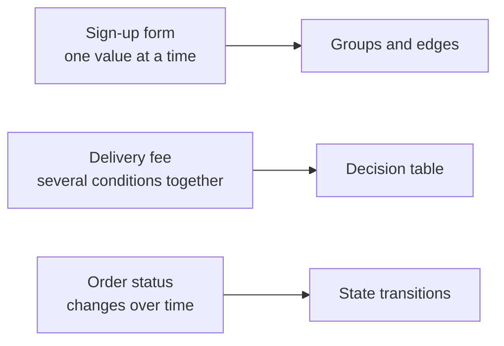

# Test Design Techniques: Find the Tests That Catch the Most Bugs

No one can test every possible input. A form with one number field already has millions of possible values. Test design techniques are simple, well-tried ways to pick a small set of tests that still finds most of the bugs. Every experienced tester uses them, often without naming them. This topic names them, and shows you how to use each one on a real feature.

!!! info "In plain words"
    Think of a cook tasting soup. They don't drink the whole pot to know if it needs salt. One spoon from the middle tells them about the whole pot. But they also check the bottom, where things burn, and the edges, where it cools first.
    Test design works the same way. One test stands in for a whole group of similar inputs. Then you add extra tests at the places where bugs like to hide.

!!! example "Your task"
    Your shop launches member accounts on Friday. Three things change at once: a new sign-up form, new delivery fees for members, and members can now cancel orders. Your lead says: "We have two days. We can't test everything. Which tests give us the most confidence?"
    This page walks through that task.

## Jump to what you need

- [Equivalence partitioning](equivalence-partitioning.md): sort inputs into groups, and test one from each
- [Boundary values](boundary-values.md): test right at the edges, where off-by-one bugs live
- [Decision tables](decision-tables.md): when the result depends on several conditions together
- [State transitions](state-transitions.md): for anything with a status that changes, like an order
- [Pairwise testing](pairwise-testing.md): cover every pair of settings (browsers, devices, payments) with few tests
- [Error guessing](error-guessing.md): try the inputs and actions that break software again and again
- [Exploratory testing](exploratory-testing.md): focused, time-boxed sessions that find what scripts miss
- [Checklist-based testing](checklist-based-testing.md): short checklists for web forms and APIs, so the basics are never skipped
- [Statement and branch coverage](statement-and-branch-coverage.md): see which lines and branches your tests really run

## 1. Understand the ask

Read the three stories, then ask the questions they don't answer:

| You ask | The product owner answers |
| --- | --- |
| Sign-up says "age 18 to 120". Is 120 itself allowed? | Yes, both ends are allowed |
| What can a username contain? | Letters and numbers, 3 to 20 characters |
| Is express delivery free for big orders, like standard? | No. Express is never free. Members pay $4.99 instead of $9.99 |
| Can a member cancel an order that has shipped? | No. Only before it ships. After paying, cancelling gives a refund |
| What does "done" mean for testing? | Automated tests for the rules, and a short list of what was not tested |

Look at the third question. The story never said express might be free. You only think to ask because you are already thinking in combinations. This is the first thing test design gives you: better questions.

## 2. Picture the system

Three features, three shapes of problem. Each shape has a technique that fits it:



Choosing the technique starts with asking "what kind of rule is this?" A range of numbers, a mix of yes/no conditions, or a status that moves.

## 3. Learn just enough

You don't need a textbook. Spend 30 minutes on:

1. This topic's [equivalence partitioning](equivalence-partitioning.md) and [boundary values](boundary-values.md) lessons: they belong together, and cover most form fields.
2. The [ISTQB Foundation syllabus](https://istqb.org/certifications/certified-tester-foundation-level-ctfl-v4-0/), chapter 4, "Test Analysis and Design": the shared names for these techniques, so your plan uses words the whole team knows.

## 4. Get something running

Before you design anything, run the developers' existing tests and try each feature once by hand. Sign-up works with a normal name and age. Delivery shows a fee. An order can be paid. The basics are alive, so the detailed design is worth doing now. (If the basics were broken, the right move would be to report that first, and wait.)

## 5. Decide what to test

Now the techniques do the real work. For each feature, fill one worksheet from the [templates](#templates):

- **Sign-up age and username:** groups and edges. Age has three groups (too young, allowed, too old) and four edge values (17, 18, 120, 121). Username has five groups and four edges. That makes 16 tests instead of millions.
- **Delivery fee:** a decision table. Three yes/no conditions give 8 rows. Each row is one test.
- **Order status:** a state table. 6 statuses and 4 actions give 24 cells. 5 are allowed moves, and the other 19 must be refused.

Then sort them by risk. Money first (delivery fee), then what stops a sale (sign-up), then cancelling.

## 6. Write a one-page plan

The plan, shared with the team before any test code is written:

- **In scope:** sign-up rules, delivery fees, order status rules, each with the technique above.
- **Not in scope:** what the pages look like, speed, and other browsers. Each is noted as a risk, with a reason.
- **How:** unit tests in pytest, one row of each worksheet per test.
- **Done when:** all worksheet rows are tests, every test passes, and the product owner has agreed the decision table.

## 7. Build in small steps

Write the tests one technique at a time, and run them after each one. The whole set runs in a blink:

```bash
python -m pytest -q
```

```text
56 passed in 0.03s
```

Then do something many people skip: break each rule on purpose, to check the tests would notice. For age, change `MIN_AGE <= age` to `MIN_AGE < age`, so an 18-year-old is refused. The group tests still pass. Only the edge test catches it:

```text
FAILED tests/test_signup_edges.py::test_age_at_the_edges[18-expected1] - Asse...
1 failed, 7 passed in 0.03s
```

That one line shows why you need both techniques. The [boundary values](boundary-values.md) lesson walks through it.

## 8. Report and get feedback

Show your lead the filled decision table, because it is easy for anyone to read and check. Point out the row the story didn't cover (express for big orders), and the answer the product owner gave. Also list what you didn't test, and why. The lead can now say "yes, that is enough for Friday", or "add this".

## 9. Keep learning on your own

Use the worksheets on your next real story, even a small one. After a few times, you will start to see groups and edges as you read. Next, read [Test cases](../test-cases/index.md) to turn these test ideas into test cases other people can run, and [Static testing and reviews](../reviews/index.md) to find missing rules before any code exists.

!!! tip "How an experienced SDET thinks about this"
    - "What kind of rule is this?" picks the technique. A range: groups and edges. A mix of conditions: a decision table. A status: a state table.
    - A worksheet is a thinking tool first, and a test list second. The questions it raises are often worth more than the tests.
    - Bugs love edges. When in doubt, add the value right at the limit.
    - A test you have never seen fail might not be testing anything. Break the rule once, on purpose, and watch it fail.

!!! warning "Red flags"
    - Test ideas are only "happy path" values like age 30.
    - Nobody asked what happens exactly at the limit.
    - The result depends on three conditions, and there are two tests.
    - Expected results were copied from what the app does today, not from the rules.
    - The team can't say which combinations were left out on purpose.

!!! question "Stuck? Try this"
    - **The story has no clear rule to work from.** Write down your best guess as a table, and ask the product owner "is this right?" People correct a wrong table much faster than they answer an open question.
    - **There are too many combinations.** Split the rule into smaller rules first. If it is still too big, [pairwise testing](pairwise-testing.md) picks a smart small set.
    - **You don't know which technique fits.** Ask: does one value matter at a time (groups and edges), several conditions together (decision table), or what happened before (state transitions)?
    - **The developers say "we already tested that".** Show them your table and ask which rows their tests cover. Gaps usually appear in a minute, and nobody has to argue.

## Templates

**Every file is below, ready to copy.** The whole folder is also [on GitHub](https://github.com/myopensdet/myopensdet.github.io/tree/main/modules/think_like_a_tester/test_design_techniques/templates).

Copy these into your own notes or project. Each file starts with a line that says where it came from.

=== "Groups and edges worksheet"

    ```markdown
    --8<-- "modules/think_like_a_tester/test_design_techniques/templates/partitions_and_boundaries_worksheet.md"
    ```

=== "boundaries.py"

    ```python
    --8<-- "modules/think_like_a_tester/test_design_techniques/templates/boundaries.py"
    ```

=== "Decision table worksheet"

    ```markdown
    --8<-- "modules/think_like_a_tester/test_design_techniques/templates/decision_table_worksheet.md"
    ```

=== "decision_table.py"

    ```python
    --8<-- "modules/think_like_a_tester/test_design_techniques/templates/decision_table.py"
    ```

=== "State transition worksheet"

    ```markdown
    --8<-- "modules/think_like_a_tester/test_design_techniques/templates/state_transition_worksheet.md"
    ```

=== "pairwise.py"

    ```python
    --8<-- "modules/think_like_a_tester/test_design_techniques/templates/pairwise.py"
    ```

=== "Error guessing checklist"

    ```markdown
    --8<-- "modules/think_like_a_tester/test_design_techniques/templates/error_guessing_checklist.md"
    ```

=== "Exploratory charter"

    ```markdown
    --8<-- "modules/think_like_a_tester/test_design_techniques/templates/exploratory_charter.md"
    ```

=== "Example session notes"

    ```markdown
    --8<-- "modules/think_like_a_tester/test_design_techniques/examples/session_notes_cancel_order.md"
    ```

=== "Web form checklist"

    ```markdown
    --8<-- "modules/think_like_a_tester/test_design_techniques/templates/web_form_checklist.md"
    ```

=== "API endpoint checklist"

    ```markdown
    --8<-- "modules/think_like_a_tester/test_design_techniques/templates/api_endpoint_checklist.md"
    ```

=== ".coveragerc"

    ```ini
    --8<-- "modules/think_like_a_tester/test_design_techniques/templates/.coveragerc"
    ```

=== "How to use them"

    1. Pick the worksheet that fits the rule: one value (groups and edges), several conditions (decision table), or a changing status (state transitions).
    2. Fill it from the story, word for word. Every blank you can't fill is a question for the team.
    3. Use `python boundaries.py LOW HIGH` and `python decision_table.py "A" "B" "C"` to skip the busy work.
    4. Turn each row into one test, or one row of `pytest.mark.parametrize`.
    5. For settings like browsers and devices, run `python pairwise.py NAME=a,b NAME=c,d` to get a small set that covers every pair.
    6. Keep the error guessing and the two checklists next to every test plan, and add your team's own bugs to them.
    7. Put `.coveragerc` in your project's main folder, then run `python -m coverage run -m pytest` and `python -m coverage report` to find code no test runs.

## Official resources

- [ISTQB Certified Tester Foundation Level](https://istqb.org/certifications/certified-tester-foundation-level-ctfl-v4-0/): chapter 4 covers these techniques
- [ISTQB Glossary](https://glossary.istqb.org/): equivalence partitioning, boundary value analysis, decision table testing, state transition testing
- [pytest: How to parametrize tests](https://docs.pytest.org/en/stable/how-to/parametrize.html): turn a worksheet into tests
- [coverage.py](https://coverage.readthedocs.io/): measure which lines and branches your tests run
