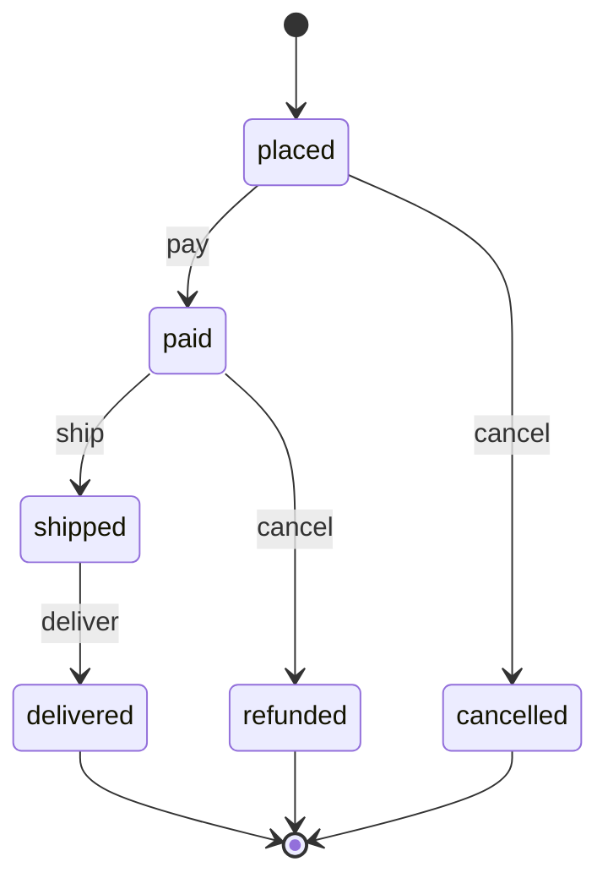

# State Transition Testing: For Anything With a Status That Changes

An order is placed, then paid, then shipped, then delivered. An account is new, then active, then locked. A support ticket is open, then in progress, then closed. Whenever something has a status, the same action can be fine in one status and a disaster in another. Cancelling a placed order is normal. Cancelling a delivered one should be impossible. State transition testing checks both.

!!! note "Before you start"
    Read [Decision tables](decision-tables.md) first: a state table works in a similar way.
    To run the examples: `pip install pytest`, then run the commands from the `examples` folder.

## What you will learn

- What states, actions and transitions are
- How to draw a state diagram and turn it into a state table
- How to test every allowed move, and every move that must be refused
- Why expected results must come from the rules, not the code

## Why this matters at work

Some of the worst bugs live here: a refund paid twice, a shipped order cancelled, a locked account that still logs in. They happen because people test the normal path (place, pay, ship, deliver) and forget to ask what happens when an action comes at the wrong moment. Users and attackers find those moments quickly.

## The idea in plain words

!!! info "In plain words"
    Think of a washing machine. It has states: off, washing, spinning, done. Some buttons work in some states and not others. You can open the door when it is done, but not while it is spinning. A good washing machine test presses every button in every state, and checks the door stays shut while spinning.

Three words to know:

- **State**: the status something is in now, like "paid".
- **Action** (or event): something that happens, like "ship".
- **Transition**: an allowed move from one state to another, caused by an action.

Here are the order rules from the story:



## Step by step

1. **List the states and actions.** From the story: 6 states (placed, paid, shipped, delivered, cancelled, refunded) and 4 actions (pay, cancel, ship, deliver).

2. **Draw the diagram.** One box per state, one arrow per allowed move. Draw it by hand first, even on paper. The diagram above is the result. A drawing is the fastest way to spot a missing arrow, and the easiest thing to show the product owner.

3. **Turn it into a state table.** Rows are states, columns are actions. Each cell says where the order goes, or "no":

    | State now | pay | cancel | ship | deliver |
    | --- | --- | --- | --- | --- |
    | placed | paid | cancelled | no | no |
    | paid | no | refunded | shipped | no |
    | shipped | no | no | no | delivered |
    | delivered | no | no | no | no |
    | cancelled | no | no | no | no |
    | refunded | no | no | no | no |

    The diagram shows 5 arrows. The table shows something the diagram hides: **19 cells say "no"**. Every one of them is a test too. "Pay a paid order" is a double charge. "Cancel a shipped order" is a refund for goods that are already on the way.

4. **Write the tests: allowed moves, refused moves, and the happy path.** Here is the code being tested:

    ```python
    --8<-- "modules/think_like_a_tester/test_design_techniques/examples/shop/order_status.py"
    ```

    And the tests. Read the comment at the top carefully. It is the most important line in this lesson:

    ```python
    --8<-- "modules/think_like_a_tester/test_design_techniques/examples/tests/test_order_states.py"
    ```

    `PATH_TO` gets an order into each state by doing real actions, the way a customer would. `NOT_ALLOWED` is built from the test's own list of allowed moves, so every other cell in the table becomes a test. And each refused move also checks that **the status didn't change**. A refused action that still changes something is a sneaky bug.

    ```bash
    python -m pytest tests/test_order_states.py -q
    ```

    ```text
    25 passed in 0.03s
    ```

    5 allowed moves, 19 refused moves and 1 happy path: 25 tests from one small table.

5. **See it catch a move the rules don't allow.** A developer adds "cancel a shipped order" to the code, thinking it would be nice for customers. It is not in the rules. Run the tests:

    ```text
    >       with pytest.raises(NotAllowedError, match=f"Can't {action} an order that is {start}"):
    E       Failed: DID NOT RAISE NotAllowedError

    FAILED tests/test_order_states.py::test_every_other_move_is_refused[shipped-cancel]
    1 failed, 24 passed in 0.03s
    ```

    "DID NOT RAISE" means the app allowed something it should have refused. The test name tells you exactly which cell: shipped, cancel. Maybe it *is* a good idea. But it is a change to the rules, and the product owner should decide, not a line of code.

    !!! success "Check: you should now be able to"
        Draw a state diagram, turn it into a table, and explain why the "no" cells matter as much as the arrows.

## When it goes wrong

- **Your tests pass, but they would pass with the bug too.** This happened while writing this lesson. The first version of the test built its "not allowed" list from the code's own `TRANSITIONS` table. When the shipped-cancel bug was added to the code, it was also added to the test's idea of "allowed", and all tests stayed green. The fix: the test keeps its own list, written from the story. **Never build expected results from the code you are testing.** Then break the code on purpose once, and check a test fails.
- **There are too many states to draw.** Draw only the states that matter for your story, and group the rest ("any final state"). A real order system might have 20 states, but a cancelling story touches only five or six.
- **Nobody knows what should happen in a "no" cell.** That is a real finding. Should paying twice show an error, or quietly do nothing? Ask. And ask what the user should *see*: "Can't cancel an order that is shipped" is much kinder than a blank page.
- **Two things happen at once.** The customer presses cancel while the warehouse presses ship. Which wins? Unit tests can't easily show this. Note it as a risk in your plan, and test it at the API level later, by sending both requests close together.

## Common mistakes

!!! warning "Common mistakes"
    - **Testing only the happy path.** Place, pay, ship, deliver works. But most of the risk is in the 19 "no" cells.
    - **Not checking the state after a refused action.** The error message appeared, but did the order still change to "refunded"? Check both.
    - **Copying the code's state table into the test.** A wrong table then passes its own tests. Write the test's table from the rules.

!!! failure "If you see this error"
    **`Failed: DID NOT RAISE NotAllowedError`**
    The app allowed a move the test expected it to refuse. Check the story first: is the move really not allowed? If the rule is right, it is a bug, and the test name (like `[shipped-cancel]`) tells you which state and action.

## Try it yourself

A user account has these rules: "A new account becomes active when the email is confirmed. After 3 wrong passwords, an active account is locked. A support agent can unlock it, and it is active again. Anyone can close their account, unless it is locked." List the states and actions, and find three moves that must be refused.

??? success "Solution"
    **States:** new, active, locked, closed. **Actions:** confirm email, 3 wrong passwords, unlock, close.

    | State now | confirm | 3 wrong | unlock | close |
    | --- | --- | --- | --- | --- |
    | new | active | no? | no | closed |
    | active | no | locked | no | closed |
    | locked | no | no | active | **no** |
    | closed | no | no | no | no |

    Three moves that must be refused: close a locked account (the rule says so), unlock an active account, and confirm an already-active account.

    Notice the "no?" in the first row. Can a new account get locked by wrong passwords before the email is confirmed? The story doesn't say. That is a question for the product owner, found by the table.

## Quick check

1. What is a transition?

    ??? question "Answer"
        An allowed move from one state to another, caused by an action, like "pay" moving an order from placed to paid.

2. Why test the "no" cells?

    ??? question "Answer"
        They are actions at the wrong moment, like paying twice or cancelling a shipped order. Many serious bugs live there.

3. Why must the test keep its own list of allowed moves?

    ??? question "Answer"
        If the test copies the code's list, a wrong list in the code passes its own tests. The test's list must come from the rules.

## References

- [ISTQB Glossary: state transition testing](https://glossary.istqb.org/)
- [Mermaid: state diagrams](https://mermaid.js.org/syntax/stateDiagram.html): draw diagrams like the one above in Markdown
- [pytest: Assertions about expected exceptions](https://docs.pytest.org/en/stable/how-to/assert.html#assertions-about-expected-exceptions)

Written for Python 3.13 and pytest 9. Links checked: November 2026.
