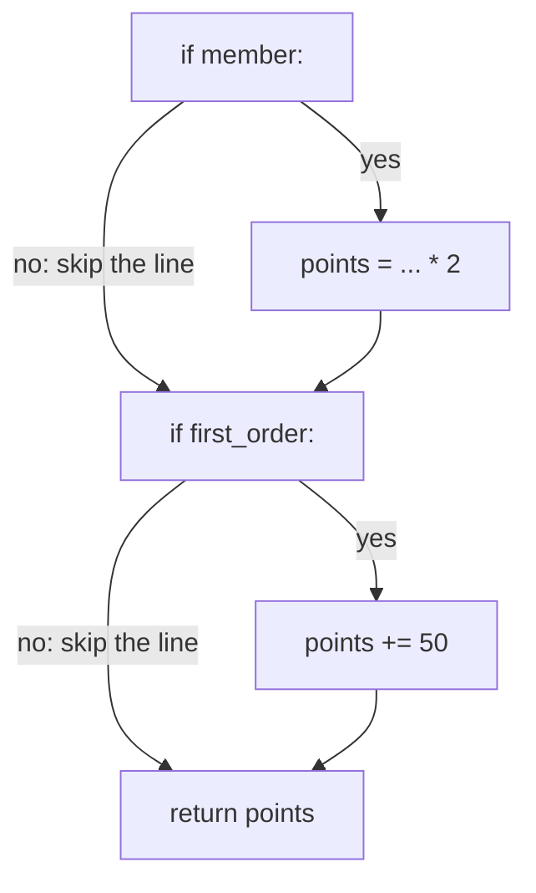

# Statement and Branch Coverage: See Which Code Your Tests Really Run

Every technique so far started from the rules: the story, the spec, the settings. This one starts from the code. Coverage tools watch your tests run and tell you which lines, and which ways through each `if`, were never used. That is called white-box testing, because you look inside the box. It is the quickest way to find code that no test has ever touched.

!!! note "Before you start"
    You should be able to read a short Python function with `if` in it, and run tests with pytest.
    To run the example: `pip install pytest coverage`, then run the commands from the `examples/coverage_demo` folder.

## What you will learn

- What statement coverage and branch coverage measure
- How to run [coverage.py](https://coverage.readthedocs.io/) with pytest, and read the report
- A real bug hiding behind "100% coverage"
- What coverage can't tell you, and how teams use the number well

## Why this matters at work

Sooner or later someone will ask "what is our test coverage?" and put a number on a dashboard. Knowing what the number means, and what it doesn't, keeps you from both mistakes: ignoring untested code, and believing a high number means the code is well tested.

## The idea in plain words

!!! info "In plain words"
    Think of a building with many rooms and doors. A safety inspector who says "I walked through every room" sounds thorough. But did they try every door? Some rooms have two doors, and one of them might be locked or broken.
    **Statement coverage** asks "did the tests walk through every room (every line)?" **Branch coverage** asks "did they also try every door (every way out of each `if`)?"



An `if` with no `else` still has two ways out: into the block, and past it. Statement coverage only notices the first one. Branch coverage counts both.

## Step by step

1. **Look at the code and its test.** A loyalty points rule: one point per whole dollar, members get double, and a first order gets 50 extra points. This version has a bug, on purpose. Can you spot it before the tools do?

    ```python
    --8<-- "modules/think_like_a_tester/test_design_techniques/examples/coverage_demo/points.py"
    ```

    And its only test:

    ```python
    --8<-- "modules/think_like_a_tester/test_design_techniques/examples/coverage_demo/test_points.py"
    ```

2. **Measure statement coverage.** `coverage run` runs pytest while watching. `coverage report` prints the result. `-m` shows the missing lines, and `--include` keeps the report to the code you are testing:

    ```bash
    python -m coverage run -m pytest -q
    python -m coverage report -m --include=points.py
    ```

    You should see:

    ```text
    Name        Stmts   Miss  Cover   Missing
    -----------------------------------------
    points.py       6      0   100%
    -----------------------------------------
    TOTAL           6      0   100%
    ```

    100%. Every line ran. It would be easy to stop here.

3. **Now measure branch coverage.** Add `--branch` to the run:

    ```bash
    python -m coverage run --branch -m pytest -q
    python -m coverage report -m --include=points.py
    ```

    ```text
    Name        Stmts   Miss Branch BrPart  Cover   Missing
    -------------------------------------------------------
    points.py       6      0      4      2    80%   10->12, 12->14
    -------------------------------------------------------
    TOTAL           6      0      4      2    80%
    ```

    Read the new columns:

    - **Branch 4:** there are four ways out of the two `if`s (yes and no, twice).
    - **BrPart 2:** two `if`s were only ever taken one way.
    - **Missing `10->12`:** the jump from line 10 (`if member:`) straight to line 12 never happened. In other words, **no test used a customer who is not a member.**
    - **Missing `12->14`:** no test used an order that isn't the first.

4. **Write a test for the missing branch.** "Not a member" is a big group of customers. Add one test for it:

    ```python
    def test_a_customer_who_is_not_a_member():
        # $30.00: 30 points, not doubled, no first-order bonus
        assert points_for(3000, member=False, first_order=False) == 30
    ```

    ```bash
    python -m pytest -q
    ```

    ```text
    >       return points
                   ^^^^^^
    E       UnboundLocalError: cannot access local variable 'points' where it is not associated with a value

    points.py:14: UnboundLocalError
    FAILED test_points.py::test_a_customer_who_is_not_a_member - UnboundLocalErro...
    1 failed, 1 passed in 0.03s
    ```

    There's the bug. `points` is only set inside `if member:`. For everyone who isn't a member, the variable doesn't exist, and the code crashes. With 100% statement coverage, every non-member customer would have hit an error at checkout.

5. **Fix it, and measure again.** Set the points first, then double them for members:

    ```python
    points = order_cents // 100
    if member:
        points *= 2
    ```

    ```bash
    python -m coverage run --branch -m pytest -q
    python -m coverage report -m --include=points.py
    ```

    ```text
    Name        Stmts   Miss Branch BrPart  Cover   Missing
    -------------------------------------------------------
    points.py       7      0      4      0   100%
    -------------------------------------------------------
    TOTAL           7      0      4      0   100%
    ```

    Every branch is covered now, with two tests.

6. **Know what 100% branch coverage still doesn't mean.** Two tests reached 100%: "member, first order" and "not a member, not first order". But nobody has tested "member, not first order". Branch coverage checks each `if` on its own, not every mix of them. Mixes are what [decision tables](decision-tables.md) are for. And coverage can never tell you about code that is *missing*: if the story says "no points for gift cards" and nobody wrote that rule, there is no line to cover.

7. **Save the settings in a file.** Typing `--branch` every time is easy to forget. Put the [.coveragerc template](index.md#templates) in your project's main folder:

    ```ini
    --8<-- "modules/think_like_a_tester/test_design_techniques/templates/.coveragerc"
    ```

    `fail_under` makes the report fail if coverage drops below a number. Here is what that looks like with the buggy version and a limit of 90:

    ```text
    Coverage failure: total of 80 is less than fail-under=90
    ```

    The command ends with exit code 2, so a CI pipeline stops. Use this to stop coverage *going down*, not as a target to chase.

    !!! success "Check: you should now be able to"
        Run coverage with and without branches, read the Missing column, and explain how 100% line coverage hid the crash.

## When it goes wrong

- **Someone wants "100% coverage" as a rule.** Explain the cost. The last few percent are often error handling and odd cases that take a long time to test, and people start writing tests that run code without checking anything, just to move the number. A better rule: "new and changed code is covered, and coverage doesn't go down".
- **Coverage is high, but bugs still reach users.** Coverage says the code *ran*, not that the test *checked* the result. A test with no `assert` can cover 100% of a function. Read the tests for the most important code, and check each one really asserts something. Breaking the code on purpose, like in the other lessons, is the honest test of a test.
- **The report includes files you don't care about**, like the tests themselves or other people's packages. Use `--include` on the command line, or `source` and `omit` in `.coveragerc`, so the number is about your code.
- **The number is different on your computer and in CI.** Usually one of them measures branches and the other doesn't, or they include different files. Put the settings in `.coveragerc` and commit it, so everyone measures the same way.

## Common mistakes

!!! warning "Common mistakes"
    - **Only measuring lines.** Turn on branch coverage. It costs nothing and finds the skipped paths.
    - **Treating coverage as a quality score.** It is a map of what was never run, not proof that what ran is right.
    - **Writing tests from the coverage report alone.** Use the report to find untested paths, then write the expected result from the rules, not from what the code does.

!!! failure "If you see this error"
    **`No data to report.`**
    The report found no measurements. Either you forgot to run `python -m coverage run -m pytest` first, or you ran it in a different folder. Run both commands from the same folder. Coverage saves its data in a file called `.coverage` in that folder (add it to `.gitignore`).

## Try it yourself

This function decides if an order can be returned:

```python
def can_return(days_since_delivery: int, opened: bool) -> bool:
    if opened:
        return days_since_delivery <= 14
    return days_since_delivery <= 30
```

Your only test is `can_return(10, opened=True) is True`. What does statement coverage say? What does branch coverage say? Which tests would you add?

??? success "Solution"
    - **Statement coverage** isn't 100%: the last line (`return days_since_delivery <= 30`) never runs, because the test always goes into the `if`.
    - **Branch coverage** shows the same gap: the "not opened" branch is missing.
    - Add a test for a parcel that isn't opened, for example `can_return(20, opened=False) is True`.

    Then add the edges, because coverage won't ask for them: day 14 and 15 for opened, day 30 and 31 for not opened. That is [boundary values](boundary-values.md) doing the work coverage can't.

## Quick check

1. What is the difference between statement and branch coverage?

    ??? question "Answer"
        Statement coverage checks every line ran. Branch coverage also checks every way out of each `if` was taken, including the "skip it" way.

2. In this lesson, what did 100% statement coverage hide?

    ??? question "Answer"
        A crash for every customer who isn't a member, because no test took the "not a member" branch.

3. What is a better coverage rule than "100%"?

    ??? question "Answer"
        New and changed code is covered, and total coverage doesn't go down.

## References

- [coverage.py documentation](https://coverage.readthedocs.io/): running, reports, and the `.coveragerc` settings
- [coverage.py: Branch coverage measurement](https://coverage.readthedocs.io/en/latest/branch.html): how branches are counted
- [Martin Fowler: Test Coverage](https://martinfowler.com/bliki/TestCoverage.html): why a high number isn't the goal
- [ISTQB Glossary: statement coverage, branch coverage](https://glossary.istqb.org/)

Written for Python 3.13, pytest 9 and coverage.py 7.17. Links checked: November 2026.
