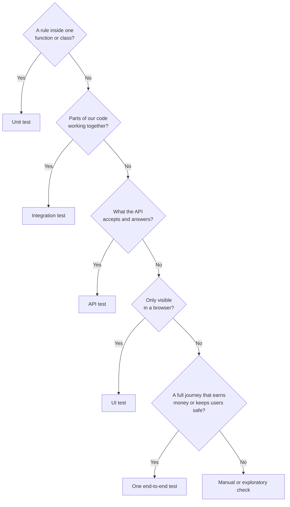

# Choosing the Right Test Level: A Decision Chart for Every Test Idea

You know the levels and the shapes. Now comes the part you will do every week at work: a new feature arrives, you have a list of test ideas, and you have to decide where each one goes. This lesson gives you five questions to ask, and walks through a real feature with them.

!!! note "Before you start"
    Read [The test levels](the-test-levels.md) and [The test pyramid](the-test-pyramid.md) first.
    You don't need to install anything for this lesson.

## What you will learn

- The one question behind every level choice
- A five-question decision chart you can use for any test idea
- A worked example: sorting the test ideas for a new coupon feature
- What to do when an idea fits no level, or several

## Why this matters at work

Choosing the level is a small decision you make many times a day. Get it right, and the suite stays fast and trusted. Get it wrong a hundred times, and you end up with the ice cream cone from the [topic page](index.md#4-get-something-running). It is also a question that comes up in interviews: "How would you test this feature?" A good answer always says *at which level*, and why.

## The idea in plain words

!!! info "In plain words"
    Think of a doctor. For a sore throat, they look in your mouth. They don't order a full body scan.
    Testing works the same way. Use the smallest, quickest check that can really find the problem. Save the big, slow checks for problems only they can find.

The one question behind it all is: **"What is the lowest level that can really catch this bug?"**



## Step by step

1. **Get the decision chart.** It is one page. Copy it from the [topic page](index.md#templates), or read it here:

    ```markdown
    --8<-- "modules/think_like_a_tester/test_levels_and_the_pyramid/templates/test_level_decision_chart.md"
    ```

    Go down the questions in order, and stop at the first "yes". The order matters: it pushes every idea as low as it can go.

2. **Write down the test ideas first, without levels.** Say your team is adding coupons to checkout. The story says: "SAVE10 takes 10% off. Unknown coupons show an error. Free shipping is worked out after the discount." List your ideas, without thinking about levels yet:

    - SAVE10 takes 10% off
    - A $50.00 order with SAVE10 pays shipping
    - An unknown coupon is refused
    - The error message shows under the coupon box
    - Should lower-case "save10" work? (The story doesn't say)
    - A customer can buy with a coupon, from search to payment
    - The total updates without reloading the page
    - The coupon box is easy to find on a phone

    Listing first, sorting second, keeps you from forcing ideas into the level you happen to like. Notice the lower-case idea is a question, not a check. Writing ideas down often shows you what the story forgot to say.

3. **Put each idea through the questions.** Here is the finished table, the "My test ideas" part of the chart:

    | Test idea | Level | Why this level |
    | --- | --- | --- |
    | SAVE10 takes 10% off | Unit | A rule in one function: `discount()` |
    | Lower-case "save10" | Unit, after asking | Same function, one more input. Today the code refuses it, so ask the product owner which is right before writing the test |
    | A $50.00 order with SAVE10 pays shipping | Integration | The cart combining two rules. This caught a real bug in [the test levels](the-test-levels.md) lesson |
    | An unknown coupon is refused | API | What the API answers: status 400 and the error text |
    | The error shows under the coupon box | UI | Only visible in a browser |
    | The total updates without reloading | UI | Needs the page's JavaScript |
    | Buy with a coupon, from search to payment | End-to-end | A journey that earns money. One test, happy path only |
    | The coupon box is easy to find on a phone | Manual | A human has to judge "easy" |

    Count them: two unit, one integration, one API, two UI, one end-to-end, one manual. Not a perfect pyramid, and that is fine for one small feature. What matters is that no rule is being tested through the browser.

4. **Look out for hidden rules in UI ideas.** "The error shows under the coupon box" is a UI idea. But it hides a rule: *which* error text? The exact text "Unknown coupon: FREE100" is already checked by the API test. So the UI test only needs to check that *an* error appears in the right place. Not the wording, not every bad coupon. That keeps it short, and stops it breaking when someone improves the message.

5. **Check the shape.** Tick the boxes at the end of the chart:

    - Most of the new tests are unit or integration tests? Three out of seven automated tests. Close enough for a feature this size.
    - Each UI or end-to-end test checks something no lower test can? Yes.
    - Nothing tested at three levels? Yes. The 10% rule is tested once, low down.

    !!! success "Check: you should now be able to"
        Take a list of test ideas, run each one through the five questions, and explain the level you chose in one sentence.

## When it goes wrong

- **An idea fits two levels.** Pick the lower one. If you are still unsure, write the lower test first and ask: "If this passes, would I still worry?" If yes, add one test a level higher.
- **The code makes the low level impossible.** Sometimes the rule is buried inside a big function that also talks to the database, so you can't unit test it. Test it at the API level for now, and tell the developers. Asking "could we pull this rule into its own function?" is a fair request, and it often makes the code better too.
- **The team wants every idea as a UI test, "because that is what users see".** Show them step 3 of [the test levels](the-test-levels.md) lesson: the bug that seven unit tests missed and one integration test caught, in a fraction of a second. Then offer to keep one UI test per journey, so users' view is still covered.
- **An idea fits no level at all.** Things like "is this easy to use?" or "does this look right?" need a person. That's not a failure of automation. Put them on the manual or exploratory list, and do them on purpose.

## Common mistakes

!!! warning "Common mistakes"
    - **Choosing the level before listing the ideas.** You end up with "UI tests for the coupon feature" and miss the rules underneath.
    - **Repeating every detail at every level.** Test the details low. Higher up, check once that the rule reaches the user.
    - **Forgetting the manual list.** Some ideas need a human. Write them down too, or nobody will check them.

!!! failure "If you see this error"
    **A test you placed at the unit level needs a database to run.**
    Then it's not a unit test, whatever its folder says. Move it to `tests/integration`, or replace the database with a simple fake. The [mocking](../../api-testing/mocking-and-stubbing/index.md) topic shows how.

## Try it yourself

The shop adds a new feature: "Customers can save their cart and come back to it within 7 days. After 7 days, the saved cart is deleted." Write four test ideas, and give each a level with a reason.

??? success "Solution"
    One good answer:

    | Test idea | Level | Why this level |
    | --- | --- | --- |
    | A cart saved 6 days ago is kept, one saved 8 days ago is deleted | Unit | A date rule. Test the edges here: day 7 and day 8 |
    | Saving a cart writes it to the database and reading it back gives the same items | Integration | Our code and the database together |
    | Asking for someone else's saved cart is refused | API | What the API answers: permissions |
    | A customer saves a cart, logs out, logs in, and sees it again | End-to-end | A full journey, one happy path |

    Notice the date edges are tested once, low down. The end-to-end test doesn't wait 7 days. It only checks that the journey works.

## References

- [The Practical Test Pyramid](https://martinfowler.com/articles/practical-test-pyramid.html): see "Avoid Test Duplication"
- [Google Testing Blog: Just Say No to More End-to-End Tests](https://testing.googleblog.com/2015/04/just-say-no-to-more-end-to-end-tests.html)
- [Martin Fowler: Test Double](https://martinfowler.com/bliki/TestDouble.html): fakes and stubs, for when a low level needs help

Links checked: November 2026.
