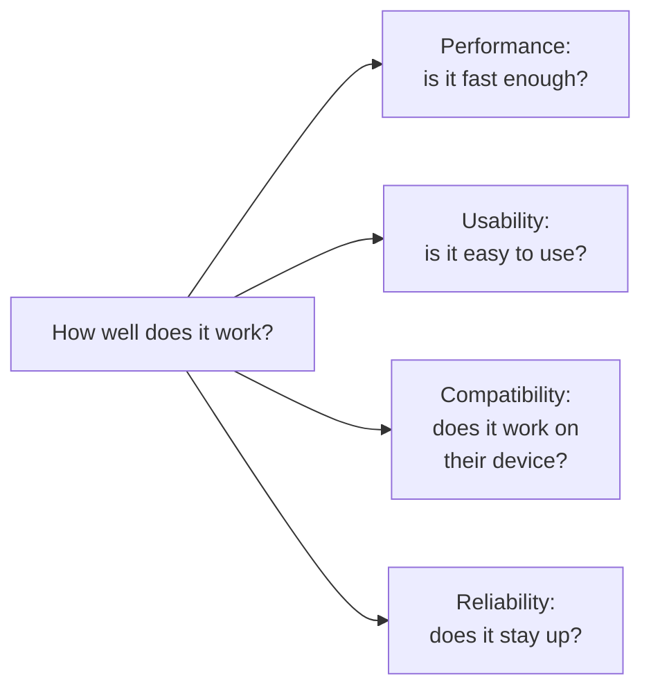

# Non-Functional Testing: Speed, Ease of Use, Compatibility and Reliability

Every test so far asked "does it give the right answer?" But an app can give the right answer and still fail its users. The page takes eight seconds to load. The button is hidden on a phone. The site falls over every Friday evening. Checking these things is called non-functional testing, and it is where many real complaints come from.

!!! note "Before you start"
    Read [The test levels](the-test-levels.md) first.
    **Functional** means "what the app does". **Non-functional** means "how well it does it": how fast, how easy, on which devices, and how often it stays up.

## What you will learn

- The four kinds of non-functional testing you will meet first
- How to run a simple speed check, and read the numbers
- Why the 95th percentile tells you more than the average
- Quick, cheap ways to check usability, compatibility and reliability

## Why this matters at work

Users rarely write "the discount was off by one cent". They write "the app is so slow" and "I can't find the pay button on my phone". If you only test functions, you miss the problems users feel most. And these problems are often found late, when they are expensive to fix, because nobody planned to look for them.

## The idea in plain words

!!! info "In plain words"
    Think about a new kettle. The functional test: does it boil water? Yes. Good.
    The non-functional tests: how long does it take? Can you lift it with one hand? Does it fit under your tap? Does it still work after a year of use? A kettle that boils water in twenty minutes is a bad kettle, even though it "works".



There are more kinds, like security and accessibility, and this site gives each of them its own topic. These four are where most people start.

## Step by step

1. **Performance: run a first speed check.** You don't need a big tool to start. This small script calls the shop's totals endpoint 200 times and times each call:

    ```python
    --8<-- "modules/think_like_a_tester/test_levels_and_the_pyramid/examples/speed_check.py"
    ```

    Run it from the examples folder:

    ```bash
    python speed_check.py
    ```

    You should see something like this (your numbers will differ, because computers differ):

    ```text
    200 requests
    median: 0.9 ms
    95th percentile: 1.3 ms  (95 out of 100 requests were this fast or faster)
    slowest: 18.3 ms
    OK
    ```

2. **Read the numbers the right way.** Look at the slowest request: 18.3 ms, about twenty times slower than the median. That was the very first call, while Python was still warming up. If you only looked at the slowest, you would panic. If you only looked at the average, one slow call would pull it up and hide what most users get.

    That is why people use **percentiles**:

    - The **median** (50th percentile) is what a normal user gets.
    - The **95th percentile** is what your unluckiest 1 in 20 users get. That is usually the number to agree a limit on.

    Here is a story that shows why. A team reports "average page time: 1 second". Sounds great. But the 95th percentile is 9 seconds. One in twenty visits is painfully slow, and those are often the users with the biggest carts, because big carts take longer to work out. The average hid exactly the customers who mattered most.

3. **Agree a limit, before you measure.** `LIMIT_MS = 50` in the script is an example. The real number is a team decision: ask your product owner "how fast should checkout answer?" Write the answer down. Without an agreed limit, every speed result turns into an argument.

    !!! tip "This is not a load test"
        This script checks one user, again and again. A **load test** checks many users at the same time, which finds different problems, like a database that gets slow when 500 people pay at once. You will do that in [Performance testing](../../performance-testing/index.md), with tools like Locust.

4. **Usability: watch, don't ask.** Usability means "can people use it without help?" The cheapest test is free: give the page to someone who has never seen it, give them a task ("buy this book with the coupon SAVE10"), and watch without helping. Write down where they stop, frown or click the wrong thing. Five people usually find most of the big problems.

    To review a page on your own, use the [10 usability heuristics from Nielsen Norman Group](https://www.nngroup.com/articles/ten-usability-heuristics/). For example, "Visibility of system status": after you press Pay, does the page show that something is happening?

5. **Compatibility: test where your users really are.** "Works on my laptop" is not enough. Ask the team for the numbers: which browsers, phones and screen sizes do real users have? Then test the top few. Before you use a new browser feature, look it up on [Can I use](https://caniuse.com/) to see which browsers support it.

    A quick check anyone can do: open the page in your browser's developer tools, switch on the phone view, and try the main journey at a narrow width. Many layout bugs show up in the first minute.

6. **Reliability: does it stay up, and come back when it falls?** Reliability tests ask questions like: what happens when the payment service is slow? When the database restarts? When the same request is sent twice? At first, you can test these with simple tricks: stop a service on purpose in a test setup and see what the user gets. A clear "please try again" message is a pass. A blank page or a double charge is a bug.

    In live systems, reliability is watched with monitoring: graphs and alerts that show errors and speed all day. The [Google SRE book's chapter on monitoring](https://sre.google/sre-book/monitoring-distributed-systems/) explains the four numbers most teams watch: speed, traffic, errors and how full the system is.

    !!! success "Check: you should now be able to"
        Name the four kinds, run the speed check and explain its numbers, and say why a team should agree a limit on the 95th percentile.

## When it goes wrong

- **Nobody can tell you how fast is fast enough.** Measure today's speed, show it to the product owner, and ask "is this OK?" A number on the table gets a much faster answer than an empty question.
- **Your speed check gives different numbers every run.** That is normal. Run it a few times, and compare medians and 95th percentiles, not single calls. If the numbers jump a lot, something else on the machine might be busy. Close other programs and try again.
- **The team says "we will do performance testing later".** Later usually means "after users complain". Suggest one small speed check on the most important endpoint now. It takes an hour, and it gives you a starting number to compare against.

## Common mistakes

!!! warning "Common mistakes"
    - **Reporting only the average.** It hides your slowest users. Report the median and the 95th percentile.
    - **Testing speed on your own fast laptop only.** Real users have slower phones and slower networks. Try the phone view with network throttling in the browser's developer tools.
    - **Leaving non-functional checks to the end.** By then, a slow design is expensive to change. Ask the speed and device questions when the story is planned.

!!! failure "If you see this error"
    **`TOO SLOW: the 95th percentile is over 50 ms`**
    The script works. The endpoint was slower than your limit. First, run it again: a busy machine can cause one slow run. If it stays slow, that is a real finding. Report the numbers, the limit, and what you were testing, the same way you would report any bug.

## Try it yourself

A team gets these speed results for their search page, from 1,000 requests: average 400 ms, median 200 ms, 95th percentile 3,000 ms. Their agreed limit is "the 95th percentile under 1 second". Did they pass? What would you look at next?

??? success "Solution"
    They **failed**. The 95th percentile is 3 seconds, three times the limit. The median looks fine, so most searches are fast, but 1 in 20 is very slow.

    Next, find out which searches are slow. Often it is a pattern: very long search words, searches with many results, or the first search after a quiet period. Once you know the pattern, you can write a test for exactly that case.

## References

- [Nielsen Norman Group: 10 Usability Heuristics](https://www.nngroup.com/articles/ten-usability-heuristics/)
- [Can I use](https://caniuse.com/): which browsers support which features
- [Google SRE book: Monitoring Distributed Systems](https://sre.google/sre-book/monitoring-distributed-systems/)
- [Python statistics module](https://docs.python.org/3/library/statistics.html): median and other measures

Written for Python 3.13 and FastAPI 0.163. Links checked: November 2026.
