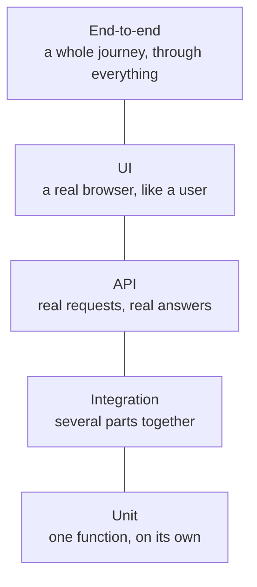

# Test Levels Explained: Unit, Integration, API, UI and End-to-End Tests

People talk about "unit tests", "API tests" and "end-to-end tests" as if everyone knows what they mean. Often they don't, and two people use the same word for different things. This lesson takes one small shop and tests it at every level, so you can see the difference for yourself.

!!! note "Before you start"
    You should know what an automated test is. If not, read [What an SDET does](../fundamentals/what-an-sdet-does.md) first.
    To run the examples, you need Python, plus `pip install pytest fastapi httpx2`. You can also just read along: every output is on the page.

## What you will learn

- What each of the five levels checks
- How fast each level is, with real timings
- What one level catches that another misses
- How to sort tests into folders by level

## Why this matters at work

When a teammate says "we need more tests", the next question is always "what kind?" If you know the levels, you can answer that properly, and you can read any test suite and understand what it protects. You will also stop writing slow browser tests for things a tiny unit test could check.

## The idea in plain words

!!! info "In plain words"
    Think of a restaurant. You can taste one sauce on its own (unit). You can taste the sauce on the pasta (integration). You can check the kitchen hands out the right dish for each order slip (API). You can sit at a table and order like a guest (UI). And you can do the whole evening: book, eat, pay and leave (end-to-end).
    Each check is useful. But you wouldn't book a full dinner every time you change the salt in the sauce.



## Step by step

Our example is a tiny shop with one important rule: orders of $50.00 or more ship free, and a coupon `SAVE10` takes 10% off. Money is in cents, so 5000 means $50.00. The shop has three files: the money rules, a cart that uses them, and a small web API.

1. **Unit tests: one function on its own.** A unit test calls one function and checks the answer. No database, no network, no browser. Here are the money rules:

    ```python
    --8<-- "modules/think_like_a_tester/test_levels_and_the_pyramid/examples/shop/money.py"
    ```

    And their unit tests:

    ```python
    --8<-- "modules/think_like_a_tester/test_levels_and_the_pyramid/examples/tests/unit/test_money.py"
    ```

    Run them:

    ```bash
    python -m pytest tests/unit -v
    ```

    You should see (the last line):

    ```text
    ============================== 7 passed in 0.03s ===============================
    ```

    Seven checks in three hundredths of a second. You can run these every time you save a file.

2. **Integration tests: several parts together.** The cart uses the money rules. Each part can be right on its own and still be wrong together. Read the comment in the cart code carefully:

    ```python
    --8<-- "modules/think_like_a_tester/test_levels_and_the_pyramid/examples/shop/cart.py"
    ```

    "Free shipping is decided after the discount." So a $50.00 order with `SAVE10` costs $45.00, and pays shipping. The integration tests check exactly that:

    ```python
    --8<-- "modules/think_like_a_tester/test_levels_and_the_pyramid/examples/tests/integration/test_cart.py"
    ```

    ```bash
    python -m pytest tests/integration -q
    ```

    You should see:

    ```text
    2 passed in 0.03s
    ```

3. **Watch an integration test catch what unit tests can't.** Say a developer changes one line in the cart, to `shipping = shipping_cost(subtotal)`, forgetting the discount. The money rules haven't changed, so every unit test still passes:

    ```text
    7 passed, 6 deselected in 0.19s
    ```

    But the integration test fails:

    ```text
    E         Differing items:
    E         {'total': 4500} != {'total': 4999}
    E         {'shipping': 0} != {'shipping': 499}
    FAILED tests/integration/test_cart.py::test_a_coupon_can_take_an_order_below_free_shipping
    1 failed, 11 passed, 1 skipped in 0.26s
    ```

    This is the whole point of levels. The functions were fine. The way they were *put together* was wrong. Only a test of the parts together could see it.

4. **API tests: real requests, real answers.** Other programs, like the web page or a phone app, talk to the shop through its API. An API test sends a real HTTP request and checks the status code and the JSON that comes back:

    ```python
    --8<-- "modules/think_like_a_tester/test_levels_and_the_pyramid/examples/tests/api/test_cart_api.py"
    ```

    ```bash
    python -m pytest tests/api -v
    ```

    You should see (the last line):

    ```text
    ============================== 3 passed in 0.14s ===============================
    ```

    Still fast. API tests are a sweet spot for many teams: they check what users really get, without the slowness of a browser.

5. **UI tests: a real browser, like a user.** A UI test opens a browser, clicks and types, and checks what is on the screen. Here is one written with Playwright:

    ```python
    --8<-- "modules/think_like_a_tester/test_levels_and_the_pyramid/examples/tests/ui/test_checkout_page.py"
    ```

    It needs a browser and a running shop, so without them it skips politely:

    ```text
    SKIPPED [1] tests/ui/test_checkout_page.py:17: set SHOP_URL to a running shop (and install pytest-playwright)
    ```

    A UI test has to start a browser and load real pages, so it takes seconds, not milliseconds. It can also break when a label or a button changes, even if the shop works fine. Keep UI tests for things only a browser can show. You will write them in [UI automation](../../automation-testing/playwright/index.md).

6. **End-to-end tests: a whole journey.** An end-to-end (E2E) test goes through the full system, the way a customer does: sign up, add to cart, pay, get the email. It tells you the most, and it costs the most to run and to fix. Most teams keep only a handful, for the journeys that earn money or keep people safe.

7. **Sort the tests into folders, and run one level at a time.** The example keeps each level in its own folder. With the [conftest.py template](index.md#templates), each test gets marked with its folder's name, so you can pick a level:

    ```bash
    python -m pytest -m "not ui" -q
    ```

    You should see:

    ```text
    12 passed, 1 deselected in 0.13s
    ```

    !!! success "Check: you should now be able to"
        Name the five levels, say what each checks, and explain why the integration test caught a bug that seven unit tests missed.

## When it goes wrong

- **A test is hard to place.** Ask what it needs to run. Only code: unit. Several of your classes, or a database: integration. A running app and a URL: API. A browser: UI. A full system with real services: end-to-end.
- **The same detail is tested at three levels.** Keep the lowest one that really catches the bug, and delete the others once you are sure. Duplicates make every change three times more expensive.
- **People argue about names.** Some teams say "component test" for unit, or "system test" for end-to-end. Don't fight about words. Agree on one list for your team and write it in the README.

## Common mistakes

!!! warning "Common mistakes"
    - **Testing money rules through the browser.** It is slow, and the test breaks when the page changes. Test rules in unit tests.
    - **Only unit tests.** They can't see wiring mistakes, like the one in step 3. You need a few tests of the parts together.
    - **Calling every automated test "end-to-end".** Name the level properly. It changes how you run it and how you fix it.

!!! failure "If you see this error"
    **`ModuleNotFoundError: No module named 'shop'`**
    Python can't find the example code. Run the tests from the folder that contains both `shop/` and `tests/`, and use `python -m pytest` instead of `pytest`. The `python -m` part adds the current folder to the places Python looks.

## Try it yourself

The shop adds a new rule: "Quantity must be 1 to 10." The check sits in `Cart.add()`, and the API also refuses 11. At which levels would you test it, and why?

??? success "Solution"
    - **Unit** (on the cart class): 0, 1, 10 and 11, the boundaries. This is where the rule lives, so this is where to test it in detail.
    - **API**: one test that 11 is refused with 422. That proves the API passes the rule on to users. You don't need to repeat every boundary here.
    - **UI**: none, unless the page has its own quantity box with its own checks.

    The example already has the API test: `test_quantity_above_10_is_refused`. A good habit: test the details low, and check once at a higher level that the rule reaches the user.

## Quick check

1. Seven unit tests passed, but the cart total was wrong. Which level caught it?

    ??? question "Answer"
        Integration. The functions were right, but the cart combined them the wrong way.

2. Why are API tests a sweet spot for many teams?

    ??? question "Answer"
        They check what users really get from the app, and they are still fast, because there is no browser.

3. When should you write a UI test?

    ??? question "Answer"
        When the thing you check can only be seen in a browser, like a button, a layout, or a page that needs JavaScript.

## References

- [The Practical Test Pyramid](https://martinfowler.com/articles/practical-test-pyramid.html): unit, integration, contract, UI and end-to-end tests, explained in depth
- [FastAPI: Testing](https://fastapi.tiangolo.com/tutorial/testing/): the TestClient used in the API tests
- [Playwright for Python](https://playwright.dev/python/docs/intro): the browser tool used in the UI test
- [ISTQB Glossary](https://glossary.istqb.org/): component testing, integration testing, system testing

Written for Python 3.13, pytest 9 and FastAPI 0.163. Links checked: November 2026.
