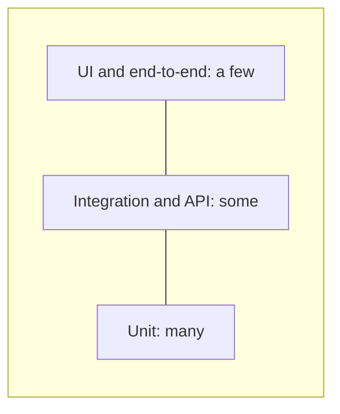

# The Test Pyramid: How Many Tests to Write at Each Level

Once you know the test levels, the next question is "how many of each?" The test pyramid is the most famous answer. It is simple, it is mostly right, and it is worth understanding properly, including where it stops being helpful.

!!! note "Before you start"
    Read [The test levels](the-test-levels.md) first.
    A **pytest marker** is a label on a test, like `unit` or `ui`, that lets you run only the tests with that label.

## What you will learn

- What the test pyramid says, and why
- The "ice cream cone": the upside-down shape that makes suites slow and flaky
- How to mark your tests by level, and count them
- How to move a test down a level safely

## Why this matters at work

The shape of a test suite decides how a team works. With a healthy shape, tests run in minutes, people run them all the time, and a failure points to the problem. With the wrong shape, tests take hours, people stop running them, and failures get ignored. Spotting the shape is one of the most useful things an SDET can do on a new team.

## The idea in plain words

!!! info "In plain words"
    Think of a building. The bottom floor is the widest, and holds everything up. Each floor above is a bit smaller, and the top is the smallest.
    A test suite is built the same way. Lots of small, fast unit tests at the bottom. Fewer integration and API tests in the middle. Only a few slow UI and end-to-end tests at the top.



The idea was made popular by Mike Cohn in his book *Succeeding with Agile*, and later by Martin Fowler's writing. The exact layers vary from team to team. The message doesn't: **write lots of small, fast tests, and few big, slow ones.**

## Step by step

1. **Understand why the bottom is wide.** Lower tests are faster, cheaper to write, and when they fail they point at one place. In our example shop, 7 unit tests ran in 0.03 seconds. A browser test can take seconds on its own, and can fail because of a slow page, a moved button, or a network blip.

2. **Know the shape to avoid: the ice cream cone.** Many teams end up with the pyramid upside down: lots of UI tests, a few API tests, almost no unit tests. Drawn out, it looks like an ice cream cone. It usually happens slowly. Each new feature gets a quick browser test, because that is the easiest thing to add, and nobody looks at the whole picture.

3. **Mark every test with its level.** You can't fix a shape you can't see. Put tests in folders by level, then add the [conftest.py template](index.md#templates) to your `tests/` folder. It marks each test from its folder name:

    ```python
    --8<-- "modules/think_like_a_tester/test_levels_and_the_pyramid/templates/conftest.py"
    ```

    And list the levels in `pytest.ini`, so pytest knows them:

    ```ini
    --8<-- "modules/think_like_a_tester/test_levels_and_the_pyramid/templates/pytest.ini"
    ```

4. **Count the tests at each level.** Run the [pyramid report](index.md#templates) from your project's main folder:

    ```bash
    python pyramid_report.py
    ```

    For the example shop you should see:

    ```text
    Tests per level (a healthy suite is widest at the bottom)

    e2e                                  0    0%
    ui           ##                      1    8%
    api          #####                   3   23%
    integration  ###                     2   15%
    unit         ###########             7   54%

    Total: 13 tests
    ```

    Widest at the bottom. That is the shape you want. An upside-down suite gets a warning at the end of the report, like the one on the [topic page](index.md#4-get-something-running).

5. **Move a test down a level, safely.** When you find a UI test that really checks a rule, move the check down in this order:

    1. Write the lower-level test.
    2. Break the rule on purpose (change `>=` to `>`, for example) and check that the new test fails.
    3. Put the rule back, and check the new test passes.
    4. Only now, delete the old UI test.

    Step 2 is the one people skip, and it is the most important. A test you have never seen fail might not be testing anything.

6. **Run the levels at the right times.** Fast levels run often, slow ones less often:

    | When | What to run |
    | --- | --- |
    | Every time you save | `pytest -m unit` |
    | Every pull request | `pytest -m "not ui and not e2e"` |
    | Before a release, or every night | Everything |

    !!! success "Check: you should now be able to"
        Draw the pyramid, describe the ice cream cone, mark tests by level, and count them with the pyramid report.

## When it goes wrong

- **Your report shows an ice cream cone, and the team is busy.** Don't try to fix everything. Pick the slowest or flakiest area, move a few tests down, and show the time saved. Small wins buy you time for the rest.
- **The code is hard to unit test.** That is common in older code. Use API tests as your wide base for now, and ask developers to write unit tests for all new code. Over time, the bottom fills in.
- **Someone says "the pyramid is outdated".** They might be thinking of the [testing trophy](the-testing-trophy.md), which is a fair point for some kinds of apps. The shared idea is the same: fast, focused tests first, a few slow ones on top.

## Common mistakes

!!! warning "Common mistakes"
    - **Chasing exact percentages.** No rule says "70% unit". Look at the shape, the speed and how much people trust the suite.
    - **Deleting UI tests without moving the check down first.** You lose protection without noticing.
    - **Counting tests but not looking at what they check.** 500 unit tests of getters and setters don't make a healthy suite.

!!! failure "If you see this error"
    **`ERROR: Unknown marker(s) in '-m' expression: unti. Use 'pytest --markers' to see available markers.`**
    You misspelled a level name after `-m`. Because `pytest.ini` lists the levels and turns on `--strict-markers`, pytest stops instead of silently running nothing. Fix the spelling, or run `pytest --markers` to see the names.

## Try it yourself

A team's pyramid report shows: e2e 2, ui 40, api 5, integration 0, unit 3. Their UI tests include "price shows two decimals", "coupon SAVE10 gives 10% off", and "the checkout page loads". What would you move first, and where?

??? success "Solution"
    - "Price shows two decimals" and "coupon gives 10% off" are rules. Move them to **unit** tests. They will run in milliseconds and stop breaking when the page changes.
    - "The checkout page loads" really is about the browser. Keep it as a **UI** test, or let the end-to-end checkout test cover it.

    Then look at the other UI tests the same way. Most suites shaped like this have many rule checks hiding in the browser layer.

## Quick check

1. Why should most tests be at the bottom of the pyramid?

    ??? question "Answer"
        They are fast and cheap to write, and when they fail they point to one place.

2. What is the "ice cream cone"?

    ??? question "Answer"
        An upside-down pyramid: mostly UI tests and very few unit tests. It makes a suite slow and flaky.

3. When you move a test down a level, which step must you not skip?

    ??? question "Answer"
        Break the rule on purpose and check that the new test fails. Otherwise you don't know it really tests anything.

## References

- [Martin Fowler: Test Pyramid](https://martinfowler.com/bliki/TestPyramid.html): where the idea came from
- [The Practical Test Pyramid](https://martinfowler.com/articles/practical-test-pyramid.html): a full, hands-on guide
- [Google Testing Blog: Just Say No to More End-to-End Tests](https://testing.googleblog.com/2015/04/just-say-no-to-more-end-to-end-tests.html): why big tests slow teams down
- [pytest: Working with custom markers](https://docs.pytest.org/en/stable/example/markers.html)

Written for pytest 9. Links checked: November 2026.
