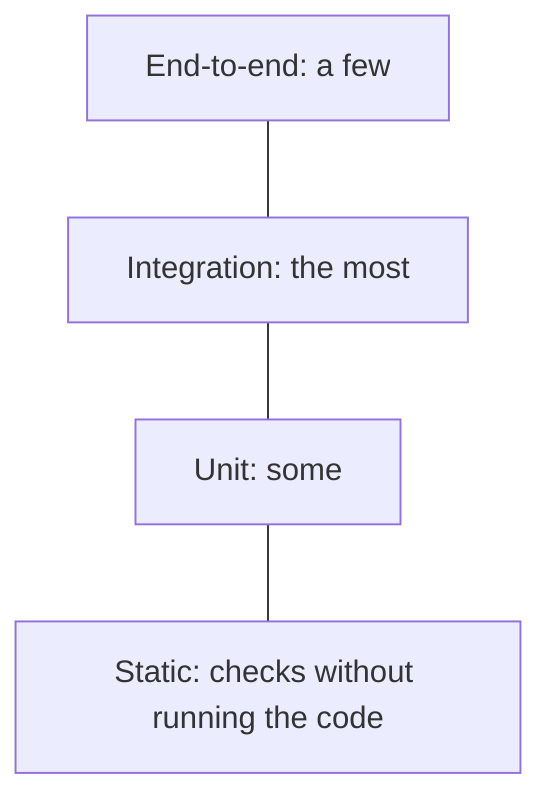

# The Testing Trophy: Another Shape for Your Tests, and When It Fits

The test pyramid isn't the only shape people talk about. If you work on web front ends, you will soon hear about the "testing trophy". This lesson explains it, shows the cheapest kind of check of all, and helps you decide which shape fits your project.

!!! note "Before you start"
    Read [The test pyramid](the-test-pyramid.md) first.
    **Static analysis** means checking code without running it, the way a spell checker reads a letter without sending it.

## What you will learn

- What the testing trophy looks like, and who suggested it
- What static analysis is, with a real example
- How the trophy differs from the pyramid
- How to choose a shape for your own project

## Why this matters at work

Teams sometimes argue "pyramid or trophy?" as if one must be wrong. Knowing both lets you skip the argument and ask the useful question instead: for our app, which tests give us the most confidence for the time they cost?

## The idea in plain words

!!! info "In plain words"
    Think of a trophy cup. It has a small base, a wide middle where the cup is, and a narrow top.
    In the testing trophy, the wide middle is integration tests: checks of several parts working together. The base is static checks that run before any test. The top is a few end-to-end tests.



Kent C. Dodds suggested this shape for testing web front ends. His reasoning: in a front end, most bugs happen where parts meet, like a form and the code that sends it. So tests of parts working together give the most confidence for their cost.

## Step by step

1. **Meet the base: static analysis.** Before you run a single test, a tool can read your code and find mistakes. Here is a tiny typo in a money rule:

    ```python
    FREE_SHIPPING_FROM = 5000
    SHIPPING_FEE = 499

    def shipping_cost(subtotal_cents: int) -> int:
        if subtotal_cents >= FREE_SHIPPING_FROM:
            return 0
        return SHIPING_FEE
    ```

    Did you spot it? `SHIPING_FEE` is missing a "P". Run [Ruff](https://docs.astral.sh/ruff/), a popular Python checker:

    ```bash
    ruff check money.py
    ```

    You should see:

    ```text
    F821 Undefined name `SHIPING_FEE`
     --> money.py:8:12
      |
    6 |     if subtotal_cents >= FREE_SHIPPING_FROM:
    7 |         return 0
    8 |     return SHIPING_FEE
      |            ^^^^^^^^^^^

    Found 1 error.
    ```

    No test was needed. The checker found it in a fraction of a second. Notice something too: a unit test for $50.00 or more would never reach that line, so it would pass, and the bug would sit there until a small order came in. Static checks are the cheapest safety net you have.

2. **Compare the two shapes side by side.**

    | | Pyramid | Trophy |
    | --- | --- | --- |
    | Widest part | Unit tests | Integration tests |
    | Base | Unit tests | Static analysis |
    | Grew up in | Back-end and business logic | Web front ends |
    | Main worry | Slow, flaky big tests | Unit tests that pass while the parts don't fit together |

3. **See what they agree on.** Both shapes say: few end-to-end tests, lots of fast checks, and a test should give real confidence for its cost. They mostly disagree about the middle, and that depends on where your bugs tend to be.

4. **Choose for your own project.** Ask where your bugs actually come from. Look at the last 20 bugs your team fixed:

    - Mostly wrong calculations and rules? Lean towards the **pyramid**, with lots of unit tests.
    - Mostly parts that don't fit together, like a form that sends the wrong field? Lean towards the **trophy**, with more integration tests.
    - Either way, add **static checks**. They cost almost nothing to run.

    !!! success "Check: you should now be able to"
        Draw the trophy, say what static analysis is, and explain how you would choose between the two shapes for your team.

## When it goes wrong

- **The team argues about pyramid versus trophy.** Bring data instead of opinions: list the last 20 bugs and the level that could have caught each one. The list usually ends the argument.
- **Static checks report hundreds of problems on old code.** Don't fix them all at once. Turn on the checker for new and changed files first, and fix the old ones a little at a time.
- **Integration tests are slow.** Look at what makes them slow, usually a real database or network. Many can use a small local database, or a fake service. The [mocking](../../api-testing/mocking-and-stubbing/index.md) topic shows how.

## Common mistakes

!!! warning "Common mistakes"
    - **Treating either shape as a law.** They are pictures to help you think, not rules to obey.
    - **Forgetting static checks.** They are the cheapest tests you will ever run, and they catch real bugs.
    - **Copying a front-end team's shape for a back-end service**, or the other way round. Look at your own bugs first.

!!! failure "If you see this error"
    **`zsh: command not found: ruff`**
    Ruff is not installed, or not in this virtual environment. Install it with `python -m pip install ruff`, then run `python -m ruff check money.py`.

## Try it yourself

A team looks at its last 10 bugs. Six were "the web form sent the wrong value to the API". Three were "a price was calculated wrong". One was "a typo in a variable name". Which shape fits them better, and what would you add first?

??? success "Solution"
    Six of ten bugs were parts not fitting together, so the **trophy** fits this team better: add integration tests between the form and the API first.

    The three price bugs still need unit tests on the price rules. And the typo would have been caught by **static analysis** for free, so switching on a checker like Ruff is the quickest win of all.

## References

- [Kent C. Dodds: The Testing Trophy and Testing Classifications](https://kentcdodds.com/blog/the-testing-trophy-and-testing-classifications)
- [Ruff documentation](https://docs.astral.sh/ruff/): a fast Python checker
- [Martin Fowler: Test Pyramid](https://martinfowler.com/bliki/TestPyramid.html)

Written for Ruff 0.17. Links checked: November 2026.
