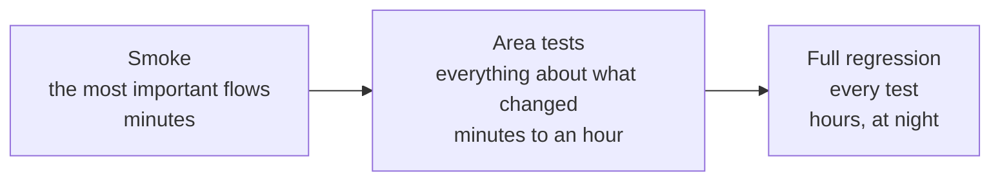

# Regression, Hotfixes and Incidents: Pick the Right Tests Under Pressure, Step by Step

Production is broken, customers are complaining, and the fix will be ready in an hour. Someone asks: "What do we need to test before it goes out?" Running everything takes four hours. Running nothing is how one bug becomes two. This guide sets up your tests so you can answer that question in a minute, and shows what a tester does during and after an incident.

!!! example "The problem"
    **Your lead, in the incident channel:** "Refunds are failing in production. The fix is almost ready. What's the minimum we must test before we release it?"

## Step 1: Design your test suites for speed and safety

Not every change needs every test. Organise tests into groups you can run on their own:



| Suite | What's in it | When it runs |
| --- | --- | --- |
| **Smoke** | The few flows that must never break: log in, search, pay | Every change, every deploy, after every hotfix |
| **Area tests** | Every test for one part of the app: checkout, search, login | When that part changes |
| **Full regression** | Every test | Before a release, and every night |

The design decision that makes this work: **every test is tagged** with its area, and the important ones also with `smoke`. Then the code knows which tests belong to what.

## Step 2: Get the kit

You need **Python 3.13** and pytest. Get the files from [Templates](#templates) below, or take the whole folder [from GitHub](https://github.com/myopensdet/myopensdet.github.io/tree/main/modules/professional_sdet/regression_hotfixes_and_incidents/templates). `pick_tests.py` uses only Python's standard library. The `sample_suite` folder is a small tagged test suite to try it on.

## Step 3: Tag your tests

pytest calls tags **markers**. List them once in `pytest.ini`, with what each means:

```ini
--8<-- "modules/professional_sdet/regression_hotfixes_and_incidents/templates/hotfix_kit/sample_suite/pytest.ini"
```

`--strict-markers` turns a misspelled marker into an error, instead of a test that silently never runs. Tag a whole file with `pytestmark`, and single tests with a decorator:

```python
--8<-- "modules/professional_sdet/regression_hotfixes_and_incidents/templates/hotfix_kit/sample_suite/tests/test_checkout.py"
```

Now `-m` picks tests by tag. In `sample_suite`:

```bash
python -m pytest -m smoke -v
```

```text
collecting ... collected 11 items / 8 deselected / 3 selected

tests/test_checkout.py::test_pay_by_card PASSED                          [ 33%]
tests/test_login.py::test_log_in PASSED                                  [ 66%]
tests/test_search.py::test_search_by_title PASSED                        [100%]

======================= 3 passed, 8 deselected in 0.01s ========================
```

3 of 11 tests: the smoke suite. `-m regression` runs all 11. `-m "checkout or smoke"` combines them. On a real suite of 2,000 tests, that's the difference between 5 minutes and 4 hours.

## Step 4: Pick the tests for a change

The hotfix changed three files. Which tests? The kit's `test_map.ini` says which code belongs to which area:

```ini
--8<-- "modules/professional_sdet/regression_hotfixes_and_incidents/templates/hotfix_kit/test_map.ini"
```

Give `pick_tests.py` the changed files, straight from Git:

```bash
git diff --name-only origin/main...HEAD | python pick_tests.py
```

Or list them by hand. For the refunds hotfix:

```bash
python pick_tests.py src/payments/refund.py tests/test_checkout.py docs/refunds.md
```

```text
Changed files: 3
  src/payments/refund.py             -> checkout
  tests/test_checkout.py             -> checkout
  docs/refunds.md                    -> no tests needed

Run:
  python -m pytest -m "checkout or smoke"
```

Run what it printed:

```text
collecting ... collected 11 items / 5 deselected / 6 selected

tests/test_checkout.py::test_pay_by_card PASSED                          [ 16%]
tests/test_checkout.py::test_pay_with_voucher PASSED                     [ 33%]
tests/test_checkout.py::test_refund_full_order PASSED                    [ 50%]
tests/test_checkout.py::test_refund_one_item PASSED                      [ 66%]
tests/test_login.py::test_log_in PASSED                                  [ 83%]
tests/test_search.py::test_search_by_title PASSED                        [100%]

======================= 6 passed, 5 deselected in 0.01s ========================
```

Every checkout test, plus smoke for the rest of the app. That's your answer to the lead: **"checkout and smoke: 6 tests, a few minutes."**

The script is careful on purpose. When shared code changes, or code it doesn't know, it doesn't guess:

```bash
python pick_tests.py src/db/connection.py
```

```text
Changed files: 1
  src/db/connection.py               -> shared

Run the full regression (shared code changed):
  python -m pytest -m regression
```

```text
Changed files: 2
  src/payments/refund.py             -> checkout
  src/emails/receipt.py              -> NOT IN THE MAP

Run the full regression (code that isn't in the map):
  python -m pytest -m regression
Then add the unknown files to test_map.ini, so next time is faster.
```

The map gets better every time you use it. Build it with the developers: they know which code is shared. On your project, change the folders and markers in `test_map.ini` (marked `CHANGE`).

## Step 5: Test the hotfix

Under pressure, a checklist keeps you from skipping the step that matters. The order is important: **reproduce the bug first**, or you can't prove the fix fixed it.

```markdown
--8<-- "modules/professional_sdet/regression_hotfixes_and_incidents/templates/hotfix_kit/hotfix_checklist.md"
```

Two rules for hotfix days:

- **Say what you didn't test**, in writing. "Checkout and smoke passed. Refunds in other currencies not tested." The release decision belongs to the team; your job is to make the risk clear.
- **The new test goes to `main` too.** A hotfix without a test is a bug that will come back.

## Step 6: During an incident

An **incident** is a problem in production that hurts users right now. Most teams have an **incident lead** who decides, and others who investigate and communicate. A tester is valuable in all of it:

| The tester's job | Why it helps |
| --- | --- |
| **Reproduce it** and find the smallest steps | Developers fix faster when they can see it fail |
| **Collect evidence**: times, request ids, versions | Use `evidence.py` from [working with developers](../working-with-developers/index.md#step-3-answer-works-on-my-machine-with-evidence) |
| **Check what's NOT broken** | "Card refunds fail, voucher refunds work" cuts the search in half |
| **Test the rollback or fix** the moment it's ready | Every minute of waiting is a minute of users affected |
| **Keep the timeline** | Nobody remembers the order of events tomorrow |

Rolling back to the last good version is often faster and safer than a fix. Ask "can we roll back?" early.

```markdown
--8<-- "modules/professional_sdet/regression_hotfixes_and_incidents/templates/hotfix_kit/incident_notes.md"
```

## Step 7: Find the root cause

After the fire is out, find **why** it happened, not just what. Keep asking "why?" until you reach something you can change. For the refunds incident:

1. **Why did refunds fail?** The payment provider rejected the amount.
2. **Why?** We sent `10.1` instead of `10.10`, and the provider wants two decimals.
3. **Why?** A change last week formatted amounts with a different function.
4. **Why wasn't it caught?** The refund tests only used whole amounts, like `40.00`.
5. **Why?** Our test data has no rule to include amounts with cents. **← the root cause: something we can change**

"Developer made a mistake" is never the root cause. People always make mistakes. The question is why our tests, reviews and checks let this one through.

## Step 8: Write a blameless postmortem

A **postmortem** is the short written story of the incident, and what changes now. **Blameless** means it looks for gaps in the system, never at who's at fault. If people fear blame, they hide problems, and the next incident is worse.

```markdown
--8<-- "modules/professional_sdet/regression_hotfixes_and_incidents/templates/hotfix_kit/postmortem.md"
```

The section testers own: **"Why our tests didn't catch it."** Turn the answer into an action with an owner and a date: here, "add amounts with cents to the refund test data", plus a new test. Then check the action is really done a month later.

## Step 9: When it goes wrong

| You see | What it means | Fix |
| --- | --- | --- |
| `ERROR: Unknown marker(s) in '-m' expression: smokee. Use 'pytest --markers' to see available markers.` | A typo in the marker name | `pytest --markers` lists the right names |
| `No changed files given. Example: git diff --name-only origin/main...HEAD \| python pick_tests.py` | No files reached the script | Pass them as arguments, or check the `git diff` command prints files |
| `-> NOT IN THE MAP` | That code isn't in `test_map.ini` | Run the full regression this time, then add it to the map with the right area |
| `-m smoke` selects 0 tests | No test has the `smoke` tag yet | Tag the most important 10 to 20 tests first. That's day one of a smoke suite |
| Every change says "full regression" | Too much code is marked shared, or the map is new | Ask developers which code is really shared, and split it into areas over time |
| The smoke suite takes 40 minutes | It grew into a second regression | Keep it to the few flows that must never break. Move the rest to area tags |
| A hotfix passed testing but broke something else | The change touched more than the map knew | Add it to the postmortem: update the map, and add the missing test |

## Templates

**Every file is below, ready to copy.** The whole folder is also [on GitHub](https://github.com/myopensdet/myopensdet.github.io/tree/main/modules/professional_sdet/regression_hotfixes_and_incidents/templates).

=== "pick_tests.py"

    ```python
    --8<-- "modules/professional_sdet/regression_hotfixes_and_incidents/templates/hotfix_kit/pick_tests.py"
    ```

## References

- [pytest: working with custom markers](https://docs.pytest.org/en/stable/example/markers.html)
- [pytest: how to mark test functions](https://docs.pytest.org/en/stable/how-to/mark.html)
- [Google SRE book: managing incidents](https://sre.google/sre-book/managing-incidents/)
- [Google SRE book: postmortem culture](https://sre.google/sre-book/postmortem-culture/)
- [Atlassian: incident postmortems](https://www.atlassian.com/incident-management/postmortem)
- [Git: diff (`--name-only`)](https://git-scm.com/docs/git-diff)

Written for Python 3.13 and pytest 9.2. Outputs captured November 2026. Links checked: November 2026.
