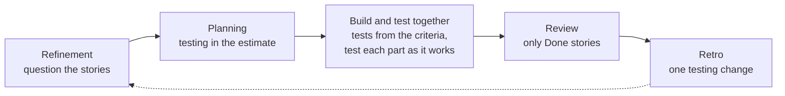

# SDET in Agile: Test Inside the Sprint, Not After It, Step by Step

In many teams, testing is where sprints go to die: developers finish on day 8, testers get everything on day 9, and half the stories move to the next sprint. The fix isn't testing faster. It's testing **earlier**: questions before the code exists, tests written alongside it. This guide shows where a tester works in each part of the sprint, with a script that checks user stories before anyone writes code.

!!! example "The problem"
    **Your Scrum Master, at the retrospective:** "Testing finished late again. Four stories carried over. What can we change?"

## Step 1: See where testing goes in a sprint



| Part | The tester's job | Why it matters |
| --- | --- | --- |
| **Refinement** | Find what's unclear in the story, before the sprint | A question in refinement costs 2 minutes. The same question as a bug on day 9 costs a day |
| **Planning** | Make sure testing is part of the estimate | "3 points" must include the testing, or the sprint is overloaded from day 1 |
| **Build and test** | Write tests from the criteria while the code is written. Test each part as soon as it works | No pile of work on the last day |
| **Review** | Show only stories that meet the Definition of Done | "Done except testing" hides risk |
| **Retrospective** | Bring one testing problem and one change to try | Small changes, every sprint |

Testing earlier like this is called **shift-left**: on a timeline drawn left to right, testing moves left, towards the start.

## Step 2: Know the models you'll meet

Most teams say "Agile" and mean one of these. What changes for you:

| Model | How work flows | What it means for testing |
| --- | --- | --- |
| **Waterfall** | Requirements → design → build → test → release, once | Testing is one long phase at the end. Bugs found late are expensive |
| **V-model** | Waterfall, with a test level planned for each step | Test plans written early, but run late |
| **Iterative** | The product is built in rounds | Each round needs regression testing of the earlier ones |
| **Scrum** | Fixed sprints (often 2 weeks) with planning, stand-up, review and retro | Test inside the sprint. The Definition of Done includes testing |
| **Kanban** | A continuous flow of tickets, with limits on work in progress | Testing is a column on the board. If it's full, developers help test before starting new work |
| **DevOps** | Build, test, release and run as one automated flow | Automated tests in the pipeline decide if a change can go out ([CI/CD](../../infrastructure/ci-cd/index.md)) |

The rest of this page uses Scrum words. Everything works in Kanban too: refinement happens when a ticket enters "Ready".

## Step 3: Get the kit

You need **Python 3.13**. Get the files from [Templates](#templates) below, or take the whole folder [from GitHub](https://github.com/arshaduzzaman-sm/myopensdet/tree/main/modules/professional_sdet/sdet_in_agile/templates). The script uses only Python's standard library.

## Step 4: Check stories before the sprint

A **user story** says who wants what, and why. Its **acceptance criteria** say how we'll know it works. Vague criteria are where bugs and arguments start. Here's a typical story, as it arrives:

```markdown
--8<-- "modules/professional_sdet/sdet_in_agile/templates/agile_kit/stories/SHOP-420.md"
```

It looks fine at a glance. `story_check.py` reads it the way a careful tester does:

```bash
python story_check.py stories/SHOP-420.md
```

```text
== SHOP-420: Discount code at checkout

== 5 acceptance criteria
AC1  The shopper can enter a discount code on the checkout page.
      no example -> Add one real example with values.
AC2  A valid code reduces the total.
      "valid" -> What makes it valid? Give one example of each.
      no example -> Add one real example with values.
AC3  Invalid codes should be handled properly.
      "properly" -> What exactly should happen? Which message, which status?
      "handled" -> Handled how? Show an error, ignore it, or log it?
      "Invalid" -> What makes it valid? Give one example of each.
      no example -> Add one real example with values.
AC4  The total updates quickly.
      "quickly" -> How fast, in seconds? For how many users at once?
      no example -> Add one real example with values.
AC5  Codes for shipping, gifts, etc. also work.
      "etc" -> What else, exactly? List every item.
      no example -> Add one real example with values.

== Not mentioned anywhere in the story
   empty or missing input   What if the field is left empty?
   limits                   Are there limits (length, amount, count)?
   who can do it            Who may do this? Guests too?
   repeats                  What if the user does it twice?

15 questions for refinement.
```

Fifteen questions, and each one is a bug that **would** have been found on day 9. "Handled properly" is the classic: the developer shows a red box, the product owner wanted the code removed, and the tester can't say who's right because the story doesn't say.

The script is a helper, not a judge: it finds words, not meaning. Read its questions, keep the useful ones, and take them to refinement. On your team's stories, add your own vague words and areas at the top of the script (marked `CHANGE`).

## Step 5: Run a Three Amigos session

**Three Amigos** is a short meeting (20 to 30 minutes) before the sprint, about one story, with three views:

| Who | Asks |
| --- | --- |
| **Product owner** | What problem does this solve? What matters most? |
| **Developer** | How will we build it? What's hard or risky? |
| **Tester** | What could go wrong? How will we know it works? |

Bring the questions from step 4. Leave with **examples**: real values that everyone agrees on. After the session, the story looks like this:

```markdown
--8<-- "modules/professional_sdet/sdet_in_agile/templates/agile_kit/stories/SHOP-420-after-refinement.md"
```

```bash
python story_check.py stories/SHOP-420-after-refinement.md
```

```text
== SHOP-420: Discount code at checkout (after refinement)

== 6 acceptance criteria
AC1  Given a cart of 40.00 and the code SAVE10 (10% off), when I apply it, then the total is 36.00.
AC2  Given the code SAVE10 has expired, when I apply it, then the total stays 40.00 and I see "This code has expired".
AC3  Given the code field is empty, when I press Apply, then nothing changes and I see "Enter a code".
AC4  Given SAVE10 is already applied, when I apply SAVE10 again, then the total stays 36.00 and I see "Code already applied".
AC5  Given any code, the new total shows within 1 second.
AC6  Only one code per order. Codes are at most 20 characters.

== Not mentioned anywhere in the story
   nothing: every area is covered

Ready for the sprint.
```

Notice what else changed: "signed-in shopper", and guests are moved to another story **on purpose**. Deciding what's **not** in a story is as useful as what is.

## Step 6: Turn the criteria into tests

**Given / When / Then** criteria are almost tests already. Decide the level for each one: the lowest level that can prove it is the fastest and most stable.

| Criterion | Test | Level |
| --- | --- | --- |
| AC1: SAVE10 on 40.00 gives 36.00 | `test_save10_takes_ten_percent_off` | API |
| AC2: expired code | `test_expired_code_keeps_total_and_shows_message` | API |
| AC3: empty code | `test_empty_code_shows_enter_a_code` | UI (the message is on the page) |
| AC4: same code twice | `test_same_code_twice_applies_once` | API |
| AC5: within 1 second | `test_apply_code_answers_within_one_second` | API |
| AC6: one code, 20 characters | `test_second_code_is_refused`, `test_21_character_code_is_refused` | API |

Write these tests **on day 1**, from the criteria, while the developer writes the code. When the code is ready, the tests are ready. Teams using BDD write the criteria straight into `.feature` files: see [BDD testing](../../core-automation/bdd-testing/index.md). For writing the tests themselves, see [automate API tests](../../work-playbooks/automate-api-tests/index.md).

## Step 7: Test during the sprint, not at the end

- **Test each part as soon as it works.** Ask the developer: "Can I try the API part today, before the page is done?"
- **Talk about bugs the same day.** A chat message plus a ticket, while the developer still remembers the code.
- **Make testing visible.** A "Testing" column on the board, or testing tasks under each story. Hidden work can't be planned.
- **Stop starting, start finishing.** If three stories wait for testing, the team helps test before starting a fourth. Kanban teams write this as a limit on the column.
- **Explore beyond the criteria.** 15 to 30 minutes per story, trying what nobody wrote down.

The whole sprint, as a checklist:

```markdown
--8<-- "modules/professional_sdet/sdet_in_agile/templates/agile_kit/sprint_testing_checklist.md"
```

## Step 8: Agree a Definition of Done

The **Definition of Done** is the team's shared list of what "done" means, for every story. Without testing in it, "done" means "the developer stopped typing". Agree it once, put it on the board, and check it at review:

```markdown
--8<-- "modules/professional_sdet/sdet_in_agile/templates/agile_kit/definition_of_done.md"
```

Propose it at a retrospective, with the numbers from the last sprints: "four stories carried over, all waiting for testing." Teams accept changes that solve a problem they already feel.

## Step 9: When it goes wrong

| You see | What it means | Fix |
| --- | --- | --- |
| `No acceptance criteria found. Add a '## Acceptance criteria' list first.` | The story has no list under a heading with "acceptance" in it | Add the heading and a list. If the story really has no criteria, that's the first question for refinement |
| `No 'As a ..., I want ..., so that ...' sentence: who is it for, and why?` | Nobody wrote down who wants it, or why | Ask the product owner. The "why" decides what matters most to test |
| `Usage: python story_check.py <story file>` | No file, or the file doesn't exist | Copy the story from your tracker into a `.md` file first |
| Stories arrive for testing on the last day | Testing starts after development, not with it | Tests from the criteria on day 1 (step 6), and test parts as they work (step 7) |
| "We don't have time for Three Amigos" | Meetings feel slower than coding | Try it on the riskiest story only, for 20 minutes. Count the bugs it saved at the retro |
| The estimate doesn't include testing | Points are given by developers alone | Ask in planning: "does this include testing?" Give your own view of the testing effort |
| A story is "done" but not tested | No shared Definition of Done | Agree one (step 8) |

## Templates

**Every file is below, ready to copy.** The whole folder is also [on GitHub](https://github.com/arshaduzzaman-sm/myopensdet/tree/main/modules/professional_sdet/sdet_in_agile/templates).

=== "Acceptance criteria template"

    ```markdown
    --8<-- "modules/professional_sdet/sdet_in_agile/templates/agile_kit/acceptance_criteria_template.md"
    ```

=== "story_check.py"

    ```python
    --8<-- "modules/professional_sdet/sdet_in_agile/templates/agile_kit/story_check.py"
    ```

## References

- [The Scrum Guide](https://scrumguides.org/scrum-guide.html)
- [Kanban Guide](https://kanbanguides.org/english/)
- [Atlassian: user stories with examples](https://www.atlassian.com/agile/project-management/user-stories)
- [Agile Alliance: Three Amigos](https://agilealliance.org/glossary/three-amigos/)
- [Agile Alliance: Definition of Done](https://agilealliance.org/glossary/definition-of-done/)
- [Cucumber: Gherkin reference (Given, When, Then)](https://cucumber.io/docs/gherkin/reference/)

Written for Python 3.13. Outputs captured November 2026. Links checked: November 2026.
