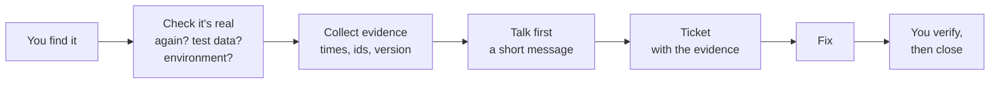

# Working with Developers: Bugs Without Blame, Evidence and Pairing, Step by Step

Testers and developers want the same thing: software that works. It doesn't always feel that way. A bug report can sound like "your work is bad", and "can't reproduce" can sound like "you're wrong". The way out is the same every time: **facts, said kindly, early**. This guide gives you a script for the facts, and words for the rest.

!!! example "The problem"
    **A developer, on your bug ticket:** "Works on my machine. Closing as can't reproduce."

## Step 1: See the path of a bug, from finding to fixed



| Step | Why it's there |
| --- | --- |
| **Check it's real** | One false alarm costs trust that takes weeks to win back. Rule out your test data, your test and the environment first |
| **Collect evidence** | "It fails" starts an argument. "It failed at 11:00:26 UTC, request `req-168fe5da`" starts a search |
| **Talk first** | A two-line message before the ticket feels like help. A ticket out of nowhere feels like a complaint |
| **Ticket** | So nothing is lost, and the team can plan it |
| **You verify** | The person who found it checks the fix. Then it's closed |

## Step 2: Get the kit

You need **Python 3.13**. Get the files from [Templates](#templates) below, or take the whole folder [from GitHub](https://github.com/myopensdet/myopensdet.github.io/tree/main/modules/professional_sdet/working_with_developers/templates). Everything uses Python's standard library: nothing to install.

Start the practice API in one terminal. It has the classic "works on my machine" bug:

```bash
python practice_server.py
```

```text
Practice API on http://127.0.0.1:8795  (Ctrl+C to stop)
```

## Step 3: Answer "works on my machine" with evidence

The developer tried once, got `200`, and closed the ticket. They're not lying: it **did** work for them. Bugs that only happen sometimes, for some users, or on one environment always look like this. Don't argue. Measure. In a second terminal:

```bash
python evidence.py http://127.0.0.1:8795/api/orders/7 --times 6
```

````text
### Evidence: GET http://127.0.0.1:8795/api/orders/7

Sent 6 times: 4 OK, 2 failed.
It fails some of the time, not always: that's why it 'works on my machine'.

| Time (UTC) | Status | ms | Request id | App version |
| --- | --- | --- | --- | --- |
| 2026-11-19 11:00:24 UTC | 200 | 10 | req-04e3b70f | 2.14.0 |
| 2026-11-19 11:00:25 UTC | 200 | 1 | req-40a8dfdf | 2.14.0 |
| 2026-11-19 11:00:26 UTC | 500 | 1 | req-168fe5da | 2.14.0 |
| 2026-11-19 11:00:27 UTC | 200 | 1 | req-8b00f14d | 2.14.0 |
| 2026-11-19 11:00:28 UTC | 200 | 2 | req-3f323ebc | 2.14.0 |
| 2026-11-19 11:00:29 UTC | 500 | 1 | req-4a7b8e51 | 2.14.0 |

First failed answer: `{"error": "internal error"}`

To reproduce (run it several times):

```bash
curl -i -X GET http://127.0.0.1:8795/api/orders/7
```
````

The output is Markdown: paste it straight into the ticket. Each part answers a developer's first question:

| Part | Answers |
| --- | --- |
| **4 OK, 2 failed** | "Is it real?" Yes, and it's intermittent. Now nobody tries once and gives up |
| **Time (UTC)** | "When?" UTC, so it matches the server logs, wherever the server is |
| **Request id** | "Which request?" The developer searches the logs for `req-168fe5da` and finds the error and its stack trace in seconds ([Linux and shell, step 6](../../infrastructure/linux-and-shell/index.md#step-6-follow-one-request-across-logs)) |
| **App version** | "Which build?" Rules out "that's fixed in the new version" |
| **curl command** | "How do I try it?" One line, to run in their own terminal |

On your own app: change `ID_HEADERS` and `VERSION_HEADERS` at the top of the script to your app's header names (ask a developer, or look at a response in the browser's Network tab). If the request needs a login, set `API_AUTH` first: the token is sent but never printed, and the curl command uses `$API_AUTH` instead.

Ask the developer to look **with** you: "It fails about 1 in 3. Want to look at the logs for `req-168fe5da` together?" When it's fixed, run the same command to verify. Here, `python practice_server.py --fixed` plays the fixed version:

```text
### Evidence: GET http://127.0.0.1:8795/api/orders/7

Sent 6 times: 6 OK, 0 failed.
```

## Step 4: Talk about bugs without blame

Blame makes people defend themselves instead of fixing things. Talk about the **behaviour**, not the person:

```markdown
--8<-- "modules/professional_sdet/working_with_developers/templates/dev_kit/talking_about_bugs.md"
```

Three habits that build trust over months:

- **Say what's good, too.** "The new checkout handled every edge case I tried." Developers mostly hear from testers when something's wrong.
- **Give bugs privately first**, then in the ticket. Never in front of the whole team at stand-up.
- **Own your mistakes.** A false alarm? Say so in the ticket and close it yourself. It makes your next report more believed, not less.

## Step 5: Disagree well

You'll disagree about two things: **is it a bug**, and **how bad is it**.

| Disagreement | What to do |
| --- | --- |
| "It's not a bug, it's how it works" | Check the story or spec. If it says nothing, it's a **missing rule**, not a bug: ask the product owner to decide |
| "It's low priority" | Bring the user impact: how many users, how often, what it costs them. "1 in 3 order pages fails for every user" is hard to call low |
| "Nobody will do that" | Show that someone can: a real user path, or a log line where it happened |
| You still disagree | Write both views on the ticket, and let the product owner decide. Then accept it |

Severity (how bad for users) and priority (how soon to fix) are explained with a ready guide in [bug reports](../../think-like-a-tester/bug-reports/index.md).

## Step 6: Give and receive code review

You'll review developers' code, and they'll review your tests. Both directions need the same attitude: **the code is being reviewed, not the person.**

**When you review**, use the checklist in [a day in the life](../a-day-in-the-life/index.md#step-6-review-pull-requests), and:

- Ask questions instead of giving orders: "What happens when the list is empty?"
- Mark what must change and what's only a suggestion ("nit:" for small things).
- Approve when it's good enough, not when it's how you'd have written it.

**When your tests are reviewed:**

- Assume good intent. "Why not a fixture here?" is a question, not an attack.
- Answer every comment: with a change, or a short reason.
- Thank people for finding real problems. A reviewer who found a bug in your test saved you a red nightly run.

## Step 7: Pair on the hard ones

**Pairing** means two people, one screen, one problem. For testers and developers, it's the fastest way to fix a "can't reproduce" bug: the developer knows the code, you know how to make it fail. Thirty minutes of pairing often beats three days of ticket comments.

```markdown
--8<-- "modules/professional_sdet/working_with_developers/templates/dev_kit/pairing_session.md"
```

Good first pairing: write the tests for a new story **with** the developer, before the code is done. You learn the code; they learn how testers think. Both of you write better work after.

## Step 8: Build the relationship before you need it

Most of working well with developers happens on calm days, not during a bug argument:

- **Learn their world.** Ask a developer to show you how they run the app, and how they debug. You'll write better bug reports.
- **Make their life easier.** Tests that fail with clear messages. Bugs with request ids. Flaky tests fixed, not just reported.
- **Join early.** Refinement and design talks ([SDET in Agile](../sdet-in-agile/index.md)) are where you prevent bugs instead of finding them.
- **Share the credit.** "Thanks to Sam's fix, the checkout tests are green for a week."

## Step 9: When it goes wrong

| You see | What it means | Fix |
| --- | --- | --- |
| `Not a full address: '127.0.0.1:8795/api/orders/7'. Start with http:// or https://` | The address needs its start | `python evidence.py http://127.0.0.1:8795/api/orders/7` |
| `no answer ([Errno 61] Connection refused)` in the table | Nothing is running at that address | Start the practice server, or check the address and port |
| `OSError: [Errno 48] Address already in use` when starting the server | It's already running | Use it, or stop the other one |
| Request id shows `-` | Your app uses another header name, or none | Change `ID_HEADERS`. No request ids at all? Ask the developers to add them: every team benefits |
| 6 out of 6 OK, but users still report it | It depends on something you haven't varied: the user, the data, the time, the load | Try other accounts and other data. Run more times: `--times 50 --wait 0.2`. For load, see [check API speed](../../work-playbooks/check-api-speed/index.md) |
| The developer is angry or defensive | The report felt like blame | Talk in person. Start with the facts and the user, not the code. Re-read step 4 |
| The same bug comes back after every release | No test protects the fix | Write an automated test for it before closing the ticket |

When you're done: **Ctrl+C** stops the practice server.

## Templates

**Every file is below, ready to copy.** The whole folder is also [on GitHub](https://github.com/myopensdet/myopensdet.github.io/tree/main/modules/professional_sdet/working_with_developers/templates).

=== "evidence.py"

    ```python
    --8<-- "modules/professional_sdet/working_with_developers/templates/dev_kit/evidence.py"
    ```

=== "practice_server.py"

    ```python
    --8<-- "modules/professional_sdet/working_with_developers/templates/dev_kit/practice_server.py"
    ```

## References

- [Google SRE book: blameless postmortem culture](https://sre.google/sre-book/postmortem-culture/)
- [Google engineering practices: the code reviewer's guide](https://google.github.io/eng-practices/review/reviewer/)
- [Google engineering practices: how to handle reviewer comments](https://google.github.io/eng-practices/review/developer/handling-comments.html)
- [Martin Fowler: on pair programming](https://martinfowler.com/articles/on-pair-programming.html)
- [MDN: HTTP response status codes](https://developer.mozilla.org/en-US/docs/Web/HTTP/Reference/Status)

Written for Python 3.13. Outputs captured November 2026. Links checked: November 2026.
