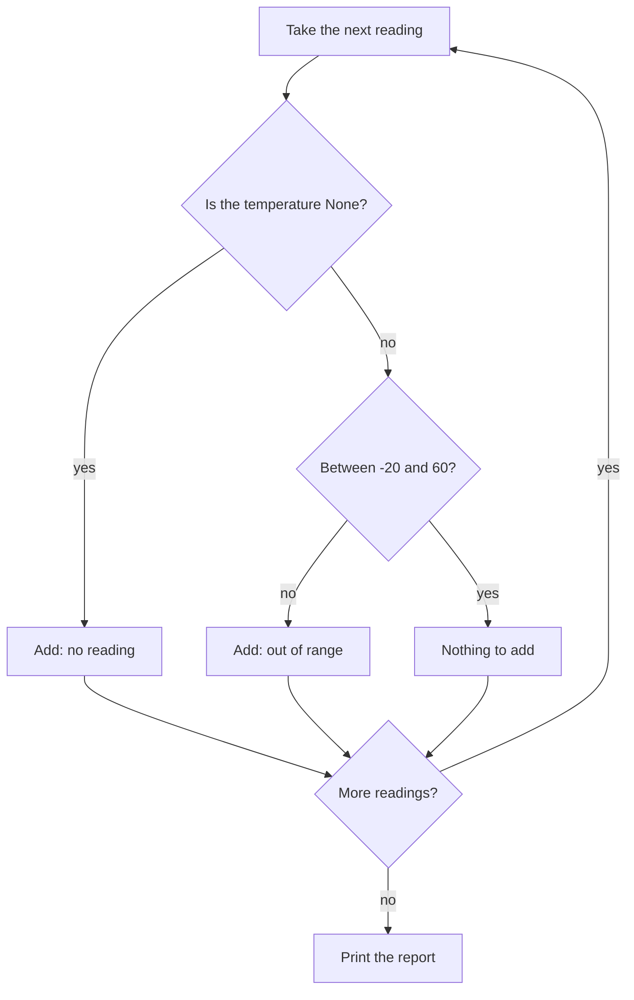

# Conditions and Loops: Decide, Check Every Item, and Retry Safely

A test makes decisions all the time: is this status a pass, a fail, or "try again"? And it repeats the same check many times: every row in a file, every device in a list. **Conditions** (`if`, `elif`, `else`) make the decisions. **Loops** (`for`) do the repeating. Together they turn one check into a check of a whole system.

!!! note "Before you start"
    You need Python 3.13 and the lesson on [lists, tuples, sets and dictionaries](lists-tuples-sets-and-dictionaries.md). The example file is `examples/loops_demo.py`.

## Why testers need this

A team runs a fleet of temperature sensors. The rule says every reading must be between -20 and 60 degrees. Your test gets the latest reading from each device, and must:

- treat a missing reading as a failure, not skip it,
- list every reading out of range, not stop at the first one,
- pick out the slow API answers,
- wait for a device that is still starting up, but never wait forever.

Checking 4 devices by hand is fine. Checking 400 needs a loop.

## How it works

The loop takes one reading at a time and runs the same checks on it. The conditions decide which path each reading takes.



*Every reading goes through the same two questions. The loop ends when no readings are left, then the report is printed once.*

## The code

```python title="examples/loops_demo.py"
--8<-- "modules/start_here/python_for_testers/examples/loops_demo.py"
```

From the `examples` folder, run:

```bash
python loops_demo.py
```

```text
status 503: RETRY
4 readings checked, 2 failed
  - SNS-0042: 85.0 is out of range
  - SNS-0043: no reading
slow responses: [1.8, 2.4]
try 1: booting
try 2: booting
try 3: online
PASS: online after 3 tries
```

## Line by line

**Part 1: one decision.**

- `if 200 <= status < 300:` asks a question. The colon `:` ends the question. The indented lines under it run only when the answer is `True`. `200 <= status < 300` means "200 or more, and less than 300": any 2xx code.
- `elif status in (429, 503):` is checked only when the `if` was `False`. 429 (too many requests) and 503 (service unavailable) often mean "busy, try later", so the verdict is `RETRY`, not `FAIL`.
- `else:` catches everything left. Python checks from the top and stops at the first `True`, so the order of the questions matters.

**Part 2: a check for every reading.**

- `for reading in readings:` takes the items one by one. Each time round, `reading` is the next dictionary. The indented block runs once per item: 4 times here.
- `if temperature is None:` comes first. If it came second, `-20 <= None` would crash the script (see [When it goes wrong](#when-it-goes-wrong)).
- `elif not -20 <= temperature <= 60:` is `True` when the reading is outside the range. `not` turns `True` into `False` and back.
- `failures.append(...)` collects every problem. The test reports all of them at the end, so one run shows the whole picture.
- `SNS-0044` reads `-3.0`, which is inside the range, so it adds nothing.

**Part 3: a loop in one line.**

- `[seconds for seconds in response_times if seconds > 1.0]` is a **list comprehension**. Read it as "each `seconds` from `response_times`, if `seconds > 1.0`". It builds a new list, `[1.8, 2.4]`. Use it for short filters. For anything longer, a normal `for` loop is easier to read.

**Part 4: retry with a limit.**

- `range(1, max_tries + 1)` gives the numbers 1 to 5. The loop can never run more than 5 times, so a broken device can't hang your test run.
- `device_answers[attempt - 1]` stands in for a real API call. List positions start at 0, so try 1 reads position 0.
- `break` stops the loop at once, as soon as the device is online. Tries 4 and 5 never happen.
- The `else:` under a `for` runs only when the loop ended without `break`. Here that means "it never came online", so the test prints `FAIL`.

## How it is used in a real QA project

- **Checking many rows.** A loop goes through every row of a test-data file, every item in an API list, or every link on a page.
- **Collecting all failures.** Good checks gather every problem first, then fail once with the full list. One run then tells you everything that broke.
- **Waiting for a system.** Tests wait for a device to come online, a job to finish, or an email to arrive. Always set a limit and a short pause between tries (`time.sleep(2)` in a real test). In UI tests, [Playwright waits](../automation-testing/playwright/waits.md) do this for you.
- **Grouping results.** `if`/`elif`/`else` turns a status code or an error message into a group, such as "client error" or "server error", for a report.
- **Fewer loops in pytest.** When each item should be its own test, use [parametrize](../automation-testing/pytest/parametrize.md) instead of a loop. Then pytest reports each case on its own.

## Your task

Open `exercises/ex03_loops.py`. Replace each `raise` line with your code:

1. `status_group(code)`: return `"ok"`, `"client error"`, `"server error"` or `"other"`, using `if`, `elif` and `else`.
2. `count_outcomes(outcomes)`: count each outcome in a list, like `["passed", "failed", "passed"]`, into a dictionary.
3. `first_ok_try(statuses, max_tries)`: return the try number of the first `200`, looking at no more than `max_tries` items. Return `0` when none of them is `200`.

From the `exercises` folder:

```bash
python -m pytest tests/test_ex03_loops.py
```

All 9 tests pass when your answers are right.

??? success "Solution"
    ```python
    --8<-- "modules/start_here/python_for_testers/solutions/ex03_loops.py"
    ```

    - `status_group` returns inside each branch, so Python leaves the function at the first match.
    - `counts.get(outcome, 0) + 1` reads the count so far (0 the first time) and adds one.
    - `statuses[:max_tries]` keeps only the first tries, so the limit is respected. `enumerate(..., start=1)` gives each status its try number. `return` inside the loop stops it, like `break`.

## When it goes wrong

These are real messages from Python 3.13.

**You forgot the colon.**

```text
    if status == 200
                    ^
SyntaxError: expected ':'
```

Every `if`, `elif`, `else` and `for` line ends with `:`.

**You used `=` instead of `==`.**

```text
SyntaxError: invalid syntax. Maybe you meant '==' or ':=' instead of '='?
```

One `=` gives a value to a name. Two (`==`) ask "are they equal?".

**The block under the loop is not indented.**

```text
IndentationError: expected an indented block after 'for' statement on line 1
```

Python uses the spaces at the start of a line to know what belongs to the loop. Indent the block by 4 spaces.

**You compared `None` with a number.**

```text
TypeError: '>' not supported between instances of 'NoneType' and 'int'
```

A reading was missing. Check `is None` before you compare, like Part 2 does.

**The test never ends.** A loop without a limit is waiting for something that never happens. Use `for attempt in range(...)` with `break`, not an endless loop. Press ++ctrl+c++ to stop the script.

## References

- [Python tutorial: if statements](https://docs.python.org/3/tutorial/controlflow.html#if-statements)
- [Python tutorial: for statements, break and else on loops](https://docs.python.org/3/tutorial/controlflow.html#for-statements)
- [Python tutorial: list comprehensions](https://docs.python.org/3/tutorial/datastructures.html#list-comprehensions)

Written for Python 3.13. Links checked: November 2026.
