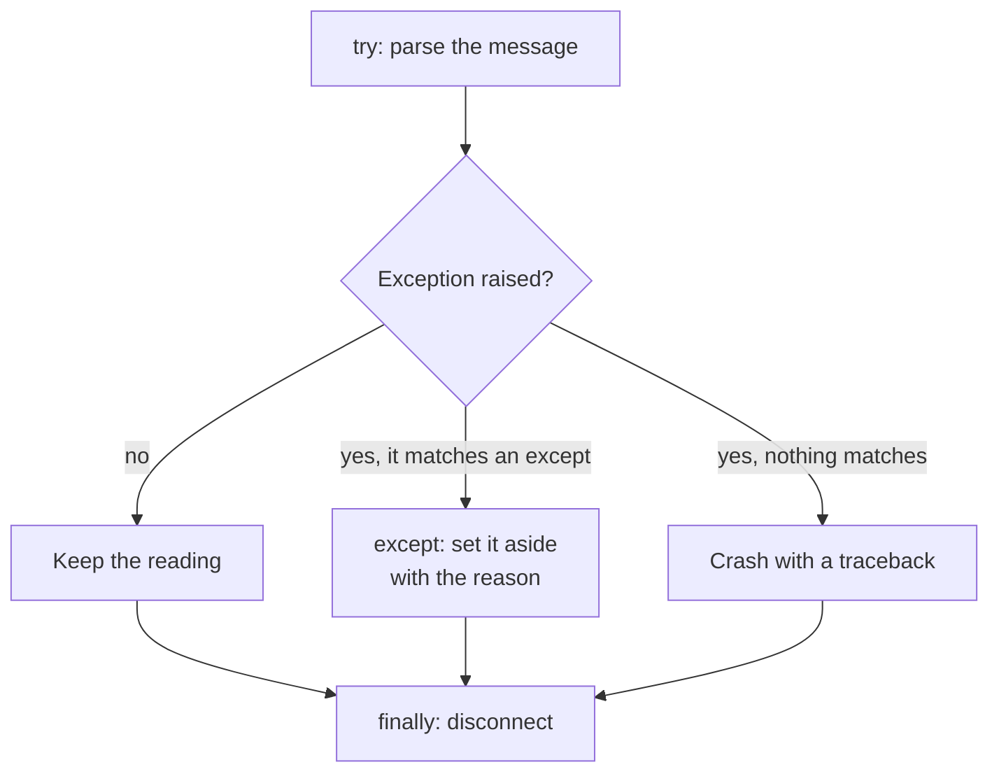

# Exception Handling: Read a Traceback, Catch Bad Data, and Always Clean Up

When Python hits a problem it can't get past, it **raises an exception**: it stops and prints what went wrong and where. For a tester, exceptions are two things. They are clues: the traceback tells you where a script or test broke. And they are tools: with `try` and `except`, your code can deal with bad data, report it clearly, and keep going.

!!! note "Before you start"
    You need Python 3.13 and the lessons on [functions](functions.md) and [object-oriented programming](object-oriented-programming.md). The example file is `examples/errors_demo.py`.

## Why testers need this

Your test listens to messages from devices (for example over MQTT) and checks each temperature. Real devices send broken messages: text instead of a number, a missing field, something that is not JSON at all. Without exception handling, the first bad message crashes your test, and you learn nothing about the other 999. You want to:

- set each bad message aside with a clear reason, and check the rest,
- turn a vague Python error into a message a person can act on,
- disconnect from the broker even when something crashes,
- read a traceback in seconds when a test does crash.

## How it works

Python tries the code in `try`. If an exception happens, it jumps to the first `except` that matches that kind of error. The `finally` block runs at the end in every case.



*Only the exceptions you name are caught. Anything else still crashes, which is what you want for bugs you did not expect. `finally` runs on every path, even the crash.*

## The code

```python title="examples/errors_demo.py"
--8<-- "modules/start_here/python_for_testers/examples/errors_demo.py"
```

From the `examples` folder, run:

```bash
python errors_demo.py
```

```text
connected to the broker (pretend)
disconnected from the broker
accepted: [21.5]
rejected: temperature is not a number: '{"device": "SNS-0043", "temperature": "hot"}'
rejected: no temperature field: '{"device": "SNS-0044"}'
rejected: not JSON: 'temperature=19'
rejected: 85.0 is out of range: '{"device": "SNS-0045", "temperature": 85}'
```

## Line by line

**Your own exception.**

- `class ReadingError(Exception):` makes a new kind of exception. It is a class that inherits from `Exception` (see [inheritance](object-oriented-programming.md)). The docstring is its whole body.
- Your own exception lets callers catch exactly your problem, and nothing else by accident.

**Inside `parse_reading()`.**

- `try:` marks the lines that might fail: reading the JSON, finding the field, and turning it into a number.
- `except json.JSONDecodeError:` catches only "this text is not JSON". `except KeyError:` catches only "the field is missing". `except (TypeError, ValueError):` catches "the value is not a number", in either form.
- `raise ReadingError(f"...") from None` replaces Python's error with your own, clearer one. `from None` hides the original error, because your message already says everything. `{payload!r}` shows the message with its quotes, so odd spaces are visible.
- `if not -20 <= temperature <= 60: raise ReadingError(...)` raises an exception for a rule, not a crash. Valid JSON with a value of 85 is still bad data for this system.

**The main loop.**

- The outer `try` with `finally:` wraps the whole job. `finally` prints `disconnected from the broker` whether the loop finishes or crashes. That is why it appears before the results: the loop ended, then cleanup ran, then the report was printed.
- The inner `try`/`except ReadingError as error:` handles one message at a time. `as error` gives you the exception object, and `str(error)` is its message.
- One bad message does not stop the others. All four bad messages are listed, each with its own reason, and the good reading is kept.

## Reading a traceback

When an exception is not caught, Python prints a **traceback**. Here is a real one from a small script that reads a battery level:

```text
Traceback (most recent call last):
  File ".../check_devices.py", line 14, in <module>
    print(check('{"device": "SNS-0042", "batery": 87}'))
          ~~~~~^^^^^^^^^^^^^^^^^^^^^^^^^^^^^^^^^^^^^^^^
  File ".../check_devices.py", line 10, in check
    level = battery_level(payload)
  File ".../check_devices.py", line 6, in battery_level
    return data["battery"]
           ~~~~^^^^^^^^^^^
KeyError: 'battery'
```

(The folder part of the path is shortened here.) Read it **from the bottom up**:

1. **The last line** says what went wrong: `KeyError: 'battery'`. The dictionary has no `battery` key.
2. **The lines just above** say where: `line 6, in battery_level`, at `data["battery"]`. The `^^^` marks point at the exact part.
3. **Further up** is how the program got there: line 14 called `check()`, which called `battery_level()` on line 10.

Now look at the data on line 14: the device sent `"batery"`, spelled wrong. The script is fine. The device's message is the bug.

## How it is used in a real QA project

- **Expected errors are tests too.** "A negative quantity is refused" is a real requirement. `pytest.raises` checks that the right exception is raised, with the right message. The exercise below uses it.
- **Cleanup with `finally`.** Tests close connections, delete test data and log out in `finally`, or in [fixtures](../automation-testing/pytest/fixtures-and-conftest.md) with `yield`, which work the same way.
- **Clear failure messages.** Wrapping a low-level error in a message like `no temperature field: '{"device": "SNS-0044"}'` saves the next person an hour.
- **Retry only what is worth retrying.** Catch a timeout and try again; never catch everything. See the retry loop in [conditions and loops](conditions-and-loops.md).
- **Triage.** When a nightly run fails, reading the traceback bottom-up tells you quickly whether the test, the test data or the product broke.

## Your task

Open `exercises/ex07_errors.py`. Replace each `raise NotImplementedError` line:

1. `parse_battery(text)`: turn `"87"` into `87`. For text that is not a whole number, or a number outside 0 to 100, raise `ValueError` with the message `Battery must be a whole number from 0 to 100, got '...'`.
2. `safe_int(text, default=0)`: turn text into a whole number, or return `default` when it isn't one.

From the `exercises` folder:

```bash
python -m pytest tests/test_ex07_errors.py
```

All 5 tests pass when your answers are right. The tests use `pytest.raises(ValueError, match="...")`, which passes only when your function raises a `ValueError` whose message matches.

??? success "Solution"
    ```python
    --8<-- "modules/start_here/python_for_testers/solutions/ex07_errors.py"
    ```

    - `parse_battery` builds the message once, and uses it for both problems: text that `int()` can't read, and a number out of range.
    - `safe_int` catches only `ValueError`. A different problem, like passing `None`, still crashes, so it can't hide a real bug.

## When it goes wrong

These are real messages from Python 3.13.

**`except` without a colon.**

```text
SyntaxError: expected ':'
```

`except ValueError` needs a `:` at the end, like `if` and `for`.

**A bare `except:` hid the real problem.** This script prints only `the error was hidden`:

```python
try:
    print(int("abc"))
except:
    pass
print("the error was hidden")
```

`except:` with no name catches every exception, even typos in your own code, and `pass` throws it away. Your test then "passes" while checking nothing. Always name the exception you expect, and never write `except: pass` in a test.

**The traceback is very long.** Start at the last line. Then find the first `File` line above it that points to **your** file, not to a library. That is usually where to look.

**The error came from a library, not from you.** If the bottom lines are inside `requests` or `playwright`, read up until you reach your own file. The call your code made there, and the data it passed, is usually the cause.

## References

- [Python tutorial: errors and exceptions](https://docs.python.org/3/tutorial/errors.html)
- [Python docs: built-in exceptions](https://docs.python.org/3/library/exceptions.html)
- [pytest: assertions about expected exceptions](https://docs.pytest.org/en/stable/how-to/assert.html#assertions-about-expected-exceptions)

Written for Python 3.13. Links checked: November 2026.
