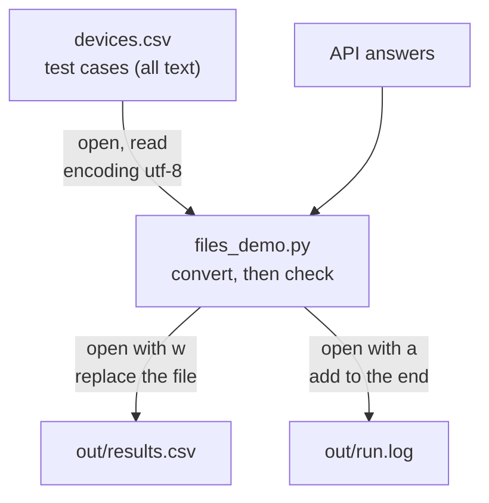

# File Handling: Read Test Data From CSV, and Write Results and Logs

Tests read files and write files all the time. The test cases come from a CSV file that a business analyst keeps in Excel. The results go into a file the team can open. A log records what happened during the run. Python reads and writes files with a few lines of code, as long as you get three things right: where the file is, its **encoding**, and the fact that everything you read is text.

!!! note "Before you start"
    You need Python 3.13 and the lessons on [conditions and loops](conditions-and-loops.md) and [modules and imports](modules-and-imports.md). The example files are `examples/devices.csv` and `examples/files_demo.py`.

## Why testers need this

A team keeps its device test cases in a spreadsheet: device ID, expected status, time limit, and location. Some locations are written in Bengali. Your job is to:

- read the cases from the CSV file, without changing the test code when a row is added,
- turn the text values into numbers before you compare them,
- write a results file the team can open in Excel,
- add a line to a log on every run, without losing the old lines,
- keep `ঢাকা অফিস` readable from start to end.

## How it works

The data flows from a file, through your test, into new files.



*One file goes in, two come out. The mode decides what happens to an existing file: `"w"` replaces it, `"a"` adds to the end.*

## The code

The test cases:

```text title="examples/devices.csv"
--8<-- "modules/start_here/python_for_testers/examples/devices.csv"
```

The script:

```python title="examples/files_demo.py"
--8<-- "modules/start_here/python_for_testers/examples/files_demo.py"
```

From the `examples` folder, run:

```bash
python files_demo.py
```

```text
3 {'device_id': 'SNS-0041', 'expected_status': '200', 'max_seconds': '1.0', 'location': 'ঢাকা অফিস'}
device_id,status,result
SNS-0041,200,PASS
SNS-0042,503,FAIL
SNS-0043,404,PASS
checked 3 devices at ঢাকা অফিস
checked 3 devices at ঢাকা অফিস
True results.csv True
```

## Line by line

**Finding the files.**

- `Path(__file__).parent` is the folder the script is in. `here / "devices.csv"` is the data file next to it. Now the script works from any folder you start it in.
- `out.mkdir(exist_ok=True)` makes the `out` folder, and does nothing if it is already there.

**Part 1: reading the CSV file.**

- `with data_file.open(encoding="utf-8", newline="") as file:` opens the file. `with` closes it again at the end of the block, even if an error happens.
- `encoding="utf-8"` tells Python how the letters are stored. Always set it. Without it, Python uses the computer's default, which can differ between your laptop and the CI server. On some Windows computers that breaks `ঢাকা অফিস`.
- `newline=""` is what the `csv` module asks for. It stops extra blank rows on Windows.
- The first line of the file is a comment, so the list comprehension skips lines that start with `#`.
- `csv.DictReader(lines)` reads the header row and turns each row into a dictionary. The first output line shows one: every value is text, even `'200'` and `'1.0'`.

**Part 2: checking each case.**

- `int(case["expected_status"])` and `float(case["max_seconds"])` turn the text into numbers before comparing. This is the [type trap](variables-and-data-types.md) from the first lesson: `'200' == 200` is `False`.
- `status, seconds = api_answers[...]` takes a pair apart into two names.
- `"PASS" if passed else "FAIL"` is a one-line `if`: it gives `"PASS"` when `passed` is `True`, otherwise `"FAIL"`.

**Part 3: writing the results.**

- `open("w", ...)` opens for writing. `"w"` empties the file first, so each run starts fresh.
- `csv.DictWriter(file, fieldnames=[...])` writes dictionaries as rows. `writeheader()` writes the column names, and `writerows(results)` writes all the rows. Excel opens the result as a normal table.

**Part 4: adding to a log.**

- `open("a", ...)` opens for **appending**: new text goes at the end, and old lines stay. The loop runs twice, so the log has two lines.
- `file.write(...)` does not add a line break for you, so the text ends with `\n`.
- The script empties the log first with `write_text("")`, only so this page always shows the same output. A real log keeps growing.

**Checking the result.** `report.exists()` is `True`, and `report.stat().st_size > 0` checks the file is not empty. Tests use checks like these to make sure a report was really written.

## How it is used in a real QA project

- **Data-driven tests.** Test cases live in CSV, JSON or Excel files, and pytest runs one test per row. See [CSV, JSON and YAML test data](../automation-testing/data-driven/csv-json-yaml-data.md) and [Excel test data](../automation-testing/data-driven/excel-test-data.md).
- **Reports.** pytest writes JUnit XML and HTML files that CI tools read. See [reporting and logging](../automation-testing/reports-and-logs/index.md).
- **Logs.** Tests append to a log during the run. The log helps you find out what happened before a failure.
- **Checking exports.** When the product exports a CSV file, the test reads it and checks the columns, the rows and the encoding.
- **Temporary files.** In pytest, the `tmp_path` fixture gives each test its own empty folder. The exercise tests below use it, so they never touch your real files.

## Your task

Open `exercises/ex08_files.py`. Replace each `raise` line:

1. `read_device_ids(path)`: read one device ID per line. Remove spaces at both ends, and skip empty lines and lines that start with `#`.
2. `write_report(path, lines)`: write each line to the file, with a line break after each one.
3. `load_cases(path)`: read a CSV file into a list of dictionaries, with `expected_status` turned into an `int`. Open it with `encoding="utf-8-sig"`, because the file may come from Excel.

From the `exercises` folder:

```bash
python -m pytest tests/test_ex08_files.py
```

All 4 tests pass when your answers are right.

??? success "Solution"
    ```python
    --8<-- "modules/start_here/python_for_testers/solutions/ex08_files.py"
    ```

    - `path.read_text(encoding="utf-8").splitlines()` reads the whole file and splits it into lines, without the line breaks.
    - `"utf-8-sig"` reads normal UTF-8 files too, so it is a safe choice for any CSV that a person may have saved from Excel.
    - The loop in `load_cases` changes each row's `expected_status` in place, from text to a number.

## When it goes wrong

These are real messages from Python 3.13.

**The file is not where Python looked.**

```text
FileNotFoundError: [Errno 2] No such file or directory: 'devise.csv'
```

Check the spelling first. Then check the folder: a plain name like `"devices.csv"` is looked up in the folder you started from, not the script's folder. Build the path from `Path(__file__).parent`, as the example does.

**The encoding does not match the file.**

```text
UnicodeDecodeError: 'ascii' codec can't decode byte 0xe0 in position 28: ordinal not in range(128)
```

The file has letters (here Bengali) that the chosen encoding can't read. Open it with `encoding="utf-8"`. If you didn't set an encoding at all, the computer's default was used. Always set it.

**A column "is missing", but you can see it in the file.**

```text
{'device_id': 'SNS-0041', 'location': 'Lab 2'}
KeyError: 'device_id'
```

Excel saved the file with a hidden mark at the start, called a BOM (``). It became part of the first column's name. Open the file with `encoding="utf-8-sig"`, which removes it.

**The log only has the last line.** You opened it with `"w"`, which empties the file every time. Use `"a"` to add to the end.

## References

- [Python tutorial: reading and writing files](https://docs.python.org/3/tutorial/inputoutput.html#reading-and-writing-files)
- [Python docs: csv](https://docs.python.org/3/library/csv.html)
- [Python docs: pathlib](https://docs.python.org/3/library/pathlib.html)
- [Python docs: encodings (utf-8-sig)](https://docs.python.org/3/library/codecs.html#encodings-and-unicode)

Written for Python 3.13. Links checked: November 2026.
